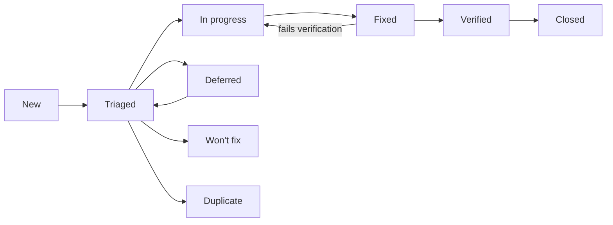

# NeoGold: Bug and Defect Log

| Field | Value |
|---|---|
| Document | 11 of 13 |
| Version | 0.2 (first entries: 31 defects from the 26 October 2026 build audit, `reports/direction/2026-10-26/report.md`) |
| Date | 26 October 2026 |
| Owner | Sowad Al-Mughni, Kitalon Labs |
| Depends on | `9_Test_Plan_Strategy.md` Section 9 (severity and handling), `10_Test_Cases.md` |
| Status | Open; 31 defects open (15 S1, 8 of them clinical; 16 S2) |

---

## 1. Rules for Every Entry

1. **No newborn data, ever.** No register numbers, participant codes, names, birth times, or images of babies in a bug report, a screenshot, a log extract, or an attachment. Use bench images or synthetic data to reproduce. A report that breaks this rule is redacted before anyone else reads it, and the breach is recorded under doc 8 Section 12.
2. **One defect per entry.** Split compound reports.
3. **Clinical flag first.** Before setting severity, ask: could this change what a health worker does for a baby? If yes, set `Clinical: Yes`, link the hazard (H1 to H11, doc 8 Section 14), set severity S1, and notify the clinical lead the same day.
4. **Link the test case** that found it, or the one that should have. If none exists, add one to doc 10 before closing the defect.
5. **Field reports** (from health workers, partners, or Play reviews) are logged here even when they cannot be reproduced; mark them `Source: Field`.

---

## 2. Fields

| Field | Format | Notes |
|---|---|---|
| ID | `BUG-YYYY-NNN` | Sequential per year, for example `BUG-2026-001` |
| Title | One line | What fails, where |
| Found | `YYYY-MM-DD` | Date in Asia/Dhaka |
| Source | `Test`, `Field`, `Review`, `Security report` | Security reports follow `SECURITY.md` and stay private until fixed |
| Build | App version and `versionCode`, or backend image digest | From the About screen or `/health` |
| Device | Matrix ID (D1 to D7) or model and Android version | Required for app defects |
| Area | `ONB`, `DEV`, `CARD`, `CAP`, `EST`, `TRI`, `UI`, `LOG`, `PRIV`, `RSH`, `EXP`, `SYNC`, `API`, `SEC`, `PERF`, `REL`, `A11Y`, `USE`, `OPS` | Same codes as doc 10 |
| Steps | Numbered | From a known state |
| Expected | Text | Cite the requirement or test case |
| Actual | Text | What happened; attach synthetic evidence only |
| Severity | `S1` to `S4` | Doc 9 Section 9.1 |
| Clinical | `Yes` or `No` | `Yes` forces S1 |
| Hazard | `H1` to `H11` or `-` | Required when Clinical is `Yes` |
| Priority | `P1` to `P3` | Order of work within a severity |
| Status | See Section 3 | |
| Owner | Name | |
| Test case | `TC-...` | Found by, or added for |
| Fix version | Version | |
| Verified | Name and date | Someone other than the fixer when possible; the clinical lead for clinical defects |

---

## 3. Status Workflow



- **Won't fix** and **Deferred** are not allowed for S1 defects.
- A clinical defect closes only after the clinical lead records the verification.
- **Closed** means the fix shipped in a release, not only merged.

---

## 4. Open Defects

Entries BUG-2026-001 to BUG-2026-031 come from the 26 October 2026 build audit: a code review plus a local test run on commit `91c1125` (`reports/direction/2026-10-26/report.md`). None involves newborn data. Rule 3 says to tell the clinical lead about clinical defects the same day. No clinical lead is named yet (PRD Section 16, open item 1), so entries 001 to 008 are waiting for that person. "Fix package" in the notes refers to the remediation packages R1 to R7 in the audit report.

| ID | Title | Found | Source | Build | Device | Area | Severity | Clinical | Hazard | Priority | Status | Owner | Test case | Fix version |
|---|---|---|---|---|---|---|---|---|---|---|---|---|---|---|
| BUG-2026-001 | S19 shows a hardcoded result; no engine runs | 2026-10-26 | Review | 1.0.0 (1000001) | n/a | TRI | S1 | Yes | H1 | P1 | New | Unassigned | TC-EST-04 | |
| BUG-2026-002 | S16 never opens the camera; capture returns a synthetic frame | 2026-10-26 | Review | 1.0.0 (1000001) | n/a | CAP | S1 | Yes | H1 | P1 | New | Unassigned | TC-CAP-01 | |
| BUG-2026-003 | Screening captures skip the quality gate; retake and fallback unreachable | 2026-10-26 | Review | 1.0.0 (1000001) | n/a | CAP | S1 | Yes | H4, H5, H6 | P1 | New | Unassigned | TC-CAP-14 | |
| BUG-2026-004 | S07 qualification always returns QUALIFIED without measuring | 2026-10-26 | Review | 1.0.0 (1000001) | n/a | DEV | S1 | Yes | H5 | P1 | New | Unassigned | TC-DEV-05 | |
| BUG-2026-005 | S06 card scan shows VERIFIED without reading or checking a QR code | 2026-10-26 | Review | 1.0.0 (1000001) | n/a | CARD | S1 | Yes | H4 | P1 | New | Unassigned | TC-CARD-02 | |
| BUG-2026-006 | Result next-step wording differs from doc 6 and drops the danger-signs reminder | 2026-10-26 | Review | 1.0.0 (1000001) | n/a | UI | S1 | Yes | H1, H11 | P1 | New | Unassigned | TC-UI-01 | |
| BUG-2026-007 | Startup integrity result is never used; modified assets do not disable screening | 2026-10-26 | Review | 1.0.0 (1000001) | n/a | SEC | S1 | Yes | H7, H9 | P1 | New | Unassigned | TC-SEC-09 | |
| BUG-2026-008 | App trusts a test manifest key whose private half is in the repository | 2026-10-26 | Review | 1.0.0 (1000001) | n/a | SEC | S1 | Yes | H7, H9 | P1 | New | Unassigned | TC-SEC-09 | |
| BUG-2026-009 | Delete all data clears settings only; database, files, and keys remain | 2026-10-26 | Review | 1.0.0 (1000001) | n/a | LOG | S1 | No | - | P1 | New | Unassigned | TC-LOG-11 | |
| BUG-2026-010 | Retention never runs; register numbers and old records are kept | 2026-10-26 | Review | 1.0.0 (1000001) | n/a | LOG | S1 | No | - | P1 | New | Unassigned | TC-LOG-04 | |
| BUG-2026-011 | PIN verifier key falls back to a hardcoded key on any Keystore error | 2026-10-26 | Review | 1.0.0 (1000001) | n/a | RSH | S1 | No | - | P1 | New | Unassigned | TC-RSH-06 | |
| BUG-2026-012 | Research unlock accepts any PIN | 2026-10-26 | Review | 1.0.0 (1000001) | n/a | RSH | S1 | No | - | P1 | New | Unassigned | TC-RSH-05 | |
| BUG-2026-013 | Research sessions are never saved or queued | 2026-10-26 | Review | 1.0.0 (1000001) | n/a | RSH | S1 | No | - | P1 | New | Unassigned | TC-RSH-14 | |
| BUG-2026-014 | android-ci and android-release workflows are invalid YAML; Android CI has never passed | 2026-10-26 | Review | commit 91c1125 | n/a | OPS | S1 | No | - | P1 | New | Unassigned | TC-OPS-01 | |
| BUG-2026-015 | Test summary reports state results the repository cannot support | 2026-10-26 | Review | docs at 91c1125 | n/a | OPS | S1 | No | - | P1 | In progress | Unassigned | n/a (doc 9 Section 15) | |
| BUG-2026-016 | Gradle wrapper and two gate scripts lack the executable bit | 2026-10-26 | Review | commit 91c1125 | n/a | OPS | S2 | No | - | P2 | New | Unassigned | TC-SEC-04 | |
| BUG-2026-017 | `:core:data` unit tests cannot run from a clean checkout (stale lock) | 2026-10-26 | Test | commit 91c1125 | n/a | OPS | S2 | No | - | P2 | New | Unassigned | TC-LOG-11 | |
| BUG-2026-018 | Secrets scan reports two findings in history; not triaged | 2026-10-26 | Review | commit 91c1125 | n/a | SEC | S2 | No | - | P2 | New | Unassigned | TC-SEC-06 | |
| BUG-2026-019 | `triageEnabled` is a hardcoded default, not read from the signed config | 2026-10-26 | Review | 1.0.0 (1000001) | n/a | TRI | S2 | No | - | P2 | New | Unassigned | TC-TRI-26 | |
| BUG-2026-020 | Hard rules are decided in navigation code, not by the triage engine | 2026-10-26 | Review | 1.0.0 (1000001) | n/a | TRI | S2 | No | - | P2 | New | Unassigned | TC-TRI-06 | |
| BUG-2026-021 | Saved sessions record a different action from the one shown | 2026-10-26 | Review | 1.0.0 (1000001) | n/a | LOG | S2 | No | - | P2 | New | Unassigned | TC-LOG-12 | |
| BUG-2026-022 | Session records carry hardcoded versions and card batch | 2026-10-26 | Review | 1.0.0 (1000001) | n/a | LOG | S2 | No | - | P2 | New | Unassigned | TC-TRI-22 | |
| BUG-2026-023 | Gestational age has a hidden default of 38 weeks | 2026-10-26 | Review | 1.0.0 (1000001) | n/a | UI | S2 | No | - | P2 | New | Unassigned | TC-UI-11 | |
| BUG-2026-024 | Research mode has no entry point | 2026-10-26 | Review | 1.0.0 (1000001) | n/a | RSH | S2 | No | - | P2 | New | Unassigned | TC-RSH-01 | |
| BUG-2026-025 | Research export screen never writes a file | 2026-10-26 | Review | 1.0.0 (1000001) | n/a | EXP | S2 | No | - | P2 | New | Unassigned | TC-EXP-01 | |
| BUG-2026-026 | Study enrollment (R08) and Leave study (R09) are placeholder screens | 2026-10-26 | Review | 1.0.0 (1000001) | n/a | SYNC | S2 | No | - | P2 | New | Unassigned | TC-API-07 | |
| BUG-2026-027 | Upload is never started by the app | 2026-10-26 | Review | 1.0.0 (1000001) | n/a | SYNC | S2 | No | - | P2 | New | Unassigned | TC-SYNC-10 | |
| BUG-2026-028 | No Play In-App Updates implementation | 2026-10-26 | Review | 1.0.0 (1000001) | n/a | ONB | S2 | No | - | P2 | New | Unassigned | TC-OPS-03 | |
| BUG-2026-029 | About 150 hardcoded English UI strings; string lint does not check Kotlin | 2026-10-26 | Review | 1.0.0 (1000001) | n/a | A11Y | S2 | No | - | P2 | New | Unassigned | TC-A11Y-01 | |
| BUG-2026-030 | Hazard log is missing | 2026-10-26 | Review | docs at 91c1125 | n/a | OPS | S2 | No | - | P2 | New | Unassigned | none (add to doc 10) | |
| BUG-2026-031 | Release notes file for v1.0.0 is missing | 2026-10-26 | Review | commit 91c1125 | n/a | OPS | S2 | No | - | P2 | New | Unassigned | TC-OPS-02 | |

### 4.1 Entries

Every entry below was found on 26 October 2026 (Source and Build as in the table; Device: n/a, found by code review or a local JVM test run). Paths under `android/` are abbreviated after their first use; `MainActivity.kt` is `android/app/src/main/kotlin/com/kitalonlabs/neogold/MainActivity.kt`.

#### BUG-2026-001: S19 shows a hardcoded result; no engine runs

- Area: TRI | Severity: S1 | Clinical: Yes | Hazard: H1 | Priority: P1
- Status: New | Owner: Unassigned | Test case: TC-EST-04, TC-TRI-22 | Fix version:

**Steps**
1. Start `NeoGoldNavHost` with `triageEnabled = true` (the only way to enable triage today; BUG-2026-019).
2. Complete a screening to S19.

**Expected** S19 runs the capture through `ScreeningPipelineUseCase` and `TriageEngine` and shows that result (doc 4 Sections 4.4 and 5; FR-18, FR-20).

**Actual** After 1.2 seconds, S19 sets `NO_FURTHER_ACTION`, a range of 8.2 to 10.1 mg/dL, and a threshold of 12.0, whatever was captured.

**Evidence** `MainActivity.kt:566-575`. `ScreeningPipelineUseCase`, `ScreeningStateMachine`, and `TriageEngine` have no callers in the app.

**Notes** Hidden in the v1.0 build only because screening is switched off by a hardcoded flag. Any build that enables triage shows a made-up, lowest-care result for every baby. Fix package R1.

#### BUG-2026-002: S16 never opens the camera; capture returns a synthetic frame

- Area: CAP | Severity: S1 | Clinical: Yes | Hazard: H1 | Priority: P1
- Status: New | Owner: Unassigned | Test case: TC-CAP-01, TC-EST-04 | Fix version:

**Steps**
1. Reach S16 in a screening.
2. Wait for auto-capture, or tap manual capture.

**Expected** CameraX preview with live card detection, and burst capture through `:engine:camera` (FR-10, FR-11; doc 4 Section 5.1).

**Actual** There is no preview. `onCaptureCompleted` receives `createDefaultCaptureFrame()`, a generated frame.

**Evidence** `android/feature/screening/src/main/kotlin/com/kitalonlabs/neogold/feature/screening/ui/S16CameraScreen.kt:44-62`. No screen uses `:engine:camera` (CameraX, `Camera2Interop`).

**Notes** Even with BUG-2026-001 fixed, the estimate would describe a synthetic image, not the baby. Fix package R1.

#### BUG-2026-003: Screening captures skip the quality gate; retake and fallback are unreachable

- Area: CAP | Severity: S1 | Clinical: Yes | Hazard: H4, H5, H6 | Priority: P1
- Status: New | Owner: Unassigned | Test case: TC-CAP-11, TC-CAP-13, TC-CAP-14 | Fix version:

**Steps**
1. Reach S16 and capture.

**Expected** Each capture goes through the quality gate. A failure shows S17 with its reason; three failures give `BLOOD_TEST_TODAY` with `QUALITY_FALLBACK` (FR-13, FR-14).

**Actual** S16 always goes to S18. Nothing navigates to S17, and no quality result is computed.

**Evidence** `MainActivity.kt:521-531` (S16 to S18). The S17 destination at `MainActivity.kt:533-549` has no incoming navigation.

**Notes** Fix package R1.

#### BUG-2026-004: S07 camera qualification always returns QUALIFIED without measuring

- Area: DEV | Severity: S1 | Clinical: Yes | Hazard: H5 | Priority: P1
- Status: New | Owner: Unassigned | Test case: TC-DEV-02, TC-DEV-03, TC-DEV-04, TC-DEV-05 | Fix version:

**Steps**
1. Run onboarding to S07 and take the three photos.

**Expected** Repeatability, duplicate-patch uniformity, and accuracy are measured. A phone that fails is `RESEARCH_ONLY` and cannot screen. The result is stored in `device_profile` (FR-04, ADR-012).

**Actual** The screen returns a fixed profile: "SampleManufacturer", "SampleModel", repeatability 0.85, uniformity 1.10, residual 1.65, `QUALIFIED`. Nothing is written to `device_profile`.

**Evidence** `android/feature/onboarding/src/main/kotlin/com/kitalonlabs/neogold/feature/onboarding/S07QualificationScreen.kt:154,168-190`.

**Notes** Every phone, including ones whose cameras tone-map locally, is marked fit to screen. Fix package R2.

#### BUG-2026-005: S06 card scan shows VERIFIED without reading or checking a QR code

- Area: CARD | Severity: S1 | Clinical: Yes | Hazard: H4 | Priority: P1
- Status: New | Owner: Unassigned | Test case: TC-CARD-01, TC-CARD-02 | Fix version:

**Steps**
1. Run onboarding to S06 and tap continue.

**Expected** The card QR is scanned and verified offline against the trust list. Unverified or expired cards are blocked from screening (FR-04b, doc 4 Section 7).

**Actual** The screen shows a fixed "VERIFIED" label and continues. `:engine:cardtrust` is not called, and no `card_batch` row is stored.

**Evidence** `android/feature/onboarding/src/main/kotlin/com/kitalonlabs/neogold/feature/onboarding/S06CardScanScreen.kt:127,142-144`.

**Notes** The card trust engine passes its tests (TC-CARD-01 to 06; 22 tests in the local run) but is never reached from the UI. Fix package R2.

#### BUG-2026-006: Result next-step wording differs from doc 6 and drops the danger-signs reminder

- Area: UI | Severity: S1 | Clinical: Yes | Hazard: H1, H11 | Priority: P1
- Status: New | Owner: Unassigned | Test case: TC-UI-01, TC-UI-14 | Fix version:

**Steps**
1. Show S20 with `triageEnabled = true`, once for each action.

**Expected** The next-step lines from doc 6 Section 3, taken from string resources in English and Bangla. "No further action" keeps "Continue routine care. Watch for danger signs." (`next_no_further`).

**Actual** Hardcoded English lines such as "Order serum bilirubin test today" and "Routine newborn care. Re-evaluate if jaundice deepens." The danger-signs reminder is gone, and there is no Bangla.

**Evidence** `MainActivity.kt:590-596`.

**Notes** Clinical wording changes need the clinical lead (CLAUDE.md). Fix package R1.

#### BUG-2026-007: The startup integrity result is never used, so modified assets do not disable screening

- Area: SEC | Severity: S1 | Clinical: Yes | Hazard: H7, H9 | Priority: P1
- Status: New | Owner: Unassigned | Test case: TC-SEC-09, TC-TRI-19 | Fix version:

**Steps**
1. Change one byte in `assets/triage-config.json`, rebuild without re-signing the manifest, and launch.

**Expected** The bundle manifest check fails and screening is disabled (doc 4 Section 12; doc 8 Section 6.5).

**Actual** The result is stored in `IntegrityStateManager` and logged. No code reads it, so nothing is disabled.

**Evidence** `android/app/src/main/kotlin/com/kitalonlabs/neogold/NeoGoldApplication.kt:28-31`. `IntegrityStateManager` has no readers.

**Notes** Fix package R4.

#### BUG-2026-008: The app trusts a test manifest key whose private half is in the repository

- Area: SEC | Severity: S1 | Clinical: Yes | Hazard: H7, H9 | Priority: P1
- Status: New | Owner: Unassigned | Test case: TC-SEC-09 | Fix version:

**Steps**
1. Read `tools/sign_bundle_manifest.py:24-25` and `BundleManifestVerifier.kt:25-26,68-73`.

**Expected** The app pins the real K3 public key from the release configuration, and the release checks refuse a test key (doc 8 Section 4, K3).

**Actual** Every build trusts `DEFAULT_TEST_K3_PUBLIC_HEX`. Its private key, `DEFAULT_TEST_K3_PRIVATE_HEX`, is committed, so anyone can sign a manifest the app accepts. A release signed with the real K3 would fail the check.

**Evidence** `android/core/security/src/main/kotlin/com/kitalonlabs/neogold/core/security/integrity/BundleManifestVerifier.kt:25-26,68-73`; `tools/sign_bundle_manifest.py:24-25`.

**Notes** Fix package R4, together with BUG-2026-007.

#### BUG-2026-009: Delete all data clears settings only; the database, encrypted files, and keys remain

- Area: LOG | Severity: S1 | Clinical: No | Hazard: - | Priority: P1
- Status: New | Owner: Unassigned | Test case: TC-LOG-11 | Fix version:

**Steps**
1. Save a screening with a register number.
2. Open Settings, choose Delete all data, and confirm.

**Expected** The database, encrypted files, and keys are removed, and the app restarts empty (FR-33).

**Actual** Only the DataStore settings are cleared. `DataPurgeManager.deleteAllData()` passes its unit test but is never called.

**Evidence** `MainActivity.kt:737-751` (`dataStore.clearAll()` at line 741). The `S25DeleteAllDataScreen.kt` KDoc says the opposite.

**Notes** A facility that deletes all data before handing a phone on still leaves every record on it. Fix package R4.

#### BUG-2026-010: Retention never runs; register numbers and old records are kept indefinitely

- Area: LOG | Severity: S1 | Clinical: No | Hazard: - | Priority: P1
- Status: New | Owner: Unassigned | Test case: TC-LOG-04, TC-LOG-05 | Fix version:

**Steps**
1. Search the app for a WorkManager periodic job or an app-start call to `RetentionManager`.

**Expected** Register numbers are erased at 60 days and screening records purged at 180 days, daily and on every app start (PRD D7; doc 5 Section 2.5).

**Actual** Nothing schedules or calls the retention jobs. `RetentionManager` passes its unit tests but never runs.

**Evidence** There is no `PeriodicWorkRequest` or `enqueueUniquePeriodicWork` in `android/**/src/main`, and `NeoGoldApplication.kt` does not call retention.

**Notes** Fix package R4.

#### BUG-2026-011: The PIN verifier key falls back to a hardcoded key on any Keystore error

- Area: RSH | Severity: S1 | Clinical: No | Hazard: - | Priority: P1
- Status: New | Owner: Unassigned | Test case: TC-RSH-06 | Fix version:

**Steps**
1. Make the Keystore throw (for example after a Keystore loss on a budget phone).
2. Set or check a research PIN.

**Expected** The HMAC step uses the non-exportable Keystore key K9. If the Keystore fails, the app takes the Keystore-loss path (doc 8 Sections 5.1 and 6.2).

**Actual** Any exception silently switches to `FakePinHmacKeyProvider.STATIC_KEY`, which is the bytes 0x01 to 0x20 and is published in the repository. A copied database can then be brute-forced off the phone.

**Evidence** `android/core/security/src/main/kotlin/com/kitalonlabs/neogold/core/security/pin/PinHmacKeyProvider.kt:51-54,73`.

**Notes** Latent until the PIN path is wired (BUG-2026-012). Fix package R4.

#### BUG-2026-012: Research unlock accepts any PIN

- Area: RSH | Severity: S1 | Clinical: No | Hazard: - | Priority: P1
- Status: New | Owner: Unassigned | Test case: TC-RSH-04, TC-RSH-05 | Fix version:

**Steps**
1. Reach R01 and enter any digits.

**Expected** Weak PINs are refused; the PIN is checked with Argon2id plus the Keystore HMAC; lockout follows 5, 10, and 15 failures (FR-25; doc 8 Section 6.2).

**Actual** `onUnlockWithPin` and `onEnrollWithPin` go to R02 without checking anything. `ResearchPinManager` is never called.

**Evidence** `MainActivity.kt:766-771`.

**Notes** Fix package R3.

#### BUG-2026-013: Research sessions are never saved or queued

- Area: RSH | Severity: S1 | Clinical: No | Hazard: - | Priority: P1
- Status: New | Owner: Unassigned | Test case: TC-RSH-11, TC-RSH-14, TC-SYNC-01 | Fix version:

**Steps**
1. Complete R03 to R06 with a test participant code.

**Expected** The participant, consent form ID, captures, and TSB value are written in a transaction and queued in the outbox (FR-26 to FR-29, NFR-09).

**Actual** The screens discard what is entered. R02 and R06 show fixed values (study "DHK-01", participant "SKP-0142", TSB 14.2 mg/dL). Nothing reaches Room or the outbox, and `ResearchViewModel` is never created.

**Evidence** `MainActivity.kt:775-847`.

**Notes** A nurse who completes a session believes it was recorded. Fix package R3.

#### BUG-2026-014: The android-ci and android-release workflows are invalid YAML, and Android CI has never passed

- Area: OPS | Severity: S1 | Clinical: No | Hazard: - | Priority: P1
- Status: New | Owner: Unassigned | Test case: TC-OPS-01, TC-SEC-01, TC-SEC-04 | Fix version:

**Steps**
1. Parse `.github/workflows/android-ci.yml` and `android-release.yml` with any YAML parser.
2. Check the Actions history.

**Expected** Every pull request and push runs lint, unit tests, golden vectors, differential triage, config schema, and gates S4, S5, S6, and S9 (doc 12 Section 3).

**Actual** Neither file parses, because `- name: Gate: ...` contains an unquoted colon (android-ci line 43, android-release line 27). The error came in with `21410eb` (P16, 20 October 2026). All 38 android-ci runs since 17 October failed, and none has run a job since that commit.

**Evidence** GitHub Actions run 40272881285 ("This run likely failed because of a workflow file issue"); a YAML parse of each file.

**Notes** The runs before that commit failed too (BUG-2026-016, BUG-2026-018). The engine tests that CLAUDE.md says block all other work have never been checked in CI. This is the first item in fix package R6.

#### BUG-2026-015: Test summary reports state results the repository cannot support

- Area: OPS | Severity: S1 | Clinical: No | Hazard: - | Priority: P1
- Status: In progress | Owner: Unassigned | Test case: n/a (doc 9 Section 15) | Fix version:

**Steps**
1. Compare `docs/test-reports/v0.1.md`, `v0.5.md`, and `v1.0.md` with the repository, the git tags, the CI history, and this log.

**Expected** Each PASS points to evidence: a CI run, a test, or attached raw data (doc 9 Section 15).

**Actual**
- The v0.1 timings and app sizes match the output of `tools/benchmark_capture_to_result.py`, which draws random timings clamped under budget and prints hardcoded sizes (lines 147-148).
- v0.5 cites tag `v0.5.0` and branch `release/0.5`; neither exists.
- v0.5 and v1.0 list closed S1 to S4 defects that were never logged here.
- Both record a clinical lead approval, but no clinical lead is named.
- Both report device, kill, power-loss, and nurse-panel passes for features the app does not run.

**Evidence** `reports/direction/2026-10-26/report.md` Section 5.

**Notes** Severity S1, because a go or no-go based on these reports could release a build that fabricates results. The 26 October correction marks each row Supported, Unverified, or Contradicted. Rows stay corrected until raw data is attached.

#### BUG-2026-016: The Gradle wrapper and two gate scripts are committed without the executable bit

- Area: OPS | Severity: S2 | Clinical: No | Hazard: - | Priority: P2
- Status: New | Owner: Unassigned | Test case: TC-SEC-04, TC-OPS-01 | Fix version:

**Steps**
1. Run `git ls-files -s android/gradlew tools/check_16kb.sh card/tools/neogold-sign/neogold-sign`.

**Expected** Mode 100755, so `./gradlew` and `tools/check_16kb.sh` run on Linux CI.

**Actual** Mode 100644. The CI runs before 20 October failed at the first Gradle step with "./gradlew: Permission denied" (exit 126).

**Evidence** android-ci run 39396331186 (20 October 2026).

**Notes** P01's PR #8 was merged with this failure. Fix package R6 (`git update-index --chmod=+x`).

#### BUG-2026-017: `:core:data` unit tests cannot run from a clean checkout (stale dependency lock)

- Area: OPS | Severity: S2 | Clinical: No | Hazard: - | Priority: P2
- Status: New | Owner: Unassigned | Test case: TC-LOG-04, TC-LOG-05, TC-LOG-11, TC-SEC-07, TC-SEC-08, TC-REL-08 | Fix version:

**Steps**
1. On a fresh clone with JDK 21, run `cd android && ./gradlew testReleaseUnitTest` (the CLAUDE.md command).

**Expected** All module tests run.

**Actual** `:core:data` fails before compiling its tests: "Resolved 'org.jetbrains.kotlin:kotlin-stdlib-common:2.2.10' which is not part of the dependency lock state". With that one lock entry updated locally (not committed), its 12 tests pass.

**Evidence** A local run on commit `91c1125` on 26 October 2026. `android/core/data/gradle.lockfile` last changed in `dab13ce` (P20).

**Notes** Fix package R6.

#### BUG-2026-018: The secrets scan (gate S9) reports two findings in git history; not triaged

- Area: SEC | Severity: S2 | Clinical: No | Hazard: - | Priority: P2
- Status: New | Owner: Unassigned | Test case: TC-SEC-06 | Fix version:

**Steps**
1. Run `gitleaks git --redact -v .` on the repository.

**Expected** A clean result, or each finding allow-listed with a reason (doc 8 Section 10).

**Actual** android-ci run 39396331186 reports "leaks found: 2", and its log is redacted. A search of the history finds no private-key blocks and no common token formats. The likely matches are committed test keys (`card/spec/testvectors/keys.json`, `tools/sign_bundle_manifest.py:25`).

**Evidence** android-ci run 39396331186.

**Notes** If either finding is a real credential, raise this to S1 and rotate the credential. BUG-2026-008 explains why the committed K3 test key matters.

#### BUG-2026-019: `triageEnabled` is a hardcoded default, not read from the signed config

- Area: TRI | Severity: S2 | Clinical: No | Hazard: - | Priority: P2
- Status: New | Owner: Unassigned | Test case: TC-TRI-26 | Fix version:

**Steps**
1. Read `MainActivity.kt:225`.

**Expected** Whether triage results can appear is decided by the parsed, integrity-checked config (`triageEnabled`, sign-off status, `validUntil`) through the triage engine (doc 4 Section 6.2, step 1).

**Actual** `NeoGoldNavHost(triageEnabled: Boolean = false)`. The config value is never read.

**Evidence** `MainActivity.kt:225`.

**Notes** It fails safe today, since no results are shown, but the gate is a code constant rather than the signed config. Fix package R1.

#### BUG-2026-020: Hard rules are decided in navigation code, not by the triage engine

- Area: TRI | Severity: S2 | Clinical: No | Hazard: - | Priority: P2
- Status: New | Owner: Unassigned | Test case: TC-TRI-06 | Fix version:

**Steps**
1. Answer Yes to early jaundice and Yes to danger signs.

**Expected** The engine applies R1 to R5 in order, and the first match is the reason code (doc 4 Section 6.2). TC-TRI-06 expects `R1` when danger signs are present.

**Actual** The S11 to S13 navigation applies the rules itself. Early jaundice is asked first, so the record says `R2`. Phototherapy is checked before gestational age, so `R4` is recorded where the engine gives `R3`. The action shown is the same.

**Evidence** `MainActivity.kt:404-456`.

**Notes** Doc 4 Section 4.4 says the UI renders state and never decides clinical flow. Fix package R1.

#### BUG-2026-021: Saved sessions record a different action from the one shown, with values outside the schema enum

- Area: LOG | Severity: S2 | Clinical: No | Hazard: - | Priority: P2
- Status: New | Owner: Unassigned | Test case: TC-LOG-12 | Fix version:

**Steps**
1. Trigger R3, R4, or R5 and save.
2. Complete S20 and save.

**Expected** `triage_action` uses the doc 5 enum and matches the screen: `CANNOT_SCREEN_BLOOD_TEST`, `CANNOT_SCREEN_CLINICAL_REVIEW`, `BLOOD_TEST_TODAY`, `NO_FURTHER_ACTION_FROM_SCREEN`.

**Actual** S14 shows "cannot screen" for R3 to R5. It saves `BLOOD_TEST_TODAY` for R3 and R4, and `CANNOT_SCREEN`, which is not in the enum, for R5. S20 saves `TriageUiAction` names such as `BLOOD_TEST` and `NO_FURTHER_ACTION`.

**Evidence** `MainActivity.kt:477-482` and line 621; `S14RuleOutcomeScreen.kt:61-89`.

**Notes** The session detail cannot show what was shown at screening time (T16). Fix package R1.

#### BUG-2026-022: Session records carry hardcoded versions and card batch

- Area: LOG | Severity: S2 | Clinical: No | Hazard: - | Priority: P2
- Status: New | Owner: Unassigned | Test case: TC-TRI-22 | Fix version:

**Steps**
1. Save any screening.

**Expected** The app, model, and config versions and the card batch come from what was actually loaded and scanned (NFR-10).

**Actual** Every row gets `appVersion` "1.0.0", `modelVersion` "1.0.0" (or null), `configVersion` "2026.10.0", and `cardBatchId` "NG-2026-001". The shipped config is "2026.10.0-draft" and the model is "1.0.0-synthetic".

**Evidence** `MainActivity.kt:496-499` and `MainActivity.kt:635-638`.

**Notes** Fix package R1.

#### BUG-2026-023: Gestational age has a hidden default of 38 weeks in navigation state

- Area: UI | Severity: S2 | Clinical: No | Hazard: - | Priority: P2
- Status: New | Owner: Unassigned | Test case: TC-UI-11 | Fix version:

**Steps**
1. Read `MainActivity.kt` lines 240 and 353.

**Expected** No silent default on a clinical input; a missing value stays missing (doc 6 Section 8, H3, CLAUDE.md).

**Actual** `sessionGaWeeks` starts at 38 and is reset to 38 for each new screening. Only S10 overwrites it.

**Evidence** `MainActivity.kt` lines 240 and 353.

**Notes** S10 itself requires a value (TC-UI-11), so the default is latent. Any path that skipped S10 would screen at 38 weeks (H3). Fix package R1.

#### BUG-2026-024: Research mode has no entry point

- Area: RSH | Severity: S2 | Clinical: No | Hazard: - | Priority: P2
- Status: New | Owner: Unassigned | Test case: TC-RSH-01 | Fix version:

**Steps**
1. From Home or Settings, look for a way into research mode.

**Expected** A route into R01 (doc 4 Section 4.6).

**Actual** Nothing navigates to R01 except R02's lock button, and R02 is reached only from R01. In the v1.0 build, where screening is hidden, the app does nothing besides settings and the log.

**Evidence** `grep -n R01_RESEARCH_UNLOCK android/app/src/main`.

**Notes** Fix package R3.

#### BUG-2026-025: The research export screen never writes a file

- Area: EXP | Severity: S2 | Clinical: No | Hazard: - | Priority: P2
- Status: New | Owner: Unassigned | Test case: TC-EXP-01 | Fix version:

**Steps**
1. Open R07 and choose a destination.

**Expected** An encrypted export written through the Storage Access Framework, with progress (FR-30; `docs/specs/export-format.md`).

**Actual** After the file picker returns, the screen shows "Preparing export package..." with a made-up total of 10 files. Nothing is written and it never completes. `ExportCryptoEngine` is not called.

**Evidence** `MainActivity.kt:849-885`.

**Notes** Fix package R3.

#### BUG-2026-026: Study enrollment (R08) and Leave study (R09) are placeholder screens

- Area: SYNC | Severity: S2 | Clinical: No | Hazard: - | Priority: P2
- Status: New | Owner: Unassigned | Test case: TC-API-07 | Fix version:

**Steps**
1. Navigate to R08 or R09.

**Expected** R08 scans the signed study QR, takes the one-time code, checks the settings, and enrolls. R09 leaves the study (doc 6 Section 5; doc 7 Section 4).

**Actual** Both show placeholder text, although `R08EnrollmentScreen.kt` and `R09LeaveStudyScreen.kt` exist.

**Evidence** `MainActivity.kt:886-887`.

**Notes** Fix package R3.

#### BUG-2026-027: Upload is never started by the app

- Area: SYNC | Severity: S2 | Clinical: No | Hazard: - | Priority: P2
- Status: New | Owner: Unassigned | Test case: TC-SYNC-01, TC-SYNC-10 | Fix version:

**Steps**
1. Search the app for calls to `ResearchWorkScheduler`.

**Expected** Background upload over Wi-Fi, plus an "Upload now" button (FR-31, NFR-12).

**Actual** `ResearchWorkScheduler` and `ResearchUploadWorker` are referenced only inside `:sync:research`. No screen or app class schedules them.

**Evidence** `android/sync/research/src/main/kotlin/com/kitalonlabs/neogold/sync/research/worker/ResearchWorkScheduler.kt`.

**Notes** The sync client passes its MockWebServer tests (34 in the local run) but cannot run in the app. Fix package R3.

#### BUG-2026-028: No Play In-App Updates implementation

- Area: ONB | Severity: S2 | Clinical: No | Hazard: - | Priority: P2
- Status: New | Owner: Unassigned | Test case: TC-OPS-03, TC-ONB-06 | Fix version:

**Steps**
1. Search for `AppUpdateManagerFactory` or the `com.google.android.play:app-update` dependency.

**Expected** A flexible prompt by default, and an immediate update at priority 4 or 5 (NG-055). This is the fastest lever in a clinical emergency (doc 8 Section 12.3; doc 12 Section 6.2).

**Actual** Only the `InAppUpdateManager` interface and `FakeAppUpdateManager` exist, and the Play library is not a dependency.

**Evidence** `android/core/common/src/main/kotlin/com/kitalonlabs/neogold/core/common/update/InAppUpdateManager.kt:52`.

**Notes** Adding the library needs dependency approval (CLAUDE.md). Fix package R6.

#### BUG-2026-029: About 150 hardcoded English UI strings; the string lint does not check Kotlin

- Area: A11Y | Severity: S2 | Clinical: No | Hazard: - | Priority: P2
- Status: New | Owner: Unassigned | Test case: TC-A11Y-01 | Fix version:

**Steps**
1. Search the `android/app` and `android/feature` main sources for `Text("...")` and `text = "..."` literals.

**Expected** No hardcoded strings, with every user string in `values/` and `values-bn/` (NFR-06). The lint fails on hardcoded strings (P13).

**Actual** About 150 literals, including nearly all of research mode, the app lock screen, the crash dialog, and the recheck notification. `tools/check_strings.py` only compares the two XML files and checks banned words.

**Evidence** `tools/check_strings.py:55-100`; `RecheckNotificationHelper.kt:51`; `R01ResearchUnlockScreen.kt:77-279`.

**Notes** The research build is meant for Bangla-first study nurses. One literal also uses a banned word: "Lost USB safe" (`R07ExportScreen.kt:137`). Fix package R5.

#### BUG-2026-030: The hazard log is missing

- Area: OPS | Severity: S2 | Clinical: No | Hazard: - | Priority: P2
- Status: New | Owner: Unassigned | Test case: none yet (add one to doc 10) | Fix version:

**Steps**
1. Look for `docs/safety/HAZARD_LOG.md`.

**Expected** The maintained hazard log, seeded from doc 8 Section 14 and reviewed with each clinical sign-off (NG-053).

**Actual** The file does not exist.

**Evidence** Doc 8 Section 14 names the path.

**Notes** Fix package R6.

#### BUG-2026-031: The release notes file for v1.0.0 is missing

- Area: OPS | Severity: S2 | Clinical: No | Hazard: - | Priority: P2
- Status: New | Owner: Unassigned | Test case: TC-OPS-02 | Fix version:

**Steps**
1. Push tag `v1.0.0`, once BUG-2026-014 is fixed.

**Expected** The release workflow creates the draft GitHub release from `docs/release-notes/v1.0.0.md`.

**Actual** Only `docs/release-notes/v0.5.0.md` exists, so `gh release create --notes-file` fails after the bundle has already gone to the Play internal track.

**Evidence** The GitHub release step in `.github/workflows/android-release.yml`; the contents of `docs/release-notes/`.

**Notes** The text already exists in doc 13 Section 6. Fix package R6.

---

## 5. Closed Defects

| ID | Title | Severity | Clinical | Fix version | Verified | Closed |
|---|---|---|---|---|---|---|

*None.*

---

## 6. Summary

Updated with each test summary report (doc 9 Section 15).

| Severity | Open | Clinical open | Closed this release |
|---|---|---|---|
| S1 | 15 | 8 | 0 |
| S2 | 16 | 0 | 0 |
| S3 | 0 | 0 | 0 |
| S4 | 0 | 0 | 0 |

As of 26 October 2026. The audit's S3 observations (report Section 4.3) are not logged yet; log each one when it is triaged.

---

## 7. Entry Template

Copy this block for each new defect, then add a row to Section 4.

```markdown
### BUG-YYYY-NNN: <title>

- Found: YYYY-MM-DD | Source: Test | Build: 1.0.0 (1000001) | Device: D1, TECNO <model>, Android 14
- Area: TRI | Severity: S1 | Clinical: Yes | Hazard: H1 | Priority: P1
- Status: New | Owner: | Test case: TC-TRI-09 | Fix version:

**Steps**
1.
2.

**Expected** (cite requirement or test case)

**Actual**

**Evidence** (synthetic data only)

**Notes**
```

---

## 8. GitHub Issue Form

When the repository is public, this log is mirrored to GitHub issues with the form below at `.github/ISSUE_TEMPLATE/bug.yml`. The form repeats the no-newborn-data rule because public issues are visible to everyone.

```yaml
name: Bug report
description: Report a problem with NeoGold. Never include any information about a real baby.
labels: [bug, needs-triage]
body:
  - type: markdown
    attributes:
      value: |
        **Do not include names, register numbers, participant codes, birth times, or photos of babies.**
        For security problems, do not open an issue; follow SECURITY.md instead.
  - type: checkboxes
    id: no-patient-data
    attributes:
      label: Privacy check
      options:
        - label: This report contains no information about a real baby.
          required: true
  - type: dropdown
    id: clinical
    attributes:
      label: Could this change what a health worker does for a baby?
      options:
        - "No"
        - "Yes"
        - "Not sure"
    validations:
      required: true
  - type: input
    id: version
    attributes:
      label: App version (from the About screen)
      placeholder: 1.0.0 (1000001)
    validations:
      required: true
  - type: input
    id: device
    attributes:
      label: Phone model and Android version
      placeholder: TECNO Spark 30C, Android 14
    validations:
      required: true
  - type: textarea
    id: steps
    attributes:
      label: Steps to reproduce
      placeholder: "1. ...\n2. ..."
    validations:
      required: true
  - type: textarea
    id: expected
    attributes:
      label: What you expected
    validations:
      required: true
  - type: textarea
    id: actual
    attributes:
      label: What happened
    validations:
      required: true
```
