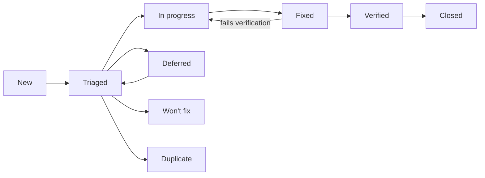

# NeoGold: Bug and Defect Log

| Field | Value |
|---|---|
| Document | 11 of 13 |
| Version | 0.2 (first entries: 31 defects from the 26 October 2026 build audit, `reports/direction/2026-10-26/build-audit.md`) |
| Date | 26 October 2026 |
| Owner | Sowad Al-Mughni, Kitalon Labs |
| Depends on | `9_Test_Plan_Strategy.md` Section 9 (severity and handling), `10_Test_Cases.md` |
| Status | Open; 31 defects open (15 S1, 8 of them clinical; 16 S2) |

---

## 1. Rules for Every Entry

1. **No newborn data, ever.** No register numbers, participant codes, names, birth times, or images of babies in a bug report, a screenshot, a log extract, or an attachment. Use bench images or synthetic data to reproduce. A report that breaks this rule is redacted before anyone else reads it, and the breach is recorded under doc 8 Section 12.
2. **One defect per entry.** Split compound reports.
3. **Clinical flag first.** Before setting severity, ask: could this change what a health worker does for a baby? If yes, set `Clinical: Yes`, link the hazard (H1 to H11, doc 8 Section 14), set severity S1, and notify the clinical lead the same day.
4. **Link the test case** that found it, or the one that should have. If none exists, add one to doc 10 before closing the defect.
5. **Field reports** (from health workers, partners, or Play reviews) are logged here even when they cannot be reproduced; mark them `Source: Field`.

---

## 2. Fields

| Field | Format | Notes |
|---|---|---|
| ID | `BUG-YYYY-NNN` | Sequential per year, for example `BUG-2026-001` |
| Title | One line | What fails, where |
| Found | `YYYY-MM-DD` | Date in Asia/Dhaka |
| Source | `Test`, `Field`, `Review`, `Security report` | Security reports follow `SECURITY.md` and stay private until fixed |
| Build | App version and `versionCode`, or backend image digest | From the About screen or `/health` |
| Device | Matrix ID (D1 to D7) or model and Android version | Required for app defects |
| Area | `ONB`, `DEV`, `CARD`, `CAP`, `EST`, `TRI`, `UI`, `LOG`, `PRIV`, `RSH`, `EXP`, `SYNC`, `API`, `SEC`, `PERF`, `REL`, `A11Y`, `USE`, `OPS` | Same codes as doc 10 |
| Steps | Numbered | From a known state |
| Expected | Text | Cite the requirement or test case |
| Actual | Text | What happened; attach synthetic evidence only |
| Severity | `S1` to `S4` | Doc 9 Section 9.1 |
| Clinical | `Yes` or `No` | `Yes` forces S1 |
| Hazard | `H1` to `H11` or `-` | Required when Clinical is `Yes` |
| Priority | `P1` to `P3` | Order of work within a severity |
| Status | See Section 3 | |
| Owner | Name | |
| Test case | `TC-...` | Found by, or added for |
| Fix version | Version | |
| Verified | Name and date | Someone other than the fixer when possible; the clinical lead for clinical defects |

---

## 3. Status Workflow



- **Won't fix** and **Deferred** are not allowed for S1 defects.
- A clinical defect closes only after the clinical lead records the verification.
- **Closed** means the fix shipped in a release, not only merged.

---

## 4. Open Defects

Entries BUG-2026-001 to BUG-2026-031 come from the 26 October 2026 build audit: a code review plus a local test run on commit `91c1125` (`reports/direction/2026-10-26/build-audit.md`). None involves newborn data. Rule 3 says to tell the clinical lead about clinical defects the same day. No clinical lead is named yet (PRD Section 16, open item 1), so entries 001 to 008 are waiting for that person. "Fix package" in the notes refers to the remediation packages R1 to R7 in the audit report.

| ID | Title | Found | Source | Build | Device | Area | Severity | Clinical | Hazard | Priority | Status | Owner | Test case | Fix version |
|---|---|---|---|---|---|---|---|---|---|---|---|---|---|---|
| BUG-2026-001 | S19 shows a hardcoded result; no engine runs | 2026-10-26 | Review | 1.0.0 (1000001) | n/a | TRI | S1 | Yes | H1 | P1 | New | Unassigned | TC-EST-04 | |
| BUG-2026-002 | S16 never opens the camera; capture returns a synthetic frame | 2026-10-26 | Review | 1.0.0 (1000001) | n/a | CAP | S1 | Yes | H1 | P1 | New | Unassigned | TC-CAP-01 | |
| BUG-2026-003 | Screening captures skip the quality gate; retake and fallback unreachable | 2026-10-26 | Review | 1.0.0 (1000001) | n/a | CAP | S1 | Yes | H4, H5, H6 | P1 | New | Unassigned | TC-CAP-14 | |
| BUG-2026-004 | S07 qualification always returns QUALIFIED without measuring | 2026-10-26 | Review | 1.0.0 (1000001) | n/a | DEV | S1 | Yes | H5 | P1 | Fixed | Unassigned | TC-DEV-05 | |
| BUG-2026-005 | S06 card scan shows VERIFIED without reading or checking a QR code | 2026-10-26 | Review | 1.0.0 (1000001) | n/a | CARD | S1 | Yes | H4 | P1 | Fixed | Unassigned | TC-CARD-02 | |
| BUG-2026-006 | Result next-step wording differs from doc 6 and drops the danger-signs reminder | 2026-10-26 | Review | 1.0.0 (1000001) | n/a | UI | S1 | Yes | H1, H11 | P1 | New | Unassigned | TC-UI-01 | |
| BUG-2026-007 | Startup integrity result is never used; modified assets do not disable screening | 2026-10-26 | Review | 1.0.0 (1000001) | n/a | SEC | S1 | Yes | H7, H9 | P1 | Fixed | Unassigned | TC-SEC-09 | |
| BUG-2026-008 | App trusts a test manifest key whose private half is in the repository | 2026-10-26 | Review | 1.0.0 (1000001) | n/a | SEC | S1 | Yes | H7, H9 | P1 | Fixed | Unassigned | TC-SEC-09 | |
| BUG-2026-009 | Delete all data clears settings only; database, files, and keys remain | 2026-10-26 | Review | 1.0.0 (1000001) | n/a | LOG | S1 | No | - | P1 | Fixed | Unassigned | TC-LOG-11 | |
| BUG-2026-010 | Retention never runs; register numbers and old records are kept | 2026-10-26 | Review | 1.0.0 (1000001) | n/a | LOG | S1 | No | - | P1 | Fixed | Unassigned | TC-LOG-04 | |
| BUG-2026-011 | PIN verifier key falls back to a hardcoded key on any Keystore error | 2026-10-26 | Review | 1.0.0 (1000001) | n/a | RSH | S1 | No | - | P1 | Fixed | Unassigned | TC-RSH-06 | |
| BUG-2026-012 | Research unlock accepts any PIN | 2026-10-26 | Review | 1.0.0 (1000001) | n/a | RSH | S1 | No | - | P1 | Fixed | Unassigned | TC-RSH-05 | |
| BUG-2026-013 | Research sessions are never saved or queued | 2026-10-26 | Review | 1.0.0 (1000001) | n/a | RSH | S1 | No | - | P1 | Fixed | Unassigned | TC-RSH-14 | |
| BUG-2026-014 | android-ci and android-release workflows are invalid YAML; Android CI has never passed | 2026-10-26 | Review | commit 91c1125 | n/a | OPS | S1 | No | - | P1 | Verified | Unassigned | TC-OPS-01 | |
| BUG-2026-015 | Test summary reports state results the repository cannot support | 2026-10-26 | Review | docs at 91c1125 | n/a | OPS | S1 | No | - | P1 | In progress | Unassigned | n/a (doc 9 Section 15) | |
| BUG-2026-016 | Gradle wrapper and two gate scripts lack the executable bit | 2026-10-26 | Review | commit 91c1125 | n/a | OPS | S2 | No | - | P2 | Verified | Unassigned | TC-SEC-04 | |
| BUG-2026-017 | `:core:data` unit tests cannot run from a clean checkout (stale lock) | 2026-10-26 | Test | commit 91c1125 | n/a | OPS | S2 | No | - | P2 | Verified | Unassigned | TC-LOG-11 | |
| BUG-2026-018 | Secrets scan reports two findings in history; not triaged | 2026-10-26 | Review | commit 91c1125 | n/a | SEC | S2 | No | - | P2 | Verified | Unassigned | TC-SEC-06 | |
| BUG-2026-019 | `triageEnabled` is a hardcoded default, not read from the signed config | 2026-10-26 | Review | 1.0.0 (1000001) | n/a | TRI | S2 | No | - | P2 | New | Unassigned | TC-TRI-26 | |
| BUG-2026-020 | Hard rules are decided in navigation code, not by the triage engine | 2026-10-26 | Review | 1.0.0 (1000001) | n/a | TRI | S2 | No | - | P2 | New | Unassigned | TC-TRI-06 | |
| BUG-2026-021 | Saved sessions record a different action from the one shown | 2026-10-26 | Review | 1.0.0 (1000001) | n/a | LOG | S2 | No | - | P2 | New | Unassigned | TC-LOG-12 | |
| BUG-2026-022 | Session records carry hardcoded versions and card batch | 2026-10-26 | Review | 1.0.0 (1000001) | n/a | LOG | S2 | No | - | P2 | New | Unassigned | TC-TRI-22 | |
| BUG-2026-023 | Gestational age has a hidden default of 38 weeks | 2026-10-26 | Review | 1.0.0 (1000001) | n/a | UI | S2 | No | - | P2 | New | Unassigned | TC-UI-11 | |
| BUG-2026-024 | Research mode has no entry point | 2026-10-26 | Review | 1.0.0 (1000001) | n/a | RSH | S2 | No | - | P2 | Fixed | Unassigned | TC-RSH-01 | |
| BUG-2026-025 | Research export screen never writes a file | 2026-10-26 | Review | 1.0.0 (1000001) | n/a | EXP | S2 | No | - | P2 | Fixed | Unassigned | TC-EXP-01 | |
| BUG-2026-026 | Study enrollment (R08) and Leave study (R09) are placeholder screens | 2026-10-26 | Review | 1.0.0 (1000001) | n/a | SYNC | S2 | No | - | P2 | New | Unassigned | TC-API-07 | |
| BUG-2026-027 | Upload is never started by the app | 2026-10-26 | Review | 1.0.0 (1000001) | n/a | SYNC | S2 | No | - | P2 | New | Unassigned | TC-SYNC-10 | |
| BUG-2026-028 | No Play In-App Updates implementation | 2026-10-26 | Review | 1.0.0 (1000001) | n/a | ONB | S2 | No | - | P2 | New | Unassigned | TC-OPS-03 | |
| BUG-2026-029 | About 150 hardcoded English UI strings; string lint does not check Kotlin | 2026-10-26 | Review | 1.0.0 (1000001) | n/a | A11Y | S2 | No | - | P2 | New | Unassigned | TC-A11Y-01 | |
| BUG-2026-030 | Hazard log is missing | 2026-10-26 | Review | docs at 91c1125 | n/a | OPS | S2 | No | - | P2 | New | Unassigned | none (add to doc 10) | |
| BUG-2026-031 | Release notes file for v1.0.0 is missing | 2026-10-26 | Review | commit 91c1125 | n/a | OPS | S2 | No | - | P2 | New | Unassigned | TC-OPS-02 | |
| BUG-2026-032 | BurstCaptureController reads capture metadata through CameraX internal APIs | 2026-10-26 | CI | commit f1e01e6 | n/a | CAP | S2 | No | - | P2 | Fixed | Unassigned | TC-CAP-01 | |
| BUG-2026-033 | Foreground service type is declared only in :app, so :sync:research and :app lint fail | 2026-10-27 | CI | commit a0b6da2 | n/a | SYNC | S3 | No | - | P2 | Verified | Unassigned | TC-SYNC-10 | |
| BUG-2026-034 | Recheck notification is posted without checking the notification permission | 2026-10-27 | CI | commit a0b6da2 | n/a | LOG | S3 | No | - | P2 | Verified | Unassigned | TC-LOG-09 | |
| BUG-2026-035 | ScreeningPipelineBenchmarkTest asserts phone time budgets on a shared build machine | 2026-10-27 | Test | commit a0b6da2 | n/a | PERF | S3 | No | - | P3 | New | Unassigned | TC-PERF-01 | |
| BUG-2026-036 | Trivy gate S2 fails: Bouncy Castle 1.78.1 (CRITICAL) and protobuf-java 3.19.3 (HIGH) ship in the app | 2026-10-27 | CI | commit 8c13d2a | n/a | SEC | S2 | No | - | P2 | In progress | Unassigned | TC-SEC-05 | |
| BUG-2026-037 | TC-CAP-01 builds a LiveCardAnalyzer and never calls it, so the test asserts on objects it constructed itself | 2026-10-27 | Review | commit a0b6da2 | n/a | CAP | S3 | No | - | P3 | Fixed | Unassigned | TC-CAP-01 | |
| BUG-2026-038 | The export checkpoint keeps the data keyset in clear next to the staged ciphertext, and a failed export leaves both behind | 2026-10-27 | Review | commit 93a2f9f | n/a | EXP | S2 | No | - | P2 | Fixed | Unassigned | TC-EXP-01 | |
| BUG-2026-039 | ResearchJpegSanitizer is never called outside tests, and extractOrientation reads the wrong bytes | 2026-10-27 | Review | commit 93a2f9f | n/a | PRIV | S2 | No | - | P2 | New | Unassigned | TC-API-20 | |
| BUG-2026-040 | StudyEnrollmentManager accepts a null verifier (unsigned study QR) and echoes the enrollment code in an error message | 2026-10-27 | Review | commit 93a2f9f | n/a | SYNC | S3 | No | - | P2 | Fixed | Unassigned | TC-API-07 | |
| BUG-2026-041 | TriageCli ships in main with silent defaults for clinical inputs, and nothing uses it | 2026-10-27 | Review | commit 93a2f9f | n/a | TRI | S3 | No | - | P3 | Fixed | Unassigned | TC-CAP-04 | |
| BUG-2026-042 | The trust list parser accepts a missing or malformed revocation list and duplicate key ids | 2026-10-27 | Review | commit c5a47b0 | n/a | SEC | S3 | No | - | P2 | New | Unassigned | TC-CARD-06 | |
| BUG-2026-043 | The three bundled-asset JSON parsers have no nesting-depth or size limit | 2026-10-27 | Review | commit c5a47b0 | n/a | SEC | S3 | No | - | P3 | New | Unassigned | TC-SEC-03 | |
| BUG-2026-044 | S10 and R03 pre-fill the baby's age with 48 hours | 2026-10-27 | Review | commit 3c60999 | n/a | UI | S2 | No | - | P2 | New | Unassigned | TC-UI-11 | |
| BUG-2026-045 | The colour and estimation golden-vector tests rewrite their own expected files | 2026-10-27 | Review | commit 3c60999 | n/a | EST | S2 | No | - | P2 | New | Unassigned | TC-EST-01, TC-EST-07 | |
| BUG-2026-046 | The tier map does not cover the vision quality gate, its defaults, or the detekt config | 2026-10-27 | Review | commit 3c60999 | n/a | OPS | S3 | No | - | P2 | Fixed | Unassigned | n/a (tools/quality_gate.py) | |
| BUG-2026-047 | The StrictMath guards miss cbrt and trigonometric calls, and detekt's method rule never runs | 2026-10-27 | Review | commit 3c60999 | n/a | OPS | S3 | No | - | P3 | Fixed | Unassigned | TC-EST-07 | |
| BUG-2026-048 | The quality gate's residual check passes when fewer than three reference patches match | 2026-10-27 | Review | commit 3c60999 | n/a | CAP | S3 | No | - | P3 | New | Unassigned | TC-CAP-09 | |
| BUG-2026-049 | ScreeningOfflineTest asserts a network-call count that nothing increments | 2026-10-27 | Review | commit 3c60999 | n/a | EST | S3 | No | - | P3 | New | Unassigned | TC-EST-04 | |
| BUG-2026-050 | The "No further action" card has a solid border where doc 6 says dashed, and no test checks borders | 2026-10-27 | Review | commit 3c60999 | n/a | UI | S3 | No | - | P3 | New | Unassigned | TC-UI-01, TC-A11Y-05 | |
| BUG-2026-051 | The session detail screen formats clinical numbers with the default locale | 2026-10-27 | Review | commit 3c60999 | n/a | UI | S3 | No | - | P3 | New | Unassigned | TC-A11Y-03 | |
| BUG-2026-052 | The release bundle cannot be built, because ABI splits are on and the Android Gradle plugin 9 refuses `bundleRelease` | 2026-10-27 | Review | commit ea82b0a | n/a | OPS | S2 | No | - | P2 | Fixed | Unassigned | TC-OPS-01, TC-OPS-02 | |
| BUG-2026-053 | No workflow checks the app size, and the script never checks install size | 2026-10-27 | Review | commit 3556b25 | n/a | OPS | S2 | No | - | P2 | New | Unassigned | TC-PERF-04 | |
| BUG-2026-054 | TC-CAP-17 rendered the AprilTag artwork, which the printed card does not use | 2026-10-27 | Review | commit 3556b25 | n/a | CAP | S3 | No | - | P3 | In progress | Unassigned | TC-CAP-17 | |
| BUG-2026-055 | The vision engine accepts any four markers with the right IDs and never checks that they form the card | 2026-10-28 | Review | commit 3556b25 | n/a | CAP | S2 | No | - | P2 | In progress | Unassigned | TC-CAP-11 | |
| BUG-2026-056 | CARD_ANGLE does not enforce the 20 degree limit for every in-plane rotation of the card | 2026-10-28 | Review | commit 3556b25 | n/a | CAP | S2 | No | - | P2 | New | Unassigned | TC-CAP-03 | |
| BUG-2026-057 | A phone on which OpenCV fails to load silently runs the looser Kotlin detector | 2026-10-28 | Review | commit 3556b25 | n/a | CAP | S3 | No | - | P2 | In progress | Unassigned | TC-CAP-17 | |
| BUG-2026-058 | No gate checks what the bundled native libraries import, or that screening writes no file and sends no traffic | 2026-10-29 | Review | commit 3556b25 | n/a | SEC | S3 | No | - | P3 | New | Unassigned | TC-PRIV-01 | |
| BUG-2026-059 | Gate S2 fails on a new Guava advisory (CVE-2026-102554, HIGH) that sits only on lint, test and annotation-processor classpaths | 2026-10-29 | CI | commit 6a9e4e8 | n/a | SEC | S3 | No | - | P3 | Fixed | Unassigned | TC-SEC-05 | |
| BUG-2026-060 | Saving a screening names a card batch the phone never stored, so the insert is refused | 2026-10-29 | Review | commit 79f5643 | n/a | LOG | S2 | No | - | P2 | Fixed | Unassigned | n/a (`ForeignKeyEnforcementTest`) | |
| BUG-2026-061 | Home shows register numbers in the due-recheck list, but is not a protected screen | 2026-10-29 | Review | commit 79f5643 | n/a | PRIV | S3 | No | - | P3 | New | Unassigned | TC-PRIV-02 | |
| BUG-2026-062 | The SQLCipher native library is never loaded, so the first database access closes the app | 2026-10-29 | Review | commit 64eee0e | n/a | LOG | S1 | No | - | P1 | Fixed | Unassigned | TC-SEC-08, TC-LOG-11 | |
| BUG-2026-063 | The server's enrollment-code secret has a default that is published in the repository | 2026-10-30 | Review | commit 64eee0e | n/a | SEC | S2 | No | - | P2 | Fixed | Unassigned | n/a (`test_enrollment_secret.py`) | |
| BUG-2026-064 | The device assertion names the study host as its audience, but the server checks the `/v1` base URL | 2026-10-30 | Review | commit 64eee0e | n/a | SYNC | S2 | No | - | P2 | Fixed | Unassigned | TC-API-07 | |
| BUG-2026-065 | The problem detail for a taken participant code repeats the code, and the response is stored for replay | 2026-10-30 | Review | commit 64eee0e | n/a | PRIV | S3 | No | - | P3 | Fixed | Unassigned | TC-API-21 | |
| BUG-2026-066 | Findings from the B2 privacy review that are not fixed yet: concurrent registration of one participant code, case-insensitive path comparison for `htu`, the key alias in key-manager messages, and no test for a bad signature from a trusted issuer | 2026-10-30 | Review | commit 64eee0e | n/a | SYNC | S3 | No | - | P3 | New | Unassigned | TC-API-21, TC-API-07 | |
| BUG-2026-067 | Three screens crash when drawn, because a String is passed to a number placeholder: S05 device check, S07 photo count and the S23 retention label | 2026-10-30 | Review | commit cde614b | n/a | UI | S1 | No | - | P1 | Fixed | Unassigned | TC-DEV-01 | |
| BUG-2026-068 | The app opens on the language screen at every launch, whatever onboarding was finished | 2026-10-30 | Review | commit cde614b | n/a | UI | S2 | No | - | P2 | Fixed | Unassigned | TC-ONB-01, TC-ONB-03 | |
| BUG-2026-069 | Qualification photos fail the skin check on the card's window, because the card is on a table: every real phone would have been research-only | 2026-10-30 | Review | commit ea47755 | n/a | DEV | S1 | Yes | H5 | P1 | Fixed | Unassigned | TC-DEV-02 | |
| BUG-2026-070 | Nothing stops a research-only or unqualified phone from being offered screening, and the re-qualification check fails open in three places | 2026-10-30 | Review | commit ea47755 | n/a | DEV | S1 | Yes | H5 | P1 | Fixed | Unassigned | TC-DEV-05, TC-DEV-07 | |
| BUG-2026-071 | Findings from the C1 reviews that are left open for later packages: partial config limits, no clock floor on S06, AE and AWB never locked, secure screens for the baby-photo preview | 2026-10-30 | Review | commit ea47755 | n/a | CAP | S3 | Yes | H5 | P3 | New | Unassigned | TC-DEV-06, TC-CAP-04 | |
| BUG-2026-072 | A saved research session records fixed app, model and config versions and no device profile, whatever was running | 2026-10-30 | Review | commit 071d782 | n/a | RSH | S2 | No | - | P2 | Fixed | Unassigned | n/a (`ResearchSessionRecordTest`) | |
| BUG-2026-073 | Every research photo is stored as quality PASSED with no failure reasons and no residual, whatever the gate said | 2026-10-30 | Review | commit 071d782 | n/a | RSH | S2 | No | - | P2 | Fixed | Unassigned | n/a (`ResearchSessionRecordTest`) | |
| BUG-2026-074 | Research photo metadata defaults to ISO 100, 10 ms and AE and AWB locked, so a lock that never happened is recorded as done | 2026-10-30 | Review | commit 071d782 | n/a | RSH | S2 | No | - | P2 | Fixed | Unassigned | n/a (`ResearchSessionRecordTest`) | |
| BUG-2026-075 | R04 "captures" a text string as the image and shows a drawn viewfinder; nothing checks that a kept photo is a JPEG | 2026-10-30 | Review | commit 071d782 | n/a | RSH | S1 | No | - | P1 | Fixed | Unassigned | TC-API-20 | |
| BUG-2026-076 | The research session never locks: its background timer, screen-off receiver and return to R01 are not wired | 2026-10-30 | Review | commit 071d782 | n/a | RSH | S2 | No | - | P2 | Fixed | Unassigned | TC-RSH-07 | |
| BUG-2026-077 | Saving a research session names a card batch the phone never stored, so the insert is refused | 2026-10-30 | Review | commit 071d782 | n/a | RSH | S2 | No | - | P2 | Fixed | Unassigned | TC-CARD-02, TC-CARD-05 | |
| BUG-2026-078 | A second study's signed QR enrolls over an active study with a PIN typed by whoever holds the phone | 2026-10-30 | Review | commit d303597 | n/a | SEC | S2 | No | - | P2 | Fixed | Unassigned | TC-RSH-01 | |
| BUG-2026-079 | Two PIN checks that overlap each read the same failure count, so parallel guesses count once | 2026-10-30 | Review | commit d303597 | n/a | SEC | S2 | No | - | P2 | Fixed | Unassigned | TC-RSH-05 | |
| BUG-2026-080 | An expired research card is chosen as the quality reference ahead of a valid older card | 2026-10-30 | Review | commit d303597 | n/a | RSH | S2 | No | H4 | P2 | Fixed | Unassigned | TC-CARD-05 | |
| BUG-2026-081 | R03 accepts a birth time of any age, but the server takes 0 to 720 hours in steps of 0.1 | 2026-10-30 | Review | commit d303597 | n/a | RSH | S2 | No | H2 | P2 | Fixed | Unassigned | TC-UI-11 | |
| BUG-2026-082 | The research age is worked out when R03 opens, but saved after the captures and the TSB step | 2026-10-30 | Review | commit d303597 | n/a | RSH | S2 | No | H2 | P2 | Fixed | Unassigned | TC-UI-11 | |
| BUG-2026-083 | Findings from the C2 part 1 reviews that are left open for later packages | 2026-10-30 | Review | commit d303597 | n/a | RSH | S3 | No | H2, H4 | P3 | New | Unassigned | TC-RSH-07, TC-RSH-14, TC-API-20 | |
| BUG-2026-084 | The API does not send X-Content-Type-Options when it is reached on its own port (the proxy sets it in production) | 2026-10-30 | Test | commit 1f32e1b | n/a | SEC | S4 | No | - | P3 | Fixed | Unassigned | n/a (`test_health.py`) | |

### 4.1 Entries

Every entry below was found on 26 October 2026 (Source and Build as in the table; Device: n/a, found by code review or a local JVM test run). Paths under `android/` are abbreviated after their first use; `MainActivity.kt` is `android/app/src/main/kotlin/com/kitalonlabs/neogold/MainActivity.kt`.

#### BUG-2026-001: S19 shows a hardcoded result; no engine runs

- Area: TRI | Severity: S1 | Clinical: Yes | Hazard: H1 | Priority: P1
- Status: New | Owner: Unassigned | Test case: TC-EST-04, TC-TRI-22 | Fix version:

**Steps**
1. Start `NeoGoldNavHost` with `triageEnabled = true` (the only way to enable triage today; BUG-2026-019).
2. Complete a screening to S19.

**Expected** S19 runs the capture through `ScreeningPipelineUseCase` and `TriageEngine` and shows that result (doc 4 Sections 4.4 and 5; FR-18, FR-20).

**Actual** After 1.2 seconds, S19 sets `NO_FURTHER_ACTION`, a range of 8.2 to 10.1 mg/dL, and a threshold of 12.0, whatever was captured.

**Evidence** `MainActivity.kt:566-575`. `ScreeningPipelineUseCase`, `ScreeningStateMachine`, and `TriageEngine` have no callers in the app.

**Notes** Hidden in the v1.0 build only because screening is switched off by a hardcoded flag. Any build that enables triage shows a made-up, lowest-care result for every baby. Fix package R1. The 1.0.0 release build also contains none of the engine code: R8 removes `TriageEngine`, `EstimationEngine`, `CardTrustVerifier` and the colour-science classes as unused (`usage.txt` of a local release build, checked 27 October 2026), so the engine tests in CI say nothing about the shipped APK until package E1 wires them.

#### BUG-2026-002: S16 never opens the camera; capture returns a synthetic frame

- Area: CAP | Severity: S1 | Clinical: Yes | Hazard: H1 | Priority: P1
- Status: New | Owner: Unassigned | Test case: TC-CAP-01, TC-EST-04 | Fix version:

**Steps**
1. Reach S16 in a screening.
2. Wait for auto-capture, or tap manual capture.

**Expected** CameraX preview with live card detection, and burst capture through `:engine:camera` (FR-10, FR-11; doc 4 Section 5.1).

**Actual** There is no preview. `onCaptureCompleted` receives `createDefaultCaptureFrame()`, a generated frame.

**Evidence** `android/feature/screening/src/main/kotlin/com/kitalonlabs/neogold/feature/screening/ui/S16CameraScreen.kt:44-62`. No screen uses `:engine:camera` (CameraX, `Camera2Interop`).

**Notes** Even with BUG-2026-001 fixed, the estimate would describe a synthetic image, not the baby. Fix package R1.

**Note from C1.** The camera host (`CameraHost`, `CameraPreviewHost`, `CameraSession`) now exists and is used by S06 and S07, so the camera opens, shows a preview and returns real photos with their capture results. S16 still returns the synthetic frame; it takes the host in package E1, which also replaces `createDefaultCaptureFrame`. The status stays New.

#### BUG-2026-003: Screening captures skip the quality gate; retake and fallback are unreachable

- Area: CAP | Severity: S1 | Clinical: Yes | Hazard: H4, H5, H6 | Priority: P1
- Status: New | Owner: Unassigned | Test case: TC-CAP-11, TC-CAP-13, TC-CAP-14 | Fix version:

**Steps**
1. Reach S16 and capture.

**Expected** Each capture goes through the quality gate. A failure shows S17 with its reason; three failures give `BLOOD_TEST_TODAY` with `QUALITY_FALLBACK` (FR-13, FR-14).

**Actual** S16 always goes to S18. Nothing navigates to S17, and no quality result is computed.

**Evidence** `MainActivity.kt:521-531` (S16 to S18). The S17 destination at `MainActivity.kt:533-549` has no incoming navigation.

**Notes** Fix package R1.

#### BUG-2026-004: S07 camera qualification always returns QUALIFIED without measuring

- Area: DEV | Severity: S1 | Clinical: Yes | Hazard: H5 | Priority: P1
- Status: Fixed | Owner: Unassigned | Test case: TC-DEV-02, TC-DEV-03, TC-DEV-04, TC-DEV-05 | Fix version:

**Steps**
1. Run onboarding to S07 and take the three photos.

**Expected** Repeatability, duplicate-patch uniformity, and accuracy are measured. A phone that fails is `RESEARCH_ONLY` and cannot screen. The result is stored in `device_profile` (FR-04, ADR-012).

**Actual** The screen returns a fixed profile: "SampleManufacturer", "SampleModel", repeatability 0.85, uniformity 1.10, residual 1.65, `QUALIFIED`. Nothing is written to `device_profile`.

**Evidence** `android/feature/onboarding/src/main/kotlin/com/kitalonlabs/neogold/feature/onboarding/S07QualificationScreen.kt:154,168-190`.

**Notes** Every phone, including ones whose cameras tone-map locally, is marked fit to screen. Fix package R2.

**Fix** Package C1. S07 takes three photos with the phone's camera (`CameraHost`, one photo per tap). Each photo goes through the quality gate first: a photo without the card, blurred or with glare is asked for again with the reason, and is not held against the phone. Three good photos are judged by `CameraQualifier` against the reference colors of the batch that S06 verified, with the limits from the signed config; the profile, the audit event (`DEVICE_QUALIFIED` or `DEVICE_RESEARCH_ONLY`) and the OS build the camera was qualified on are stored, and the earlier profile is superseded. The fabricated `QUALIFIED` result is gone, and so is the card reference that came from the card design and not from the scanned batch. Re-qualification after 30 days or an OS build change is checked at start (TC-DEV-07). Tests: `OnboardingDomainTest`, `OnboardingStateTest` (TC-DEV-01, TC-DEV-02 to TC-DEV-05, TC-DEV-07, TC-DEV-08). Not verified: a real phone against a printed card (bench task D1, D2, D4).

#### BUG-2026-005: S06 card scan shows VERIFIED without reading or checking a QR code

- Area: CARD | Severity: S1 | Clinical: Yes | Hazard: H4 | Priority: P1
- Status: Fixed | Owner: Unassigned | Test case: TC-CARD-01, TC-CARD-02 | Fix version:

**Steps**
1. Run onboarding to S06 and tap continue.

**Expected** The card QR is scanned and verified offline against the trust list. Unverified or expired cards are blocked from screening (FR-04b, doc 4 Section 7).

**Actual** The screen shows a fixed "VERIFIED" label and continues. `:engine:cardtrust` is not called, and no `card_batch` row is stored.

**Evidence** `android/feature/onboarding/src/main/kotlin/com/kitalonlabs/neogold/feature/onboarding/S06CardScanScreen.kt:127,142-144`.

**Notes** The card trust engine passes its tests (TC-CARD-01 to 06; 22 tests in the local run) but is never reached from the UI. Fix package R2.

**Fix** Package C1. S06 reads the QR with the camera (`CameraPreviewHost` and `QrScanAnalyzer` over ZXing, which returns the payload as the exact bytes of its byte-mode segments) and `CardScanService` checks it against the signed trust list (`CardTrustVerifier`: signature, issuer, purpose, expiry, revocation). Only then does S06 show the batch as verified and enable Continue, and only then is the batch stored. A card that fails says why (`card_invalid`, expired, withdrawn, not a NeoGold card), stores nothing and writes a `CARD_REJECTED` audit event with the reason and no payload. The screen's built-in batch `NG-2026-001` and its fixed "VERIFIED" badge are gone. Tests: `QrDecoderTest` (every card and study vector read back byte for byte), `OnboardingDomainTest` and `OnboardingStateTest` (valid, tampered, unknown issuer, wrong purpose, expired, revoked, unreadable; one check per card however often the camera reads it), TC-CARD-01 to TC-CARD-06. Not verified: a real printed card on a phone (bench task D1, D2, D4); on the emulator S06 opens the virtual camera and waits for a code.

#### BUG-2026-006: Result next-step wording differs from doc 6 and drops the danger-signs reminder

- Area: UI | Severity: S1 | Clinical: Yes | Hazard: H1, H11 | Priority: P1
- Status: New | Owner: Unassigned | Test case: TC-UI-01, TC-UI-14 | Fix version:

**Steps**
1. Show S20 with `triageEnabled = true`, once for each action.

**Expected** The next-step lines from doc 6 Section 3, taken from string resources in English and Bangla. "No further action" keeps "Continue routine care. Watch for danger signs." (`next_no_further`).

**Actual** Hardcoded English lines such as "Order serum bilirubin test today" and "Routine newborn care. Re-evaluate if jaundice deepens." The danger-signs reminder is gone, and there is no Bangla.

**Evidence** `MainActivity.kt:590-596`.

**Notes** Clinical wording changes need the clinical lead (CLAUDE.md). Fix package R1.

#### BUG-2026-007: The startup integrity result is never used, so modified assets do not disable screening

- Area: SEC | Severity: S1 | Clinical: Yes | Hazard: H7, H9 | Priority: P1
- Status: Fixed | Owner: Unassigned | Test case: TC-SEC-09, TC-TRI-19 | Fix version:

**Steps**
1. Change one byte in `assets/triage-config.json`, rebuild without re-signing the manifest, and launch.

**Expected** The bundle manifest check fails and screening is disabled (doc 4 Section 12; doc 8 Section 6.5).

**Actual** The result is stored in `IntegrityStateManager` and logged. No code reads it, so nothing is disabled.

**Evidence** `android/app/src/main/kotlin/com/kitalonlabs/neogold/NeoGoldApplication.kt:28-31`. `IntegrityStateManager` has no readers.

**Notes** Fix package R4.

**Fix** Package B1. `NeoGoldContainer.verifyAssets()` checks the bundle at start-up through `BundleManifestVerifier.load`, which reads each file once, hashes those bytes and hands the same bytes on; `VerifiedAssets` parses the triage config from them, so nothing is checked and then read again. The result gates the triage switch (`VerifiedAssets.triageEnabled`), every screening and research route (`IntegrityBlockedScreen`) and, through `IntegrityChecker`, the state machine and the pipeline, which no longer default to "intact". Tests: `BundleManifestVerifierTest` (one open per file, a file swapped after the read cannot reach the caller, oversized asset, a bundle signed by the build tool), `VerifiedAssetsTest`, `SecurityInstrumentedTest` (a changed config asset on a device, TC-SEC-09). Becomes Verified when CI is green and `SecurityInstrumentedTest` has run on a phone. Not done: the "re-signed APK" case of TC-SEC-09 (an APK changed after signing and installed) is a device check for package D1.

#### BUG-2026-008: The app trusts a test manifest key whose private half is in the repository

- Area: SEC | Severity: S1 | Clinical: Yes | Hazard: H7, H9 | Priority: P1
- Status: Fixed | Owner: Unassigned | Test case: TC-SEC-09 | Fix version:

**Steps**
1. Read `tools/sign_bundle_manifest.py:24-25` and `BundleManifestVerifier.kt:25-26,68-73`.

**Expected** The app pins the real K3 public key from the release configuration, and the release checks refuse a test key (doc 8 Section 4, K3).

**Actual** Every build trusts `DEFAULT_TEST_K3_PUBLIC_HEX`. Its private key, `DEFAULT_TEST_K3_PRIVATE_HEX`, is committed, so anyone can sign a manifest the app accepts. A release signed with the real K3 would fail the check.

**Evidence** `android/core/security/src/main/kotlin/com/kitalonlabs/neogold/core/security/integrity/BundleManifestVerifier.kt:25-26,68-73`; `tools/sign_bundle_manifest.py:24-25`.

**Notes** Fix package R4, together with BUG-2026-007.

**Fix** Package B1. No key is committed: the test private key is gone from `tools/sign_bundle_manifest.py` and from `BundleManifestVerifierTest`, and `test_the_retired_test_key_is_not_in_the_repository` fails if it returns (it is still in git history; no build trusts it). The test holds only the key's public half and finds a private key by deriving the public key from every 64-character hex and 32-byte base64 string in a tracked file. Its first version held the private key split in two strings, which gate S9 (gitleaks) reported in commit fe31801; that one finding is listed by fingerprint in `.gitleaksignore` with its reason, because a history scan reports it for as long as the commit exists. The build signs the bundle into the app's generated assets (`:app:signBundleManifest`, nothing signed is committed) and the app trusts the public half of the key that signed its own bundle (`BuildConfig.K3_PUBLIC_KEY_HEX`). A release needs `-PmanifestKey` and `-PrequireReleaseKey=true` (the release workflow passes both) and a public key pinned in `config/k3-public-key.hex`; the build fails if the two differ. An installed build that is not debuggable and carries a development key turns screening and research off (`IntegrityResult.DevelopmentKeyInRelease`). Tests: `tools/tests/test_sign_bundle_manifest.py` (19 cases, among them: a release key with nothing pinned is refused even without the flag, and a raw key file whose first or last byte looks like whitespace is read intact), `VerifiedAssetsTest`. K3 detects a changed asset in an app that is otherwise intact; it does not stop someone who repackages the whole APK and signs it with their own key, because the app trusts the key that signed its own bundle. That case is covered by the Play app signature and the closed-track distribution, not by K3 (doc 8 Section 6.5). Open for the owner: `config/k3-public-key.hex` does not exist until K3 is generated (package G), so a release build is refused until then, which is intended.

#### BUG-2026-009: Delete all data clears settings only; the database, encrypted files, and keys remain

- Area: LOG | Severity: S1 | Clinical: No | Hazard: - | Priority: P1
- Status: Fixed | Owner: Unassigned | Test case: TC-LOG-11 | Fix version:

**Steps**
1. Save a screening with a register number.
2. Open Settings, choose Delete all data, and confirm.

**Expected** The database, encrypted files, and keys are removed, and the app restarts empty (FR-33).

**Actual** Only the DataStore settings are cleared. `DataPurgeManager.deleteAllData()` passes its unit test but is never called.

**Evidence** `MainActivity.kt:737-751` (`dataStore.clearAll()` at line 741). The `S25DeleteAllDataScreen.kt` KDoc says the opposite.

**Notes** A facility that deletes all data before handing a phone on still leaves every record on it. Fix package R4.

**Fix** Package B1. `DataPurgeManager.deleteAllData()` returns a `PurgeResult` and runs `DataWiper`s for what it does not own: the PIN key K9, the device signing keys (`neogold_device_key_*`), the crash report key, the export staging folder and the crash reports. A wiper that fails is named in the `DATA_DELETED` audit event and shown to the user, and the app does not restart into a half-empty state. `NeoGoldContainer.startDeleteAll()` cancels background work, locks research, deletes, and restarts the process; S25 says how many research items the study has not acknowledged (doc 8 Section 7.3). Tests: `DataPurgeManagerTest`, `WipersTest`, `SecurityInstrumentedTest` (the database, an encrypted file, K9, a device key, the staging folder and the crash folder, on a device). Becomes Verified when CI is green and the instrumented test has run.

**Still open after B1** (found in the privacy review, not part of this fix): a process kill in the middle of a delete leaves some data behind, and nothing records that a delete was under way, so the app starts normally and the user is not told. A marker written before the first step and cleared after the last, checked at start, would close it. Proposed for package D1, which exercises a kill during delete on a phone (TC-LOG-11).

#### BUG-2026-010: Retention never runs; register numbers and old records are kept indefinitely

- Area: LOG | Severity: S1 | Clinical: No | Hazard: - | Priority: P1
- Status: Fixed | Owner: Unassigned | Test case: TC-LOG-04, TC-LOG-05 | Fix version:

**Steps**
1. Search the app for a WorkManager periodic job or an app-start call to `RetentionManager`.

**Expected** Register numbers are erased at 60 days and screening records purged at 180 days, daily and on every app start (PRD D7; doc 5 Section 2.5).

**Actual** Nothing schedules or calls the retention jobs. `RetentionManager` passes its unit tests but never runs.

**Evidence** There is no `PeriodicWorkRequest` or `enqueueUniquePeriodicWork` in `android/**/src/main`, and `NeoGoldApplication.kt` does not call retention.

**Notes** Fix package R4.

**Fix** Package B1. `RetentionWorker.scheduleDaily` is called from `NeoGoldApplication.onCreate`; the worker reaches the app's own database through `RetentionComponent` instead of building a second set of keys; and the retention jobs run every time storage opens (`StorageCoordinator`, TC-LOG-04, TC-LOG-05). Tests: `StorageCoordinatorTest` (retention runs after opening, and a failing run does not stop the app); `RetentionManagerTest` still covers the jobs. Not verified: that WorkManager fires on a phone with a battery saver (package D1).

**Still open after B1**: the retention jobs read the phone's own clock, so a clock set forward deletes records early and one set back keeps them too long; and encrypted files whose database row is already gone are not swept. Neither is new. Proposed for package D1.

#### BUG-2026-011: The PIN verifier key falls back to a hardcoded key on any Keystore error

- Area: RSH | Severity: S1 | Clinical: No | Hazard: - | Priority: P1
- Status: Fixed | Owner: Unassigned | Test case: TC-RSH-06 | Fix version:

**Steps**
1. Make the Keystore throw (for example after a Keystore loss on a budget phone).
2. Set or check a research PIN.

**Expected** The HMAC step uses the non-exportable Keystore key K9. If the Keystore fails, the app takes the Keystore-loss path (doc 8 Sections 5.1 and 6.2).

**Actual** Any exception silently switches to `FakePinHmacKeyProvider.STATIC_KEY`, which is the bytes 0x01 to 0x20 and is published in the repository. A copied database can then be brute-forced off the phone.

**Evidence** `android/core/security/src/main/kotlin/com/kitalonlabs/neogold/core/security/pin/PinHmacKeyProvider.kt:52-55,80` (the catch, the fallback and `STATIC_KEY`).

**Notes** Latent until the PIN path is wired (BUG-2026-012). Fix package R4. The detekt suppression on that function (A2) cites this bug so the fallback stays visible. `KeystoreRecoveryManager.checkKeystoreHealth` catches `Throwable`, which also swallows `OutOfMemoryError` and `CancellationException`; narrow it to `Exception` and rethrow cancellation when it is wired, and ask before wiping.

**Fix** Package B1. `KeystorePinHmacKeyProvider` fails closed: every way the Keystore can fail is a `KeystoreLossException`, there is no software key, and `FakePinHmacKeyProvider` no longer appears in production code (`TestDoublesStayOutOfProductionTest`). `Argon2PinHasher.verifyPin` reports a missing K9 as a key loss, not a wrong PIN, so the lockout counter does not run up; `ResearchPinManager.verifyPin` checks for K9 before it moves the counter, puts the counter back if K9 disappears while the PIN is being checked, and returns `PinCheckResult.VerifierKeyLost`, which both callers show as enroll again (TC-RSH-06 key-loss test). `KeystoreRecoveryManager.checkKeystoreHealth` catches `Exception` instead of `Throwable`, rethrows cancellation and logs the class only. The health check runs before the database opens (`StorageCoordinator`), and nothing is deleted until the user chooses Reset saved data and confirms a dialog that says unsent research items are lost with it; `KeepOnCorruptionFactory` stops the SQLCipher library deleting a database it cannot open with the wrong key. Tests: `PinHmacKeyProviderTest`, `StorageCoordinatorTest`, `SecurityInstrumentedTest` (K9 on the real Keystore is non-exportable, TC-RSH-06; a lost database key, and a database opened with the wrong key that fails to open and keeps its file, TC-SEC-07). Deviation from the plan: the Fake classes stay in `src/main` of `:core:security` because five modules' tests share them and moving them needs a test-fixtures module; the scan test is what keeps them out of the app.

#### BUG-2026-012: Research unlock accepts any PIN

- Area: RSH | Severity: S1 | Clinical: No | Hazard: - | Priority: P1
- Status: Fixed | Owner: Unassigned | Test case: TC-RSH-04, TC-RSH-05 | Fix version:

**Steps**
1. Reach R01 and enter any digits.

**Expected** Weak PINs are refused; the PIN is checked with Argon2id plus the Keystore HMAC; lockout follows 5, 10, and 15 failures (FR-25; doc 8 Section 6.2).

**Actual** `onUnlockWithPin` and `onEnrollWithPin` go to R02 without checking anything. `ResearchPinManager` is never called.

**Evidence** `MainActivity.kt:766-771`.

**Notes** Fix package R3.

**Fix** Package C2 part 1 (commit d303597). R01 calls `ResearchViewModel.unlockWithPin` and `enrollWithScannedProfile`, which check the PIN through `ResearchPinManager` (Argon2id plus the Keystore HMAC, run off the main thread) and show the lockout; R02 opens only after a successful check. `ResearchViewModelTest` now covers a wrong PIN, the lockout and the session lock (BUG-2026-083 item 10); it is not Verified until the device run.

#### BUG-2026-013: Research sessions are never saved or queued

- Area: RSH | Severity: S1 | Clinical: No | Hazard: - | Priority: P1
- Status: Fixed | Owner: Unassigned | Test case: TC-RSH-11, TC-RSH-14, TC-SYNC-01 | Fix version:

**Steps**
1. Complete R03 to R06 with a test participant code.

**Expected** The participant, consent form ID, captures, and TSB value are written in a transaction and queued in the outbox (FR-26 to FR-29, NFR-09).

**Actual** The screens discard what is entered. R02 and R06 show fixed values (study "DHK-01", participant "SKP-0142", TSB 14.2 mg/dL). Nothing reaches Room or the outbox, and `ResearchViewModel` is never created. R03 starts with a birth time of 48 hours ago and an age of 48.0 hours (BUG-2026-044), its birth-time Edit button does nothing, and `MainActivity` discards the age, gestational age and safety answers it collects.

**Evidence** `MainActivity.kt:775-847`; `R03ParticipantConsentScreen.kt:66-67,193` in `:feature:research`.

**Notes** A nurse who completes a session believes it was recorded. Fix package R3. Proposed release check (package C2): fail the build when `SKP-0142` or `14.2` is left in a `src/main` source file, so a placeholder screen cannot reach a store build.

**Fix** Package C2 part 1 (commit d303597). R03 to R06 go through `ResearchViewModel` and `ResearchRepository`, which write the participant, inputs, captures and TSB in one transaction and queue the outbox rows; R02 and R06 read the real study, participant and session result, and `SKP-0142`, `14.2` and `DHK-01` are gone from the research screens. Still open: the upload itself (package C4, BUG-2026-026 and 027), the export file (C3, BUG-2026-025), TC-RSH-14 and TC-SYNC-01 (no run yet), and the proposed release check that fails a build when a placeholder literal is left in `src/main`. The five fabrications that the same wiring removed are BUG-2026-072 to 077.

#### BUG-2026-014: The android-ci and android-release workflows are invalid YAML, and Android CI has never passed

- Area: OPS | Severity: S1 | Clinical: No | Hazard: - | Priority: P1
- Status: Verified | Owner: Unassigned | Test case: TC-OPS-01, TC-SEC-01, TC-SEC-04 | Fix version:

**Steps**
1. Parse `.github/workflows/android-ci.yml` and `android-release.yml` with any YAML parser.
2. Check the Actions history.

**Expected** Every pull request and push runs lint, unit tests, golden vectors, differential triage, config schema, and gates S4, S5, S6, and S9 (doc 12 Section 3).

**Actual** Neither file parses, because `- name: Gate: ...` contains an unquoted colon (android-ci line 43, android-release line 27). The error came in with `21410eb` (P16, 20 October 2026). All 38 android-ci runs since 17 October failed, and none has run a job since that commit.

**Evidence** GitHub Actions run 40272881285 ("This run likely failed because of a workflow file issue"); a YAML parse of each file.

**Notes** The runs before that commit failed too (BUG-2026-016, BUG-2026-018). The engine tests that CLAUDE.md says block all other work have never been checked in CI. This is the first item in fix package R6.

**Fix** `android-ci.yml` and `android-release.yml` quote the step names. P25 then repeated the mistake in `repo-ci.yml` (`DATABASE_URL: sqlite:///:memory:`), also fixed. `tools/check_workflows.py`, run in `repo-ci`, now fails on invalid YAML or a step with neither `run` nor `uses`. The Android workflows also lacked the Python tooling that `signAssetManifest` needs (now installed from the hash-locked requirements) and never ran `verifyStrings`. Becomes Verified when android-ci is green on `dev`.

**Verified** 27 October 2026 by CI: android-ci (build-test and scan) and repo-ci are green on `4335ae4` (android-ci run 40483478982).

#### BUG-2026-015: Test summary reports state results the repository cannot support

- Area: OPS | Severity: S1 | Clinical: No | Hazard: - | Priority: P1
- Status: In progress | Owner: Unassigned | Test case: n/a (doc 9 Section 15) | Fix version:

**Steps**
1. Compare `docs/test-reports/v0.1.md`, `v0.5.md`, and `v1.0.md` with the repository, the git tags, the CI history, and this log.

**Expected** Each PASS points to evidence: a CI run, a test, or attached raw data (doc 9 Section 15).

**Actual**
- The v0.1 timings and app sizes match the output of `tools/benchmark_capture_to_result.py`, which draws random timings clamped under budget and prints hardcoded sizes (lines 147-148).
- v0.5 cites tag `v0.5.0` and branch `release/0.5`; neither exists.
- v0.5 and v1.0 list closed S1 to S4 defects that were never logged here.
- Both record a clinical lead approval, but no clinical lead is named.
- Both report device, kill, power-loss, and nurse-panel passes for features the app does not run.

**Evidence** `reports/direction/2026-10-26/build-audit.md` Section 5.

**Notes** Severity S1, because a go or no-go based on these reports could release a build that fabricates results. The 26 October correction marks each row Supported, Unverified, or Contradicted. Rows stay corrected until raw data is attached.

#### BUG-2026-016: The Gradle wrapper and two gate scripts are committed without the executable bit

- Area: OPS | Severity: S2 | Clinical: No | Hazard: - | Priority: P2
- Status: Verified | Owner: Unassigned | Test case: TC-SEC-04, TC-OPS-01 | Fix version:

**Steps**
1. Run `git ls-files -s android/gradlew tools/check_16kb.sh card/tools/neogold-sign/neogold-sign`.

**Expected** Mode 100755, so `./gradlew` and `tools/check_16kb.sh` run on Linux CI.

**Actual** Mode 100644. The CI runs before 20 October failed at the first Gradle step with "./gradlew: Permission denied" (exit 126).

**Evidence** android-ci run 39396331186 (20 October 2026).

**Notes** P01's PR #8 was merged with this failure. Fix package R6 (`git update-index --chmod=+x`).

**Fix** Executable bit set on `android/gradlew`, `tools/check_16kb.sh` and `card/tools/neogold-sign/neogold-sign`. The committed files are LF, so the bit was the only problem.

**Verified** 27 October 2026 by CI: android-ci (build-test and scan) and repo-ci are green on `4335ae4` (android-ci run 40483478982).

#### BUG-2026-017: `:core:data` unit tests cannot run from a clean checkout (stale dependency lock)

- Area: OPS | Severity: S2 | Clinical: No | Hazard: - | Priority: P2
- Status: Verified | Owner: Unassigned | Test case: TC-LOG-04, TC-LOG-05, TC-LOG-11, TC-SEC-07, TC-SEC-08, TC-REL-08 | Fix version:

**Steps**
1. On a fresh clone with JDK 21, run `cd android && ./gradlew testReleaseUnitTest` (the CLAUDE.md command).

**Expected** All module tests run.

**Actual** `:core:data` fails before compiling its tests: "Resolved 'org.jetbrains.kotlin:kotlin-stdlib-common:2.2.10' which is not part of the dependency lock state". With that one lock entry updated locally (not committed), its 12 tests pass.

**Evidence** A local run on commit `91c1125` on 26 October 2026. `android/core/data/gradle.lockfile` last changed in `dab13ce` (P20).

**Notes** Fix package R6.

**Fix** The configuration was added to the `kotlin-stdlib-common:2.2.10` lock line by hand: `debugUnitTestRuntimeClasspath`, and later `releaseRuntimeClasspath`, which a strict clean-cache run also demanded. **Maintainers:** Gradle's lock writer never writes that line for those two configurations although its validator requires it, and `--write-locks` removes it again. After regenerating locks, restore it, then run `./gradlew :core:data:test lintRelease` without `--write-locks`. Gradle also persists lock state only when the whole build succeeds, so fix every other failure first.

**Verified** 27 October 2026 by CI: android-ci (build-test and scan) and repo-ci are green on `4335ae4` (android-ci run 40483478982).

#### BUG-2026-018: The secrets scan (gate S9) reports two findings in git history; not triaged

- Area: SEC | Severity: S2 | Clinical: No | Hazard: - | Priority: P2
- Status: Verified | Owner: Unassigned | Test case: TC-SEC-06 | Fix version:

**Steps**
1. Run `gitleaks git --redact -v .` on the repository.

**Expected** A clean result, or each finding allow-listed with a reason (doc 8 Section 10).

**Actual** android-ci run 39396331186 reports "leaks found: 2", and its log is redacted. A search of the history finds no private-key blocks and no common token formats. The likely matches are committed test keys (`card/spec/testvectors/keys.json`, `tools/sign_bundle_manifest.py:25`).

**Evidence** android-ci run 39396331186.

**Notes** If either finding is a real credential, raise this to S1 and rotate the credential. BUG-2026-008 explains why the committed K3 test key matters.

**Fix** Triaged by running gitleaks v8.30.1 on the full history. Three findings, none a credential: a constant's name in this log, and the internal Docker address `172.30.0.10` in a compose comment and its runbook copy. The guess above about test-key files was wrong. `.gitleaks.toml` allowlists only those two exact strings in those three files, and an invented secret in the same file is still reported. No rotation is needed for those three. This closure does **not** cover the committed K3 test signing key (BUG-2026-008): the default rule needs a keyword in the variable name, `DEFAULT_TEST_K3_PRIVATE_HEX` has none, so gate S9 cannot see that key. BUG-2026-008 removes it; until then S9 being green says nothing about it.

**Verified** 27 October 2026 by CI: android-ci (build-test and scan) and repo-ci are green on `4335ae4` (android-ci run 40483478982).

#### BUG-2026-019: `triageEnabled` is a hardcoded default, not read from the signed config

- Area: TRI | Severity: S2 | Clinical: No | Hazard: - | Priority: P2
- Status: New | Owner: Unassigned | Test case: TC-TRI-26 | Fix version:

**Steps**
1. Read `MainActivity.kt:225`.

**Expected** Whether triage results can appear is decided by the parsed, integrity-checked config (`triageEnabled`, sign-off status, `validUntil`) through the triage engine (doc 4 Section 6.2, step 1).

**Actual** `NeoGoldNavHost(triageEnabled: Boolean = false)`. The config value is never read.

**Evidence** `MainActivity.kt:225`.

**Notes** It fails safe today, since no results are shown, but the gate is a code constant rather than the signed config. Fix package R1. Nothing ties the UI flag to the config: Gate G1 (`tools/verify_clinical_signoff.py`) reads `config/triage-config.json` only, so passing it says nothing about the UI, and `S20ResultScreen` defaults to `true` (line 59). Until packages B1 and E1 read the flag from the verified config, a source check that the `NeoGoldNavHost` default stays `false` would close the gap. Found by the safety-reviewer on 27 October 2026.

#### BUG-2026-020: Hard rules are decided in navigation code, not by the triage engine

- Area: TRI | Severity: S2 | Clinical: No | Hazard: - | Priority: P2
- Status: New | Owner: Unassigned | Test case: TC-TRI-06 | Fix version:

**Steps**
1. Answer Yes to early jaundice and Yes to danger signs.

**Expected** The engine applies R1 to R5 in order, and the first match is the reason code (doc 4 Section 6.2). TC-TRI-06 expects `R1` when danger signs are present.

**Actual** The S11 to S13 navigation applies the rules itself. Early jaundice is asked first, so the record says `R2`. Phototherapy is checked before gestational age, so `R4` is recorded where the engine gives `R3`. The action shown is the same.

**Evidence** `MainActivity.kt:404-456`.

**Notes** Doc 4 Section 4.4 says the UI renders state and never decides clinical flow. Fix package R1.

#### BUG-2026-021: Saved sessions record a different action from the one shown, with values outside the schema enum

- Area: LOG | Severity: S2 | Clinical: No | Hazard: - | Priority: P2
- Status: New | Owner: Unassigned | Test case: TC-LOG-12 | Fix version:

**Steps**
1. Trigger R3, R4, or R5 and save.
2. Complete S20 and save.

**Expected** `triage_action` uses the doc 5 enum and matches the screen: `CANNOT_SCREEN_BLOOD_TEST`, `CANNOT_SCREEN_CLINICAL_REVIEW`, `BLOOD_TEST_TODAY`, `NO_FURTHER_ACTION_FROM_SCREEN`.

**Actual** S14 shows "cannot screen" for R3 to R5. It saves `BLOOD_TEST_TODAY` for R3 and R4, and `CANNOT_SCREEN`, which is not in the enum, for R5. S20 saves `TriageUiAction` names such as `BLOOD_TEST` and `NO_FURTHER_ACTION`.

**Evidence** `MainActivity.kt:477-482` and line 621; `S14RuleOutcomeScreen.kt:61-89`.

**Notes** The session detail cannot show what was shown at screening time (T16). Fix package R1.

#### BUG-2026-022: Session records carry hardcoded versions and card batch

- Area: LOG | Severity: S2 | Clinical: No | Hazard: - | Priority: P2
- Status: New | Owner: Unassigned | Test case: TC-TRI-22 | Fix version:

**Steps**
1. Save any screening.

**Expected** The app, model, and config versions and the card batch come from what was actually loaded and scanned (NFR-10).

**Actual** Every row gets `appVersion` "1.0.0", `modelVersion` "1.0.0" (or null), `configVersion` "2026.10.0", and `cardBatchId` "NG-2026-001". The shipped config is "2026.10.0-draft" and the model is "1.0.0-synthetic".

**Evidence** `MainActivity.kt:496-499` and `MainActivity.kt:635-638`.

**Notes** Fix package R1.

#### BUG-2026-023: Gestational age has a hidden default of 38 weeks in navigation state

- Area: UI | Severity: S2 | Clinical: No | Hazard: - | Priority: P2
- Status: New | Owner: Unassigned | Test case: TC-UI-11 | Fix version:

**Steps**
1. Read `MainActivity.kt` lines 240 and 353.

**Expected** No silent default on a clinical input; a missing value stays missing (doc 6 Section 8, H3, CLAUDE.md).

**Actual** `sessionGaWeeks` starts at 38 and is reset to 38 for each new screening. Only S10 overwrites it.

**Evidence** `MainActivity.kt` lines 240 and 353.

**Notes** S10 itself requires a value (TC-UI-11), so the default is latent. Any path that skipped S10 would screen at 38 weeks (H3). Fix package R1. The stepper also anchors at 38: the first tap on either its minus or plus button sets 38 weeks (`NgControls.kt:52,88`), the band with the highest thresholds.

#### BUG-2026-024: Research mode has no entry point

- Area: RSH | Severity: S2 | Clinical: No | Hazard: - | Priority: P2
- Status: Fixed | Owner: Unassigned | Test case: TC-RSH-01 | Fix version:

**Steps**
1. From Home or Settings, look for a way into research mode.

**Expected** A route into R01 (doc 4 Section 4.6).

**Actual** Nothing navigates to R01 except R02's lock button, and R02 is reached only from R01. In the v1.0 build, where screening is hidden, the app does nothing besides settings and the log.

**Evidence** `grep -n R01_RESEARCH_UNLOCK android/app/src/main`.

**Notes** Fix package R3.

**Fix** Package C2 part 1 (commit d303597). Settings (S23) has a Research mode row that opens R01; when the research session is already unlocked, R01 goes straight to R02. Not run on a device.

#### BUG-2026-025: The research export screen never writes a file

- Area: EXP | Severity: S2 | Clinical: No | Hazard: - | Priority: P2
- Status: Fixed | Owner: Unassigned | Test case: TC-EXP-01 | Fix version:

**Steps**
1. Open R07 and choose a destination.

**Expected** An encrypted export written through the Storage Access Framework, with progress (FR-30; `docs/specs/export-format.md`).

**Actual** After the file picker returns, the screen shows "Preparing export package..." with a made-up total of 10 files. Nothing is written and it never completes. `ExportCryptoEngine` is not called.

**Evidence** `MainActivity.kt:849-885`.

**Notes** Fix package R3.

**Fix** Package C3. The R07 route passes the picked document to `ResearchExportManager.exportToUri` (through `ExportDestination`), shows the manager's real progress by stage (the screen writes the stage text itself, in English or Bangla), names the file `neogold-export-<STUDY_CODE>-<UTC TIMESTAMP>.zip` (`exportFileName`, spec Section 3), and shows a failure card when the export does not finish. The export runs in a scope tied to the screen: leaving R07, or a lock that sends the worker back to R01, cancels it at the next file, removes what it staged and deletes the half-written document. The server section (enroll, upload now, leave study) is hidden until package C4 so no button does nothing. The banned word "safe" in the old encryption notes is gone (reworded: "If the drive is lost, the records cannot be read without ..."), and every visible text on R07 is in both languages (the Bangla is a draft). Tests: `ResearchExportCleanupTest` (11), `ExportWiringGuardTest`. Not run on a device with a real USB drive (bench task).

**After the privacy review of C3 (same package)** The first wording said "every file is encrypted" and "de-identified"; both overclaimed. `header.json` and `manifest.sha256` are in the archive in plain text (study code, export time, counts, capture IDs and hashes), and the data tables hold participant codes and exact times (the date shift is applied later, by the coordinator's decrypt tool), so the export is pseudonymised, not anonymous. R07 now says "all study data and photos are encrypted ... the archive header lists the study code and the counts" and "pseudonymised: participant codes and dates". Also fixed: a half-written file now survives neither an `Error` (the discard runs before the error goes on) nor a provider that refuses the delete (the failure card then tells the worker to delete the file, `ExportFileRemains`); the export is cancelled between files, and while the archive is packed, when the research session is locked (`canContinue`), and a cancelled export is not logged as created; the staging subdirectory is named by a random ID (a study code made of path pieces cannot lead outside it); exports run one at a time for the whole app (a shared mutex).

#### BUG-2026-026: Study enrollment (R08) and Leave study (R09) are placeholder screens

- Area: SYNC | Severity: S2 | Clinical: No | Hazard: - | Priority: P2
- Status: New | Owner: Unassigned | Test case: TC-API-07 | Fix version:

**Steps**
1. Navigate to R08 or R09.

**Expected** R08 scans the signed study QR, takes the one-time code, checks the settings, and enrolls. R09 leaves the study (doc 6 Section 5; doc 7 Section 4).

**Actual** Both show placeholder text, although `R08EnrollmentScreen.kt` and `R09LeaveStudyScreen.kt` exist.

**Evidence** `MainActivity.kt:886-887`.

**Notes** Fix package R3.

#### BUG-2026-027: Upload is never started by the app

- Area: SYNC | Severity: S2 | Clinical: No | Hazard: - | Priority: P2
- Status: New | Owner: Unassigned | Test case: TC-SYNC-01, TC-SYNC-10 | Fix version:

**Steps**
1. Search the app for calls to `ResearchWorkScheduler`.

**Expected** Background upload over Wi-Fi, plus an "Upload now" button (FR-31, NFR-12).

**Actual** `ResearchWorkScheduler` and `ResearchUploadWorker` are referenced only inside `:sync:research`. No screen or app class schedules them.

**Evidence** `android/sync/research/src/main/kotlin/com/kitalonlabs/neogold/sync/research/worker/ResearchWorkScheduler.kt`.

**Notes** The sync client passes its MockWebServer tests (34 in the local run) but cannot run in the app. Fix package R3.

**Note from B1**: `ResearchUploadWorker` builds its own clients and keys instead of taking them from `NeoGoldContainer`, so it bypasses the storage coordinator and the integrity check. A worker that wakes while saved data is unreadable, or after the start-up check failed, would still try to upload. Package C4 makes the worker take everything from the container and stop when storage is not ready or the check did not pass.

#### BUG-2026-028: No Play In-App Updates implementation

- Area: ONB | Severity: S2 | Clinical: No | Hazard: - | Priority: P2
- Status: New | Owner: Unassigned | Test case: TC-OPS-03, TC-ONB-06 | Fix version:

**Steps**
1. Search for `AppUpdateManagerFactory` or the `com.google.android.play:app-update` dependency.

**Expected** A flexible prompt by default, and an immediate update at priority 4 or 5 (NG-055). This is the fastest lever in a clinical emergency (doc 8 Section 12.3; doc 12 Section 6.2).

**Actual** Only the `InAppUpdateManager` interface and `FakeAppUpdateManager` exist, and the Play library is not a dependency.

**Evidence** `android/core/common/src/main/kotlin/com/kitalonlabs/neogold/core/common/update/InAppUpdateManager.kt:52`.

**Notes** Adding the library needs dependency approval (CLAUDE.md). Fix package R6.

#### BUG-2026-029: About 150 hardcoded English UI strings; the string lint does not check Kotlin

- Area: A11Y | Severity: S2 | Clinical: No | Hazard: - | Priority: P2
- Status: New | Owner: Unassigned | Test case: TC-A11Y-01 | Fix version:

**Steps**
1. Search the `android/app` and `android/feature` main sources for `Text("...")` and `text = "..."` literals.

**Expected** No hardcoded strings, with every user string in `values/` and `values-bn/` (NFR-06). The lint fails on hardcoded strings (P13).

**Actual** About 150 literals, including nearly all of research mode, the app lock screen, the crash dialog, and the recheck notification. `tools/check_strings.py` only compares the two XML files and checks banned words.

**Evidence** `tools/check_strings.py:55-100`; `RecheckNotificationHelper.kt:51`; `R01ResearchUnlockScreen.kt:77-279`.

**Notes** The research build is meant for Bangla-first study nurses. One literal also uses a banned word: "Lost USB safe" (`R07ExportScreen.kt:137`). Fix package R5.

#### BUG-2026-030: The hazard log is missing

- Area: OPS | Severity: S2 | Clinical: No | Hazard: - | Priority: P2
- Status: New | Owner: Unassigned | Test case: none yet (add one to doc 10) | Fix version:

**Steps**
1. Look for `docs/safety/HAZARD_LOG.md`.

**Expected** The maintained hazard log, seeded from doc 8 Section 14 and reviewed with each clinical sign-off (NG-053).

**Actual** The file does not exist.

**Evidence** Doc 8 Section 14 names the path.

**Notes** Fix package R6.

#### BUG-2026-031: The release notes file for v1.0.0 is missing

- Area: OPS | Severity: S2 | Clinical: No | Hazard: - | Priority: P2
- Status: New | Owner: Unassigned | Test case: TC-OPS-02 | Fix version:

**Steps**
1. Push tag `v1.0.0`, once BUG-2026-014 is fixed.

**Expected** The release workflow creates the draft GitHub release from `docs/release-notes/v1.0.0.md`.

**Actual** Only `docs/release-notes/v0.5.0.md` exists, so `gh release create --notes-file` fails after the bundle has already gone to the Play internal track.

**Evidence** The GitHub release step in `.github/workflows/android-release.yml`; the contents of `docs/release-notes/`.

**Notes** The text already exists in doc 13 Section 6. Fix package R6.

#### BUG-2026-032: BurstCaptureController reads capture metadata through CameraX internal APIs

- Area: CAP | Severity: S2 | Clinical: No | Hazard: - | Priority: P2
- Status: Fixed | Owner: Unassigned | Test case: TC-CAP-01 | Fix version:

**Steps**
1. Run `./gradlew :engine:camera:lintRelease` on a clean checkout.

**Expected** Lint passes (it is part of the android-ci line, doc 12 Section 3).

**Actual** Six `RestrictedApi` errors: `CameraCaptureResultImageInfo` and `Camera2CameraCaptureResult` are CameraX internals that may change or disappear in any CameraX release. The reflection fallback below them reaches for the same classes.

**Evidence** `android/engine/camera/src/main/kotlin/com/kitalonlabs/neogold/engine/camera/BurstCaptureController.kt`, `extractCaptureResult`. The first real android-ci run needs a clean Gradle cache to show it, which is why it surfaced only on 26 October 2026.

**Notes** Nothing calls `BurstCaptureController`, not the app and not any test, so there is no runtime effect today. That also means its metadata path has never been exercised. A narrow `@SuppressLint("RestrictedApi")` makes the violation visible and lets lint pass until the camera host (work package C1) replaces it with a `Camera2Interop` session callback installed when the `ImageCapture` is built, correlated to frames by sensor timestamp. The suppression and this entry are removed then. Status becomes Fixed in that change.

**Fix** Package C1. `CameraHost` installs a Camera2 interop session callback when it builds the still capture; it records each still capture's result in `CaptureResultRegistry` by sensor timestamp, and `BurstCaptureController` waits briefly for the one that belongs to the photo. The code that read CameraX internals, and its `RestrictedApi` suppression, are removed. A photo whose result does not arrive is kept with metadata that says nothing is known; the old fallback recorded the AE and AWB locks as on, which was a guess, and now records off. Tests: `CameraHostTest`; `CameraHostInstrumentedTest` on the API 37 x86_64 emulator's virtual camera (a photo carries ISO and exposure from the capture result, and a burst records each photo). Not verified on an ARM phone or a real lens.

#### BUG-2026-033: Foreground service type is declared only in :app, so :sync:research and :app lint fail

- Area: SYNC | Severity: S3 | Clinical: No | Hazard: - | Priority: P2
- Status: Verified | Owner: Unassigned | Test case: TC-SYNC-10 | Fix version:

**Steps**
1. Run `./gradlew :sync:research:lintRelease :app:lintRelease` on a clean checkout.

**Expected** Lint passes (it is part of the android-ci line, doc 12 Section 3).

**Actual** `:sync:research` reports `SpecifyForegroundServiceType` ("Missing dataSync foregroundServiceType in the AndroidManifest.xml", `ResearchUploadWorker.kt:166`). `:app` reports `MissingClass` for `androidx.work.impl.foreground.SystemForegroundService` (`AndroidManifest.xml` line 25), because `androidx.work` is not on `:app`'s compile classpath.

**Evidence** `android/sync/research/src/main/AndroidManifest.xml` had the permissions but not the service; `android/app/src/main/AndroidManifest.xml` declared the service. The first real android-ci run needs a clean Gradle cache to show it.

**Notes** There is no runtime defect. The worker already passes `FOREGROUND_SERVICE_TYPE_DATA_SYNC` on API 29 and later, and the merged manifest carried the `dataSync` type. An earlier note in the remediation plan called this an Android 14 crash; that was wrong, and is corrected here. The declaration now lives in `:sync:research`'s manifest, next to the code that starts the worker (`tools:node="merge"`), and is removed from `:app`. The merged manifest is unchanged.

**Verified** 27 October 2026 by CI: android-ci (build-test and scan) and repo-ci are green on `4335ae4` (android-ci run 40483478982).

#### BUG-2026-034: Recheck notification is posted without checking the notification permission

- Area: LOG | Severity: S3 | Clinical: No | Hazard: - | Priority: P2
- Status: Verified | Owner: Unassigned | Test case: TC-LOG-09 | Fix version:

**Steps**
1. Run `./gradlew :feature:screening:lintRelease`.
2. Or deny `POST_NOTIFICATIONS` on an API 33 device and let a recheck fall due.

**Expected** When notifications are blocked nothing is posted and the Home due list still shows the recheck (FR-36, NG-048).

**Actual** Lint reports `MissingPermission` at `RecheckNotificationHelper.kt:69`. The code relied on catching `SecurityException`, so it called `notify` regardless of the permission.

**Evidence** `android/feature/screening/src/main/kotlin/com/kitalonlabs/neogold/feature/screening/notification/RecheckNotificationHelper.kt`. TC-LOG-09 had no test at all.

**Notes** `showRecheckNotification` now checks `POST_NOTIFICATIONS` on API 33 and later, and the user's notification setting before that, and posts nothing when blocked. Five Robolectric tests were added for TC-LOG-09 (no baby details in the text, nothing posted when denied, one posted when granted, one posted on API 32 where no runtime permission exists, nothing posted on API 32 when the user switched notifications off); the denied case failed before the change, and the API 32 switched-off case fails if that branch is removed. Reshaping the check was not enough for lint: it decides whether a module holds a permission from that module's own manifest, so `:feature:screening` now declares `POST_NOTIFICATIONS` in its own manifest. It is the same permission `:app` already declares and `tools/check_manifest.py` allow-lists, so the merged manifest is unchanged. The notification is still not scheduled or posted by anything in the app (NG-048); that belongs to the screening wiring package.

**Verified** 27 October 2026 by CI: android-ci (build-test and scan) and repo-ci are green on `4335ae4` (android-ci run 40483478982).

#### BUG-2026-035: ScreeningPipelineBenchmarkTest asserts phone time budgets on a shared build machine

- Area: PERF | Severity: S3 | Clinical: No | Hazard: - | Priority: P3
- Status: New | Owner: Unassigned | Test case: TC-PERF-01 | Fix version:

**Steps**
1. Run `./gradlew --rerun-tasks testReleaseUnitTest` with a cold cache, so many modules build and test in parallel.

**Expected** Unit tests pass deterministically.

**Actual** `testCaptureToResultBenchmark_30Runs_withinBudgets` failed once: warp-and-sample p95 "expected to be less than 700, but was 866". Run alone on a quiet machine, twice, the same test measures p95 of 109 and 113 ms.

**Evidence** `android/benchmark/src/test/kotlin/com/kitalonlabs/neogold/benchmark/ScreeningPipelineBenchmarkTest.kt:202`; the two isolated reruns of 27 October 2026.

**Notes** The test applies a phone time budget to the host JVM on synthetic frames. It proves nothing about phones, and it can fail on a busy CI runner. The threshold is not loosened (CLAUDE.md: never weaken a test). The Macrobenchmark package (E2) replaces this test and `tools/benchmark_capture_to_result.py` with measurements on real phones. It failed a second time on 27 October 2026 in a full parallel run with reviewers working in the background (two of its three tests: the capture-to-result p95 and the marker-detection latency) and passed when run alone. CI has passed it on every run so far.

#### BUG-2026-036: Trivy gate S2 fails: Bouncy Castle 1.78.1 (CRITICAL) and protobuf-java 3.19.3 (HIGH) ship in the app

- Area: SEC | Severity: S2 | Clinical: No | Hazard: - | Priority: P2
- Status: In progress | Owner: Unassigned | Test case: TC-SEC-05 | Fix version:

**Steps**
1. Run the `scan` job of `android-ci.yml`, or `trivy fs --severity CRITICAL,HIGH android`.

**Expected** No CRITICAL or HIGH finding in what ships (gate S2, doc 8 Section 10).

**Actual** The first full android-ci run on 27 October 2026 reported three libraries. `bcprov-jdk18on` 1.78.1 is on every release runtime classpath (it hashes the research PIN with Argon2id, ADR-016): CVE-2025-14813 (CRITICAL, in the GOST cipher mode, which NeoGold does not use), CVE-2026-8763 (CRITICAL), CVE-2026-13506 (HIGH). `protobuf-java` 3.19.3 is also on the release classpath: CVE-2022-3509, CVE-2022-3510, CVE-2024-7254 (HIGH). `bcprov-jdk18on` 1.80.2 appears only in the `androidLintTool` configuration.

**Evidence** The `scan` job log of android-ci run 40474881430; the lockfiles list the configurations each version is in. A review of the Tink call sites in `:core:security` (`FileKeysetProvider`, `ExportCryptoEngine`) found no protobuf parsing of untrusted input.

**Notes** Fixed in part. Bouncy Castle was upgraded to 1.86 (jar and pom checksums cross-checked against the sha256 and sha1 Maven Central publishes; the 43 `:core:security` tests, including Argon2id, still pass). What remains is time-boxed in `.trivyignore.yaml`, each entry scoped to one package version, with a reason and an expiry of 31 January 2027: Bouncy Castle 1.80.2 inside Android's lint tool (not shipped; clears with an Android Gradle Plugin upgrade) and `protobuf-java` 3.19.3, which ships because the project uses the Tink JVM jar `tink` 1.7.0 instead of `tink-android`. Moving to `tink-android` or a newer Tink removes it; that touches keyset storage and the HPKE export, so it belongs to work package B1 with its own tests. Status becomes Fixed when that lands and the ignore entries are deleted. The gate stays active for everything else. The 97 checksum entries added for the detekt, ktlint and Kotlin 2.0.21 build tooling (A17) were cross-checked the same way on 27 October 2026: every one equals the SHA-1 Maven Central publishes, and 72 also equal the published SHA-256. They are build-time tools only.

#### BUG-2026-037: TC-CAP-01 builds a LiveCardAnalyzer and never calls it, so the test asserts on objects it constructed itself

- Area: CAP | Severity: S3 | Clinical: No | Hazard: - | Priority: P3
- Status: Fixed | Owner: Unassigned | Test case: TC-CAP-01 | Fix version:

**Steps**
1. Read `tcCap01_liveCardDetectionAndAutoCaptureGating` in `android/engine/camera/src/test/kotlin/com/kitalonlabs/neogold/engine/camera/CameraCaptureTest.kt`.

**Expected** The test feeds frames to `LiveCardAnalyzer` and checks that auto-capture fires only when all four markers are found and the card has been steady.

**Actual** The analyzer is created and never used. The assertions are on `LiveCardState` values the test builds by hand, so they pass whatever the analyzer does.

**Evidence** Found by detekt `UnusedPrivateProperty` when the rule was switched on (A17). Same class of weakness as the tautological tests in the audit (TC-TRI-26, TC-UI-14, TC-UI-01).

**Notes** The unused variable carries a `@Suppress` that points at this entry, so the gap stays visible. The fix is a real analyzer test with synthetic frames (the 25 vision tests already render synthetic cards), planned with the camera host in C1. It strengthens the test, so it is allowed under the test-protection hook.

**Fix** Package C1. The test that never called its analyzer is replaced by `LiveCardAnalyzerTest` (6), which drives the analyzer with YUV frames of a rendered card and a controlled clock: no card gives no capture; four markers without a steady card give none; a card steady for the required time gives exactly one; a moving card restarts the wait; losing the card and resetting allows a second capture; every frame is closed. TC-CAP-01.

#### BUG-2026-038: The export checkpoint keeps the data keyset in clear next to the staged ciphertext, and a failed export leaves both behind

- Area: EXP | Severity: S2 | Clinical: No | Hazard: - | Priority: P2
- Status: Fixed | Owner: Unassigned | Test case: TC-EXP-01 | Fix version:

**Steps**
1. Start a research export and interrupt it (kill the app, or make the destination fail).
2. Look at `cacheDir/export_staging/<study>/`.

**Expected** Only ciphertext is left on the device, and the key that opens it exists only inside the HPKE wrap addressed to the offline study key (doc 8 export design). A failed export cleans up.

**Actual** `saveCheckpoint` writes `raw_keyset_b64`, the export data keyset, through `CleartextKeysetHandle` into `checkpoint.json` beside the data it encrypted. The staging directory is deleted only on the success path; the catch block does not clean up. A lost or shared phone, or an extraction of app data, yields the ciphertext and the key together.

**Evidence** `android/feature/research/src/main/kotlin/com/kitalonlabs/neogold/feature/research/export/ResearchExportManager.kt` (`saveCheckpoint`, `loadOrCreateCheckpoint`, the success-only cleanup) and `android/core/security/src/main/kotlin/com/kitalonlabs/neogold/core/security/export/ExportCryptoEngine.kt` (`serializeKeyset`). Found by the privacy-security-reviewer on 27 October 2026. Doc 8 does not mention a checkpoint.

**Notes** Latent: the export screen is not wired yet (BUG-2026-025). Fix in package C3: wrap the checkpoint keyset with a key-store-backed key (as `FileKeysetProvider` does) or drop resumability, delete the staging directory on failure and cancel, and add a test that fails an export half way and checks that nothing readable is left.

**Fix** Package C3. Resumability is dropped: nothing in the spec, the PRD or the test cases asks for it, and the old "resume" test only ran two exports one after the other (the staging directory was deleted after the first). The data key of an export is made for that export and kept in memory only: `ExportSession.serializeKeyset` and `ExportCryptoEngine.restoreSession` are removed, so the app has no way to write it to disk, and it leaves the phone only inside the HPKE wrap addressed to the offline study key. The staging directory is emptied before an export starts (leftovers of a killed run are never reused) and removed in `finally`, on success, failure and cancel. A failure shows a fixed message, never the text of an exception. Tests (each fails with its guard removed): `ResearchExportCleanupTest`: the key is never on disk while an export runs, a finished, a failed (images, archive) and a cancelled export leave nothing, and leftovers are removed. The old `testExportResumeCapability` is unchanged and still passes; it checks that a second export into the same directory works.

#### BUG-2026-039: ResearchJpegSanitizer is never called outside tests, and extractOrientation reads the wrong bytes

- Area: PRIV | Severity: S2 | Clinical: No | Hazard: - | Priority: P2
- Status: New | Owner: Unassigned | Test case: TC-API-20 | Fix version:

**Steps**
1. Search the repository for callers of `ResearchJpegSanitizer`.
2. Call `extractOrientation` on a JPEG with an Exif block, without passing `forcedOrientation` to `sanitize`.

**Expected** Every research image is stripped to the allow-list before it is stored or uploaded (doc 8 Section 6.4), and the orientation is read from the Exif block.

**Actual** Only the sanitizer's own tests call it, so the control is not enforced in the pipeline. `extractOrientation` wraps the JPEG bytes at the TIFF header and then calls `buf.position(4)`, which is an absolute position in the whole array, so it reads the wrong bytes and mostly returns null. The validator (`inspectExifStrictly`) uses `.slice()` correctly. The tests always pass `forcedOrientation`, so this is not covered.

**Evidence** `android/engine/camera/src/main/kotlin/com/kitalonlabs/neogold/engine/camera/research/ResearchJpegSanitizer.kt` (`extractOrientation`); no caller outside `src/test`. Found by the privacy-security-reviewer on 27 October 2026. It did not trace whether research images reach storage through a bitmap re-encode that already drops Exif.

**Notes** Fix in packages C1/C2: send research images through the sanitizer, use `.slice()` in `extractOrientation`, and add a test that does not pass `forcedOrientation`. The server also rejects metadata (`IMAGE_METADATA_NOT_ALLOWED`), so uploads would fail rather than leak.

**Partly fixed in C1.** `extractOrientation` read the EXIF block at offsets counted from the start of the file instead of from the TIFF header (the validator used `slice()`, this did not), so the orientation of a real photo was read from the wrong bytes; it is fixed and bounds-checked, with tests that read orientations 1 to 8 in both byte orders and sanitize a photo without forcing an orientation. Still open: nothing outside tests calls `ResearchJpegSanitizer`; research images go through it when the research session saves them (package C2). The status stays In progress until then.

#### BUG-2026-040: StudyEnrollmentManager accepts a null verifier (unsigned study QR) and echoes the enrollment code in an error message

- Area: SYNC | Severity: S3 | Clinical: No | Hazard: - | Priority: P2
- Status: Fixed | Owner: Unassigned | Test case: TC-API-07 | Fix version:

**Steps**
1. Construct `StudyEnrollmentManager` with `cardTrustVerifier = null` and enroll with an unsigned study QR.
2. Enter a malformed enrollment code.

**Expected** A study QR is accepted only when its signature verifies. An error message never contains the enrollment code, which is a bearer credential.

**Actual** With a null verifier the payload is parsed without any signature check, so a forged QR could point the app at another host and substitute the export public key. The `require` message for a malformed code includes the code that was entered, and exception messages can reach the UI and the logs.

**Evidence** `android/sync/research/src/main/kotlin/com/kitalonlabs/neogold/sync/research/enrollment/StudyEnrollmentManager.kt` (`resolveStudyProfile` and the `codeRegex` check). No production constructor exists yet, so it is not reachable today. Found by the privacy-security-reviewer on 27 October 2026.

**Notes** Fix in packages B2/C4: make the verifier non-null (a test double in tests) and remove the code from the message.

**Fix** Package B2. `StudyEnrollmentManager`'s public constructor takes the `CardTrustVerifier`, and the only other way to build one (`StudyProfileVerifier`, a test double) is `internal` to the module, so the app has no way to skip the signature check; a profile that does not verify is refused (`IllegalArgumentException`) before a device key is made or a request is sent, and the message for a badly formed enrollment code no longer repeats the code. Tests: `SyncTestCases` (`unsignedStudyProfile_isRefused_beforeAnyKeyIsMadeOrAnythingIsSent`, `aBadlyFormedEnrollmentCode_isRefusedWithoutEchoingIt`). Not done: nothing builds the verifier from the trust list yet; that is the enrollment screen (package C4).

#### BUG-2026-041: TriageCli ships in main with silent defaults for clinical inputs, and nothing uses it

- Area: TRI | Severity: S3 | Clinical: No | Hazard: - | Priority: P3
- Status: Fixed | Owner: Unassigned | Test case: TC-CAP-04 | Fix version:

**Steps**
1. Read `TriageCli.main`: a batch item without `ga`, `age_h` or `danger` is evaluated with 40 weeks, 48 hours and no danger signs.
2. Search the repository for a caller.

**Expected** No default for gestational age, age or a safety question (PRD FR-01, FR-02, CLAUDE.md).

**Actual** The command-line entry point fills missing clinical inputs with defaults. Nothing in the repository references it (the differential test runs the engine in-process), so it cannot affect a screening. It was in the engine's main source set, so it was compiled into debug builds; the release build's R8 report (`usage.txt`) lists it as removed, so it did not reach a release APK.

**Evidence** `android/engine/triage/src/main/kotlin/com/kitalonlabs/neogold/engine/triage/TriageCli.kt`. Found while preparing the detekt pass on the engines (A2).

**Notes** Decision (A2, with the safety-reviewer, 27 October 2026): delete. Every default was fail-open (40 weeks, 48 hours, no danger signs), nothing called the file (the differential test runs the engine in-process), and keeping it would leave an unreviewed entry point in a Tier 0 module. Making the fields required was rejected for the same reason.

**Fix** Commit `0fb0bba` removed `TriageCli.kt`. Its message says the class "shipped in the APK"; that holds for debug builds only. `TriageConfigParser` now has no production caller at all; the verified asset loader in package B1 will be the first.

#### BUG-2026-042: The trust list parser accepts a missing or malformed revocation list and duplicate key ids

- Area: SEC | Severity: S3 | Clinical: No | Hazard: - | Priority: P2
- Status: New | Owner: Unassigned | Test case: TC-CARD-06 | Fix version:

**Steps**
1. Parse a trust list whose revocation field is misspelled (`revoked_card_batch`), or whose list holds a non-string entry (`["NG-2026-0007", 7]`).
2. Parse a trust list with two keys that share a `key_id`.

**Expected** A trust list that does not match its schema is rejected, as every other field already is. A revoked batch never verifies (doc 8, threat T5, hazard H4).

**Actual** `revoked_card_batches` and `revoked_study_codes` are the only optional fields: a missing or non-array field becomes an empty list and non-string entries are dropped silently. Entries are not checked against the schema patterns. Duplicate `key_id` values are accepted and `firstOrNull` keeps the first, so a rotated key that reuses an id never takes effect.

**Evidence** `android/engine/cardtrust/src/main/kotlin/com/kitalonlabs/neogold/engine/cardtrust/TrustList.kt` (the revocation fields and key list) and `CardTrustVerifier.kt` (the revocation checks). Found by the privacy-security-reviewer on 27 October 2026.

**Notes** Defense in depth: CI's `tools/verify_config_schema.py` validates the shipped `config/trust-list.json`, and the manifest signature covers the file's hash, so this needs a process failure to matter. No main-source code parses the trust list yet. Fix in package B1, where the verified asset loader makes this parser live: require both fields to be arrays of strings that match the schema patterns, reject duplicate `key_id`, one test per case. The verifier and the parser each encode the QR layout on their own (header size, 64-byte signature, 23 patches of 6 bytes); share the constants so one edit cannot make them disagree (package F4).

#### BUG-2026-043: The three bundled-asset JSON parsers have no nesting-depth or size limit

- Area: SEC | Severity: S3 | Clinical: No | Hazard: - | Priority: P3
- Status: New | Owner: Unassigned | Test case: TC-SEC-03 | Fix version:

**Steps**
1. Feed a document of a few thousand nested `[` to `TrustListParser.parse`, `TriageConfigParser.parse` or `EstimationModelParser.parse`.

**Expected** A typed rejection (`IllegalArgumentException`, or `InvalidModelException` for the model).

**Actual** The recursive-descent parsers run out of stack and throw `StackOverflowError`, an `Error` that neither callers nor the `catch (e: Exception)` in `EstimationModelParser.parse` handle.

**Evidence** `TrustList.kt` (`parseValue`), `TriageConfigParser.kt` (`parseValue`), `EstimationModelParser.kt` (`parseValue`). Found by the privacy-security-reviewer on 27 October 2026.

**Notes** Not reachable today: the files are bundled, hashed under K3 and not parsed at runtime. It matters once the asset loader (B1) parses them, and more if over-the-air updates ship (NG-062). Fix in B1: a depth counter of about 32 in each `parseValue` and a size cap before parsing, with a test for each parser.

#### BUG-2026-044: S10 and R03 pre-fill the baby's age with 48 hours

- Area: UI | Severity: S2 | Clinical: No | Hazard: - | Priority: P2
- Status: New | Owner: Unassigned | Test case: TC-UI-11 | Fix version:

**Steps**
1. Open S10 (screening) or R03 (research) and read the birth time before touching it.

**Expected** No silent default on a clinical input: the birth time stays empty until the health worker sets it (FR-02, doc 6 Section 8, CLAUDE.md; action A9 of the direction report).

**Actual** S10 starts at the phone time minus 48 hours, and Next enables once a gestational age is chosen and the clock checks pass, so the default is accepted without a touch. R03 starts with the same birth time and an age of 48.0 hours, its birth-time Edit button does nothing (`onEditClicked = { }`), and `MainActivity` drops every value R03 collects (BUG-2026-013).

**Evidence** `S10BirthTimeGaScreen.kt:85-87,113` in `:feature:screening`; `R03ParticipantConsentScreen.kt:66-67,193` in `:feature:research`. Found by the safety-reviewer on 27 October 2026. The file-level suppressions A2 added to both files say the defaults go in E1 and C2.

**Notes** Neither flow is reachable today (screening is hidden, research has no entry point, BUG-2026-024), so nothing records a wrong age yet. In screening, an unnoticed 48 hours puts a younger baby under the wrong threshold row (H2, H3). In research, every row would carry the same age, which would corrupt the validation data the study exists to collect. Fix: S10 in package E1 and R03 in package C2, with no pre-fill, Next disabled until a birth time is set, and a working picker in R03. The gestational-age stepper has a related anchor (BUG-2026-023).

**Update 30 October 2026** The R03 half is fixed in package C2 part 1 (commit d303597): R03 starts with no birth time and no age, uses a birth-time picker (`NgBirthTimePicker`), and works out the age in hours from the time that was set. The S10 half is open until package E1, so this stays New.

#### BUG-2026-045: The colour and estimation golden-vector tests rewrite their own expected files

- Area: EST | Severity: S2 | Clinical: No | Hazard: - | Priority: P2
- Status: New | Owner: Unassigned | Test case: TC-EST-01, TC-EST-07 | Fix version:

**Steps**
1. Change a constant in `Ciede2000.kt` or `ColorConversions.kt`.
2. Run `./gradlew verifyGoldenVectors`.

**Expected** The check fails until a person regenerates and reviews the golden vectors (TC-EST-01, TC-EST-07; hazard H7).

**Actual** `GoldenVectorsTest.testGenerateAndVerifyGoldenVectors` and `EstimationGoldenVectorsTest` write `testdata/golden/colorscience/*.json` and `testdata/golden/estimation/golden_estimation.json` from the engine's current output, write the SHA-256 manifest from those files, and then check the manifest they just wrote. A changed value cannot fail them, and no CI step runs `git diff --exit-code` on `testdata/golden/`. Each local run also leaves modified tracked files behind.

**Evidence** `GoldenVectorsTest.kt:26-47` in `:engine:colorscience`; `EstimationGoldenVectorsTest.kt:58-76` in `:engine:estimation`; `.github/workflows/android-ci.yml` (no diff step). Found by the safety-reviewer on 27 October 2026. The A2 claim that the engine edits changed no value rests on a by-hand comparison of the regenerated files with `HEAD`, which is the comparison the test should make.

**Notes** The triage differential test reads fixed vectors and writes nothing, so TC-TRI-24 is not affected. Fix in package D1: compare against the committed files, regenerate only on an explicit request (a system property), and add the diff check to CI. Never change a vector in the same commit as an engine edit.

#### BUG-2026-046: The tier map does not cover the vision quality gate, its defaults, or the detekt config

- Area: OPS | Severity: S3 | Clinical: No | Hazard: - | Priority: P2
- Status: Fixed | Owner: Unassigned | Test case: n/a (`tools/quality_gate.py`) | Fix version:

**Steps**
1. Run `python3 tools/quality_gate.py --base <ref>` on a change to `VisionQualityGate.kt`.

**Expected** A change to the quality gate (blur, glare, exposure, light uniformity, residual and skin checks) is Tier 0: the mutation check and a safety-reviewer section are required (`quality/tiers.yaml` describes Tier 0 as including the vision quality gate).

**Actual** The Tier 0 pattern is `android/engine/vision/.../QualityGate*.kt`, which matches no file, because the class is `VisionQualityGate.kt`. That file, the defaults in `VisionModels.kt`, the skin check in `CardSampler.kt` and `ScreeningPipelineUseCase.kt` all fall under Tier 2 patterns, and `android/config/detekt/*.yml` (where the StrictMath import ban lives) under Tier 3. The app's bundled copies of `triage-config.json` and `trust-list.json` (byte-identical to the files in `config/` today) and `bundle-manifest.json` were Tier 2 as well; only the bundled `model.json` was Tier 0.

**Evidence** `quality/tiers.yaml` (Tier 0 `paths`); `tools/quality_gate.py` (`match_path_to_tier`, which uses `fnmatch`). Found by the safety-reviewer on 27 October 2026.

**Notes** The A2 change set touched `VisionQualityGate.kt` and `VisionModels.kt` without the Tier 0 requirements; the safety-reviewer covered them by hand. A later change that loosened a default in `VisionModels.kt` (for example the maximum blur) would let blurry or colour-distorted photos through with no Tier 0 check (H1, H5, H6).

**Fix** `quality/tiers.yaml` now lists `*QualityGate*.kt`, `VisionModels.kt`, `CardSampler.kt`, `ScreeningPipelineUseCase.kt`, `android/config/detekt/**` and `android/app/src/main/assets/**` in Tier 0. `tools/tests/test_quality_gate.py` now loads the real map and fails when a Tier 0 pattern matches no tracked file or when one of those files falls out of Tier 0; both tests fail against the previous map (mutation check, 27 October 2026). The bundled copies of `triage-config.json` and `trust-list.json` that the hook did not protect no longer exist: package B1 stopped committing any signed copy under `android/app/src/main/assets` (the build signs `config/` into generated assets), so the protected files in `config/` are the only source and the Tier 0 pattern for the assets folder was removed. Package E1 adds `ScreeningStateMachine.kt` to Tier 0 when it starts making the triage call.

#### BUG-2026-047: The StrictMath guards miss cbrt and trigonometric calls, and detekt's method rule never runs

- Area: OPS | Severity: S3 | Clinical: No | Hazard: - | Priority: P3
- Status: Fixed | Owner: Unassigned | Test case: TC-EST-07 | Fix version:

**Steps**
1. In a pure engine, add `Math.cbrt(x)`, `Math.pow(x, 2.0)` or `import kotlin.math.sin`.
2. Run `python3 tools/check_strictmath.py` and `./gradlew detekt`.

**Expected** Any platform math call whose result may differ between arm64-v8a and armeabi-v7a fails the build (doc 4 Section 4.2, TC-EST-07).

**Actual** `tools/check_strictmath.py` bans only pow, sqrt, exp, log, log10 and hypot calls, and the pow, sqrt, exp, ln, log, log10, log2 and hypot imports. `Math.cbrt`, `Math.sin`, `Math.cos`, `Math.atan2` and their `kotlin.math` imports pass, yet the engines call all four through `StrictMath` (`ColorConversions.kt`, `Ciede2000.kt`). In detekt, `ForbiddenImport` sees only explicit imports, and `ForbiddenMethodCall` needs type resolution, which the plain `detekt` task lacks. On 27 October 2026 a probe file with `Math.pow` and `Math.cbrt` calls produced no finding.

**Evidence** `tools/check_strictmath.py` (the two pattern lists); `android/config/detekt/detekt-engine.yml`. Found by the safety-reviewer and confirmed with the probe.

**Notes** Current engine code is compliant, and a one-ulp difference rarely moves an integer tenth, so the risk is low. A2 widened the detekt import ban to cbrt and the trigonometric functions, removed the inert rule, and corrected `CLAUDE.md` and `CONTRIBUTING.md`.

**Fix** `tools/check_strictmath.py` now bans `Math.` calls and `kotlin.math` imports for cbrt and the exponential, logarithm and trigonometric families, and the `kotlin.math.*` wildcard import. Its tests cover each family and a clean `StrictMath` file, and fail against the previous script (mutation check, 27 October 2026). Doc 4 Section 6.2 and the CLAUDE.md rule now name logarithms and trigonometric functions. Running detekt with type resolution on the engines (`detektMain`) stays an optional extra for package F4.

#### BUG-2026-048: The quality gate's residual check passes when fewer than three reference patches match

- Area: CAP | Severity: S3 | Clinical: No | Hazard: - | Priority: P3
- Status: New | Owner: Unassigned | Test case: TC-CAP-09 | Fix version:

**Steps**
1. Read step 9 of `VisionQualityGate.evaluate`: `meanResidualDeltaE` starts at 0.0 and changes only inside `if (observedLinearRgbList.size >= 3)`.

**Expected** A residual that cannot be computed fails the gate, as it does when the fit throws (the exception path sets 999.0).

**Actual** With fewer than three sampled patches that have a reference value, the residual stays 0.0, HIGH_RESIDUAL cannot fire, and the gate passes this step. A comment A2 added to the 999.0 constant first described this wrongly; it now says what the code does.

**Evidence** `VisionQualityGate.kt:172-205` and the constant at the end of the file, in `:engine:vision`. Found by the safety-reviewer on 27 October 2026.

**Notes** Not reachable today as far as the review could trace: `PayloadParser` accepts only a card batch with exactly 23 patches, so a batch reference covers every sampled patch. It would matter if the card layout changed. Fix with the next quality-gate change that has clinical sign-off: start from the sentinel, overwrite it on success, and add a test for the fewer-than-three case (package E1).

#### BUG-2026-049: ScreeningOfflineTest asserts a network-call count that nothing increments

- Area: EST | Severity: S3 | Clinical: No | Hazard: - | Priority: P3
- Status: New | Owner: Unassigned | Test case: TC-EST-04 | Fix version:

**Steps**
1. Read `ScreeningOfflineTest`: `networkCallCount` is an `AtomicInteger(0)` (line 39) and the test asserts it is 0 (line 113).

**Expected** The offline test (TC-EST-04: no network request during a full screening) fails when the screening path makes one.

**Actual** Nothing increments the counter, so the test passes whatever the screening path does. It also carried unused `SocketImplFactory` imports from a hook that was never installed; the A2 formatting pass removed them.

**Evidence** `ScreeningOfflineTest.kt:39,113` in `:feature:screening`. Found by the safety-reviewer on 27 October 2026.

**Notes** The property is guarded elsewhere: only `:sync:research` may depend on the HTTP client (`tools/check_dependencies.py`). This test adds nothing to that. Fix in package E1 with the other tautological tests (BUG-2026-037): install a hook that counts or forbids socket use, or rely on the airplane-mode run in package E2.

#### BUG-2026-050: The "No further action" card has a solid border where doc 6 says dashed, and no test checks borders

- Area: UI | Severity: S3 | Clinical: No | Hazard: - | Priority: P3
- Status: New | Owner: Unassigned | Test case: TC-UI-01, TC-A11Y-05 | Fix version:

**Steps**
1. Compare `NgTriageCard` with the border row of doc 6 Section 3.

**Expected** Each of the four actions has its own colour, icon, border and words, so none relies on colour alone (TC-UI-01, hazard H11). "No further action" has a 2 dp dashed border.

**Actual** `NO_FURTHER_ACTION` is drawn with a 2 dp solid border, the same as `RECHECK`; there is no dashed border anywhere in the app. `ColorVisionDistinguishabilityTest` lists "Distinct borders" in its description but asserts only icons.

**Evidence** `NgTriageCard.kt:76-91` in `:core:designsystem`; `docs/6_UI_UX_Guidelines.md` Section 3 (border row); `ColorVisionDistinguishabilityTest.kt:12-14`. Found by the safety-reviewer on 27 October 2026. An unused `borderDp` map in that test was removed as dead code in `93a2f9f`.

**Notes** Colour, icon and wording still differ between the two actions, so a reader is not left with colour alone; the border is the missing fourth signal. Fix in package E1, with the result-screen work in BUG-2026-006: draw the dashed border and assert all four borders in the test.

#### BUG-2026-051: The session detail screen formats clinical numbers with the default locale

- Area: UI | Severity: S3 | Clinical: No | Hazard: - | Priority: P3
- Status: New | Owner: Unassigned | Test case: TC-A11Y-03 | Fix version:

**Steps**
1. Set the phone language to Bangla and open S22 for a saved session.

**Expected** Clinical numbers appear in Western digits by default in both languages (doc 6 Section 12, TC-A11Y-03, TC-ONB-04).

**Actual** S22 formats the estimate, its interval and the threshold with `"%.1f mg/dL".format(...)`, which uses the default locale, so the digits and the decimal separator follow the phone's language settings. `ClinicalNumberFormatter` exists for this.

**Evidence** `S22SessionDetailScreen.kt:244,246,254` in `:feature:log`. Found by the safety-reviewer on 27 October 2026.

**Notes** Fix in package F1 (localization), with the other number and string work: use `ClinicalNumberFormatter` and add a test that renders S22 under a Bangla locale.

#### BUG-2026-052: The release bundle cannot be built, because ABI splits are on and the Android Gradle plugin 9 refuses `bundleRelease`

- Area: OPS | Severity: S2 | Clinical: No | Hazard: - | Priority: P2
- Status: Fixed | Owner: Unassigned | Test case: TC-OPS-01, TC-OPS-02 | Fix version:

**Steps**
1. Run `./gradlew :app:bundleRelease` in `android/`.

**Expected** A release App Bundle, which the release workflow signs, checks against gates S4 and S5 and uploads (doc 12 Section 4; TC-OPS-01, TC-OPS-02).

**Actual** `:app:buildReleasePreBundle` fails with "Multiple shrunk-resources files found ... Please disable building multiple APKs when building an Android app bundle" (Android Gradle plugin issue 402800800). `NeoGoldAndroidApplicationPlugin` turns on `splits.abi` for every build, and plugin 9.4.1 does not allow that together with a bundle. `android-release.yml` runs `bundleRelease`, so the release workflow could not have produced a bundle, and gates S4 and S5 on the bundle could not have run.

**Evidence** `NeoGoldAndroidApplicationPlugin.kt` (the `splits` block); `.github/workflows/android-release.yml` (the `bundleRelease` step); a local run on 27 October 2026. Found while measuring the app size for package A3.

**Notes** `android-ci.yml` builds `assembleRelease` with the splits and checks the arm64 APK for 16 KB alignment, so that path works and needs them. Play makes the ABI splits from the bundle itself.

**Fix** The splits are turned off when the Gradle command names a bundle task and stay on for APK builds. `./gradlew :app:bundleRelease` now builds (3 min 48 s on the developer machine), and `bundletool` 1.18.3 reports the per-ABI download and install sizes. A command that names both an assemble and a bundle task gets no splits. Becomes Verified when the release workflow builds a bundle on a runner.

#### BUG-2026-053: No workflow checks the app size, and the script never checks install size

- Area: OPS | Severity: S2 | Clinical: No | Hazard: - | Priority: P2
- Status: New | Owner: Unassigned | Test case: TC-PERF-04 | Fix version:

**Steps**
1. Search `.github/workflows` for `check_bundle_size`.
2. Read `tools/check_bundle_size.py`.

**Expected** NFR-04 (download under 25 MB, install under 40 MB) is checked on every release, and on pull requests that add a dependency, a font or an asset (CLAUDE.md "Budgets", TC-PERF-04).

**Actual** No workflow calls `tools/check_bundle_size.py`. The script reads only the download size, and when `bundletool` fails it falls back to the raw size of the bundle, which is larger. It never checks the install size. With OpenCV in (ADR-018) the install size is the tight budget: 34.28 MB of 40 MB on arm64-v8a. The older test summaries quote sizes (v0.1: 14.85 MB download and 26.40 MB install, marked CONTRADICTED) that no CI artifact backs.

**Evidence** `.github/workflows/*.yml` (no match); `tools/check_bundle_size.py`; the A3 measurement of 27 October 2026 (doc 4, ADR-018).

**Notes** Fix in package F2 (release readiness): after `bundleRelease` in `android-release.yml`, run `bundletool get-size total` for the download and add up the extracted split APKs for the install size, for an arm64-v8a and an armeabi-v7a device spec as the A3 measurement did, and fail above 25 MB or 40 MB. Run the same in `android-ci.yml` if the extra bundle build (about 4 minutes) is acceptable. Until then every package that adds code, a font or a library measures by hand (CLAUDE.md Commands). The fix must also change the script itself: it starts its maximum at the raw size of the bundle (`max_observed = file_bytes`), which is 27.13 MiB with OpenCV, so it would fail a healthy build whose real per-device download is about 14 MiB. Its 25 MB is 25 MiB (`25 * 1024 * 1024`); in decimal megabytes the budgets are tighter.

#### BUG-2026-054: TC-CAP-17 rendered the AprilTag artwork, which the printed card does not use

- Area: CAP | Severity: S3 | Clinical: No | Hazard: - | Priority: P3
- Status: In progress | Owner: Unassigned | Test case: TC-CAP-17 | Fix version:

**Steps**
1. Read the `markerFamily` default in `SyntheticRenderConfig` and the TC-CAP-17 test in `VisionQualityGateTest`.

**Expected** The synthetic cards carry the artwork of the printed card, ARUCO_4X4 (`card/spec/card-v1.json`).

**Actual** The default `markerFamily` is `APRILTAG_36H11` and no test set it, so every vision test, TC-CAP-17 included, rendered AprilTag markers and ran the Kotlin detector on them. "TC-CAP-17 passes" therefore said nothing about the ArUco markers on the card.

**Evidence** `SyntheticCardRenderer.kt:35`; `VisionQualityGateTest.kt` (`tcCap17_cardDetectionAndPatchExtractionAccuracy`). Found while preparing the OpenCV detector (package A3).

**Fix, for TC-CAP-17 only** A3 added `tcCap17_cardDetectionAndPatchExtractionAccuracy_onArucoArtwork` (JVM, Kotlin detector) and the OpenCV tests of `OpenCvMarkerDetectorInstrumentedTest`, all on ARUCO_4X4. Both pass.

**Still open, package D1** The other JVM capture cases (TC-CAP-02 to 10) still render the AprilTag default. The committed image sets in `testdata/bad` and `testdata/golden/vision` carry AprilTag markers, so through OpenCV's `DICT_4X4_50` they give four markers in 0 of 13 and 1 of 10 images, and TC-CAP-11 and TC-CAP-12 cannot exercise the production detector (the safety reviewer re-rendered the same 12 bad and 9 golden conditions with ARUCO and got four markers every time, so the data fix is cheap). No CI job runs the on-device tests, although doc 9 promises a nightly emulator job. `tools/trace.py` counts test-case IDs in `src/androidTest` files as coverage, which CI cannot vouch for; the OpenCV test names none. Package F4 switches the default artwork and drops the AprilTag decode branch of `FastMarkerDetector`.

#### BUG-2026-055: The vision engine accepts any four markers with the right IDs and never checks that they form the card

- Area: CAP | Severity: S2 | Clinical: No | Hazard: - | Priority: P2
- Status: In progress | Owner: Unassigned | Test case: TC-CAP-11 | Fix version:

**Steps**
1. Read `VisionEngine.processFrame`: once the four IDs are found it builds the homography from the four marker centres and never reads the corners again.
2. Put two cards in view, or let glare move one marker's corner.

**Expected** A marker set that cannot be one card (two cards in view, a foreign marker larger than the real one, a corner moved by glare) is rejected (hazards H1, H4, H5).

**Actual** Two cards in view give every ID twice. The first version of the OpenCV detector took the larger marker of each pair, which reads whichever card is nearer, and the engine kept the last of a repeated ID. Fixed on 28 October 2026: a repeated ID is dropped by the detector and by the engine, with tests on the JVM and on a device. Still open: a marker with the right ID in the wrong place passes. In the safety reviewer's model 9 of 441 complete sets had a corner off by more than 6 px (up to 22.7 px), which moved patch sampling by up to 7.2 canonical px against an 18 px margin. Nothing compares the four markers' corners with the homography that the four centres define.

**Evidence** `VisionEngine.kt` (marker handling and the homography), `CardMarkerSelection.kt`; the safety review of 28 October 2026 (F1).

**Notes** Fix in package E1, with bench photos: compare each marker's corners with the four-centre homography, or fit all sixteen corners by least squares, and reject above a threshold. In the reviewer's model a 4 px threshold flagged all 9 bad sets and 11 of 432 others. The threshold belongs in the quality configuration, so it needs the clinical lead (CLAUDE.md). `LiveCardAnalyzer.kt:61` still collects markers with `associateBy`, which is harmless while the detectors drop repeated IDs. A threshold-free interim check, that the four centres form a convex quadrilateral with the winding TL, TR, BR, BL, would already catch swapped IDs and a mirrored card. This entry, 056 and 057 must be closed or accepted by the clinical lead before any build sets `triageEnabled` to true.

#### BUG-2026-056: CARD_ANGLE does not enforce the 20 degree limit for every in-plane rotation of the card

- Area: CAP | Severity: S2 | Clinical: No | Hazard: - | Priority: P2
- Status: New | Owner: Unassigned | Test case: TC-CAP-03 | Fix version:

**Steps**
1. Render the synthetic card turned 45 degrees in the plane and tilted 20, 30 and 40 degrees.
2. Read the card angle the engine reports.

**Expected** A tilt above the limit (`QualityThresholds.maxCardAngleDegrees`, 20 degrees) is rejected with `CARD_ANGLE` whatever the in-plane rotation (TC-CAP-03).

**Actual** The estimator reads only the aspect compression of the card. With the tilt axis fixed to the camera and the card turned 45 degrees in the plane, true tilts of 20, 30 and 40 degrees read 2.2, 2.5 and 1.1 degrees; at 30 degrees of rotation a true 30 reads 20.9. Every test applies the tilt before the rotation, so none of them reaches this.

**Evidence** `Homography.kt:164-191`, `VisionEngine.kt:82`, `VisionQualityGateTest.kt:77-93`; the safety review of 28 October 2026 (F4), reproduced in a Python model.

**Notes** Pre-existing, found while reviewing A3. A card seen at a steep slant gives colours the correction was not fitted for (hazards H5, H6). Fix in package E1: derive the tilt from the homography (the ratio of the singular values of its local affine part) and sweep the rotation from 0 to 180 degrees in TC-CAP-03. This entry, 055 and 057 must be closed or accepted by the clinical lead before any build sets `triageEnabled` to true.

#### BUG-2026-057: A phone on which OpenCV fails to load silently runs the looser Kotlin detector

- Area: CAP | Severity: S3 | Clinical: No | Hazard: - | Priority: P2
- Status: In progress | Owner: Unassigned | Test case: TC-CAP-17 | Fix version:

**Steps**
1. Make `System.loadLibrary("opencv_java4")` fail on a supported phone (a packaging fault, or R8 once the detector is referenced).

**Expected** The screening is blocked and the fault is recorded. No photo is read by a detector that the printed card was never tried with.

**Actual** `OpenCvMarkerDetector.isAvailable()` stays false for the whole process, and `DefaultMarkerDetector` hands every frame to the Kotlin detector. That detector accepts one flipped bit (OpenCV accepts none), tries both windings so it accepts mirrored cards, decodes the AprilTag family the card does not carry, and samples one pixel per module. Nothing logs, flags or blocks it.

**Evidence** `DefaultMarkerDetector.kt`; the safety review of 28 October 2026 (F2).

**Notes** Today nothing in the app calls the detector, so no user is affected. A3 added `DefaultMarkerDetector.usesFallback`, which reports the state, and a frame on which OpenCV throws now counts as "no markers" instead of going to the Kotlin detector. Still open, package E1: when `usesFallback` is true on an arm64-v8a or armeabi-v7a phone, block the screening and record a non-personal "detector=fallback" flag, and add a smoke test of the minified release build once something calls the detector. A3 also added `DefaultMarkerDetector.failedFrames`, which counts the frames on which OpenCV threw: a swallowed `NoSuchMethodError` would otherwise look like a permanent "no card" with `usesFallback` false, and package E1 flags a count that keeps rising. The Kotlin fallback reports the mean of the corners as a marker's centre, not the crossing of the diagonals. This entry, 055 and 056 must be closed or accepted by the clinical lead before any build sets `triageEnabled` to true.

#### BUG-2026-058: No gate checks what the bundled native libraries import, or that screening writes no file and sends no traffic

- Area: SEC | Severity: S3 | Clinical: No | Hazard: - | Priority: P3
- Status: New | Owner: Unassigned | Test case: TC-PRIV-01 | Fix version:

**Steps**
1. In `:engine:vision`, call `Imgcodecs.imwrite` on a frame (a debug aid that someone forgets).
2. Run every CI gate.

**Expected** A screening image is never written to disk, and the screening path makes no network call (CLAUDE.md, doc 8 Sections 2 and 6.1).

**Actual** Nothing stops it except review. `proguard-rules.pro` keeps all of `org.opencv.**`, so the release dex holds `Imgcodecs`, `VideoCapture`, `dnn.Net` and `android.Utils`. `NetworkIsolationTest` reads build files only, `tools/check_dependencies.py` reads Maven names, and the OpenCV on-device tests do not run in CI. A3 adds a detekt ban on those four OpenCV imports (checked with a probe file), which covers the Kotlin source but not a native call.

**Evidence** The supply-chain review of 29 October 2026 (findings 1 and 2); `android/config/detekt/detekt-engine.yml`.

**Notes** Fix in package D1: check the imported symbols of every `lib/*.so` in the release APK against an allow-list (`libsqlcipher.so` already imports `socket`, `connect` and `getaddrinfo`), and make the OpenCV on-device test assert that the files and cache directories are unchanged and that `TrafficStats.getUidTxBytes` stays flat across `initLocal` and `detectMarkers`. The library also embeds libjpeg-turbo, libwebp, libpng, libtiff, libopenjp2, OpenEXR, protobuf and oneTBB, which neither the Trivy gate nor the SBOM sees; track OpenCV releases by hand until the SBOM lists them.

#### BUG-2026-059: Gate S2 fails on a new Guava advisory (CVE-2026-102554, HIGH) that sits only on lint, test and annotation-processor classpaths

- Area: SEC | Severity: S3 | Clinical: No | Hazard: - | Priority: P3
- Status: Fixed | Owner: Unassigned | Test case: TC-SEC-05 | Fix version:

**Steps**
1. Run the `scan` job of `android-ci.yml` on `dev` after the advisory reached the vulnerability database.
2. List where Guava is resolved: `grep '^com.google.guava:guava:' $(find android -name gradle.lockfile)`, and read the configuration names after the `=`.

**Expected** A finding on a library that the app does not contain does not block `dev`; a finding on one it does contain does (gate S2, doc 8 Section 10).

**Actual** android-ci run 40824452863 on `6a9e4e8` failed in `scan`: `com.google.guava:guava` CVE-2026-102554 (GHSA-xxph-c9ww-hj94, HIGH, fixed in 33.7.2) in 15 lockfiles, in four versions. The advisory: `CompactHashMap`, `CompactHashSet` and `MapMakerInternalMap` read a size from the stream in `readObject` and allocate an array of that size, so a crafted Java-serialized object can exhaust memory (OSV, read on 29 October 2026). 31.1-jre is on the KSP and kapt processor classpaths of `:core:data` (the Room 2.6.1 compiler). 33.2.1-android and 33.3.1-jre are on unit-test classpaths, and 33.2.1-android is also on the `debugAndroidTest` classpaths of `:engine:vision`, so the instrumented-test APK holds it; that APK exists only on a developer's emulator or phone. 33.4.0-jre is in `androidLintTool`, Android's lint. In all 22 lockfiles no `releaseRuntimeClasspath`, `debugRuntimeClasspath` or main `*CompileClasspath` lists Guava, so neither app APK contains it, and `android/` uses no Java serialization (no `ObjectInputStream`, `ObjectOutputStream` or `readObject`). The cause is the vulnerability database, not the A3 change: the last green android-ci run is `3556b25` (run 40543308626, 27 October 2026), the A3 commits `2d03bd8` and `fe22eb7` were pushed together with `6a9e4e8` and got no run of their own, and eight of the 15 flagged lockfiles were not touched by A3. The lint, processor and test JVMs read only this repository's own files.

**Evidence** The `scan` log of android-ci run 40824452863; the lockfiles (step 2); OSV GHSA-xxph-c9ww-hj94. An independent review (privacy-security-reviewer, 29 October 2026) confirmed the configuration list and the purl match, and made four findings, all fixed: the first wording ("clears with a Room or Android Gradle Plugin upgrade") was not supported, because such an upgrade can change the version without reaching 33.7.2, and then the entry stops matching; a version-scoped exception would go on hiding Guava if it ever reached a shipped classpath; the first expiry (31 January 2027) was longer than doc 8's 30 days for a high finding; and the green baseline I cited was not the nearest.

**Notes** Time-boxed in `.trivyignore.yaml`: one entry per version, each naming the configuration that carries it. They expire on 28 November 2026, 30 days from the finding (doc 8 Section 10). Gate S2 at release needs no open high finding (doc 8 Section 13.3, TC-SEC-05), so they are gone before any release candidate. `tools/tests/test_trivy_exceptions.py` (repo-ci) fails if a tooling-only exception names a configuration an APK is built from or one not seen before, if its version is in no lockfile any more, or if an entry lacks a versioned purl, a reason or an expiry; a mutation check on copies of the real lockfiles caught each break. The lasting fix is due before the expiry: a Guava constraint at 33.7.2 (published as `-jre` and `-android`) on the kapt and KSP, `androidLintTool` and test configurations. It rewrites the 22 lockfiles and adds checksums; then the four entries go, and the test's dead-entry check tells whoever deletes them. Status becomes Fixed then. Two decisions belong to the owner. (1) Gate S2 scans every configuration the lockfiles list, build tooling included, so each new advisory against lint, a compiler plugin or a test library turns `dev` red until an exception is written; failing only on the release runtime classpaths would stop that, but it loosens what the gate checks, so it is not done. (2) The BUG-2026-036 entries run to 31 January 2027, but doc 8 gives a critical finding 7 days and a high one 30: Bouncy Castle CVE-2026-8763 is critical (in the lint tool only) and the three protobuf findings are high and ship. Either shorten them or write the rule for unshipped tooling into doc 8 Section 10.

**Fix** Package A3b. `android/build.gradle.kts` maps every request for `com.google.guava:guava` to 33.7.2, in the flavor asked for, and the lockfiles and checksums moved with it (commit 1416ff2). android-ci then found one more line: `:core:data`'s lockfile still held the kapt classpath of the old Room compiler, with Guava 31.1-jre, for configurations that no longer exist; they were removed (commit 64eee0e). The four `.trivyignore.yaml` entries are deleted. android-ci run 40887986570 and repo-ci run 40887986608 on 64eee0e are green, scan included.

#### BUG-2026-060: Saving a screening names a card batch the phone never stored, so the insert is refused

- Area: LOG | Severity: S2 | Clinical: No | Hazard: - | Priority: P2
- Status: Fixed | Owner: Unassigned | Test case: n/a (`ForeignKeyEnforcementTest`) | Fix version:

**Steps**
1. In a build where screening is enabled, finish a screening or a rule outcome and choose Save to log.

**Expected** The session is saved.

**Actual** `MainActivity` wrote `cardBatchId = "NG-2026-001"`, a batch no one had inserted. The database enforces foreign keys, so `ScreeningSessionDao.insert` throws `SQLiteConstraintException` inside a coroutine that nothing catches, and the app closes with the result lost. `ForeignKeyEnforcementTest.sessionNamingACardBatchThatWasNeverStored_isRefused` reproduces it.

**Evidence** `MainActivity.kt` (both `ScreeningSessionEntity(...)` calls); `ForeignKeyEnforcementTest`. Suspected in the 27 October plan and confirmed on 29 October 2026.

**Notes** Latent in v1.0: the New screening button is hidden while `triageEnabled` is false (S09), so no study build reaches it. It would be the first thing to fail when screening is switched on. The same test also cleared a second suspicion: `CardBatchDao.insert` replaces on conflict, which looked as if it would break sessions that name the batch when a card is scanned again; SQLite checks the foreign key at the end of the statement, so it does not (`scanningACardBatchAgain_keepsTheSessionsThatNameIt`). A fabricated batch id on a clinical record is also false provenance (audit finding A11).

**Fix** Package B1 stops writing the made-up id (`cardBatchId = null`). The real fix is package C1 (S06 stores the scanned batch) and E1 (the saved record names the batch that was scanned). Becomes Verified with E1.

#### BUG-2026-061: Home shows register numbers in the due-recheck list, but is not a protected screen

- Area: PRIV | Severity: S3 | Clinical: No | Hazard: - | Priority: P3
- Status: New | Owner: Unassigned | Test case: TC-PRIV-02 | Fix version:

**Steps**
1. Save a screening with a register number and a recheck, then open Home after the recheck is due.

**Expected** Every screen that shows a register number is protected against screenshots and the recents thumbnail (doc 8 Section 6.1).

**Actual** The due list on S09 prints `Reg <number>`. `SecureScreenHelper.SECURE_DESTINATIONS` does not include `s09_home`, and `SecureScreenHelperTest` asserts that Home is not secure.

**Evidence** `S09HomeScreen.kt` (the `Reg ${session.registerNumber}` text); `SecureScreenHelperTest.secureDestinations_matchDoc8AndTC_PRIV_02`.

**Notes** Found while adding S14 to the protected screens in package B1. It needs a decision, so it is not changed: either S09 becomes protected and that assertion changes, or the list drops register numbers until the app lock is open (doc 8 Section 6.3 says the Home list shows them only after the app lock). Belongs to the privacy reviewer and the owner.

#### BUG-2026-062: The SQLCipher native library is never loaded, so the first database access closes the app

- Area: LOG | Severity: S1 | Clinical: No | Hazard: - | Priority: P1
- Status: Fixed | Owner: Unassigned | Test case: TC-SEC-08, TC-LOG-11 | Fix version:

**Steps**
1. Install the debug build on the emulator and run `SecurityInstrumentedTest`, which makes the app open its database through `NeoGoldContainer`. (On the code as it stood, the same first query came from S09 Home, `getDueRechecks`.)

**Expected** The encrypted database opens (doc 5 Section 2.6, doc 8 Section 5.1).

**Actual** The process dies with `java.lang.UnsatisfiedLinkError: No implementation found for long net.zetetic.database.sqlcipher.SQLiteConnection.nativeOpen(...) ... is the library loaded, e.g. System.loadLibrary?`. `net.zetetic:sqlcipher-android` does not load `libsqlcipher.so` by itself, and nothing in the repository called `System.loadLibrary`. An `Error` is not an `Exception`, so no `catch` in the app sees it.

**Evidence** The instrumented run on the API 37 x86_64 emulator, 29 October 2026 (first run: the crash above; after the fix: 7 of 7 pass, and logcat shows `libsqlcipher.so` loaded from the base APK); `grep -rn loadLibrary android` found no call. The universal debug APK carries `libsqlcipher.so` for all four ABIs, so only the load was missing.

**Notes** No unit test could see it: TC-SEC-08's JVM test checks only the format of the passphrase, and the Robolectric tests open the database through the framework SQLite helper (`openHelperFactory`), never through SQLCipher. Every phone that finished onboarding would have crashed on Home. It is the reason the plan asks for an emulator test with the real SQLCipher and Keystore (package B1).

**Fix** `NeoGoldDatabase.buildDatabase` loads the library once per process before it builds the SQLCipher factory. `SecurityInstrumentedTest` opens the real database, deletes all data and resets after a lost key, so a regression fails there. That test runs by hand; wiring an emulator job into CI is package D1.

#### BUG-2026-063: The server's enrollment-code secret has a default that is published in the repository

- Area: SEC | Severity: S2 | Clinical: No | Hazard: - | Priority: P2
- Status: Fixed | Owner: Unassigned | Test case: n/a (`backend/tests/test_enrollment_secret.py`) | Fix version:

**Steps**
1. Start the Study Intake Service without `ENROLLMENT_CODE_SECRET` in its environment.

**Expected** The server refuses to start: K12 is a server secret (doc 8 Section 4) and a missing one is a deployment mistake.

**Actual** `app/config.py` fell back to `default-study-enrollment-secret-key-32b`, a value anyone can read in this repository. The server started, issued enrollment codes and stored `HMAC-SHA256(secret, code)` as their hash. Whoever read a copy of the database could test guesses against those hashes offline with a key they already had.

**Evidence** `backend/app/config.py` (the `os.getenv("ENROLLMENT_CODE_SECRET", "default-...")` default); `backend/app/cli.py` and `backend/app/routers/enrollments.py` read the setting directly. Found by the audit's action item A6 on 26 October 2026 and logged when package B2 started.

**Notes** The enrollment code is 60 bits and expires, so this is a weakness in depth, not an open door. The real deployment sets the secret in the server's environment file (doc 12 Section 5); whether it was ever left at the default on staging cannot be told from the repository.

**Fix** Package B2. There is no default. `Settings.enrollment_code_key()` raises `ConfigurationError` when the secret is missing, empty, shorter than 32 characters or the old published value, and the application's start-up hook (`lifespan` in `app.main`) calls it, so the server does not come up without it. The check runs at start and not at import, so Alembic, `backend/tools/diff_spec.py` and the drift inventory, which import the app only to read its API description, work without the secret (the privacy review found that an import-time check would have turned two CI steps red). The secret is trimmed first, and a long run of one character, or fewer than 10 different characters, is refused as not random. Tests: `test_enrollment_secret.py` (14). Becomes Verified when the staging server has started with its real secret.

#### BUG-2026-064: The device assertion names the study host as its audience, but the server checks the `/v1` base URL

- Area: SYNC | Severity: S2 | Clinical: No | Hazard: - | Priority: P2
- Status: Fixed | Owner: Unassigned | Test case: TC-API-07 | Fix version:

**Steps**
1. Enroll a phone from a study QR whose host has no `/v1` (for example `https://study.example`), then make any authenticated request.

**Expected** The request is accepted (doc 7 Section 4.2: `aud` is the API base URL, `htu` the full request URL).

**Actual** `ResearchApiClient` added `/v1` to the request URL but passed the host as it came from the QR to the token as `aud`. The server compares `aud` with its public base URL, which ends in `/v1`, so every authenticated call from such a phone would be refused with 401. `DeviceAssertionAudienceTest` reproduces the mismatch against the vector the backend tests also read.

**Evidence** `ResearchApiClient.normalizeUrl` and the two `DeviceAssertionMinter.mintToken(... baseAudUrl = baseUrl ...)` calls; `testdata/api/assertion_claims_vector.json` and `backend/tests/test_assertion_claims_vector.py`. Listed as [Likely] in the 27 October plan and confirmed on 30 October 2026.

**Notes** Latent: nothing in the app calls the API yet, and the unit tests used a base URL that already ended in `/v1`. It would have shown on the first real enrollment (package C4).

**Fix** Package B2. `apiBaseUrl()` always returns the URL with `/v1` and is used for the request URL, `htu` and `aud` alike; `DeviceAssertionMinter` refuses an audience without `/v1` instead of minting a token the server will reject. Kotlin and Python tests read one claims vector, so the two sides cannot drift apart. The privacy review added: `StudyEnrollmentManager` accepts only an https address with no user name, query, fragment or path but `/v1` (`studyBaseUrl`), lower-cases the host and drops a default port as the server compares them, the minter refuses an audience with a user name, query or fragment, and `ResearchUploadWorker` no longer follows redirects, so a 307 cannot send an enrollment or participant body to another host. Tests: `DeviceAssertionAudienceTest` (4), `StudyBaseUrlTest` (5), `test_assertion_claims_vector.py` (6). Becomes Verified with the throttled-link run against staging (package C4).

#### BUG-2026-065: The problem detail for a taken participant code repeats the code, and the response is stored for replay

- Area: PRIV | Severity: S3 | Clinical: No | Hazard: - | Priority: P3
- Status: Fixed | Owner: Unassigned | Test case: TC-API-21 | Fix version:

**Steps**
1. Register a participant code with one consent form ID, then register the same code with another.

**Expected** A conflict whose text carries no participant code (doc 7 Section 6.1).

**Actual** `PARTICIPANT_CODE_TAKEN` said `Participant code <code> is already in use ...`. The response body is also what the idempotency table stores for replay, so the code sat in `idempotency_record` as well as in the response.

**Evidence** `backend/app/routers/participants.py` (`ParticipantCodeTakenError` message); `backend/tests/test_participants.py`.

**Notes** A participant code is a study pseudonym, not a name, so this is S3; it still counts as a value that should not be copied into places that outlive the request.

**Fix** Package B2. The message no longer names the code, and `test_participants.py` asserts that neither the response body, the problem detail nor the stored replay body in `idempotency_record` contains it. The review also found two more routes into the server journal, which are closed: the database engines hide statement parameters (`hide_parameters=True`; a failed insert used to log the participant code in the `[parameters: ...]` line) and the catch-all error handler logs the exception type and the request ID, not the message or traceback. On the phone, three messages in `ResearchRepository` that repeated the participant code (one of them any typed text, which could be a name) no longer do. Becomes Verified when CI is green.

#### BUG-2026-066: Findings from the B2 privacy review that are not fixed yet

- Area: SYNC | Severity: S3 | Clinical: No | Hazard: - | Priority: P3
- Status: New | Owner: Unassigned | Test case: TC-API-21, TC-API-07 | Fix version:

**Steps** Read the privacy-security review of package B2 (30 October 2026); four of its findings are left open on purpose.

**Expected** Each is either fixed or recorded with the package that fixes it.

**Actual**
1. Two phones registering the same participant code at the same moment both pass the lookup and the second insert hits the unique key (`participants.py`, the two new-participant cases). Nothing maps the database error to the alias or 409 path, so the second caller gets a 500. The values no longer reach the journal (BUG-2026-065), so this is a correctness fault, not a leak.
2. `middleware/auth.py` compares the whole `htu` claim without regard to case, path included. Doc 7 Section 4.2 says only the scheme and host are compared that way.
3. `DeviceKeyManager` puts the key alias (`neogold_device_key_<studyCode>`) into exception messages. A study code is not personal, so the sensitivity is low.
4. `unsignedStudyProfile_isRefused_beforeAnyKeyIsMadeOrAnythingIsSent` covers a profile from an issuer that is not on the trust list. A profile with a bad signature from a trusted issuer is covered only by the cardtrust engine's own tests.

**Evidence** The review report of 30 October 2026 (findings MEDIUM and LOW, items named above).

**Notes** None of the four is reachable in v1.0: nothing in the app calls the API yet (packages C2 and C4).

**Fix** Item 1 with package F3 (backend contract), which owns the participant endpoints; items 2 and 3 with package F3 and C4; item 4 with package C4 (enrollment screen), where the verifier is built from the real trust list.

#### BUG-2026-067: Three screens crash when drawn, because a String is passed to a number placeholder

- Area: UI | Severity: S1 | Clinical: No | Hazard: - | Priority: P1
- Status: Fixed | Owner: Unassigned | Test case: TC-DEV-01 | Fix version:

**Steps**
1. Install the debug build on the emulator, choose a language, acknowledge the safety notice and reach S05 (device check).

**Expected** The device check shows the phone's memory and camera level.

**Actual** The app closes. `java.util.IllegalFormatConversionException: d != java.lang.String` from `S05DeviceCheckScreen`: the string `s05_ram` is `Memory: %d MB` and the screen passed it the text `4,096 MB`. The same mistake is in S07 (`s07_instruction`, the photo number, passed through `ClinicalNumberFormatter.formatInteger`) and in S23 (`settings_retention_days`, the retention label). The first-run flow could not get past S05 on any phone, and Settings could not be opened.

**Evidence** The first emulator walk through onboarding, 30 October 2026, with the fatal exception in `logcat -b crash`; `S05DeviceCheckScreen.kt` (the `ramText` argument), `S07QualificationScreen.kt`, `S23SettingsScreen.kt`.

**Notes** No unit test could see it: the logic is tested without drawing the screen, and Kotlin does not check `stringResource` arguments against the placeholders. It is the second defect that only a run on a device found (BUG-2026-062 was the first). Both would have shown on the first real install of the study build.

**Fix** Package C1. The three calls pass the number itself. `tools/check_strings.py` has a new check (section 5, tests in `tools/tests/test_check_strings_formats.py`) that reads every `stringResource` and `getString` call and fails when a String-looking argument (a formatted value, a quoted text, `toString()`, a name ending in `Text`) is given to a `%d` or `%f` placeholder; it runs in Gradle's `verifyStrings` and in repo-ci. Digits follow the phone's language for these non-clinical numbers; clinical numbers still use `ClinicalNumberFormatter`. Still missing: a Compose UI test of each screen, which needs the `ui-test-junit4` dependency the owner has approved (package D1).

#### BUG-2026-068: The app opens on the language screen at every launch, whatever onboarding was finished

- Area: UI | Severity: S2 | Clinical: No | Hazard: - | Priority: P2
- Status: Fixed | Owner: Unassigned | Test case: TC-ONB-01, TC-ONB-03 | Fix version:

**Steps**
1. Finish onboarding, close the app, open it again.

**Expected** The app opens on Home (TC-ONB-02), or on the safety notice if the acknowledged version is old (TC-ONB-03), or on the card scan if the camera qualification is due (TC-DEV-07).

**Actual** `NeoGoldNavHost` was never given a start destination, so it used its default, `S01_LANGUAGE`, at every launch. A user had to click through language, the notice, the device check, a card scan and a qualification each time, and each pass wrote a new profile.

**Evidence** `MainActivity.kt` (the call to `NeoGoldNavHost` passed no `startDestination`).

**Notes** Hidden until now because S06 and S07 were fakes that took one tap each.

**Fix** Package C1. `OnboardingServices.startDestination()` reads the saved onboarding state and the qualification clock, and `chooseStartDestination` (a pure function with `StartDestinationTest`, 6 cases) picks the screen; the graph is built only after it is known. After a re-qualification the flow ends on Home with the back stack cleared.

#### BUG-2026-069: Qualification photos fail the skin check on the card's window, because the card is on a table

- Area: DEV | Severity: S1 | Clinical: Yes | Hazard: H5 | Priority: P1
- Status: Fixed | Owner: Unassigned | Test case: TC-DEV-02 | Fix version:

**Steps**
1. Qualify a phone with three photos of the card laid on a table (S07 tells the user to do so).

**Expected** The phone's colors are measured on the card's patches.

**Actual** The quality gate ran in full, including `WINDOW_NOT_SKIN`, which checks that the card's punched window shows skin. On a table the window shows the table, so every photo was refused: S07 could not be finished, and `CameraQualifier` counted the same reason as a failed photo and gave `RESEARCH_ONLY`. Every synthetic test photo has skin in the window, so no test could show it.

**Evidence** The C1 safety review of 30 October 2026 (`checkPhoto`, and the loop in `CameraQualifier.qualifyCamera`); `VisionQualityGate` item 10.

**Notes** Found by reading, not by a device. It failed closed (no phone could be wrongly qualified), but staff would have worked around it, and a valid qualification test could not be run on a bench.

**Fix** Package C1. The skin check is left out of the qualification photos, both in `QualificationService.checkPhoto` and in `CameraQualifier.qualifyCamera` (it stays in the screening gate, where the window is on a baby). Tests: `CameraQualifierTest.tcDev02_aCardOnATableWithNoSkinInItsWindowQualifiesLikeAnyOther`, and `OnboardingDomainTest.theCardOnATableIsNotHeldAgainstThePhoneForHavingNoSkinInItsWindow_TC_DEV_02` (which also shows the gate itself still flags the window). Not verified on a real card and phone (bench task D1, D2, D4).

#### BUG-2026-070: Nothing stops a research-only or unqualified phone from being offered screening, and the re-qualification check fails open in three places

- Area: DEV | Severity: S1 | Clinical: Yes | Hazard: H5 | Priority: P1
- Status: Fixed | Owner: Unassigned | Test case: TC-DEV-05, TC-DEV-07 | Fix version:

**Steps**
1. Qualify a phone that comes out `RESEARCH_ONLY` (TC-DEV-05); after the screening pipeline is switched on, look at Home.

**Expected** Screening is not offered: "a phone that fails qualification never opens the camera for screening" (doc 6 Section 9, rule 6).

**Actual** `screeningAvailable` and the screening routes never looked at the device profile; only the config switch and `SCREENING_PIPELINE_WIRED` held screening back. S08's "Get started" also finished onboarding for a research-only phone. Separately: no stored profile took the app to Home (a save that failed halfway, or a phone that finished the old fake onboarding); a clock set back to before the qualification made its age negative so the 30-day rule never fired; a profile with no remembered OS build was taken as "same build"; and replacing the profile was two statements with a gap between them.

**Evidence** The C1 safety review of 30 October 2026; `NeoGoldContainer.screeningAvailable`, `OnboardingServices`, `QualificationService.requalificationReason` and `qualify`.

**Notes** Latent in v1.0: screening is hidden by `triageEnabled: false` and `SCREENING_PIPELINE_WIRED = false`. It would have been the first thing to fail when package E1 switches screening on.

**Fix** Package C1. Screening is offered only when the config allows it AND the active profile is `QUALIFIED` and not due (`QualificationService.screeningEligible`, `FirstRunState.screeningEligible`, applied in the navigation graph and refreshed when S08 finishes). A finished onboarding with no active profile starts at S06. An age below zero counts as expired, a missing remembered build counts as changed, and a new profile is inserted before the old ones are retired (`supersedeOtherProfiles`; the active profile is the newest). S06 says why the camera is being checked again. A batch ID that is scanned again with different signed content is refused (the server refuses it too), and a batch that was not verified is never used as a reference. Tests: `OnboardingDomainTest` (TC-DEV-05, TC-DEV-07), `StartDestinationTest`.

#### BUG-2026-071: Findings from the C1 reviews that are left open for later packages

- Area: CAP | Severity: S3 | Clinical: Yes | Hazard: H5 | Priority: P3
- Status: New | Owner: Unassigned | Test case: TC-DEV-06, TC-CAP-04 | Fix version:

**Steps** Read the safety-reviewer and privacy-security-reviewer reports on package C1 (30 October 2026); these findings are not fixed in C1.

**Expected** Each is fixed or recorded with the package that fixes it.

**Actual**
1. Only some quality limits come from the signed config. `maxRepeatabilityDeltaE` and the skin limits exist only as code defaults, so they are outside the clinical sign-off hook; a missing or garbled key falls back silently, and the text "NaN" parses and turns a check off. The schema leaves `qualityThresholds` free-form. (Package E1: the config schema and the quality gate.)
2. S06 judges a card's dates against the phone's own clock with no build-time floor (the floor from H2 exists only on S10), so a phone with its clock set back accepts an expired card. (E1.)
3. `CameraHost` never locks AE and AWB and does not wait for them to converge (doc 4 steps 3 and 4); it records what the camera did. It fails closed for repeatability (TC-DEV-06). (E1, with S16.)
4. The test that an unknown lock is recorded as off builds the controller with no camera characteristics, so it passed before the fix too; a case with an AE-lock-capable `CameraCharacteristics` is needed. (D1.)
5. `SecureScreenHelper.SECURE_DESTINATIONS` lacks S16 to S18 and R04, and the recents thumbnail is only switched off on API 33 and up, so on API 26 to 32 a preview showing a baby could be written to disk by the system. C1 uses the preview only on S06 and S07 (the card). (E1 and C2, when they open the camera on a baby.)
6. TC-CARD-02 and TC-CARD-05 describe research capture continuing with an invalid or expired card; S06 blocks onboarding on any card that fails. That is stricter and is a decision recorded in doc 6 Section 5.0: a phone is qualified only on a verified card. The research session's handling of an unverified card is package C2.
7. The Maestro device flow lost its battery-guidance assertion (TC-DEV-09): the ids it used never existed, and S05 has no tag for the card yet. (D1.)

**Evidence** The two C1 review reports.

**Notes** None of these is reachable in v1.0 (screening is hidden; R04 and S16 do not open the camera yet).

**Fix** Per item, in the package named.

#### BUG-2026-072: A saved research session records fixed app, model and config versions and no device profile, whatever was running

- Area: RSH | Severity: S2 | Clinical: No | Hazard: - | Priority: P2
- Status: Fixed | Owner: Unassigned | Test case: n/a (`ResearchSessionRecordTest`) | Fix version:

**Steps**
1. Save a research session, then read the session row.

**Expected** The row names the app version, model version, config version and device profile that produced the captures (audit finding A11; doc 5).

**Actual** `ResearchRepository.completeSessionWithTsb` wrote `appVersion = "1.0.0"`, `modelVersion = "1.0.0-synthetic"`, `configVersion = "2026.10.0"` and `deviceProfileId = null` for every session, on every build.

**Evidence** `ResearchRepository.kt`, the `ScreeningSessionEntity(...)` call (commit 071d782).

**Notes** The study exists to compare phones and builds; with these values every row looks the same and the real build cannot be recovered from the data. A wrong version on a research row is false provenance, the same fault as BUG-2026-060 on the screening side.

**Fix** Package C2 part 1 (commit d303597). `ResearchRepository` takes a `provenance` provider that is read when the session is saved; `NeoGoldContainer` builds it from `BuildConfig.VERSION_NAME`, the verified asset bundle's model version, the signed config's version and the active device profile. Test: `ResearchSessionRecordTest.theRecordNamesTheAppModelAndConfigThatRan_A11`.

#### BUG-2026-073: Every research photo is stored as quality PASSED with no failure reasons and no residual, whatever the gate said

- Area: RSH | Severity: S2 | Clinical: No | Hazard: - | Priority: P2
- Status: Fixed | Owner: Unassigned | Test case: n/a (`ResearchSessionRecordTest`) | Fix version:

**Steps**
1. Save a research session that contains a photo the quality gate refused.

**Expected** The capture row keeps that photo's verdict, its failure reasons and its correction residual (doc 5 `captures`).

**Actual** `ResearchRepository` wrote `qualityStatus = "PASSED"`, `qualityFailReasons = null` and `correctionResidualDe = null` for every capture. `ResearchCaptureInput` had no field to carry a verdict, so the caller could not say otherwise.

**Evidence** `ResearchRepository.kt`, the `CaptureEntity(...)` call and `ResearchCaptureInput` (commit 071d782).

**Notes** Analysis of the validation data would have counted blurred, shadowed and card-less photos as good ones. Nothing in the research flow ran the gate on a photo before this package (BUG-2026-075), so the value was also never measured.

**Fix** Package C2 part 1 (commit d303597). `ResearchCaptureInput` requires `qualityPassed` and carries the failure reasons and the residual; the repository stores them as given. `ResearchCaptureProcessor` runs the vision quality gate on a downsampled copy of each photo, against the card of the active device profile. Test: `ResearchSessionRecordTest.eachPhotoKeepsItsOwnQualityVerdictAndWhatTheCameraReported_TC_RSH_13`. Open: whether an expired card should still give the gate a reference (the record keeps the card status either way).

#### BUG-2026-074: Research photo metadata defaults to ISO 100, 10 ms and AE and AWB locked, so a lock that never happened is recorded as done

- Area: RSH | Severity: S2 | Clinical: No | Hazard: - | Priority: P2
- Status: Fixed | Owner: Unassigned | Test case: n/a (`ResearchSessionRecordTest`) | Fix version:

**Steps**
1. Save a research capture without giving the camera metadata.

**Expected** A value that was not measured is empty; exposure locks that were not seen are recorded as off.

**Actual** `ResearchCaptureInput` defaulted `iso = 100`, `exposureNs = 10_000_000`, `aeLocked = 1` and `awbLocked = 1`, so a caller that passed nothing produced a row claiming a locked, fixed exposure.

**Evidence** `ResearchCaptureInput` (commit 071d782).

**Notes** This is the research-side counterpart of BUG-2026-071 item 3 (AE and AWB are never locked by `CameraHost`): a default of "locked" hid it. The defaults named by the C2 hand-off as "gestation and flags" are not in the research code: R03 already started with no gestational age and no safety answers, and the repository takes them as required values. The code that sets the screening flags from the rule code and clamps the gestational age to 22 to 44 is in the screening save path (`MainActivity`) and belongs to package E1.

**Fix** Package C2 part 1 (commit d303597). The defaults are now `null` for ISO and exposure and `0` for both locks; the camera session reports what it did. Test: `ResearchSessionRecordTest.eachPhotoKeepsItsOwnQualityVerdictAndWhatTheCameraReported_TC_RSH_13`.

#### BUG-2026-075: R04 "captures" a text string as the image and shows a drawn viewfinder; nothing checks that a kept photo is a JPEG

- Area: RSH | Severity: S1 | Clinical: No | Hazard: - | Priority: P1
- Status: Fixed | Owner: Unassigned | Test case: TC-API-20 | Fix version:

**Steps**
1. Open R04 and tap Capture at each step of the protocol.

**Expected** The camera takes a still, the quality gate checks it, only the orientation survives in the JPEG, and a photo over 5,000,000 bytes is refused (FR-27, TC-API-20, doc 7).

**Actual** `R04ResearchCaptureScreen` drew a simulated viewfinder, and its default `onCaptureImage` returned the bytes of the text `MOCK_IMAGE_DATA_FOR_<site>_<time>`. The repository encrypted and stored whatever it was given, so a nurse could finish a session believing five photos had been taken, and the rows would hold text.

**Evidence** `R04ResearchCaptureScreen.kt` (the `onCaptureImage` default and the viewfinder box), `ResearchRepository.kt` (no image check), commit 071d782.

**Notes** Hidden because research mode had no entry point (BUG-2026-024) and `MainActivity` discarded the captures (BUG-2026-013). It would have been the first thing a study site found.

**Fix** Package C2 part 1 (commit d303597). R04 uses `CameraPreviewHost` in still mode and `CameraSession.captureStill` (JPEG quality 90, about 8 MP). `ResearchCaptureProcessor` checks quality on a downsampled copy, strips the metadata with `ResearchJpegSanitizer` and throws `CaptureTooLargeException` over 5,000,000 bytes. The repository refuses any photo that is not a JPEG carrying only its orientation (`isAllowedImage`) and keeps nothing. Tests: `ResearchSessionRecordTest.aPhotoThatIsNotACleanJpegIsRefusedAndNothingIsKept_TC_API_20` and `aPhotoWithGpsInItIsRefused_TC_API_20`. Open: a `ResearchCaptureProcessor` test with a fake `CameraSession`, the blinding checks on the wired screens, and an emulator offline session (all package C2, not written yet). Not run on a device.

#### BUG-2026-076: The research session never locks: its background timer, screen-off receiver and return to R01 are not wired

- Area: RSH | Severity: S2 | Clinical: No | Hazard: - | Priority: P2
- Status: Fixed | Owner: Unassigned | Test case: TC-RSH-07 | Fix version:

**Steps**
1. Unlock research mode, leave the app for 5 minutes (or turn the screen off), come back.

**Expected** The PIN is asked for again (FR-25, TC-RSH-07), and no research screen stays on show.

**Actual** `MainActivity.onStart` and `onStop` called `appLockManager` only; nothing called `researchSession.onAppForegrounded` or `onAppBackgrounded`, and `NeoGoldApplication` never registered the screen-off receiver that `ResearchSessionManager` provides. `researchSession.lock()` ran only from "Reset saved data" and delete-all in `NeoGoldContainer`. R02 to R06 had only the manual Lock button and did not watch the session state, so a lock from elsewhere would have left them on screen.

**Evidence** `MainActivity.kt` (commit 071d782: the only lifecycle hook is `appLockManager`), `NeoGoldApplication.kt`, `ResearchSessionManager.kt`.

**Notes** Latent while research mode was unreachable (BUG-2026-024). Participant codes and the study name are visible on R02 to R06, so an unlocked phone left on a ward would have shown them.

**Fix** Package C2 part 1 (commit d303597). `MainActivity` calls the research session's foreground and background hooks, `NeoGoldApplication` registers the screen-off receiver, and every research route goes through `researchSessionComposable`, which returns to R01 when `isUnlocked` becomes false. Open: the ViewModel test for session lock (package C2); an emulator check that the camera is released when R04 is left and entered again twice.

#### BUG-2026-077: Saving a research session names a card batch the phone never stored, so the insert is refused

- Area: RSH | Severity: S2 | Clinical: No | Hazard: - | Priority: P2
- Status: Fixed | Owner: Unassigned | Test case: TC-CARD-02, TC-CARD-05 | Fix version:

**Steps**
1. Save a research session with the QR payload of a card whose signature checks (or that has expired).

**Expected** The session is saved, and the row names a card batch that is stored (TC-CARD-05: research continues on an expired card and records `EXPIRED`).

**Actual** `completeSessionWithTsb` set `cardBatchId` from the payload and inserted the session row without a `card_batch` row. The database enforces foreign keys, so the insert threw and the transaction rolled back; the session was lost.

**Evidence** `ResearchRepository.kt` (commit 071d782); the screening counterpart is BUG-2026-060 and `ForeignKeyEnforcementTest`.

**Notes** Written separately from BUG-2026-060 because the research code path is different and `MainActivity` never reached it before C2. The research record is the only place a card status other than VERIFIED is meant to be kept, so the failure fell on exactly the cases TC-CARD-02 and TC-CARD-05 describe.

**Fix** Package C2 part 1 (commit d303597). `storeCardBatch` inserts the batch inside the same transaction before the session row; a batch already on the phone is not replaced, and a session never names a batch whose stored bytes differ from the payload. A payload that cannot be read is not kept and the session names no batch. Tests: `ResearchSessionRecordTest` (`theCardBatchIsStoredBeforeTheSessionNamesIt_BUG_2026_060`, `anExpiredCardIsRecordedAsExpiredWithItsSignatureValid_TC_CARD_05`, `aCardFromAnIssuerNotOnTheTrustListIsKeptButNotTrusted_TC_CARD_03`, `aCardThatCannotBeReadIsNotKeptAndTheSessionNamesNoBatch_TC_CARD_02`, `aDifferentCardUnderAnIdAlreadyOnThePhoneIsNotTaken_TC_CARD_02`).

#### BUG-2026-078: A second study's signed QR enrolls over an active study with a PIN typed by whoever holds the phone

- Area: SEC | Severity: S2 | Clinical: No | Hazard: - | Priority: P2
- Status: Fixed | Owner: Unassigned | Test case: TC-RSH-01 | Fix version:

**Steps**
1. Enroll in study A with a PIN. Scan the signed QR of a different study B (any QR whose issuer is on the trust list) and type a new PIN.

**Expected** A phone holds one study; opening research mode needs that study's PIN (FR-25).

**Actual** `ResearchRepository.unlockWithStudyQr` took the "new study" branch for any study code it had not stored, and inserted a second ACTIVE study with the typed PIN, with no check of the first PIN and no shared lockout. `getActiveStudy()` had no `ORDER BY`, so R02, the export, the outbox and retention could resolve either study.

**Evidence** The C2 part 1 privacy review of 30 October 2026 (`ResearchRepository.kt`, the else branch of `unlockWithStudyQr`; `ResearchStudyDao.getActiveStudy`). R02, `ResearchExportManager`, `OutboxProcessor`, `ResearchRetentionConfirmationHook` and `RetentionManager` all read the study through `getActiveStudy()`.

**Notes** Needs a lost or shared phone and a photographed QR of another study. How much of the first study's data the second PIN would show was not traced, because the fix removes the second study.

**Fix** Package C2 (follow-up to d303597). Enrollment is refused while any study is ACTIVE; `getActiveStudy` now orders by `enrolled_at DESC, id`. Test: `ResearchStudyUnlockTest.tcRsh01_aSecondStudyIsNotEnrolledOverAnActiveOne`.

**Known cost, until package C4** Nothing ever sets a study's status to anything but ACTIVE (`leaveStudy` and the revocation handler only clear the device id and key; a server answer of CLOSED is only returned to the worker), and no screen calls `leaveStudy`. So a phone whose study ended, was revoked or lost its PIN key cannot enroll in the next study except through Settings, Delete all data, which also removes unsent research sessions (S25 warns with a count). The refusal says so. Package C4 must ship R09 so that leaving sets the status in the same transaction that clears the device ids, record CLOSED when the server reports it, and give a lost verifier key a way back (the message "Enroll in the study again" loops today for the same study code). This is why BUG-2026-083 item 14 exists.

**Decision (30 October 2026, product and technical)** Keep the refusal; build no switching screen now. v1.0 is a closed build for one partner's validation study (PRD D10), so a phone holds one study for its whole life and the cost lands only at hand-over, where the phone is re-provisioned anyway. A switch gated by the old PIN would still need the old study's unsent sessions handled first (the outbox sends through the active study, so sessions of the old study would go to the new study's server), and that logic belongs in R09, not in a rushed variant of R01. R09 (package C4) must: ask for the PIN, refuse while the outbox is not empty or not exported, set the status in one transaction, and be done before any second study is set up. Until then, moving a phone to another study is: upload or export the pending sessions, then Settings, Delete all data.

#### BUG-2026-079: Two PIN checks that overlap each read the same failure count, so parallel guesses count once

- Area: SEC | Severity: S2 | Clinical: No | Hazard: - | Priority: P2
- Status: Fixed | Owner: Unassigned | Test case: TC-RSH-05 | Fix version:

**Steps**
1. On R01, tap Unlock several times quickly with wrong PINs.

**Expected** Each wrong PIN counts; five of them lock the study for a minute (doc 8 Section 6.2, TC-RSH-05).

**Actual** `ResearchPinManager.verifyPin` read the study row, then wrote `failedPinAttempts + 1` from that copy. C2 part 1 moved the Argon2 hashing off the main thread and left the Unlock button enabled, so checks could overlap; N of them advance the counter once.

**Evidence** The C2 part 1 privacy review of 30 October 2026 (`ResearchPinManager.verifyPin`, `judgePin`; `ResearchViewModel.unlockWithPin`). Before d303597 the check ran on the main thread, which kept them in order.

**Notes** It weakens the lockout, not the hash. An attacker taps by hand, so the gain is small, but the lockout is the control that makes a 6-digit PIN adequate.

**Fix** Package C2 (follow-up to d303597; the lock-count change is in BUG-2026-083 item 16). `verifyPin` runs under a `Mutex`, so checks run one at a time; `ResearchViewModel` ignores a second unlock, enroll or save while one is running (`isBusy`). Test: `ResearchStudyUnlockTest.tcRsh05_wrongPinsTriedAtTheSameTimeAreEachCounted` (it fails only some of the time without the lock). Open: the buttons are not drawn disabled while a check runs (BUG-2026-083).

#### BUG-2026-080: An expired research card is chosen as the quality reference ahead of a valid older card

- Area: RSH | Severity: S2 | Clinical: No | Hazard: H4 | Priority: P2
- Status: Fixed | Owner: Unassigned | Test case: TC-CARD-05 | Fix version:

**Steps**
1. Save a research session with the QR of an expired card (its signature is valid, so the batch is stored). Start another session.

**Expected** The quality gate's color check uses a card that has not expired; an expired card is recorded as EXPIRED and nothing more (TC-CARD-05).

**Actual** `researchCaptureSetup` took the active profile's batch, else the newest batch with `signatureValid == 1`, and never looked at `expiresAt`. A research save stores an expired card with `signatureValid = 1` (the signature does verify), so the expired card was the newest and became the reference of every later session; photos were judged against it.

**Evidence** The C2 part 1 safety review of 30 October 2026 (`NeoGoldContainer.researchCaptureSetup`; `ResearchRepository.storeCardBatch`). Device qualification checks the same column (`QualificationService.referenceOf`) but is handed a batch that S06 has just verified, so it is not reached this way.

**Notes** The session record itself was right (the status comes from the bytes at save time). The photo verdict and residual were not.

**Fix** Package C2 (follow-up to d303597; changed after the second safety review). `chooseResearchCard` names the card of the active device profile whatever its date, so the record never names a different card than the one the phone works with (the TC-CARD-05 case reads EXPIRED); without a profile card it takes the newest signed card that has not expired, else the newest signed one. The quality gate gets a reference only from a card that has not expired. One expiry rule is shared with the card verifier: a card is valid through the whole day it expires on (`cardHasExpired`; the first version treated it as expired from the start of that day, so on the last valid day the record said VERIFIED while the color check had no reference). `signatureValid` keeps its meaning (the signature checked). Tests: `ChooseResearchCardTest` (6 cases, with the day boundary). Decided here: an expired card gives no reference. Not done: the card named is the one the phone holds, not the card in the photo (BUG-2026-083 item 15).

#### BUG-2026-081: R03 accepts a birth time of any age, but the server takes 0 to 720 hours in steps of 0.1

- Area: RSH | Severity: S2 | Clinical: No | Hazard: H2 | Priority: P2
- Status: Fixed | Owner: Unassigned | Test case: TC-UI-11 | Fix version:

**Steps**
1. In R03, pick a birth time 40 days back and finish the session.

**Expected** The age is refused on the form, because the contract limits `age_hours` to 0 to 720 in multiples of 0.1 (doc 7, `openapi.yaml`).

**Actual** R03 refused only a birth time in the future. A birth time 40 days back saved an age of about 960 hours, which the server rejects, so the session would sit in the outbox for good. The age was a raw double, never rounded to a tenth.

**Evidence** The C2 part 1 safety review of 30 October 2026 (`R03ParticipantConsentScreen.kt`, the `ageHours` line; `ResearchRepository.saveBlindedResearchSession`; `docs/api/openapi.yaml`, `age_hours`).

**Notes** The H2 clock controls (a clock earlier than the build time, a large offset from the server) are not applied in R03 (BUG-2026-083).

**Fix** Package C2 (follow-up to d303597). R03 does not enable Start for an age over 719 hours (one hour is left for the captures, because the age is worked out again at save) and says why (`birth_time_too_old_error`, English and Bangla draft); `saveBlindedResearchSession` refuses an age outside 0 to 720; the age is a multiple of 0.1 (`researchAgeHours`, rounded down). Tests: `ResearchSessionRecordTest` (age range, 2 cases), `ResearchAgeHoursTest`.

#### BUG-2026-082: The research age is worked out when R03 opens, but saved after the captures and the TSB step

- Area: RSH | Severity: S2 | Clinical: No | Hazard: H2 | Priority: P2
- Status: Fixed | Owner: Unassigned | Test case: TC-UI-11 | Fix version:

**Steps**
1. Set a birth time in R03, spend ten minutes on the captures, save.

**Expected** The age on the record is the age at the session time (`created_at`).

**Actual** R03 computed the age from the time the screen was composed and the view model kept it. The session row got `created_at = now` at save, with an age that was behind it by the time spent on the captures and the TSB step. A baby near 24 or 48 hours could be put in the wrong age band.

**Evidence** The C2 part 1 safety review of 30 October 2026 (`R03ParticipantConsentScreen.kt`; `ResearchViewModel.completeSessionWithTsb`).

**Notes** The birth time was already kept in memory (`ResearchClinicalInputs.birthTimeMillis`), so nothing new is stored.

**Fix** Package C2 (follow-up to d303597). `completeSessionWithTsb` works the age out from the birth time at the moment of saving (`researchAgeHours`), rounded down to a tenth of an hour: down is toward the younger age, the side of more care, so 47.96 hours is stored as 47.9 and never as 48.0. A birth time after the save time always gives a negative age and is refused (rounding to nearest turned three minutes ahead into 0.0 and accepted it, found in the second safety review). R03 still shows the age as of now for confirmation. Tests: `ResearchAgeHoursTest` (4 cases).

#### BUG-2026-083: Findings from the C2 part 1 reviews that are left open for later packages

- Area: RSH | Severity: S3 | Clinical: No | Hazard: H2, H4 | Priority: P3
- Status: New | Owner: Unassigned | Test case: TC-RSH-07, TC-RSH-14, TC-API-20 | Fix version:

**Steps** Read the safety-reviewer and privacy-security-reviewer reports on commit d303597 (30 October 2026); these findings are not fixed.

**Expected** Each is fixed or recorded with the package that fixes it.

**Actual**
1. RESOLVED (decision of 30 October 2026): a photo taken with no card to compare with (none stored, or the stored one has expired) is recorded FAILED with the reason `NO_REFERENCE_CARD` and an empty residual. The worker is not stopped or asked to retake: the photo is still taken, because a session on a missing or expired card is still data (TC-CARD-05), and the session record carries the card status (`UNVERIFIED` or `EXPIRED`). An analyst who filters on PASSED gets only photos that were checked against a card. Test: `ResearchCaptureProcessorTest`. Open: R02 still shows the card status of the last saved session, so the worker is not told before the session that the card is missing (hand-off follow-up a, package C2).
2. A process kill after an encrypted photo is written and before the database commits leaves a `cap_*.enc` file with no row. `EncryptedFileStore` cannot list files; it needs a `listFiles` and a start-up sweep that deletes files no capture row names. (C2, privacy review.)
3. `ResearchJpegSanitizer.validateAllowList` accepts a longer APP0 or APP1 segment, a missing EOI and stray bytes between segments. `sanitize()` rewrites every photo first, so this is depth only; the repository now treats an exception from it as a refusal. (D1.)
4. The unlock and save buttons are not drawn disabled while a check or save runs; the view model ignores the extra tap. Photo bytes are not zeroed after a lock; the state is cleared. (C2.)
5. The first tap on the gestational-age stepper commits 38 weeks (`NgControls`, noted for E1). (E1, with BUG-2026-023.)
6. The H2 clock controls are not applied in R03: a clock earlier than the build time, a large offset from the last server time, automatic time off, the 14-day rule. (C4, with enrollment.)
7. `researchCaptureSetup` falls back to code defaults when `qualityThresholds` is missing; it should fail closed (BUG-2026-071 item 1). (E1.)
8. The 5,000,000 byte cap is the app's own; the study's `max_image_bytes` policy is not followed. (C4.)
9. RESOLVED: every message on R01, R03 and R05 is a typed error that the screen writes in English or Bangla (Bangla draft), and 53 more literals on R01, R02, R03, R05 and R06 moved to resources (the literal baseline fell from 157 to 100). The Bangla texts are a draft for the nurse panel. Still hardcoded: R04 and the R07 to R09 placeholders (C3 and C4).
10. PARTLY RESOLVED: `ResearchViewModelTest` (15 cases: scan, confirm, enroll, two PINs that differ, a weak PIN, a wrong PIN, five wrong PINs and the lockout, the right PIN again, the lock clearing session state and a scanned QR, a PIN check that finishes after a lock, the save, an age after the save time, a double tap, and a log capture of the whole flow), `ResearchCaptureProcessorTest` (6, including a photo over 5,000,000 bytes) and `ResearchBlindingGuardTest` (3) are written. Still open: the second-study refusal through the view model (it needs a second signed study vector; the repository test covers it), and a lock while on Settings.
11. The lockout compares the wall clock, so a phone with its clock set back shortens a lockout (design, doc 8 Section 6.2; a monotonic anchor would harden it). (Later.)
12. The S19 placeholder on the hidden screening path still sets `NO_FURTHER_ACTION`, 8.2 to 10.1 and a threshold of 12.0 (BUG-2026-001). (E1.)
13. R05: whether the participant-code field is editable while a session is in progress was not checked; the TSB attaches to the session's participant either way. (C2.)
14. The one-study refusal has no exit except Delete all data until R09 exists, and nothing sets a study's status to LEFT or CLOSED (BUG-2026-078). Also: the check-then-insert in `unlockWithStudyQr` is not atomic (only the view model's busy flag serializes it); `StudyEnrollmentManager` has no one-study guard and stores an empty `pinHash` for a new study; `ResearchPinManager.setPin` is outside the mutex (its only caller is a test). (C4.)
15. The card the record names is the one the phone holds (the active profile's), not the card in the photo; a worker holding a different card gets the profile card's status. Binding the batch to the scanned card needs a card scan in the research session. (C2 or C4; doc 6 says so.)
16. A save that finishes after a lock now keeps the rows and shows nothing; the save is not cancelled when the session locks. A cancellation that arrives while the transaction commits is covered by a `committed` flag, but the Room version's behaviour was not checked. (C2.)
17. The screening save path in `MainActivity` clamps an age with `coerceIn(0.0, 720.0)` instead of refusing it (a birth time in the future becomes age 0, a very old one becomes 720). It matters only when screening is switched on. (E1, with BUG-2026-001.)
20. Not written, and why: the emulator offline-session test (TC-RSH-01 to 16 on a real Keystore and SQLCipher). There is no emulator in the build container (no KVM), and the app's bundled trust list holds only production keys, so a test study QR cannot be scanned on a device without a test trust list or a debug-only fixture. It needs both, then a run on the device matrix. (D1.)
21. Not written: the accessibility-tree check of the drawn screens (nothing the screens expose to TalkBack contains an estimate). It needs the Compose UI test dependency the owner has approved (`ui-test-junit4`, package D1); until then `ResearchBlindingGuardTest` holds the structural guarantee. (D1.)
22. Found in the C2 test-round reviews and FIXED in the same package: registering a participant and entering a TSB later had no lock check, so a lock that landed during the database call let the late result put the participant and inputs back in memory; a lock that came before the view model had collected it was not seen by any action (every action now refuses unless the session manager itself says unlocked); the repository imported the error types from the UI package (moved to `data`); R02 showed VERIFIED from the stored flag without asking the card verifier again, so a card whose issuer key was revoked after the scan still looked fine (`researchCardStatus` now verifies the stored bytes against the trust list, as a save does, and falls back to UNVERIFIED on a storage error); stale messages from R05 could show on R03 (cleared on entry); the Bangla unit read "ডেসিলি" (now "ডেসিলিটার", for the nurse panel to confirm); the card badges on R02 and R06 and the R05 method names were English only (localized). Tests: `ResearchViewModelTest` registration, deferred TSB, save and enrollment against a lock (the registration and deferred-TSB tests fail without their guard; the save test depends on timing).
23. Open (low): R01 shows the enrolled study's name before the PIN, and the "another study is set up" message tells a holder of any validly signed study QR that the phone is enrolled elsewhere, without costing a PIN try. Decide with doc 8 whether the name should wait for the PIN. (C4.)
24. Open (low): `ResearchBlindingGuardTest` checks the module's own build file, the screen and capture code, and the displayed strings; it does not check `export/` (the CSV has estimate and triage columns, always empty for research rows) or the dependency graph through other modules. Add a test that the export columns are empty for research rows, and a graph check in `tools/check_dependencies.py`. (D1.)
25. RESOLVED in package C3: the export failure shows a fixed message in both languages; no exception text reaches the screen (`ExportWiringGuardTest`, `ResearchExportCleanupTest`).
29. RESOLVED (30 October 2026, with item 27): `ExportCryptoEngine` is encrypt-only. `generateDataKeysetHandle`, `wrapDataKey`, `getStreamingAead`, `encryptStream` and `encryptBytes` are `internal`; the only public entry points are `createSession`, `sha256Hex` and `CONTEXT_INFO`, and `ExportSession` offers `encryptBytes`, `encryptStream` and `wrapDataKey` only. `wrapDataKey` zeroes the serialized data key after the wrap (and `FileKeysetProvider` does the same for the image keyset). `unwrapDataKey`, `decryptStream`, the HPKE private-key handling and `generateKeyPair` are gone from the app; the app's tests now decrypt with the offline tool (`DecryptEngine`, made public for that), so a passing test means the tool opens what the app writes. `ExportCryptoEngineTest.tcExp01_onlyEncryptingEntryPointsArePublic` fails if a public function is added (mutation-checked: making `wrapDataKey` public fails it).
30. PARTLY RESOLVED (30 October 2026): the save picker belongs to the activity (`PendingPick`), not to the R07 screen. A result that arrives after the screen was left or after a lock is deleted with `DocumentsContract.deleteDocument` instead of leaving an empty file on the drive (`PendingPickTest`, 7 cases, mutation-checked; `ExportWiringGuardTest` checks the wiring). Still open: if the provider refuses the delete, the empty file stays and nobody can be told, because the screen is gone; and the lock reaches the export screen through the navigation effect, so with the screen off the cancellation can wait for the next frame (the export itself also asks `canContinue` between files). Neither is verified on a device. Rotation while the picker is open deletes the picked file and the worker picks again (fails closed). The activity-level launcher needs a lint suppression (`InvalidFragmentVersionForActivityResult`): the app resolves androidx.fragment 1.2.5 through the biometric library and lint wants 1.3.0; raising it is a dependency change that waits for the owner. (C3 bench task.)
31. PARTLY RESOLVED (30 October 2026): `tcExp01_theDataKeyIsNeverOnTheDiskWhileAnExportRuns` now learns the data key from the finished archive (unwrapping it with the study key) and looks for the raw key and the serialized keyset by their bytes in every file written during the test under the app cache and files directories, the code cache, the test folder and the JVM temp directory, at every export step and at the end. `tcExp01_theKeyScanFindsAKeyThatWasWrittenToDisk` proves the scan finds a planted key in each place. Mutation-checked: writing the key to the JVM temp directory fails it. Still open: `ExportWiringGuardTest` is a source check, not proof of the scope binding, and a process killed in the middle of an export is not tested (what is left is ciphertext only, by design). (D1.)
32. PARTLY VERIFIED (30 October 2026), NOT on a device. The real release build (`:app:minifyReleaseWithR8`) failed on the first try with Tink 1.24: R8 reported two missing classes, `android.crypto.hpke.Hpke` and `android.crypto.hpke.Message` (Android's own HPKE API, referenced from Tink's X-Wing code, which the export never uses). They are now exact `-dontwarn` rules in `app/proguard-rules.pro`, like the four before them, and the build passes. `tools/r8_export_check/run.sh` shrinks and renames Tink plus the app's export package with the app's own rules and Tink's consumer rule, runs the export and a stored-keyset parse round trip on a JVM, and opens the result with the unshrunk decrypt tool: it passes (3.4 MB of Tink became 640 KB). The check is weaker than it looks: it also passes with Tink's protobuf keep rule left out, so it does not prove that rule is applied; and it is not the app's dex. Still open: run the export on a minified release APK on a phone (D1 release smoke test).
33. C4 STARTED, NOT DONE (30 October 2026, state at hand-over): groundwork only. Added `StudyServer` (the interface `:feature:research` uses for enroll, leave, upload now and schedule uploads; `:app` will implement it over `:sync:research`), seven typed messages (`ENROLL_CODE_FORMAT`, `ENROLL_CODE_REJECTED`, `ENROLL_OTHER_STUDY`, `ENROLL_SETTINGS_MISMATCH`, `SERVER_UNREACHABLE`, `SERVER_REFUSED`, `NOT_ENROLLED`) and 38 English and Bangla strings for R08, R09 and those errors (unused until the screens are changed). Nothing is wired: R08 and R09 are still placeholders in `MainActivity`, `showCloudSync` is still false, nothing schedules uploads, `ResearchRetentionConfirmationHook` is not injected. Planned shape: a `StudyServerViewModel` (scan the study QR again in R08, refuse a QR of another study, check the code format, PIN re-entry for R09 through `verifyPin`), `StudyServerSync` in `:app`, R08 and R09 rewritten with the new strings, upload scheduled after a save, after enrollment and at app start. Decision taken for R09: leaving only disconnects the server (key and device ID), the study stays ACTIVE locally, because export and retention find the study through `getActiveStudy()` and a LEFT or CLOSED row would strand its data (TC-SYNC-16). Moving to a different study stays Export, then Delete all data; items 8, 14 and 23 and BUG-026 and BUG-027 are still open. The full-day simulation runs against a mock server (`SyncFullDaySimulationTest`), not the real backend.
27. RESOLVED (30 October 2026, approved by the owner): Tink moved from `com.google.crypto.tink:tink` 1.7.0 to `tink-android` 1.24.0 in every module and the decrypt tool (ADR-019). The export engine uses the typed key API (`HpkeParameters`, `HpkePublicKey`, `PredefinedStreamingAeadParameters`, `TinkProtoKeysetFormat` with `InsecureSecretKeyAccess`) instead of `CleartextKeysetHandle`, protobuf messages and a deprecated template. The wire format did not change, and `ExportCryptoEngineTest.tcExp01_archiveWrittenByTink170StillOpens` opens a fixture written by the 1.7.0 build with the 1.24 decryptor (synthetic key, `core/security/src/test/resources/export/`). protobuf-java 3.19.3 is in no classpath any more and its three Trivy exceptions are removed. New transitive libraries: gson 2.13.2, error_prone_annotations 2.41.0, jsr305 3.0.2, androidx.annotation-jvm 1.8.2. Verification hashes: the jar hashes of tink-android, gson and error_prone_annotations were checked against Maven Central directly; the tink-android pom hash was not (Central answered 429), so check it once the CI run has resolved it. Lockfiles were edited from the committed ones, not regenerated, because `gradle dependencies --write-locks` also locks the detekt configurations.
28. Not run: an export to a real USB drive through the Storage Access Framework, and a decrypt on the coordinator's computer of a file the phone made (bench task). The unit tests decrypt the archive with `DecryptEngine`, but not through a content provider.
26. Note: `lockEpoch` is 0 when there is no session manager, so the in-flight protection is off in that configuration; production always passes the manager, so this is only a trap for a future caller.
19. No DAST pass has reached the authenticated routes: StackHawk cannot make a device assertion, so it got 401 on every route except `/health` and `/enrollments` (BUG-2026-084). A test-only issuer key and a helper that signs assertions for the scanner would let it exercise participants, sessions, captures and TSB, and the cross-device checks. (F3, with the Schemathesis work.)
18. The age shown on R03 is the whole hours (`toInt`, rounded down) and the record is rounded down to a tenth: the two agree to within a tenth of an hour. (None.)

**Expected fix** Per item, in the package named.

#### BUG-2026-084: The API does not send X-Content-Type-Options when it is reached on its own port

- Area: SEC | Severity: S4 | Clinical: No | Hazard: - | Priority: P3
- Status: Fixed | Owner: Unassigned | Test case: n/a (`test_health.py`) | Fix version:

**Steps**
1. Start the Study Intake Service on a local port and scan it with StackHawk (`stackhawk.yml`, first run on 30 October 2026).

**Expected** Responses carry `X-Content-Type-Options: nosniff` (doc 8 Section 10).

**Actual** `GET /v1/health` had no such header. Only `deploy/Caddyfile` sets it, so the API depended on the proxy. The scan reached all 8 route groups of `docs/api/openapi.yaml` and reported this one Low finding and nothing else.

**Evidence** StackHawk scan 38413821-2912-496b-abe2-773212640c90 (app `neogold-backend`, environment Development); rescan c7a8a2b7-ea48-4d8b-b3c2-3487c653550a after the fix: no findings.

**Notes** Behind Caddy the header was already present, so no study server was affected. What the scan did not test: every route except `/health` and `/enrollments` needs a device assertion signed by a phone's hardware key, which a scanner cannot make, so the scan got 401 on them. Authorization logic (a device reading another device's participants or sessions) has not had a DAST pass; see BUG-2026-083 item 19.

**Fix** `SecurityHeadersMiddleware` sets the header on every response, including 401s from the auth layer (it is the outermost middleware). Test: `test_responses_carry_x_content_type_options_nosniff`. The backend suite passes (80 tests).

---

## 5. Closed Defects

| ID | Title | Severity | Clinical | Fix version | Verified | Closed |
|---|---|---|---|---|---|---|

*None.*

---

## 6. Summary

Updated with each test summary report (doc 9 Section 15).

| Severity | Open | Clinical open | Closed this release |
|---|---|---|---|
| S1 | 19 | 10 | 0 |
| S2 | 37 | 0 | 0 |
| S3 | 21 | 1 | 0 |
| S4 | 1 | 0 | 0 |

As of 30 October 2026, counted from the table in Section 4: a defect is open until it is Verified, so Fixed ones still count. The audit's S3 observations (report Section 4.3) are not logged yet; log each one when it is triaged.

---

## 7. Entry Template

Copy this block for each new defect, then add a row to Section 4.

```markdown
### BUG-YYYY-NNN: <title>

- Found: YYYY-MM-DD | Source: Test | Build: 1.0.0 (1000001) | Device: D1, TECNO <model>, Android 14
- Area: TRI | Severity: S1 | Clinical: Yes | Hazard: H1 | Priority: P1
- Status: New | Owner: | Test case: TC-TRI-09 | Fix version:

**Steps**
1.
2.

**Expected** (cite requirement or test case)

**Actual**

**Evidence** (synthetic data only)

**Notes**
```

---

## 8. GitHub Issue Form

When the repository is public, this log is mirrored to GitHub issues with the form below at `.github/ISSUE_TEMPLATE/bug.yml`. The form repeats the no-newborn-data rule because public issues are visible to everyone.

```yaml
name: Bug report
description: Report a problem with NeoGold. Never include any information about a real baby.
labels: [bug, needs-triage]
body:
  - type: markdown
    attributes:
      value: |
        **Do not include names, register numbers, participant codes, birth times, or photos of babies.**
        For security problems, do not open an issue; follow SECURITY.md instead.
  - type: checkboxes
    id: no-patient-data
    attributes:
      label: Privacy check
      options:
        - label: This report contains no information about a real baby.
          required: true
  - type: dropdown
    id: clinical
    attributes:
      label: Could this change what a health worker does for a baby?
      options:
        - "No"
        - "Yes"
        - "Not sure"
    validations:
      required: true
  - type: input
    id: version
    attributes:
      label: App version (from the About screen)
      placeholder: 1.0.0 (1000001)
    validations:
      required: true
  - type: input
    id: device
    attributes:
      label: Phone model and Android version
      placeholder: TECNO Spark 30C, Android 14
    validations:
      required: true
  - type: textarea
    id: steps
    attributes:
      label: Steps to reproduce
      placeholder: "1. ...\n2. ..."
    validations:
      required: true
  - type: textarea
    id: expected
    attributes:
      label: What you expected
    validations:
      required: true
  - type: textarea
    id: actual
    attributes:
      label: What happened
    validations:
      required: true
```
