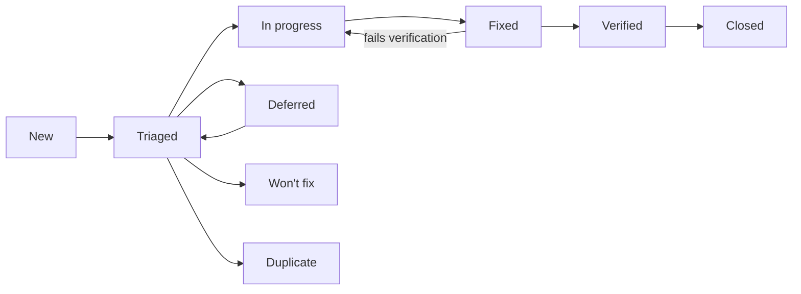

# NeoGold: Bug and Defect Log

| Field | Value |
|---|---|
| Document | 11 of 13 |
| Version | 0.1 (empty log) |
| Date | 11 October 2026 |
| Owner | Sowad Al-Mughni, Kitalon Labs |
| Depends on | `9_Test_Plan_Strategy.md` Section 9 (severity and handling), `10_Test_Cases.md` |
| Status | Open; no defects logged yet |

---

## 1. Rules for Every Entry

1. **No newborn data, ever.** No register numbers, participant codes, names, birth times, or images of babies in a bug report, a screenshot, a log extract, or an attachment. Use bench images or synthetic data to reproduce. A report that breaks this rule is redacted before anyone else reads it, and the breach is recorded under doc 8 Section 12.
2. **One defect per entry.** Split compound reports.
3. **Clinical flag first.** Before setting severity, ask: could this change what a health worker does for a baby? If yes, set `Clinical: Yes`, link the hazard (H1 to H11, doc 8 Section 14), set severity S1, and notify the clinical lead the same day.
4. **Link the test case** that found it, or the one that should have. If none exists, add one to doc 10 before closing the defect.
5. **Field reports** (from health workers, partners, or Play reviews) are logged here even when they cannot be reproduced; mark them `Source: Field`.

---

## 2. Fields

| Field | Format | Notes |
|---|---|---|
| ID | `BUG-YYYY-NNN` | Sequential per year, for example `BUG-2026-001` |
| Title | One line | What fails, where |
| Found | `YYYY-MM-DD` | Date in Asia/Dhaka |
| Source | `Test`, `Field`, `Review`, `Security report` | Security reports follow `SECURITY.md` and stay private until fixed |
| Build | App version and `versionCode`, or backend image digest | From the About screen or `/health` |
| Device | Matrix ID (D1 to D7) or model and Android version | Required for app defects |
| Area | `ONB`, `DEV`, `CARD`, `CAP`, `EST`, `TRI`, `UI`, `LOG`, `PRIV`, `RSH`, `EXP`, `SYNC`, `API`, `SEC`, `PERF`, `REL`, `A11Y`, `USE`, `OPS` | Same codes as doc 10 |
| Steps | Numbered | From a known state |
| Expected | Text | Cite the requirement or test case |
| Actual | Text | What happened; attach synthetic evidence only |
| Severity | `S1` to `S4` | Doc 9 Section 9.1 |
| Clinical | `Yes` or `No` | `Yes` forces S1 |
| Hazard | `H1` to `H11` or `-` | Required when Clinical is `Yes` |
| Priority | `P1` to `P3` | Order of work within a severity |
| Status | See Section 3 | |
| Owner | Name | |
| Test case | `TC-...` | Found by, or added for |
| Fix version | Version | |
| Verified | Name and date | Someone other than the fixer when possible; the clinical lead for clinical defects |

---

## 3. Status Workflow



- **Won't fix** and **Deferred** are not allowed for S1 defects.
- A clinical defect closes only after the clinical lead records the verification.
- **Closed** means the fix shipped in a release, not only merged.

---

## 4. Open Defects

| ID | Title | Found | Source | Build | Device | Area | Severity | Clinical | Hazard | Priority | Status | Owner | Test case | Fix version |
|---|---|---|---|---|---|---|---|---|---|---|---|---|---|---|

*No defects logged.*

---

## 5. Closed Defects

| ID | Title | Severity | Clinical | Fix version | Verified | Closed |
|---|---|---|---|---|---|---|

*None.*

---

## 6. Summary

Updated with each test summary report (doc 9 Section 15).

| Severity | Open | Clinical open | Closed this release |
|---|---|---|---|
| S1 | 0 | 0 | 0 |
| S2 | 0 | 0 | 0 |
| S3 | 0 | 0 | 0 |
| S4 | 0 | 0 | 0 |

---

## 7. Entry Template

Copy this block for each new defect, then add a row to Section 4.

```markdown
### BUG-YYYY-NNN: <title>

- Found: YYYY-MM-DD | Source: Test | Build: 1.0.0 (1000001) | Device: D1, TECNO <model>, Android 14
- Area: TRI | Severity: S1 | Clinical: Yes | Hazard: H1 | Priority: P1
- Status: New | Owner: | Test case: TC-TRI-09 | Fix version:

**Steps**
1.
2.

**Expected** (cite requirement or test case)

**Actual**

**Evidence** (synthetic data only)

**Notes**
```

---

## 8. GitHub Issue Form

When the repository is public, this log is mirrored to GitHub issues with the form below at `.github/ISSUE_TEMPLATE/bug.yml`. The form repeats the no-newborn-data rule because public issues are visible to everyone.

```yaml
name: Bug report
description: Report a problem with NeoGold. Never include any information about a real baby.
labels: [bug, needs-triage]
body:
  - type: markdown
    attributes:
      value: |
        **Do not include names, register numbers, participant codes, birth times, or photos of babies.**
        For security problems, do not open an issue; follow SECURITY.md instead.
  - type: checkboxes
    id: no-patient-data
    attributes:
      label: Privacy check
      options:
        - label: This report contains no information about a real baby.
          required: true
  - type: dropdown
    id: clinical
    attributes:
      label: Could this change what a health worker does for a baby?
      options:
        - "No"
        - "Yes"
        - "Not sure"
    validations:
      required: true
  - type: input
    id: version
    attributes:
      label: App version (from the About screen)
      placeholder: 1.0.0 (1000001)
    validations:
      required: true
  - type: input
    id: device
    attributes:
      label: Phone model and Android version
      placeholder: TECNO Spark 30C, Android 14
    validations:
      required: true
  - type: textarea
    id: steps
    attributes:
      label: Steps to reproduce
      placeholder: "1. ...\n2. ..."
    validations:
      required: true
  - type: textarea
    id: expected
    attributes:
      label: What you expected
    validations:
      required: true
  - type: textarea
    id: actual
    attributes:
      label: What happened
    validations:
      required: true
```
