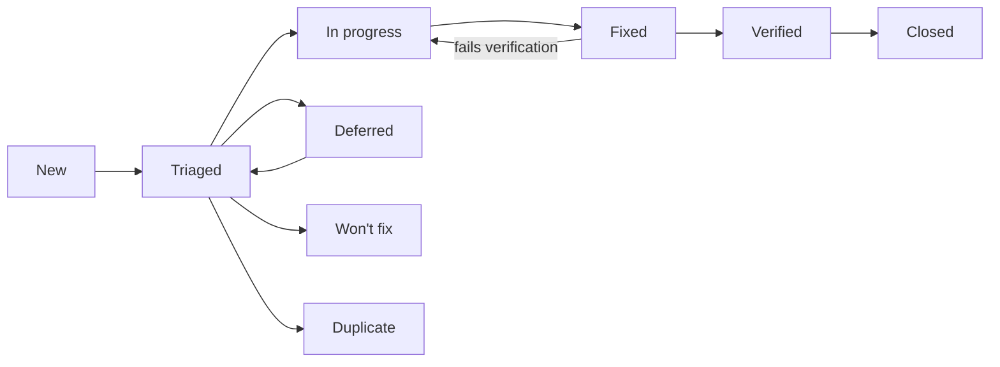

# NeoGold: Bug and Defect Log

| Field | Value |
|---|---|
| Document | 11 of 13 |
| Version | 0.2 (first entries: 31 defects from the 26 October 2026 build audit, `reports/direction/2026-10-26/build-audit.md`) |
| Date | 26 October 2026 |
| Owner | Sowad Al-Mughni, Kitalon Labs |
| Depends on | `9_Test_Plan_Strategy.md` Section 9 (severity and handling), `10_Test_Cases.md` |
| Status | Open; 31 defects open (15 S1, 8 of them clinical; 16 S2) |

---

## 1. Rules for Every Entry

1. **No newborn data, ever.** No register numbers, participant codes, names, birth times, or images of babies in a bug report, a screenshot, a log extract, or an attachment. Use bench images or synthetic data to reproduce. A report that breaks this rule is redacted before anyone else reads it, and the breach is recorded under doc 8 Section 12.
2. **One defect per entry.** Split compound reports.
3. **Clinical flag first.** Before setting severity, ask: could this change what a health worker does for a baby? If yes, set `Clinical: Yes`, link the hazard (H1 to H11, doc 8 Section 14), set severity S1, and notify the clinical lead the same day.
4. **Link the test case** that found it, or the one that should have. If none exists, add one to doc 10 before closing the defect.
5. **Field reports** (from health workers, partners, or Play reviews) are logged here even when they cannot be reproduced; mark them `Source: Field`.

---

## 2. Fields

| Field | Format | Notes |
|---|---|---|
| ID | `BUG-YYYY-NNN` | Sequential per year, for example `BUG-2026-001` |
| Title | One line | What fails, where |
| Found | `YYYY-MM-DD` | Date in Asia/Dhaka |
| Source | `Test`, `Field`, `Review`, `Security report` | Security reports follow `SECURITY.md` and stay private until fixed |
| Build | App version and `versionCode`, or backend image digest | From the About screen or `/health` |
| Device | Matrix ID (D1 to D7) or model and Android version | Required for app defects |
| Area | `ONB`, `DEV`, `CARD`, `CAP`, `EST`, `TRI`, `UI`, `LOG`, `PRIV`, `RSH`, `EXP`, `SYNC`, `API`, `SEC`, `PERF`, `REL`, `A11Y`, `USE`, `OPS` | Same codes as doc 10 |
| Steps | Numbered | From a known state |
| Expected | Text | Cite the requirement or test case |
| Actual | Text | What happened; attach synthetic evidence only |
| Severity | `S1` to `S4` | Doc 9 Section 9.1 |
| Clinical | `Yes` or `No` | `Yes` forces S1 |
| Hazard | `H1` to `H11` or `-` | Required when Clinical is `Yes` |
| Priority | `P1` to `P3` | Order of work within a severity |
| Status | See Section 3 | |
| Owner | Name | |
| Test case | `TC-...` | Found by, or added for |
| Fix version | Version | |
| Verified | Name and date | Someone other than the fixer when possible; the clinical lead for clinical defects |

---

## 3. Status Workflow



- **Won't fix** and **Deferred** are not allowed for S1 defects.
- A clinical defect closes only after the clinical lead records the verification.
- **Closed** means the fix shipped in a release, not only merged.

---

## 4. Open Defects

Entries BUG-2026-001 to BUG-2026-031 come from the 26 October 2026 build audit: a code review plus a local test run on commit `91c1125` (`reports/direction/2026-10-26/build-audit.md`). None involves newborn data. Rule 3 says to tell the clinical lead about clinical defects the same day. No clinical lead is named yet (PRD Section 16, open item 1), so entries 001 to 008 are waiting for that person. "Fix package" in the notes refers to the remediation packages R1 to R7 in the audit report.

| ID | Title | Found | Source | Build | Device | Area | Severity | Clinical | Hazard | Priority | Status | Owner | Test case | Fix version |
|---|---|---|---|---|---|---|---|---|---|---|---|---|---|---|
| BUG-2026-001 | S19 shows a hardcoded result; no engine runs | 2026-10-26 | Review | 1.0.0 (1000001) | n/a | TRI | S1 | Yes | H1 | P1 | New | Unassigned | TC-EST-04 | |
| BUG-2026-002 | S16 never opens the camera; capture returns a synthetic frame | 2026-10-26 | Review | 1.0.0 (1000001) | n/a | CAP | S1 | Yes | H1 | P1 | New | Unassigned | TC-CAP-01 | |
| BUG-2026-003 | Screening captures skip the quality gate; retake and fallback unreachable | 2026-10-26 | Review | 1.0.0 (1000001) | n/a | CAP | S1 | Yes | H4, H5, H6 | P1 | New | Unassigned | TC-CAP-14 | |
| BUG-2026-004 | S07 qualification always returns QUALIFIED without measuring | 2026-10-26 | Review | 1.0.0 (1000001) | n/a | DEV | S1 | Yes | H5 | P1 | New | Unassigned | TC-DEV-05 | |
| BUG-2026-005 | S06 card scan shows VERIFIED without reading or checking a QR code | 2026-10-26 | Review | 1.0.0 (1000001) | n/a | CARD | S1 | Yes | H4 | P1 | New | Unassigned | TC-CARD-02 | |
| BUG-2026-006 | Result next-step wording differs from doc 6 and drops the danger-signs reminder | 2026-10-26 | Review | 1.0.0 (1000001) | n/a | UI | S1 | Yes | H1, H11 | P1 | New | Unassigned | TC-UI-01 | |
| BUG-2026-007 | Startup integrity result is never used; modified assets do not disable screening | 2026-10-26 | Review | 1.0.0 (1000001) | n/a | SEC | S1 | Yes | H7, H9 | P1 | New | Unassigned | TC-SEC-09 | |
| BUG-2026-008 | App trusts a test manifest key whose private half is in the repository | 2026-10-26 | Review | 1.0.0 (1000001) | n/a | SEC | S1 | Yes | H7, H9 | P1 | New | Unassigned | TC-SEC-09 | |
| BUG-2026-009 | Delete all data clears settings only; database, files, and keys remain | 2026-10-26 | Review | 1.0.0 (1000001) | n/a | LOG | S1 | No | - | P1 | New | Unassigned | TC-LOG-11 | |
| BUG-2026-010 | Retention never runs; register numbers and old records are kept | 2026-10-26 | Review | 1.0.0 (1000001) | n/a | LOG | S1 | No | - | P1 | New | Unassigned | TC-LOG-04 | |
| BUG-2026-011 | PIN verifier key falls back to a hardcoded key on any Keystore error | 2026-10-26 | Review | 1.0.0 (1000001) | n/a | RSH | S1 | No | - | P1 | New | Unassigned | TC-RSH-06 | |
| BUG-2026-012 | Research unlock accepts any PIN | 2026-10-26 | Review | 1.0.0 (1000001) | n/a | RSH | S1 | No | - | P1 | New | Unassigned | TC-RSH-05 | |
| BUG-2026-013 | Research sessions are never saved or queued | 2026-10-26 | Review | 1.0.0 (1000001) | n/a | RSH | S1 | No | - | P1 | New | Unassigned | TC-RSH-14 | |
| BUG-2026-014 | android-ci and android-release workflows are invalid YAML; Android CI has never passed | 2026-10-26 | Review | commit 91c1125 | n/a | OPS | S1 | No | - | P1 | Verified | Unassigned | TC-OPS-01 | |
| BUG-2026-015 | Test summary reports state results the repository cannot support | 2026-10-26 | Review | docs at 91c1125 | n/a | OPS | S1 | No | - | P1 | In progress | Unassigned | n/a (doc 9 Section 15) | |
| BUG-2026-016 | Gradle wrapper and two gate scripts lack the executable bit | 2026-10-26 | Review | commit 91c1125 | n/a | OPS | S2 | No | - | P2 | Verified | Unassigned | TC-SEC-04 | |
| BUG-2026-017 | `:core:data` unit tests cannot run from a clean checkout (stale lock) | 2026-10-26 | Test | commit 91c1125 | n/a | OPS | S2 | No | - | P2 | Verified | Unassigned | TC-LOG-11 | |
| BUG-2026-018 | Secrets scan reports two findings in history; not triaged | 2026-10-26 | Review | commit 91c1125 | n/a | SEC | S2 | No | - | P2 | Verified | Unassigned | TC-SEC-06 | |
| BUG-2026-019 | `triageEnabled` is a hardcoded default, not read from the signed config | 2026-10-26 | Review | 1.0.0 (1000001) | n/a | TRI | S2 | No | - | P2 | New | Unassigned | TC-TRI-26 | |
| BUG-2026-020 | Hard rules are decided in navigation code, not by the triage engine | 2026-10-26 | Review | 1.0.0 (1000001) | n/a | TRI | S2 | No | - | P2 | New | Unassigned | TC-TRI-06 | |
| BUG-2026-021 | Saved sessions record a different action from the one shown | 2026-10-26 | Review | 1.0.0 (1000001) | n/a | LOG | S2 | No | - | P2 | New | Unassigned | TC-LOG-12 | |
| BUG-2026-022 | Session records carry hardcoded versions and card batch | 2026-10-26 | Review | 1.0.0 (1000001) | n/a | LOG | S2 | No | - | P2 | New | Unassigned | TC-TRI-22 | |
| BUG-2026-023 | Gestational age has a hidden default of 38 weeks | 2026-10-26 | Review | 1.0.0 (1000001) | n/a | UI | S2 | No | - | P2 | New | Unassigned | TC-UI-11 | |
| BUG-2026-024 | Research mode has no entry point | 2026-10-26 | Review | 1.0.0 (1000001) | n/a | RSH | S2 | No | - | P2 | New | Unassigned | TC-RSH-01 | |
| BUG-2026-025 | Research export screen never writes a file | 2026-10-26 | Review | 1.0.0 (1000001) | n/a | EXP | S2 | No | - | P2 | New | Unassigned | TC-EXP-01 | |
| BUG-2026-026 | Study enrollment (R08) and Leave study (R09) are placeholder screens | 2026-10-26 | Review | 1.0.0 (1000001) | n/a | SYNC | S2 | No | - | P2 | New | Unassigned | TC-API-07 | |
| BUG-2026-027 | Upload is never started by the app | 2026-10-26 | Review | 1.0.0 (1000001) | n/a | SYNC | S2 | No | - | P2 | New | Unassigned | TC-SYNC-10 | |
| BUG-2026-028 | No Play In-App Updates implementation | 2026-10-26 | Review | 1.0.0 (1000001) | n/a | ONB | S2 | No | - | P2 | New | Unassigned | TC-OPS-03 | |
| BUG-2026-029 | About 150 hardcoded English UI strings; string lint does not check Kotlin | 2026-10-26 | Review | 1.0.0 (1000001) | n/a | A11Y | S2 | No | - | P2 | New | Unassigned | TC-A11Y-01 | |
| BUG-2026-030 | Hazard log is missing | 2026-10-26 | Review | docs at 91c1125 | n/a | OPS | S2 | No | - | P2 | New | Unassigned | none (add to doc 10) | |
| BUG-2026-031 | Release notes file for v1.0.0 is missing | 2026-10-26 | Review | commit 91c1125 | n/a | OPS | S2 | No | - | P2 | New | Unassigned | TC-OPS-02 | |
| BUG-2026-032 | BurstCaptureController reads capture metadata through CameraX internal APIs | 2026-10-26 | CI | commit f1e01e6 | n/a | CAP | S2 | No | - | P2 | In progress | Unassigned | TC-CAP-01 | |
| BUG-2026-033 | Foreground service type is declared only in :app, so :sync:research and :app lint fail | 2026-10-27 | CI | commit a0b6da2 | n/a | SYNC | S3 | No | - | P2 | Verified | Unassigned | TC-SYNC-10 | |
| BUG-2026-034 | Recheck notification is posted without checking the notification permission | 2026-10-27 | CI | commit a0b6da2 | n/a | LOG | S3 | No | - | P2 | Verified | Unassigned | TC-LOG-09 | |
| BUG-2026-035 | ScreeningPipelineBenchmarkTest asserts phone time budgets on a shared build machine | 2026-10-27 | Test | commit a0b6da2 | n/a | PERF | S3 | No | - | P3 | New | Unassigned | TC-PERF-01 | |
| BUG-2026-036 | Trivy gate S2 fails: Bouncy Castle 1.78.1 (CRITICAL) and protobuf-java 3.19.3 (HIGH) ship in the app | 2026-10-27 | CI | commit 8c13d2a | n/a | SEC | S2 | No | - | P2 | In progress | Unassigned | TC-SEC-05 | |
| BUG-2026-037 | TC-CAP-01 builds a LiveCardAnalyzer and never calls it, so the test asserts on objects it constructed itself | 2026-10-27 | Review | commit a0b6da2 | n/a | CAP | S3 | No | - | P3 | New | Unassigned | TC-CAP-01 | |
| BUG-2026-038 | The export checkpoint keeps the data keyset in clear next to the staged ciphertext, and a failed export leaves both behind | 2026-10-27 | Review | commit 93a2f9f | n/a | EXP | S2 | No | - | P2 | New | Unassigned | TC-EXP-01 | |
| BUG-2026-039 | ResearchJpegSanitizer is never called outside tests, and extractOrientation reads the wrong bytes | 2026-10-27 | Review | commit 93a2f9f | n/a | PRIV | S2 | No | - | P2 | New | Unassigned | TC-API-20 | |
| BUG-2026-040 | StudyEnrollmentManager accepts a null verifier (unsigned study QR) and echoes the enrollment code in an error message | 2026-10-27 | Review | commit 93a2f9f | n/a | SYNC | S3 | No | - | P2 | New | Unassigned | TC-API-07 | |
| BUG-2026-041 | TriageCli ships in main with silent defaults for clinical inputs, and nothing uses it | 2026-10-27 | Review | commit 93a2f9f | n/a | TRI | S3 | No | - | P3 | Fixed | Unassigned | TC-CAP-04 | |
| BUG-2026-042 | The trust list parser accepts a missing or malformed revocation list and duplicate key ids | 2026-10-27 | Review | commit c5a47b0 | n/a | SEC | S3 | No | - | P2 | New | Unassigned | TC-CARD-06 | |
| BUG-2026-043 | The three bundled-asset JSON parsers have no nesting-depth or size limit | 2026-10-27 | Review | commit c5a47b0 | n/a | SEC | S3 | No | - | P3 | New | Unassigned | TC-SEC-03 | |
| BUG-2026-044 | S10 and R03 pre-fill the baby's age with 48 hours | 2026-10-27 | Review | commit 3c60999 | n/a | UI | S2 | No | - | P2 | New | Unassigned | TC-UI-11 | |
| BUG-2026-045 | The colour and estimation golden-vector tests rewrite their own expected files | 2026-10-27 | Review | commit 3c60999 | n/a | EST | S2 | No | - | P2 | New | Unassigned | TC-EST-01, TC-EST-07 | |
| BUG-2026-046 | The tier map does not cover the vision quality gate, its defaults, or the detekt config | 2026-10-27 | Review | commit 3c60999 | n/a | OPS | S3 | No | - | P2 | Fixed | Unassigned | n/a (tools/quality_gate.py) | |
| BUG-2026-047 | The StrictMath guards miss cbrt and trigonometric calls, and detekt's method rule never runs | 2026-10-27 | Review | commit 3c60999 | n/a | OPS | S3 | No | - | P3 | Fixed | Unassigned | TC-EST-07 | |
| BUG-2026-048 | The quality gate's residual check passes when fewer than three reference patches match | 2026-10-27 | Review | commit 3c60999 | n/a | CAP | S3 | No | - | P3 | New | Unassigned | TC-CAP-09 | |
| BUG-2026-049 | ScreeningOfflineTest asserts a network-call count that nothing increments | 2026-10-27 | Review | commit 3c60999 | n/a | EST | S3 | No | - | P3 | New | Unassigned | TC-EST-04 | |
| BUG-2026-050 | The "No further action" card has a solid border where doc 6 says dashed, and no test checks borders | 2026-10-27 | Review | commit 3c60999 | n/a | UI | S3 | No | - | P3 | New | Unassigned | TC-UI-01, TC-A11Y-05 | |
| BUG-2026-051 | The session detail screen formats clinical numbers with the default locale | 2026-10-27 | Review | commit 3c60999 | n/a | UI | S3 | No | - | P3 | New | Unassigned | TC-A11Y-03 | |

### 4.1 Entries

Every entry below was found on 26 October 2026 (Source and Build as in the table; Device: n/a, found by code review or a local JVM test run). Paths under `android/` are abbreviated after their first use; `MainActivity.kt` is `android/app/src/main/kotlin/com/kitalonlabs/neogold/MainActivity.kt`.

#### BUG-2026-001: S19 shows a hardcoded result; no engine runs

- Area: TRI | Severity: S1 | Clinical: Yes | Hazard: H1 | Priority: P1
- Status: New | Owner: Unassigned | Test case: TC-EST-04, TC-TRI-22 | Fix version:

**Steps**
1. Start `NeoGoldNavHost` with `triageEnabled = true` (the only way to enable triage today; BUG-2026-019).
2. Complete a screening to S19.

**Expected** S19 runs the capture through `ScreeningPipelineUseCase` and `TriageEngine` and shows that result (doc 4 Sections 4.4 and 5; FR-18, FR-20).

**Actual** After 1.2 seconds, S19 sets `NO_FURTHER_ACTION`, a range of 8.2 to 10.1 mg/dL, and a threshold of 12.0, whatever was captured.

**Evidence** `MainActivity.kt:566-575`. `ScreeningPipelineUseCase`, `ScreeningStateMachine`, and `TriageEngine` have no callers in the app.

**Notes** Hidden in the v1.0 build only because screening is switched off by a hardcoded flag. Any build that enables triage shows a made-up, lowest-care result for every baby. Fix package R1. The 1.0.0 release build also contains none of the engine code: R8 removes `TriageEngine`, `EstimationEngine`, `CardTrustVerifier` and the colour-science classes as unused (`usage.txt` of a local release build, checked 27 October 2026), so the engine tests in CI say nothing about the shipped APK until package E1 wires them.

#### BUG-2026-002: S16 never opens the camera; capture returns a synthetic frame

- Area: CAP | Severity: S1 | Clinical: Yes | Hazard: H1 | Priority: P1
- Status: New | Owner: Unassigned | Test case: TC-CAP-01, TC-EST-04 | Fix version:

**Steps**
1. Reach S16 in a screening.
2. Wait for auto-capture, or tap manual capture.

**Expected** CameraX preview with live card detection, and burst capture through `:engine:camera` (FR-10, FR-11; doc 4 Section 5.1).

**Actual** There is no preview. `onCaptureCompleted` receives `createDefaultCaptureFrame()`, a generated frame.

**Evidence** `android/feature/screening/src/main/kotlin/com/kitalonlabs/neogold/feature/screening/ui/S16CameraScreen.kt:44-62`. No screen uses `:engine:camera` (CameraX, `Camera2Interop`).

**Notes** Even with BUG-2026-001 fixed, the estimate would describe a synthetic image, not the baby. Fix package R1.

#### BUG-2026-003: Screening captures skip the quality gate; retake and fallback are unreachable

- Area: CAP | Severity: S1 | Clinical: Yes | Hazard: H4, H5, H6 | Priority: P1
- Status: New | Owner: Unassigned | Test case: TC-CAP-11, TC-CAP-13, TC-CAP-14 | Fix version:

**Steps**
1. Reach S16 and capture.

**Expected** Each capture goes through the quality gate. A failure shows S17 with its reason; three failures give `BLOOD_TEST_TODAY` with `QUALITY_FALLBACK` (FR-13, FR-14).

**Actual** S16 always goes to S18. Nothing navigates to S17, and no quality result is computed.

**Evidence** `MainActivity.kt:521-531` (S16 to S18). The S17 destination at `MainActivity.kt:533-549` has no incoming navigation.

**Notes** Fix package R1.

#### BUG-2026-004: S07 camera qualification always returns QUALIFIED without measuring

- Area: DEV | Severity: S1 | Clinical: Yes | Hazard: H5 | Priority: P1
- Status: New | Owner: Unassigned | Test case: TC-DEV-02, TC-DEV-03, TC-DEV-04, TC-DEV-05 | Fix version:

**Steps**
1. Run onboarding to S07 and take the three photos.

**Expected** Repeatability, duplicate-patch uniformity, and accuracy are measured. A phone that fails is `RESEARCH_ONLY` and cannot screen. The result is stored in `device_profile` (FR-04, ADR-012).

**Actual** The screen returns a fixed profile: "SampleManufacturer", "SampleModel", repeatability 0.85, uniformity 1.10, residual 1.65, `QUALIFIED`. Nothing is written to `device_profile`.

**Evidence** `android/feature/onboarding/src/main/kotlin/com/kitalonlabs/neogold/feature/onboarding/S07QualificationScreen.kt:154,168-190`.

**Notes** Every phone, including ones whose cameras tone-map locally, is marked fit to screen. Fix package R2.

#### BUG-2026-005: S06 card scan shows VERIFIED without reading or checking a QR code

- Area: CARD | Severity: S1 | Clinical: Yes | Hazard: H4 | Priority: P1
- Status: New | Owner: Unassigned | Test case: TC-CARD-01, TC-CARD-02 | Fix version:

**Steps**
1. Run onboarding to S06 and tap continue.

**Expected** The card QR is scanned and verified offline against the trust list. Unverified or expired cards are blocked from screening (FR-04b, doc 4 Section 7).

**Actual** The screen shows a fixed "VERIFIED" label and continues. `:engine:cardtrust` is not called, and no `card_batch` row is stored.

**Evidence** `android/feature/onboarding/src/main/kotlin/com/kitalonlabs/neogold/feature/onboarding/S06CardScanScreen.kt:127,142-144`.

**Notes** The card trust engine passes its tests (TC-CARD-01 to 06; 22 tests in the local run) but is never reached from the UI. Fix package R2.

#### BUG-2026-006: Result next-step wording differs from doc 6 and drops the danger-signs reminder

- Area: UI | Severity: S1 | Clinical: Yes | Hazard: H1, H11 | Priority: P1
- Status: New | Owner: Unassigned | Test case: TC-UI-01, TC-UI-14 | Fix version:

**Steps**
1. Show S20 with `triageEnabled = true`, once for each action.

**Expected** The next-step lines from doc 6 Section 3, taken from string resources in English and Bangla. "No further action" keeps "Continue routine care. Watch for danger signs." (`next_no_further`).

**Actual** Hardcoded English lines such as "Order serum bilirubin test today" and "Routine newborn care. Re-evaluate if jaundice deepens." The danger-signs reminder is gone, and there is no Bangla.

**Evidence** `MainActivity.kt:590-596`.

**Notes** Clinical wording changes need the clinical lead (CLAUDE.md). Fix package R1.

#### BUG-2026-007: The startup integrity result is never used, so modified assets do not disable screening

- Area: SEC | Severity: S1 | Clinical: Yes | Hazard: H7, H9 | Priority: P1
- Status: New | Owner: Unassigned | Test case: TC-SEC-09, TC-TRI-19 | Fix version:

**Steps**
1. Change one byte in `assets/triage-config.json`, rebuild without re-signing the manifest, and launch.

**Expected** The bundle manifest check fails and screening is disabled (doc 4 Section 12; doc 8 Section 6.5).

**Actual** The result is stored in `IntegrityStateManager` and logged. No code reads it, so nothing is disabled.

**Evidence** `android/app/src/main/kotlin/com/kitalonlabs/neogold/NeoGoldApplication.kt:28-31`. `IntegrityStateManager` has no readers.

**Notes** Fix package R4.

#### BUG-2026-008: The app trusts a test manifest key whose private half is in the repository

- Area: SEC | Severity: S1 | Clinical: Yes | Hazard: H7, H9 | Priority: P1
- Status: New | Owner: Unassigned | Test case: TC-SEC-09 | Fix version:

**Steps**
1. Read `tools/sign_bundle_manifest.py:24-25` and `BundleManifestVerifier.kt:25-26,68-73`.

**Expected** The app pins the real K3 public key from the release configuration, and the release checks refuse a test key (doc 8 Section 4, K3).

**Actual** Every build trusts `DEFAULT_TEST_K3_PUBLIC_HEX`. Its private key, `DEFAULT_TEST_K3_PRIVATE_HEX`, is committed, so anyone can sign a manifest the app accepts. A release signed with the real K3 would fail the check.

**Evidence** `android/core/security/src/main/kotlin/com/kitalonlabs/neogold/core/security/integrity/BundleManifestVerifier.kt:25-26,68-73`; `tools/sign_bundle_manifest.py:24-25`.

**Notes** Fix package R4, together with BUG-2026-007.

#### BUG-2026-009: Delete all data clears settings only; the database, encrypted files, and keys remain

- Area: LOG | Severity: S1 | Clinical: No | Hazard: - | Priority: P1
- Status: New | Owner: Unassigned | Test case: TC-LOG-11 | Fix version:

**Steps**
1. Save a screening with a register number.
2. Open Settings, choose Delete all data, and confirm.

**Expected** The database, encrypted files, and keys are removed, and the app restarts empty (FR-33).

**Actual** Only the DataStore settings are cleared. `DataPurgeManager.deleteAllData()` passes its unit test but is never called.

**Evidence** `MainActivity.kt:737-751` (`dataStore.clearAll()` at line 741). The `S25DeleteAllDataScreen.kt` KDoc says the opposite.

**Notes** A facility that deletes all data before handing a phone on still leaves every record on it. Fix package R4.

#### BUG-2026-010: Retention never runs; register numbers and old records are kept indefinitely

- Area: LOG | Severity: S1 | Clinical: No | Hazard: - | Priority: P1
- Status: New | Owner: Unassigned | Test case: TC-LOG-04, TC-LOG-05 | Fix version:

**Steps**
1. Search the app for a WorkManager periodic job or an app-start call to `RetentionManager`.

**Expected** Register numbers are erased at 60 days and screening records purged at 180 days, daily and on every app start (PRD D7; doc 5 Section 2.5).

**Actual** Nothing schedules or calls the retention jobs. `RetentionManager` passes its unit tests but never runs.

**Evidence** There is no `PeriodicWorkRequest` or `enqueueUniquePeriodicWork` in `android/**/src/main`, and `NeoGoldApplication.kt` does not call retention.

**Notes** Fix package R4.

#### BUG-2026-011: The PIN verifier key falls back to a hardcoded key on any Keystore error

- Area: RSH | Severity: S1 | Clinical: No | Hazard: - | Priority: P1
- Status: New | Owner: Unassigned | Test case: TC-RSH-06 | Fix version:

**Steps**
1. Make the Keystore throw (for example after a Keystore loss on a budget phone).
2. Set or check a research PIN.

**Expected** The HMAC step uses the non-exportable Keystore key K9. If the Keystore fails, the app takes the Keystore-loss path (doc 8 Sections 5.1 and 6.2).

**Actual** Any exception silently switches to `FakePinHmacKeyProvider.STATIC_KEY`, which is the bytes 0x01 to 0x20 and is published in the repository. A copied database can then be brute-forced off the phone.

**Evidence** `android/core/security/src/main/kotlin/com/kitalonlabs/neogold/core/security/pin/PinHmacKeyProvider.kt:52-55,80` (the catch, the fallback and `STATIC_KEY`).

**Notes** Latent until the PIN path is wired (BUG-2026-012). Fix package R4. The detekt suppression on that function (A2) cites this bug so the fallback stays visible. `KeystoreRecoveryManager.checkKeystoreHealth` catches `Throwable`, which also swallows `OutOfMemoryError` and `CancellationException`; narrow it to `Exception` and rethrow cancellation when it is wired, and ask before wiping.

#### BUG-2026-012: Research unlock accepts any PIN

- Area: RSH | Severity: S1 | Clinical: No | Hazard: - | Priority: P1
- Status: New | Owner: Unassigned | Test case: TC-RSH-04, TC-RSH-05 | Fix version:

**Steps**
1. Reach R01 and enter any digits.

**Expected** Weak PINs are refused; the PIN is checked with Argon2id plus the Keystore HMAC; lockout follows 5, 10, and 15 failures (FR-25; doc 8 Section 6.2).

**Actual** `onUnlockWithPin` and `onEnrollWithPin` go to R02 without checking anything. `ResearchPinManager` is never called.

**Evidence** `MainActivity.kt:766-771`.

**Notes** Fix package R3.

#### BUG-2026-013: Research sessions are never saved or queued

- Area: RSH | Severity: S1 | Clinical: No | Hazard: - | Priority: P1
- Status: New | Owner: Unassigned | Test case: TC-RSH-11, TC-RSH-14, TC-SYNC-01 | Fix version:

**Steps**
1. Complete R03 to R06 with a test participant code.

**Expected** The participant, consent form ID, captures, and TSB value are written in a transaction and queued in the outbox (FR-26 to FR-29, NFR-09).

**Actual** The screens discard what is entered. R02 and R06 show fixed values (study "DHK-01", participant "SKP-0142", TSB 14.2 mg/dL). Nothing reaches Room or the outbox, and `ResearchViewModel` is never created. R03 starts with a birth time of 48 hours ago and an age of 48.0 hours (BUG-2026-044), its birth-time Edit button does nothing, and `MainActivity` discards the age, gestational age and safety answers it collects.

**Evidence** `MainActivity.kt:775-847`; `R03ParticipantConsentScreen.kt:66-67,193` in `:feature:research`.

**Notes** A nurse who completes a session believes it was recorded. Fix package R3. Proposed release check (package C2): fail the build when `SKP-0142` or `14.2` is left in a `src/main` source file, so a placeholder screen cannot reach a store build.

#### BUG-2026-014: The android-ci and android-release workflows are invalid YAML, and Android CI has never passed

- Area: OPS | Severity: S1 | Clinical: No | Hazard: - | Priority: P1
- Status: Verified | Owner: Unassigned | Test case: TC-OPS-01, TC-SEC-01, TC-SEC-04 | Fix version:

**Steps**
1. Parse `.github/workflows/android-ci.yml` and `android-release.yml` with any YAML parser.
2. Check the Actions history.

**Expected** Every pull request and push runs lint, unit tests, golden vectors, differential triage, config schema, and gates S4, S5, S6, and S9 (doc 12 Section 3).

**Actual** Neither file parses, because `- name: Gate: ...` contains an unquoted colon (android-ci line 43, android-release line 27). The error came in with `21410eb` (P16, 20 October 2026). All 38 android-ci runs since 17 October failed, and none has run a job since that commit.

**Evidence** GitHub Actions run 40272881285 ("This run likely failed because of a workflow file issue"); a YAML parse of each file.

**Notes** The runs before that commit failed too (BUG-2026-016, BUG-2026-018). The engine tests that CLAUDE.md says block all other work have never been checked in CI. This is the first item in fix package R6.

**Fix** `android-ci.yml` and `android-release.yml` quote the step names. P25 then repeated the mistake in `repo-ci.yml` (`DATABASE_URL: sqlite:///:memory:`), also fixed. `tools/check_workflows.py`, run in `repo-ci`, now fails on invalid YAML or a step with neither `run` nor `uses`. The Android workflows also lacked the Python tooling that `signAssetManifest` needs (now installed from the hash-locked requirements) and never ran `verifyStrings`. Becomes Verified when android-ci is green on `dev`.

**Verified** 27 October 2026 by CI: android-ci (build-test and scan) and repo-ci are green on `4335ae4` (android-ci run 40483478982).

#### BUG-2026-015: Test summary reports state results the repository cannot support

- Area: OPS | Severity: S1 | Clinical: No | Hazard: - | Priority: P1
- Status: In progress | Owner: Unassigned | Test case: n/a (doc 9 Section 15) | Fix version:

**Steps**
1. Compare `docs/test-reports/v0.1.md`, `v0.5.md`, and `v1.0.md` with the repository, the git tags, the CI history, and this log.

**Expected** Each PASS points to evidence: a CI run, a test, or attached raw data (doc 9 Section 15).

**Actual**
- The v0.1 timings and app sizes match the output of `tools/benchmark_capture_to_result.py`, which draws random timings clamped under budget and prints hardcoded sizes (lines 147-148).
- v0.5 cites tag `v0.5.0` and branch `release/0.5`; neither exists.
- v0.5 and v1.0 list closed S1 to S4 defects that were never logged here.
- Both record a clinical lead approval, but no clinical lead is named.
- Both report device, kill, power-loss, and nurse-panel passes for features the app does not run.

**Evidence** `reports/direction/2026-10-26/build-audit.md` Section 5.

**Notes** Severity S1, because a go or no-go based on these reports could release a build that fabricates results. The 26 October correction marks each row Supported, Unverified, or Contradicted. Rows stay corrected until raw data is attached.

#### BUG-2026-016: The Gradle wrapper and two gate scripts are committed without the executable bit

- Area: OPS | Severity: S2 | Clinical: No | Hazard: - | Priority: P2
- Status: Verified | Owner: Unassigned | Test case: TC-SEC-04, TC-OPS-01 | Fix version:

**Steps**
1. Run `git ls-files -s android/gradlew tools/check_16kb.sh card/tools/neogold-sign/neogold-sign`.

**Expected** Mode 100755, so `./gradlew` and `tools/check_16kb.sh` run on Linux CI.

**Actual** Mode 100644. The CI runs before 20 October failed at the first Gradle step with "./gradlew: Permission denied" (exit 126).

**Evidence** android-ci run 39396331186 (20 October 2026).

**Notes** P01's PR #8 was merged with this failure. Fix package R6 (`git update-index --chmod=+x`).

**Fix** Executable bit set on `android/gradlew`, `tools/check_16kb.sh` and `card/tools/neogold-sign/neogold-sign`. The committed files are LF, so the bit was the only problem.

**Verified** 27 October 2026 by CI: android-ci (build-test and scan) and repo-ci are green on `4335ae4` (android-ci run 40483478982).

#### BUG-2026-017: `:core:data` unit tests cannot run from a clean checkout (stale dependency lock)

- Area: OPS | Severity: S2 | Clinical: No | Hazard: - | Priority: P2
- Status: Verified | Owner: Unassigned | Test case: TC-LOG-04, TC-LOG-05, TC-LOG-11, TC-SEC-07, TC-SEC-08, TC-REL-08 | Fix version:

**Steps**
1. On a fresh clone with JDK 21, run `cd android && ./gradlew testReleaseUnitTest` (the CLAUDE.md command).

**Expected** All module tests run.

**Actual** `:core:data` fails before compiling its tests: "Resolved 'org.jetbrains.kotlin:kotlin-stdlib-common:2.2.10' which is not part of the dependency lock state". With that one lock entry updated locally (not committed), its 12 tests pass.

**Evidence** A local run on commit `91c1125` on 26 October 2026. `android/core/data/gradle.lockfile` last changed in `dab13ce` (P20).

**Notes** Fix package R6.

**Fix** The configuration was added to the `kotlin-stdlib-common:2.2.10` lock line by hand: `debugUnitTestRuntimeClasspath`, and later `releaseRuntimeClasspath`, which a strict clean-cache run also demanded. **Maintainers:** Gradle's lock writer never writes that line for those two configurations although its validator requires it, and `--write-locks` removes it again. After regenerating locks, restore it, then run `./gradlew :core:data:test lintRelease` without `--write-locks`. Gradle also persists lock state only when the whole build succeeds, so fix every other failure first.

**Verified** 27 October 2026 by CI: android-ci (build-test and scan) and repo-ci are green on `4335ae4` (android-ci run 40483478982).

#### BUG-2026-018: The secrets scan (gate S9) reports two findings in git history; not triaged

- Area: SEC | Severity: S2 | Clinical: No | Hazard: - | Priority: P2
- Status: Verified | Owner: Unassigned | Test case: TC-SEC-06 | Fix version:

**Steps**
1. Run `gitleaks git --redact -v .` on the repository.

**Expected** A clean result, or each finding allow-listed with a reason (doc 8 Section 10).

**Actual** android-ci run 39396331186 reports "leaks found: 2", and its log is redacted. A search of the history finds no private-key blocks and no common token formats. The likely matches are committed test keys (`card/spec/testvectors/keys.json`, `tools/sign_bundle_manifest.py:25`).

**Evidence** android-ci run 39396331186.

**Notes** If either finding is a real credential, raise this to S1 and rotate the credential. BUG-2026-008 explains why the committed K3 test key matters.

**Fix** Triaged by running gitleaks v8.30.1 on the full history. Three findings, none a credential: a constant's name in this log, and the internal Docker address `172.30.0.10` in a compose comment and its runbook copy. The guess above about test-key files was wrong. `.gitleaks.toml` allowlists only those two exact strings in those three files, and an invented secret in the same file is still reported. No rotation is needed for those three. This closure does **not** cover the committed K3 test signing key (BUG-2026-008): the default rule needs a keyword in the variable name, `DEFAULT_TEST_K3_PRIVATE_HEX` has none, so gate S9 cannot see that key. BUG-2026-008 removes it; until then S9 being green says nothing about it.

**Verified** 27 October 2026 by CI: android-ci (build-test and scan) and repo-ci are green on `4335ae4` (android-ci run 40483478982).

#### BUG-2026-019: `triageEnabled` is a hardcoded default, not read from the signed config

- Area: TRI | Severity: S2 | Clinical: No | Hazard: - | Priority: P2
- Status: New | Owner: Unassigned | Test case: TC-TRI-26 | Fix version:

**Steps**
1. Read `MainActivity.kt:225`.

**Expected** Whether triage results can appear is decided by the parsed, integrity-checked config (`triageEnabled`, sign-off status, `validUntil`) through the triage engine (doc 4 Section 6.2, step 1).

**Actual** `NeoGoldNavHost(triageEnabled: Boolean = false)`. The config value is never read.

**Evidence** `MainActivity.kt:225`.

**Notes** It fails safe today, since no results are shown, but the gate is a code constant rather than the signed config. Fix package R1. Nothing ties the UI flag to the config: Gate G1 (`tools/verify_clinical_signoff.py`) reads `config/triage-config.json` only, so passing it says nothing about the UI, and `S20ResultScreen` defaults to `true` (line 59). Until packages B1 and E1 read the flag from the verified config, a source check that the `NeoGoldNavHost` default stays `false` would close the gap. Found by the safety-reviewer on 27 October 2026.

#### BUG-2026-020: Hard rules are decided in navigation code, not by the triage engine

- Area: TRI | Severity: S2 | Clinical: No | Hazard: - | Priority: P2
- Status: New | Owner: Unassigned | Test case: TC-TRI-06 | Fix version:

**Steps**
1. Answer Yes to early jaundice and Yes to danger signs.

**Expected** The engine applies R1 to R5 in order, and the first match is the reason code (doc 4 Section 6.2). TC-TRI-06 expects `R1` when danger signs are present.

**Actual** The S11 to S13 navigation applies the rules itself. Early jaundice is asked first, so the record says `R2`. Phototherapy is checked before gestational age, so `R4` is recorded where the engine gives `R3`. The action shown is the same.

**Evidence** `MainActivity.kt:404-456`.

**Notes** Doc 4 Section 4.4 says the UI renders state and never decides clinical flow. Fix package R1.

#### BUG-2026-021: Saved sessions record a different action from the one shown, with values outside the schema enum

- Area: LOG | Severity: S2 | Clinical: No | Hazard: - | Priority: P2
- Status: New | Owner: Unassigned | Test case: TC-LOG-12 | Fix version:

**Steps**
1. Trigger R3, R4, or R5 and save.
2. Complete S20 and save.

**Expected** `triage_action` uses the doc 5 enum and matches the screen: `CANNOT_SCREEN_BLOOD_TEST`, `CANNOT_SCREEN_CLINICAL_REVIEW`, `BLOOD_TEST_TODAY`, `NO_FURTHER_ACTION_FROM_SCREEN`.

**Actual** S14 shows "cannot screen" for R3 to R5. It saves `BLOOD_TEST_TODAY` for R3 and R4, and `CANNOT_SCREEN`, which is not in the enum, for R5. S20 saves `TriageUiAction` names such as `BLOOD_TEST` and `NO_FURTHER_ACTION`.

**Evidence** `MainActivity.kt:477-482` and line 621; `S14RuleOutcomeScreen.kt:61-89`.

**Notes** The session detail cannot show what was shown at screening time (T16). Fix package R1.

#### BUG-2026-022: Session records carry hardcoded versions and card batch

- Area: LOG | Severity: S2 | Clinical: No | Hazard: - | Priority: P2
- Status: New | Owner: Unassigned | Test case: TC-TRI-22 | Fix version:

**Steps**
1. Save any screening.

**Expected** The app, model, and config versions and the card batch come from what was actually loaded and scanned (NFR-10).

**Actual** Every row gets `appVersion` "1.0.0", `modelVersion` "1.0.0" (or null), `configVersion` "2026.10.0", and `cardBatchId` "NG-2026-001". The shipped config is "2026.10.0-draft" and the model is "1.0.0-synthetic".

**Evidence** `MainActivity.kt:496-499` and `MainActivity.kt:635-638`.

**Notes** Fix package R1.

#### BUG-2026-023: Gestational age has a hidden default of 38 weeks in navigation state

- Area: UI | Severity: S2 | Clinical: No | Hazard: - | Priority: P2
- Status: New | Owner: Unassigned | Test case: TC-UI-11 | Fix version:

**Steps**
1. Read `MainActivity.kt` lines 240 and 353.

**Expected** No silent default on a clinical input; a missing value stays missing (doc 6 Section 8, H3, CLAUDE.md).

**Actual** `sessionGaWeeks` starts at 38 and is reset to 38 for each new screening. Only S10 overwrites it.

**Evidence** `MainActivity.kt` lines 240 and 353.

**Notes** S10 itself requires a value (TC-UI-11), so the default is latent. Any path that skipped S10 would screen at 38 weeks (H3). Fix package R1. The stepper also anchors at 38: the first tap on either its minus or plus button sets 38 weeks (`NgControls.kt:52,88`), the band with the highest thresholds.

#### BUG-2026-024: Research mode has no entry point

- Area: RSH | Severity: S2 | Clinical: No | Hazard: - | Priority: P2
- Status: New | Owner: Unassigned | Test case: TC-RSH-01 | Fix version:

**Steps**
1. From Home or Settings, look for a way into research mode.

**Expected** A route into R01 (doc 4 Section 4.6).

**Actual** Nothing navigates to R01 except R02's lock button, and R02 is reached only from R01. In the v1.0 build, where screening is hidden, the app does nothing besides settings and the log.

**Evidence** `grep -n R01_RESEARCH_UNLOCK android/app/src/main`.

**Notes** Fix package R3.

#### BUG-2026-025: The research export screen never writes a file

- Area: EXP | Severity: S2 | Clinical: No | Hazard: - | Priority: P2
- Status: New | Owner: Unassigned | Test case: TC-EXP-01 | Fix version:

**Steps**
1. Open R07 and choose a destination.

**Expected** An encrypted export written through the Storage Access Framework, with progress (FR-30; `docs/specs/export-format.md`).

**Actual** After the file picker returns, the screen shows "Preparing export package..." with a made-up total of 10 files. Nothing is written and it never completes. `ExportCryptoEngine` is not called.

**Evidence** `MainActivity.kt:849-885`.

**Notes** Fix package R3.

#### BUG-2026-026: Study enrollment (R08) and Leave study (R09) are placeholder screens

- Area: SYNC | Severity: S2 | Clinical: No | Hazard: - | Priority: P2
- Status: New | Owner: Unassigned | Test case: TC-API-07 | Fix version:

**Steps**
1. Navigate to R08 or R09.

**Expected** R08 scans the signed study QR, takes the one-time code, checks the settings, and enrolls. R09 leaves the study (doc 6 Section 5; doc 7 Section 4).

**Actual** Both show placeholder text, although `R08EnrollmentScreen.kt` and `R09LeaveStudyScreen.kt` exist.

**Evidence** `MainActivity.kt:886-887`.

**Notes** Fix package R3.

#### BUG-2026-027: Upload is never started by the app

- Area: SYNC | Severity: S2 | Clinical: No | Hazard: - | Priority: P2
- Status: New | Owner: Unassigned | Test case: TC-SYNC-01, TC-SYNC-10 | Fix version:

**Steps**
1. Search the app for calls to `ResearchWorkScheduler`.

**Expected** Background upload over Wi-Fi, plus an "Upload now" button (FR-31, NFR-12).

**Actual** `ResearchWorkScheduler` and `ResearchUploadWorker` are referenced only inside `:sync:research`. No screen or app class schedules them.

**Evidence** `android/sync/research/src/main/kotlin/com/kitalonlabs/neogold/sync/research/worker/ResearchWorkScheduler.kt`.

**Notes** The sync client passes its MockWebServer tests (34 in the local run) but cannot run in the app. Fix package R3.

#### BUG-2026-028: No Play In-App Updates implementation

- Area: ONB | Severity: S2 | Clinical: No | Hazard: - | Priority: P2
- Status: New | Owner: Unassigned | Test case: TC-OPS-03, TC-ONB-06 | Fix version:

**Steps**
1. Search for `AppUpdateManagerFactory` or the `com.google.android.play:app-update` dependency.

**Expected** A flexible prompt by default, and an immediate update at priority 4 or 5 (NG-055). This is the fastest lever in a clinical emergency (doc 8 Section 12.3; doc 12 Section 6.2).

**Actual** Only the `InAppUpdateManager` interface and `FakeAppUpdateManager` exist, and the Play library is not a dependency.

**Evidence** `android/core/common/src/main/kotlin/com/kitalonlabs/neogold/core/common/update/InAppUpdateManager.kt:52`.

**Notes** Adding the library needs dependency approval (CLAUDE.md). Fix package R6.

#### BUG-2026-029: About 150 hardcoded English UI strings; the string lint does not check Kotlin

- Area: A11Y | Severity: S2 | Clinical: No | Hazard: - | Priority: P2
- Status: New | Owner: Unassigned | Test case: TC-A11Y-01 | Fix version:

**Steps**
1. Search the `android/app` and `android/feature` main sources for `Text("...")` and `text = "..."` literals.

**Expected** No hardcoded strings, with every user string in `values/` and `values-bn/` (NFR-06). The lint fails on hardcoded strings (P13).

**Actual** About 150 literals, including nearly all of research mode, the app lock screen, the crash dialog, and the recheck notification. `tools/check_strings.py` only compares the two XML files and checks banned words.

**Evidence** `tools/check_strings.py:55-100`; `RecheckNotificationHelper.kt:51`; `R01ResearchUnlockScreen.kt:77-279`.

**Notes** The research build is meant for Bangla-first study nurses. One literal also uses a banned word: "Lost USB safe" (`R07ExportScreen.kt:137`). Fix package R5.

#### BUG-2026-030: The hazard log is missing

- Area: OPS | Severity: S2 | Clinical: No | Hazard: - | Priority: P2
- Status: New | Owner: Unassigned | Test case: none yet (add one to doc 10) | Fix version:

**Steps**
1. Look for `docs/safety/HAZARD_LOG.md`.

**Expected** The maintained hazard log, seeded from doc 8 Section 14 and reviewed with each clinical sign-off (NG-053).

**Actual** The file does not exist.

**Evidence** Doc 8 Section 14 names the path.

**Notes** Fix package R6.

#### BUG-2026-031: The release notes file for v1.0.0 is missing

- Area: OPS | Severity: S2 | Clinical: No | Hazard: - | Priority: P2
- Status: New | Owner: Unassigned | Test case: TC-OPS-02 | Fix version:

**Steps**
1. Push tag `v1.0.0`, once BUG-2026-014 is fixed.

**Expected** The release workflow creates the draft GitHub release from `docs/release-notes/v1.0.0.md`.

**Actual** Only `docs/release-notes/v0.5.0.md` exists, so `gh release create --notes-file` fails after the bundle has already gone to the Play internal track.

**Evidence** The GitHub release step in `.github/workflows/android-release.yml`; the contents of `docs/release-notes/`.

**Notes** The text already exists in doc 13 Section 6. Fix package R6.

#### BUG-2026-032: BurstCaptureController reads capture metadata through CameraX internal APIs

- Area: CAP | Severity: S2 | Clinical: No | Hazard: - | Priority: P2
- Status: In progress | Owner: Unassigned | Test case: TC-CAP-01 | Fix version:

**Steps**
1. Run `./gradlew :engine:camera:lintRelease` on a clean checkout.

**Expected** Lint passes (it is part of the android-ci line, doc 12 Section 3).

**Actual** Six `RestrictedApi` errors: `CameraCaptureResultImageInfo` and `Camera2CameraCaptureResult` are CameraX internals that may change or disappear in any CameraX release. The reflection fallback below them reaches for the same classes.

**Evidence** `android/engine/camera/src/main/kotlin/com/kitalonlabs/neogold/engine/camera/BurstCaptureController.kt`, `extractCaptureResult`. The first real android-ci run needs a clean Gradle cache to show it, which is why it surfaced only on 26 October 2026.

**Notes** Nothing calls `BurstCaptureController`, not the app and not any test, so there is no runtime effect today. That also means its metadata path has never been exercised. A narrow `@SuppressLint("RestrictedApi")` makes the violation visible and lets lint pass until the camera host (work package C1) replaces it with a `Camera2Interop` session callback installed when the `ImageCapture` is built, correlated to frames by sensor timestamp. The suppression and this entry are removed then. Status becomes Fixed in that change.

#### BUG-2026-033: Foreground service type is declared only in :app, so :sync:research and :app lint fail

- Area: SYNC | Severity: S3 | Clinical: No | Hazard: - | Priority: P2
- Status: Verified | Owner: Unassigned | Test case: TC-SYNC-10 | Fix version:

**Steps**
1. Run `./gradlew :sync:research:lintRelease :app:lintRelease` on a clean checkout.

**Expected** Lint passes (it is part of the android-ci line, doc 12 Section 3).

**Actual** `:sync:research` reports `SpecifyForegroundServiceType` ("Missing dataSync foregroundServiceType in the AndroidManifest.xml", `ResearchUploadWorker.kt:166`). `:app` reports `MissingClass` for `androidx.work.impl.foreground.SystemForegroundService` (`AndroidManifest.xml` line 25), because `androidx.work` is not on `:app`'s compile classpath.

**Evidence** `android/sync/research/src/main/AndroidManifest.xml` had the permissions but not the service; `android/app/src/main/AndroidManifest.xml` declared the service. The first real android-ci run needs a clean Gradle cache to show it.

**Notes** There is no runtime defect. The worker already passes `FOREGROUND_SERVICE_TYPE_DATA_SYNC` on API 29 and later, and the merged manifest carried the `dataSync` type. An earlier note in the remediation plan called this an Android 14 crash; that was wrong, and is corrected here. The declaration now lives in `:sync:research`'s manifest, next to the code that starts the worker (`tools:node="merge"`), and is removed from `:app`. The merged manifest is unchanged.

**Verified** 27 October 2026 by CI: android-ci (build-test and scan) and repo-ci are green on `4335ae4` (android-ci run 40483478982).

#### BUG-2026-034: Recheck notification is posted without checking the notification permission

- Area: LOG | Severity: S3 | Clinical: No | Hazard: - | Priority: P2
- Status: Verified | Owner: Unassigned | Test case: TC-LOG-09 | Fix version:

**Steps**
1. Run `./gradlew :feature:screening:lintRelease`.
2. Or deny `POST_NOTIFICATIONS` on an API 33 device and let a recheck fall due.

**Expected** When notifications are blocked nothing is posted and the Home due list still shows the recheck (FR-36, NG-048).

**Actual** Lint reports `MissingPermission` at `RecheckNotificationHelper.kt:69`. The code relied on catching `SecurityException`, so it called `notify` regardless of the permission.

**Evidence** `android/feature/screening/src/main/kotlin/com/kitalonlabs/neogold/feature/screening/notification/RecheckNotificationHelper.kt`. TC-LOG-09 had no test at all.

**Notes** `showRecheckNotification` now checks `POST_NOTIFICATIONS` on API 33 and later, and the user's notification setting before that, and posts nothing when blocked. Five Robolectric tests were added for TC-LOG-09 (no baby details in the text, nothing posted when denied, one posted when granted, one posted on API 32 where no runtime permission exists, nothing posted on API 32 when the user switched notifications off); the denied case failed before the change, and the API 32 switched-off case fails if that branch is removed. Reshaping the check was not enough for lint: it decides whether a module holds a permission from that module's own manifest, so `:feature:screening` now declares `POST_NOTIFICATIONS` in its own manifest. It is the same permission `:app` already declares and `tools/check_manifest.py` allow-lists, so the merged manifest is unchanged. The notification is still not scheduled or posted by anything in the app (NG-048); that belongs to the screening wiring package.

**Verified** 27 October 2026 by CI: android-ci (build-test and scan) and repo-ci are green on `4335ae4` (android-ci run 40483478982).

#### BUG-2026-035: ScreeningPipelineBenchmarkTest asserts phone time budgets on a shared build machine

- Area: PERF | Severity: S3 | Clinical: No | Hazard: - | Priority: P3
- Status: New | Owner: Unassigned | Test case: TC-PERF-01 | Fix version:

**Steps**
1. Run `./gradlew --rerun-tasks testReleaseUnitTest` with a cold cache, so many modules build and test in parallel.

**Expected** Unit tests pass deterministically.

**Actual** `testCaptureToResultBenchmark_30Runs_withinBudgets` failed once: warp-and-sample p95 "expected to be less than 700, but was 866". Run alone on a quiet machine, twice, the same test measures p95 of 109 and 113 ms.

**Evidence** `android/benchmark/src/test/kotlin/com/kitalonlabs/neogold/benchmark/ScreeningPipelineBenchmarkTest.kt:202`; the two isolated reruns of 27 October 2026.

**Notes** The test applies a phone time budget to the host JVM on synthetic frames. It proves nothing about phones, and it can fail on a busy CI runner. The threshold is not loosened (CLAUDE.md: never weaken a test). The Macrobenchmark package (E2) replaces this test and `tools/benchmark_capture_to_result.py` with measurements on real phones. It failed a second time on 27 October 2026 in a full parallel run with reviewers working in the background (two of its three tests: the capture-to-result p95 and the marker-detection latency) and passed when run alone. CI has passed it on every run so far.

#### BUG-2026-036: Trivy gate S2 fails: Bouncy Castle 1.78.1 (CRITICAL) and protobuf-java 3.19.3 (HIGH) ship in the app

- Area: SEC | Severity: S2 | Clinical: No | Hazard: - | Priority: P2
- Status: In progress | Owner: Unassigned | Test case: TC-SEC-05 | Fix version:

**Steps**
1. Run the `scan` job of `android-ci.yml`, or `trivy fs --severity CRITICAL,HIGH android`.

**Expected** No CRITICAL or HIGH finding in what ships (gate S2, doc 8 Section 10).

**Actual** The first full android-ci run on 27 October 2026 reported three libraries. `bcprov-jdk18on` 1.78.1 is on every release runtime classpath (it hashes the research PIN with Argon2id, ADR-016): CVE-2025-14813 (CRITICAL, in the GOST cipher mode, which NeoGold does not use), CVE-2026-8763 (CRITICAL), CVE-2026-13506 (HIGH). `protobuf-java` 3.19.3 is also on the release classpath: CVE-2022-3509, CVE-2022-3510, CVE-2024-7254 (HIGH). `bcprov-jdk18on` 1.80.2 appears only in the `androidLintTool` configuration.

**Evidence** The `scan` job log of android-ci run 40474881430; the lockfiles list the configurations each version is in. A review of the Tink call sites in `:core:security` (`FileKeysetProvider`, `ExportCryptoEngine`) found no protobuf parsing of untrusted input.

**Notes** Fixed in part. Bouncy Castle was upgraded to 1.86 (jar and pom checksums cross-checked against the sha256 and sha1 Maven Central publishes; the 43 `:core:security` tests, including Argon2id, still pass). What remains is time-boxed in `.trivyignore.yaml`, each entry scoped to one package version, with a reason and an expiry of 31 January 2027: Bouncy Castle 1.80.2 inside Android's lint tool (not shipped; clears with an Android Gradle Plugin upgrade) and `protobuf-java` 3.19.3, which ships because the project uses the Tink JVM jar `tink` 1.7.0 instead of `tink-android`. Moving to `tink-android` or a newer Tink removes it; that touches keyset storage and the HPKE export, so it belongs to work package B1 with its own tests. Status becomes Fixed when that lands and the ignore entries are deleted. The gate stays active for everything else. The 97 checksum entries added for the detekt, ktlint and Kotlin 2.0.21 build tooling (A17) were cross-checked the same way on 27 October 2026: every one equals the SHA-1 Maven Central publishes, and 72 also equal the published SHA-256. They are build-time tools only.

#### BUG-2026-037: TC-CAP-01 builds a LiveCardAnalyzer and never calls it, so the test asserts on objects it constructed itself

- Area: CAP | Severity: S3 | Clinical: No | Hazard: - | Priority: P3
- Status: New | Owner: Unassigned | Test case: TC-CAP-01 | Fix version:

**Steps**
1. Read `tcCap01_liveCardDetectionAndAutoCaptureGating` in `android/engine/camera/src/test/kotlin/com/kitalonlabs/neogold/engine/camera/CameraCaptureTest.kt`.

**Expected** The test feeds frames to `LiveCardAnalyzer` and checks that auto-capture fires only when all four markers are found and the card has been steady.

**Actual** The analyzer is created and never used. The assertions are on `LiveCardState` values the test builds by hand, so they pass whatever the analyzer does.

**Evidence** Found by detekt `UnusedPrivateProperty` when the rule was switched on (A17). Same class of weakness as the tautological tests in the audit (TC-TRI-26, TC-UI-14, TC-UI-01).

**Notes** The unused variable carries a `@Suppress` that points at this entry, so the gap stays visible. The fix is a real analyzer test with synthetic frames (the 25 vision tests already render synthetic cards), planned with the camera host in C1. It strengthens the test, so it is allowed under the test-protection hook.

#### BUG-2026-038: The export checkpoint keeps the data keyset in clear next to the staged ciphertext, and a failed export leaves both behind

- Area: EXP | Severity: S2 | Clinical: No | Hazard: - | Priority: P2
- Status: New | Owner: Unassigned | Test case: TC-EXP-01 | Fix version:

**Steps**
1. Start a research export and interrupt it (kill the app, or make the destination fail).
2. Look at `cacheDir/export_staging/<study>/`.

**Expected** Only ciphertext is left on the device, and the key that opens it exists only inside the HPKE wrap addressed to the offline study key (doc 8 export design). A failed export cleans up.

**Actual** `saveCheckpoint` writes `raw_keyset_b64`, the export data keyset, through `CleartextKeysetHandle` into `checkpoint.json` beside the data it encrypted. The staging directory is deleted only on the success path; the catch block does not clean up. A lost or shared phone, or an extraction of app data, yields the ciphertext and the key together.

**Evidence** `android/feature/research/src/main/kotlin/com/kitalonlabs/neogold/feature/research/export/ResearchExportManager.kt` (`saveCheckpoint`, `loadOrCreateCheckpoint`, the success-only cleanup) and `android/core/security/src/main/kotlin/com/kitalonlabs/neogold/core/security/export/ExportCryptoEngine.kt` (`serializeKeyset`). Found by the privacy-security-reviewer on 27 October 2026. Doc 8 does not mention a checkpoint.

**Notes** Latent: the export screen is not wired yet (BUG-2026-025). Fix in package C3: wrap the checkpoint keyset with a key-store-backed key (as `FileKeysetProvider` does) or drop resumability, delete the staging directory on failure and cancel, and add a test that fails an export half way and checks that nothing readable is left.

#### BUG-2026-039: ResearchJpegSanitizer is never called outside tests, and extractOrientation reads the wrong bytes

- Area: PRIV | Severity: S2 | Clinical: No | Hazard: - | Priority: P2
- Status: New | Owner: Unassigned | Test case: TC-API-20 | Fix version:

**Steps**
1. Search the repository for callers of `ResearchJpegSanitizer`.
2. Call `extractOrientation` on a JPEG with an Exif block, without passing `forcedOrientation` to `sanitize`.

**Expected** Every research image is stripped to the allow-list before it is stored or uploaded (doc 8 Section 6.4), and the orientation is read from the Exif block.

**Actual** Only the sanitizer's own tests call it, so the control is not enforced in the pipeline. `extractOrientation` wraps the JPEG bytes at the TIFF header and then calls `buf.position(4)`, which is an absolute position in the whole array, so it reads the wrong bytes and mostly returns null. The validator (`inspectExifStrictly`) uses `.slice()` correctly. The tests always pass `forcedOrientation`, so this is not covered.

**Evidence** `android/engine/camera/src/main/kotlin/com/kitalonlabs/neogold/engine/camera/research/ResearchJpegSanitizer.kt` (`extractOrientation`); no caller outside `src/test`. Found by the privacy-security-reviewer on 27 October 2026. It did not trace whether research images reach storage through a bitmap re-encode that already drops Exif.

**Notes** Fix in packages C1/C2: send research images through the sanitizer, use `.slice()` in `extractOrientation`, and add a test that does not pass `forcedOrientation`. The server also rejects metadata (`IMAGE_METADATA_NOT_ALLOWED`), so uploads would fail rather than leak.

#### BUG-2026-040: StudyEnrollmentManager accepts a null verifier (unsigned study QR) and echoes the enrollment code in an error message

- Area: SYNC | Severity: S3 | Clinical: No | Hazard: - | Priority: P2
- Status: New | Owner: Unassigned | Test case: TC-API-07 | Fix version:

**Steps**
1. Construct `StudyEnrollmentManager` with `cardTrustVerifier = null` and enroll with an unsigned study QR.
2. Enter a malformed enrollment code.

**Expected** A study QR is accepted only when its signature verifies. An error message never contains the enrollment code, which is a bearer credential.

**Actual** With a null verifier the payload is parsed without any signature check, so a forged QR could point the app at another host and substitute the export public key. The `require` message for a malformed code includes the code that was entered, and exception messages can reach the UI and the logs.

**Evidence** `android/sync/research/src/main/kotlin/com/kitalonlabs/neogold/sync/research/enrollment/StudyEnrollmentManager.kt` (`resolveStudyProfile` and the `codeRegex` check). No production constructor exists yet, so it is not reachable today. Found by the privacy-security-reviewer on 27 October 2026.

**Notes** Fix in packages B2/C4: make the verifier non-null (a test double in tests) and remove the code from the message.

#### BUG-2026-041: TriageCli ships in main with silent defaults for clinical inputs, and nothing uses it

- Area: TRI | Severity: S3 | Clinical: No | Hazard: - | Priority: P3
- Status: Fixed | Owner: Unassigned | Test case: TC-CAP-04 | Fix version:

**Steps**
1. Read `TriageCli.main`: a batch item without `ga`, `age_h` or `danger` is evaluated with 40 weeks, 48 hours and no danger signs.
2. Search the repository for a caller.

**Expected** No default for gestational age, age or a safety question (PRD FR-01, FR-02, CLAUDE.md).

**Actual** The command-line entry point fills missing clinical inputs with defaults. Nothing in the repository references it (the differential test runs the engine in-process), so it cannot affect a screening. It was in the engine's main source set, so it was compiled into debug builds; the release build's R8 report (`usage.txt`) lists it as removed, so it did not reach a release APK.

**Evidence** `android/engine/triage/src/main/kotlin/com/kitalonlabs/neogold/engine/triage/TriageCli.kt`. Found while preparing the detekt pass on the engines (A2).

**Notes** Decision (A2, with the safety-reviewer, 27 October 2026): delete. Every default was fail-open (40 weeks, 48 hours, no danger signs), nothing called the file (the differential test runs the engine in-process), and keeping it would leave an unreviewed entry point in a Tier 0 module. Making the fields required was rejected for the same reason.

**Fix** Commit `0fb0bba` removed `TriageCli.kt`. Its message says the class "shipped in the APK"; that holds for debug builds only. `TriageConfigParser` now has no production caller at all; the verified asset loader in package B1 will be the first.

#### BUG-2026-042: The trust list parser accepts a missing or malformed revocation list and duplicate key ids

- Area: SEC | Severity: S3 | Clinical: No | Hazard: - | Priority: P2
- Status: New | Owner: Unassigned | Test case: TC-CARD-06 | Fix version:

**Steps**
1. Parse a trust list whose revocation field is misspelled (`revoked_card_batch`), or whose list holds a non-string entry (`["NG-2026-0007", 7]`).
2. Parse a trust list with two keys that share a `key_id`.

**Expected** A trust list that does not match its schema is rejected, as every other field already is. A revoked batch never verifies (doc 8, threat T5, hazard H4).

**Actual** `revoked_card_batches` and `revoked_study_codes` are the only optional fields: a missing or non-array field becomes an empty list and non-string entries are dropped silently. Entries are not checked against the schema patterns. Duplicate `key_id` values are accepted and `firstOrNull` keeps the first, so a rotated key that reuses an id never takes effect.

**Evidence** `android/engine/cardtrust/src/main/kotlin/com/kitalonlabs/neogold/engine/cardtrust/TrustList.kt` (the revocation fields and key list) and `CardTrustVerifier.kt` (the revocation checks). Found by the privacy-security-reviewer on 27 October 2026.

**Notes** Defense in depth: CI's `tools/verify_config_schema.py` validates the shipped `config/trust-list.json`, and the manifest signature covers the file's hash, so this needs a process failure to matter. No main-source code parses the trust list yet. Fix in package B1, where the verified asset loader makes this parser live: require both fields to be arrays of strings that match the schema patterns, reject duplicate `key_id`, one test per case. The verifier and the parser each encode the QR layout on their own (header size, 64-byte signature, 23 patches of 6 bytes); share the constants so one edit cannot make them disagree (package F4).

#### BUG-2026-043: The three bundled-asset JSON parsers have no nesting-depth or size limit

- Area: SEC | Severity: S3 | Clinical: No | Hazard: - | Priority: P3
- Status: New | Owner: Unassigned | Test case: TC-SEC-03 | Fix version:

**Steps**
1. Feed a document of a few thousand nested `[` to `TrustListParser.parse`, `TriageConfigParser.parse` or `EstimationModelParser.parse`.

**Expected** A typed rejection (`IllegalArgumentException`, or `InvalidModelException` for the model).

**Actual** The recursive-descent parsers run out of stack and throw `StackOverflowError`, an `Error` that neither callers nor the `catch (e: Exception)` in `EstimationModelParser.parse` handle.

**Evidence** `TrustList.kt` (`parseValue`), `TriageConfigParser.kt` (`parseValue`), `EstimationModelParser.kt` (`parseValue`). Found by the privacy-security-reviewer on 27 October 2026.

**Notes** Not reachable today: the files are bundled, hashed under K3 and not parsed at runtime. It matters once the asset loader (B1) parses them, and more if over-the-air updates ship (NG-062). Fix in B1: a depth counter of about 32 in each `parseValue` and a size cap before parsing, with a test for each parser.

#### BUG-2026-044: S10 and R03 pre-fill the baby's age with 48 hours

- Area: UI | Severity: S2 | Clinical: No | Hazard: - | Priority: P2
- Status: New | Owner: Unassigned | Test case: TC-UI-11 | Fix version:

**Steps**
1. Open S10 (screening) or R03 (research) and read the birth time before touching it.

**Expected** No silent default on a clinical input: the birth time stays empty until the health worker sets it (FR-02, doc 6 Section 8, CLAUDE.md; action A9 of the direction report).

**Actual** S10 starts at the phone time minus 48 hours, and Next enables once a gestational age is chosen and the clock checks pass, so the default is accepted without a touch. R03 starts with the same birth time and an age of 48.0 hours, its birth-time Edit button does nothing (`onEditClicked = { }`), and `MainActivity` drops every value R03 collects (BUG-2026-013).

**Evidence** `S10BirthTimeGaScreen.kt:85-87,113` in `:feature:screening`; `R03ParticipantConsentScreen.kt:66-67,193` in `:feature:research`. Found by the safety-reviewer on 27 October 2026. The file-level suppressions A2 added to both files say the defaults go in E1 and C2.

**Notes** Neither flow is reachable today (screening is hidden, research has no entry point, BUG-2026-024), so nothing records a wrong age yet. In screening, an unnoticed 48 hours puts a younger baby under the wrong threshold row (H2, H3). In research, every row would carry the same age, which would corrupt the validation data the study exists to collect. Fix: S10 in package E1 and R03 in package C2, with no pre-fill, Next disabled until a birth time is set, and a working picker in R03. The gestational-age stepper has a related anchor (BUG-2026-023).

#### BUG-2026-045: The colour and estimation golden-vector tests rewrite their own expected files

- Area: EST | Severity: S2 | Clinical: No | Hazard: - | Priority: P2
- Status: New | Owner: Unassigned | Test case: TC-EST-01, TC-EST-07 | Fix version:

**Steps**
1. Change a constant in `Ciede2000.kt` or `ColorConversions.kt`.
2. Run `./gradlew verifyGoldenVectors`.

**Expected** The check fails until a person regenerates and reviews the golden vectors (TC-EST-01, TC-EST-07; hazard H7).

**Actual** `GoldenVectorsTest.testGenerateAndVerifyGoldenVectors` and `EstimationGoldenVectorsTest` write `testdata/golden/colorscience/*.json` and `testdata/golden/estimation/golden_estimation.json` from the engine's current output, write the SHA-256 manifest from those files, and then check the manifest they just wrote. A changed value cannot fail them, and no CI step runs `git diff --exit-code` on `testdata/golden/`. Each local run also leaves modified tracked files behind.

**Evidence** `GoldenVectorsTest.kt:26-47` in `:engine:colorscience`; `EstimationGoldenVectorsTest.kt:58-76` in `:engine:estimation`; `.github/workflows/android-ci.yml` (no diff step). Found by the safety-reviewer on 27 October 2026. The A2 claim that the engine edits changed no value rests on a by-hand comparison of the regenerated files with `HEAD`, which is the comparison the test should make.

**Notes** The triage differential test reads fixed vectors and writes nothing, so TC-TRI-24 is not affected. Fix in package D1: compare against the committed files, regenerate only on an explicit request (a system property), and add the diff check to CI. Never change a vector in the same commit as an engine edit.

#### BUG-2026-046: The tier map does not cover the vision quality gate, its defaults, or the detekt config

- Area: OPS | Severity: S3 | Clinical: No | Hazard: - | Priority: P2
- Status: Fixed | Owner: Unassigned | Test case: n/a (`tools/quality_gate.py`) | Fix version:

**Steps**
1. Run `python3 tools/quality_gate.py --base <ref>` on a change to `VisionQualityGate.kt`.

**Expected** A change to the quality gate (blur, glare, exposure, light uniformity, residual and skin checks) is Tier 0: the mutation check and a safety-reviewer section are required (`quality/tiers.yaml` describes Tier 0 as including the vision quality gate).

**Actual** The Tier 0 pattern is `android/engine/vision/.../QualityGate*.kt`, which matches no file, because the class is `VisionQualityGate.kt`. That file, the defaults in `VisionModels.kt`, the skin check in `CardSampler.kt` and `ScreeningPipelineUseCase.kt` all fall under Tier 2 patterns, and `android/config/detekt/*.yml` (where the StrictMath import ban lives) under Tier 3. The app's bundled copies of `triage-config.json` and `trust-list.json` (byte-identical to the files in `config/` today) and `bundle-manifest.json` were Tier 2 as well; only the bundled `model.json` was Tier 0.

**Evidence** `quality/tiers.yaml` (Tier 0 `paths`); `tools/quality_gate.py` (`match_path_to_tier`, which uses `fnmatch`). Found by the safety-reviewer on 27 October 2026.

**Notes** The A2 change set touched `VisionQualityGate.kt` and `VisionModels.kt` without the Tier 0 requirements; the safety-reviewer covered them by hand. A later change that loosened a default in `VisionModels.kt` (for example the maximum blur) would let blurry or colour-distorted photos through with no Tier 0 check (H1, H5, H6).

**Fix** `quality/tiers.yaml` now lists `*QualityGate*.kt`, `VisionModels.kt`, `CardSampler.kt`, `ScreeningPipelineUseCase.kt`, `android/config/detekt/**` and `android/app/src/main/assets/**` in Tier 0. `tools/tests/test_quality_gate.py` now loads the real map and fails when a Tier 0 pattern matches no tracked file or when one of those files falls out of Tier 0; both tests fail against the previous map (mutation check, 27 October 2026). Still open for the owner: `.claude/hooks/protect_clinical.py` protects only the bundled `model.json`, not the bundled `triage-config.json` and `trust-list.json`. Package E1 adds `ScreeningStateMachine.kt` to Tier 0 when it starts making the triage call.

#### BUG-2026-047: The StrictMath guards miss cbrt and trigonometric calls, and detekt's method rule never runs

- Area: OPS | Severity: S3 | Clinical: No | Hazard: - | Priority: P3
- Status: Fixed | Owner: Unassigned | Test case: TC-EST-07 | Fix version:

**Steps**
1. In a pure engine, add `Math.cbrt(x)`, `Math.pow(x, 2.0)` or `import kotlin.math.sin`.
2. Run `python3 tools/check_strictmath.py` and `./gradlew detekt`.

**Expected** Any platform math call whose result may differ between arm64-v8a and armeabi-v7a fails the build (doc 4 Section 4.2, TC-EST-07).

**Actual** `tools/check_strictmath.py` bans only pow, sqrt, exp, log, log10 and hypot calls, and the pow, sqrt, exp, ln, log, log10, log2 and hypot imports. `Math.cbrt`, `Math.sin`, `Math.cos`, `Math.atan2` and their `kotlin.math` imports pass, yet the engines call all four through `StrictMath` (`ColorConversions.kt`, `Ciede2000.kt`). In detekt, `ForbiddenImport` sees only explicit imports, and `ForbiddenMethodCall` needs type resolution, which the plain `detekt` task lacks. On 27 October 2026 a probe file with `Math.pow` and `Math.cbrt` calls produced no finding.

**Evidence** `tools/check_strictmath.py` (the two pattern lists); `android/config/detekt/detekt-engine.yml`. Found by the safety-reviewer and confirmed with the probe.

**Notes** Current engine code is compliant, and a one-ulp difference rarely moves an integer tenth, so the risk is low. A2 widened the detekt import ban to cbrt and the trigonometric functions, removed the inert rule, and corrected `CLAUDE.md` and `CONTRIBUTING.md`.

**Fix** `tools/check_strictmath.py` now bans `Math.` calls and `kotlin.math` imports for cbrt and the exponential, logarithm and trigonometric families, and the `kotlin.math.*` wildcard import. Its tests cover each family and a clean `StrictMath` file, and fail against the previous script (mutation check, 27 October 2026). Doc 4 Section 6.2 and the CLAUDE.md rule now name logarithms and trigonometric functions. Running detekt with type resolution on the engines (`detektMain`) stays an optional extra for package F4.

#### BUG-2026-048: The quality gate's residual check passes when fewer than three reference patches match

- Area: CAP | Severity: S3 | Clinical: No | Hazard: - | Priority: P3
- Status: New | Owner: Unassigned | Test case: TC-CAP-09 | Fix version:

**Steps**
1. Read step 9 of `VisionQualityGate.evaluate`: `meanResidualDeltaE` starts at 0.0 and changes only inside `if (observedLinearRgbList.size >= 3)`.

**Expected** A residual that cannot be computed fails the gate, as it does when the fit throws (the exception path sets 999.0).

**Actual** With fewer than three sampled patches that have a reference value, the residual stays 0.0, HIGH_RESIDUAL cannot fire, and the gate passes this step. A comment A2 added to the 999.0 constant first described this wrongly; it now says what the code does.

**Evidence** `VisionQualityGate.kt:172-205` and the constant at the end of the file, in `:engine:vision`. Found by the safety-reviewer on 27 October 2026.

**Notes** Not reachable today as far as the review could trace: `PayloadParser` accepts only a card batch with exactly 23 patches, so a batch reference covers every sampled patch. It would matter if the card layout changed. Fix with the next quality-gate change that has clinical sign-off: start from the sentinel, overwrite it on success, and add a test for the fewer-than-three case (package E1).

#### BUG-2026-049: ScreeningOfflineTest asserts a network-call count that nothing increments

- Area: EST | Severity: S3 | Clinical: No | Hazard: - | Priority: P3
- Status: New | Owner: Unassigned | Test case: TC-EST-04 | Fix version:

**Steps**
1. Read `ScreeningOfflineTest`: `networkCallCount` is an `AtomicInteger(0)` (line 39) and the test asserts it is 0 (line 113).

**Expected** The offline test (TC-EST-04: no network request during a full screening) fails when the screening path makes one.

**Actual** Nothing increments the counter, so the test passes whatever the screening path does. It also carried unused `SocketImplFactory` imports from a hook that was never installed; the A2 formatting pass removed them.

**Evidence** `ScreeningOfflineTest.kt:39,113` in `:feature:screening`. Found by the safety-reviewer on 27 October 2026.

**Notes** The property is guarded elsewhere: only `:sync:research` may depend on the HTTP client (`tools/check_dependencies.py`). This test adds nothing to that. Fix in package E1 with the other tautological tests (BUG-2026-037): install a hook that counts or forbids socket use, or rely on the airplane-mode run in package E2.

#### BUG-2026-050: The "No further action" card has a solid border where doc 6 says dashed, and no test checks borders

- Area: UI | Severity: S3 | Clinical: No | Hazard: - | Priority: P3
- Status: New | Owner: Unassigned | Test case: TC-UI-01, TC-A11Y-05 | Fix version:

**Steps**
1. Compare `NgTriageCard` with the border row of doc 6 Section 3.

**Expected** Each of the four actions has its own colour, icon, border and words, so none relies on colour alone (TC-UI-01, hazard H11). "No further action" has a 2 dp dashed border.

**Actual** `NO_FURTHER_ACTION` is drawn with a 2 dp solid border, the same as `RECHECK`; there is no dashed border anywhere in the app. `ColorVisionDistinguishabilityTest` lists "Distinct borders" in its description but asserts only icons.

**Evidence** `NgTriageCard.kt:76-91` in `:core:designsystem`; `docs/6_UI_UX_Guidelines.md` Section 3 (border row); `ColorVisionDistinguishabilityTest.kt:12-14`. Found by the safety-reviewer on 27 October 2026. An unused `borderDp` map in that test was removed as dead code in `93a2f9f`.

**Notes** Colour, icon and wording still differ between the two actions, so a reader is not left with colour alone; the border is the missing fourth signal. Fix in package E1, with the result-screen work in BUG-2026-006: draw the dashed border and assert all four borders in the test.

#### BUG-2026-051: The session detail screen formats clinical numbers with the default locale

- Area: UI | Severity: S3 | Clinical: No | Hazard: - | Priority: P3
- Status: New | Owner: Unassigned | Test case: TC-A11Y-03 | Fix version:

**Steps**
1. Set the phone language to Bangla and open S22 for a saved session.

**Expected** Clinical numbers appear in Western digits by default in both languages (doc 6 Section 12, TC-A11Y-03, TC-ONB-04).

**Actual** S22 formats the estimate, its interval and the threshold with `"%.1f mg/dL".format(...)`, which uses the default locale, so the digits and the decimal separator follow the phone's language settings. `ClinicalNumberFormatter` exists for this.

**Evidence** `S22SessionDetailScreen.kt:244,246,254` in `:feature:log`. Found by the safety-reviewer on 27 October 2026.

**Notes** Fix in package F1 (localization), with the other number and string work: use `ClinicalNumberFormatter` and add a test that renders S22 under a Bangla locale.

---

## 5. Closed Defects

| ID | Title | Severity | Clinical | Fix version | Verified | Closed |
|---|---|---|---|---|---|---|

*None.*

---

## 6. Summary

Updated with each test summary report (doc 9 Section 15).

| Severity | Open | Clinical open | Closed this release |
|---|---|---|---|
| S1 | 15 | 8 | 0 |
| S2 | 22 | 0 | 0 |
| S3 | 14 | 0 | 0 |
| S4 | 0 | 0 | 0 |

As of 27 October 2026. The audit's S3 observations (report Section 4.3) are not logged yet; log each one when it is triaged.

---

## 7. Entry Template

Copy this block for each new defect, then add a row to Section 4.

```markdown
### BUG-YYYY-NNN: <title>

- Found: YYYY-MM-DD | Source: Test | Build: 1.0.0 (1000001) | Device: D1, TECNO <model>, Android 14
- Area: TRI | Severity: S1 | Clinical: Yes | Hazard: H1 | Priority: P1
- Status: New | Owner: | Test case: TC-TRI-09 | Fix version:

**Steps**
1.
2.

**Expected** (cite requirement or test case)

**Actual**

**Evidence** (synthetic data only)

**Notes**
```

---

## 8. GitHub Issue Form

When the repository is public, this log is mirrored to GitHub issues with the form below at `.github/ISSUE_TEMPLATE/bug.yml`. The form repeats the no-newborn-data rule because public issues are visible to everyone.

```yaml
name: Bug report
description: Report a problem with NeoGold. Never include any information about a real baby.
labels: [bug, needs-triage]
body:
  - type: markdown
    attributes:
      value: |
        **Do not include names, register numbers, participant codes, birth times, or photos of babies.**
        For security problems, do not open an issue; follow SECURITY.md instead.
  - type: checkboxes
    id: no-patient-data
    attributes:
      label: Privacy check
      options:
        - label: This report contains no information about a real baby.
          required: true
  - type: dropdown
    id: clinical
    attributes:
      label: Could this change what a health worker does for a baby?
      options:
        - "No"
        - "Yes"
        - "Not sure"
    validations:
      required: true
  - type: input
    id: version
    attributes:
      label: App version (from the About screen)
      placeholder: 1.0.0 (1000001)
    validations:
      required: true
  - type: input
    id: device
    attributes:
      label: Phone model and Android version
      placeholder: TECNO Spark 30C, Android 14
    validations:
      required: true
  - type: textarea
    id: steps
    attributes:
      label: Steps to reproduce
      placeholder: "1. ...\n2. ..."
    validations:
      required: true
  - type: textarea
    id: expected
    attributes:
      label: What you expected
    validations:
      required: true
  - type: textarea
    id: actual
    attributes:
      label: What happened
    validations:
      required: true
```
