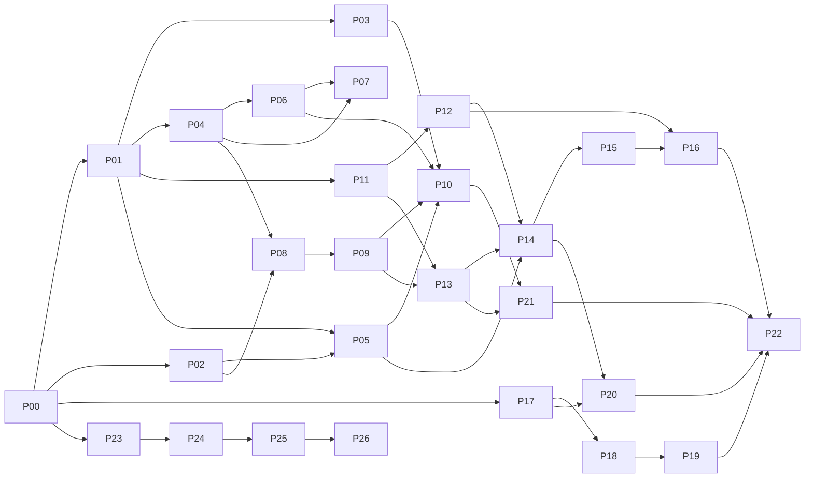

# NeoGold: Build Plan

| Field | Value |
|---|---|
| Document | 14 (added after the 13-document set) |
| Version | 0.1 |
| Date | 11 October 2026 |
| Owner | Sowad Al-Mughni, Kitalon Labs |
| Depends on | Documents 2 to 13 |
| Companion | `15_Claude_Code_Prompts.md` (one prompt per work package), `CLAUDE.md` (repository rules for Claude Code) |
| Status | Awaiting founder review |

Confidence tags: **[Certain]** from the docs or verified, **[Likely]** strong inference, **[Guessing]** an estimate.

---

## 0. Read This First

1. **Claude Code can write all of the software, but the software cannot prove itself.** The estimate needs paired photos and blood tests, the cards need printing and measuring, and the thresholds need a neonatologist's signature. The plan builds every part up to those seams with synthetic and bench stand-ins, so nothing waits on them except the final numbers.
2. **Two specs were missing from the document set.** The physical card layout (size, patch list, positions, markers, window) and the byte format of the card and study QR codes. Work package P02 writes them first and stops for your approval; P05, P08, and P13 depend on them.
3. **The human track is the critical path, not the code** [Likely]. Ethics approval, a clinical lead, and measured cards each take weeks to months. Start them in the first week (Section 5).
4. **Every work package is one reviewable pull request.** Claude Code plans first and waits for approval, writes tests from doc 10 before engine code, runs two reviewer subagents, and your second approver reviews every PR. That is slower per package and much faster overall, because mistakes in triage or crypto are expensive to find later.

---

## 1. Phases and Work Packages

25 work packages (P00 to P24) in 12 phases (0 to 11), mapped to the three milestones in PRD Section 13. Effort is in Claude Code sessions of a few hours each, plus review time [Guessing; adjust after P01 and P03].

| WP | Name | Phase | Depends on | Backlog | Tests | Sessions |
|---|---|---|---|---|---|---|
| P00 | Repository bootstrap | 0 Foundation | none | NG-001, NG-037 | TC-OPS-08 | 1 |
| P01 | Android skeleton and build guardrails | 0 Foundation | P00 | NG-001 | TC-SEC-01, TC-SEC-02 (static), TC-SEC-04 | 2 |
| P02 | Card v1 and QR format specs | 1 Specs and engines | P00 | NG-006, NG-045 | (spec review) | 1 to 2 |
| P03 | Triage engine and signed config | 1 Specs and engines | P01 | NG-019, NG-020, NG-053 | TC-TRI-01 to 26 | 2 to 3 |
| P04 | Color science engine | 1 Specs and engines | P01 | NG-013 | TC-EST-02, TC-EST-03 | 2 |
| P05 | Card trust engine and signing tool | 1 Specs and engines | P01, P02 | NG-039, NG-045 | TC-CARD-01 to 06, TC-RSH-02, 03 | 2 |
| P06 | Estimation engine and model format | 1 Specs and engines | P04 | NG-015, NG-016 | TC-EST-01, 05, 06, 07 | 2 |
| P07 | Training pipeline | 2 Training | P04, P06 (format) | NG-032, NG-033, NG-038 | TC-OPS-07 | 2 to 3 |
| P08 | Vision engine | 3 Camera and vision | P02, P04 | NG-010, NG-011, NG-014 | TC-CAP-02 to 12, 17, TC-CARD-07 | 3 |
| P09 | Camera, device check, qualification | 3 Camera and vision | P08 | NG-004, NG-007, NG-008, NG-009, NG-044 | TC-DEV-01 to 10, TC-CAP-01, 15 | 3 |
| P10 | v0.1 integration and performance | 3 Camera and vision | P03, P05, P06, P09 | NG-025 | TC-PERF-01 to 04, TC-EST-04 | 2 |
| P11 | Local data layer | 4 Data and security | P01 | NG-023, NG-034, NG-035, NG-057 | TC-LOG-04, 05, 07, 11, TC-SEC-07, 08, TC-REL-08 | 3 |
| P12 | Integrity, privacy, app lock, crash handling | 4 Data and security | P11 | NG-049, NG-054, NG-057 | TC-PRIV-01 to 05, TC-SEC-03, 09 | 2 |
| P13 | Design system, onboarding, settings, Bangla | 5 App shell | P09, P11 | NG-002, NG-003, NG-005, NG-027, NG-038, NG-046, NG-055 | TC-ONB-01 to 06, TC-UI-04 to 08, TC-A11Y-01 to 05 | 3 |
| P14 | Research mode | 6 Research | P05, P11, P12, P13 | NG-028 to NG-031, NG-041 | TC-RSH-01 to 16 | 3 |
| P15 | Encrypted export and decrypt tool | 6 Research | P14 | NG-036 | TC-EXP-01 to 04 | 2 |
| P16 | Release pipeline and security gates | 7 Release v0.5 | P12, P15 | NG-055 | TC-OPS-01 to 03, 10, TC-SEC-05, 06, 10, 14 | 2 |
| P17 | Study Intake API core | 8 Backend | P00 | NG-042 | TC-API-01 to 16, 25, 31 | 3 |
| P18 | Intake images, admin CLI, export | 8 Backend | P17 | NG-042 | TC-API-17 to 33 | 3 |
| P19 | Deployment stack and backend CI | 8 Backend | P18 | NG-042 | TC-OPS-04, 05, 11, TC-SEC-11 to 13 | 2 |
| P20 | Research sync client and enrollment | 9 Sync | P14, P17 | NG-042 | TC-SYNC-01 to 20, TC-API-07 | 3 |
| P21 | Screening flow (built, hidden in v1.0) | 10 Screening | P10, P13 | NG-012, NG-017 to NG-024, NG-026, NG-040, NG-043, NG-047, NG-048, NG-051, NG-056 | TC-UI-01 to 03, 09 to 14, TC-LOG-01 to 03, 06, 08 to 10, 12, TC-REL-01 to 07, TC-CAP-13, 14, 16, TC-CARD-08, 09 | 3 to 4 |
| P22 | Device matrix and release candidates | 10 Release v1.0 | all | NG-046 | TC-PERF-05 to 07, TC-USE-01 to 05, TC-OPS-06, 09, remaining E2E | 2 to 3 |
| P23 | Spike and assumption check | 11 Agent quality loop | P00 | none (process) | tooling tests in tools/tests/ | 1 to 2 |
| P24 | Direction check | 11 Agent quality loop | P23 | none (process) | tooling tests in tools/tests/ | 2 to 3 |
| P25 | Guardrails as code | 11 Agent quality loop | P24 | none (process) | tooling and hook tests in tools/tests/ and .claude/hooks/tests/ | 2 |
| P26 | Security scan command and security-debt ledger | 11 Agent quality loop | P25 | none (process) | TC-SEC-10 groundwork (MobSF step), tooling tests in tools/tests/ | 2 |

Total: about 52 to 64 sessions [Guessing].

---

## 2. Dependency Graph

**Parallel tracks.** Four can run at the same time in separate Claude Code sessions, each in its own git worktree:

| Track | Packages | Notes |
|---|---|---|
| Android | P01, P03 to P06, P08 to P16, P20 to P22 | The main line |
| Training | P07 | Starts once P04 and the P06 model format exist |
| Backend | P17 to P19 | Starts right after P00; only needs `docs/api/openapi.yaml` |
| Quality loop | P23, P24, P25, P26 | Spike protocol and assumption check (P23); direction check, `/ng-direction`, and the `drift_inventory.py --check` CI job (P24); guardrails as code, hooks, quality tiers (P25); security scan `/ng-secscan` and security-debt ledger (P26) |

---

## 3. Milestones

| Milestone | Packages | Exit criteria (doc 9 Section 8) |
|---|---|---|
| **M1: v0.1 prototype** | P00 to P10 | Capture to estimate works end to end on 3 phones; golden-vector parity; bad image set 100% rejected; camera qualification measured on all six matrix phones |
| **M2: v0.5 research build** | P11 to P16 | Research mode complete; zero records lost in 50 kill and 10 power-loss tests per phone; encrypted USB export; build on Play closed testing for the partner |
| **M3: v1.0 closed research release** | P17 to P22 | Study server upload working against staging; screening flow built and tested with `triageEnabled` false; all P1 and P2 cases pass on D1 to D4; gates S1 to S9 pass |

v0.5 already supports an export-only study (no server). That lets the partner start the study at M2 if ethics approval arrives before the backend is ready.

---

## 4. Review Gates Where You Decide

Claude Code stops and waits at these points. Your second approver reviews the PR as usual; these need your decision as well.

| Gate | In | Decision |
|---|---|---|
| Card layout and QR formats | P02 | Approve the card spec before anything is printed or coded against it |
| Config schema | P03 | Approve the structure the clinical lead will sign |
| Marker library | P08 | OpenCV (ArUco 4x4), decided by the measured size on both ABIs (ADR-018, 27 October 2026) |
| Model format | P06 | Approve `model.json` before the training pipeline writes it |
| Database schema v1 | P11 | Approve before the first build that real study phones install, because it can only migrate forward from then on |
| Release | P16, P22 | Go or no-go with the second approver |

---

## 5. Human Track (Starts in Week 1)

| Task | Owner | Needed by | Notes |
|---|---|---|---|
| Partner institution and ethics submission | Founder | M2 | No real newborn is photographed before approval (PRD Section 11) |
| Clinical lead named | Founder | P21 sign-off, M3 | First approach: the Sakhipur trial neonatology investigators (PRD Section 16) |
| Six matrix phones bought or borrowed | Founder | P08 | Doc 9 Section 4.2, D1 to D6 |
| Bench rig: lights, ColorChecker, jig, phantoms | Founder | P04, P08 | Doc 9 Section 5 |
| Print partner and measurement lab quotes | Founder | After P02 approval | PRD Section 9a |
| GitHub organization repo, branch protection, `release` environment with both approvers | Founder, second approver | P00 | Doc 12 Section 3 |
| Play Console app entry (organization account), service account for uploads | Founder | P16 | Doc 12 Section 4 |
| Offline signing machine; keys K3, K4, K5 | Founder and a second key holder | P05, P16 | Doc 8 Section 4 |
| Staging droplet (BLR1, dedicated) | Founder | P19 | Doc 12 Section 7.2 |
| Public dataset licence check | Founder | P07 | Only openly licensed data trains the v1 model |
| Nurse wording panel | Founder, partner | P13, P21 | Bangla strings |

---

## 6. How to Run a Work Package in Claude Code

1. Unzip `neogold-starter-kit.zip` into an empty repository and commit it (P00 then finishes the setup).
2. Start Claude Code in the repository root. It reads `CLAUDE.md` automatically.
3. Run the package as a slash command, for example `/ng-p03`. The kit stores each prompt in `.claude/commands/` [Likely the simplest packaging; the same text also works pasted into a session].
4. Claude Code reads the listed sections, proposes a plan, and waits. Read the plan's open questions before approving; most mistakes show up there.
5. When it finishes, it has run the reviewer subagents (`safety-reviewer`, `privacy-security-reviewer` in `.claude/agents/`) and opened a PR. The second approver reviews and merges.
6. For parallel tracks, use one git worktree per track so sessions do not edit the same files.

**If a session goes wrong:** stop it, discard the branch, and rerun the prompt with a one-line note on what to avoid. Packages are sized so that redoing one costs hours, not days.

---

## 7. Open Issues for Review

1. **Effort estimates** are guesses until P01 and P03 are done; recalibrate then.
2. **Card printing** can start only after the P02 spec is approved, and measured batches gate any real capture (PRD G2).
3. **Training data:** if no openly licensed paired dataset exists, P07 builds and tests the pipeline on bench phantoms only, and the first real model comes from the study's own data.
