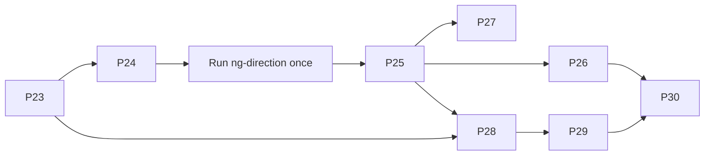

# NeoGold: Agent Quality Loop Prompts

| Field | Value |
|---|---|
| Document | 16 (added after documents 14 and 15) |
| Version | 0.1 |
| Date | 25 October 2026 |
| Owner | Sowad Al-Mughni, Kitalon Labs |
| Depends on | `CLAUDE.md`, `14_Build_Plan.md`, `15_Claude_Code_Prompts.md`, documents 2 to 13 |
| Status | Awaiting founder review |

Confidence tags: **[Certain]** from the docs or verified, **[Likely]** strong inference, **[Guessing]** an estimate.

Eight more work packages, P23 to P30. They don't add product features. They build the tools that check the product: that the build still matches the plan, that the rules enforce themselves, that an attacker and a first-time user can't break it, and that field reports get handled fast. Each prompt follows the same session workflow as P00 to P22: read, plan, **wait for approval**, build with tests, run the reviewer subagents, then open a PR for your second approver.

---

## 0. Read This First

1. **Two of the seven tips conflict with NeoGold's own rules, so these prompts adapt them instead of copying them.**
   - Sentry is a third-party crash SDK. Doc 8 Section 6.6 and FR-34 rule it out. P30 uses Play vitals, the crash reports health workers choose to share, and GitHub issues instead.
   - "Fix it straight away" would skip your second approver, and for clinical reports it would also skip the clinical lead. P30 makes the fix ready the same day; a human still merges it.
2. **You can't measure "error-free sessions" in the field.** NeoGold has no analytics by design (FR-34). P29 measures the rate in the lab, per journey and per phone, and makes it a release gate. A field number would mean counting inside the app, which is a change to the study protocol and consent, not a code change.
3. **An agent that checks other agents gives confident false passes.** So every package here runs a script first and uses agents second. Every agent verdict needs a file and line or a script result as evidence. "Unknown" is a valid answer; "Implemented" without evidence is not.
4. **Some of these are expensive** [Guessing on the amounts]. `/ng-direction` (about ten subagents), `/ng-break`, and DeepSec use the most tokens. Run them on the schedule in Section 3, not on every PR. The cheap script parts run in CI on every PR.
5. **Claude Code features change fast.** The prompts use skills, subagent frontmatter (`tools`, `hooks`, `isolation`, `omitClaudeMd`), and hook decisions (exit code 2, `permissionDecision`). All of these are in the current docs as of 25 October 2026 [Certain], but an older installed version may lack some. Every prompt tells Claude Code to check the docs for the installed version (`claude --version`) before writing those files.
6. **None of this makes NeoGold clinically valid.** That still takes the partner study, the clinical lead, and the nurse panel. These tools make sure the software doesn't hide problems from them.

---

## 1. What Each Tip Becomes

| Tip from the video | Package | What it creates | What changed for NeoGold |
|---|---|---|---|
| 1. Test an idea before you commit to it | P23 | `/ng-spike`, `/ng-assumptions`, `docs/spikes/` | The prototype stage is behind you. What matters now is the `[Likely]` and `[Guessing]` claims the code was built on, so each one gets tested in a throwaway worktree |
| 2. Check direction, not output | P24 | `/ng-direction`, `doc-auditor` subagent, `tools/drift_inventory.py`, a CI check | A script inventory comes first (dependencies, permissions, endpoints, tables, screens, strings), then agents, and every verdict needs evidence. You decide each drift item |
| 3a. Security scans after every feature | P26 | `/ng-secscan`, `security/exceptions.yaml`, a security-debt ledger, CI | Doc 8 Section 10 already lists the scanners; this package connects and runs them. DeepSec is a trial, not a dependency (it supports Python; Kotlin support is unconfirmed) |
| 3b. Quality gates and slop debt | P25 | `quality/tiers.yaml`, `tools/quality_gate.py` | Tier 0 is the clinical code, where slop isn't allowed. Tier 3 is tooling, where it is |
| 4. Must-not-trade-off rules with tests | P25 | A "Must not trade off" table in CLAUDE.md, Claude Code hooks, and new checks | Hooks block the edit itself, so the rule works even if the agent forgets it |
| 5. An agent that tries to break the app | P27 | `breaker` subagent, `/ng-break`, a disposable environment | Wrong-but-confident results and lost research data come first; traffic comes second. Load is sized to a study, not to Vercel's traffic |
| 6a. An agent that is a first-time user | P28 | `fresh-eyes` subagent, `tools/ux/drive.sh`, `/ng-fresh-eyes` | It drives an Android phone over `adb`, not a browser. The personas are Rokeya and Shirin from the PRD. It is not a substitute for the nurse panel |
| 6b. Track error-free sessions | P29 | `/ng-journeys`, `tools/journeys/run.py`, `tools/check_journeys.py` | A lab number only, because of FR-34 |
| 7. How fast you act on feedback | P30 | `/ng-feedback`, `play_vitals.py`, `report_times.py` | No Sentry. Clinical and privacy reports always go to a human first |

---

## 2. Order



1. **P23 and P24 first.** Then run `/ng-direction` before anything else. It answers the question that finishing 23 prompts doesn't: is what got built what the docs asked for, and did each milestone actually meet doc 9 Section 8?
2. **P25 before the agent-heavy packages.** Its hooks protect clinical values and tests from every agent that comes after it, including the breaker.
3. **P26, P27, and P28** can run in any order once P25 is merged. P28 also needs P23 for its camera spike. P29 comes after P28, because it reuses the same device and camera setup.
4. **P30** once study phones are in the field, or before that with synthetic reports.

Each package adds its own row to `docs/14_Build_Plan.md` (Phase 11, Agent quality loop) and its command to the CLAUDE.md Commands table, so the build plan stays complete.

---

## 3. Cadence After They Exist

| Command or check | When | Cost [Guessing] | Blocks |
|---|---|---|---|
| `drift_inventory.py --check` (CI) | Every PR | Script only | The PR, on any undeclared dependency, permission, endpoint, table, screen, or config key |
| `quality_gate.py` (CI) | Every PR | Script only | The PR, if the touched tier's checks are missing |
| `/ng-secscan --changed` (CI) | Every PR | Low | The PR, on a new high or critical finding |
| `/ng-secscan --full` | Nightly and every release candidate | Medium | The release candidate |
| `/ng-direction` | After every 3 merged packages and before every release candidate | High | The release candidate, if the verdict is Off course |
| `/ng-break` | Before each release candidate, and after any Tier 0 or Tier 1 change | High | The release candidate, on any open S1 or S2 |
| `/ng-journeys` | Every release candidate, on D1 to D4 | Mostly device time | The release candidate, through `check_journeys.py` |
| `/ng-fresh-eyes` | After a batch of UI changes and before each nurse panel session | Medium | Nothing |
| `/ng-feedback` | Daily during the study | Low | Nothing |
| `/ng-assumptions` | Monthly and before each release candidate | Medium | Nothing |
| `/ng-spike` | Whenever a decision rests on a claim nobody has tested | Low to medium | Nothing |

---

## 4. First Spikes Worth Running

Later packages depend on these claims, so test them with `/ng-spike` as soon as P23 is merged:

1. Hook input carries `agent_type` inside subagents, and hooks in a subagent's frontmatter apply only while that subagent runs (P24, P27, P28). The current docs say both [Certain]; the spike checks your installed version.
2. A fresh-eyes session started from a sandbox folder outside the repository sees no CLAUDE.md, no git status, and no file names in its first context (P28) [Likely].
3. The emulator's virtual scene camera can show a bench image that the vision engine accepts (P28, P29) [Guessing].
4. DeepSec finds at least one real issue in `backend/` that Bandit and Ruff miss (P26) [Guessing].
5. Maestro's output gives per-step timing good enough for step budgets (P29) [Guessing].

---

## 5. Prompts

### P23. Spike and Assumption Check

````markdown
# P23: Spike and assumption check

Phase 11, Agent quality loop. Depends on: P00. Backlog: none (process). Tests: tooling tests in tools/tests/ (no TC IDs; this package adds process, not product requirements).

## Read first
- CLAUDE.md
- docs/16_Agent_Quality_Prompts.md Sections 0, 1, and 4
- Every `[Likely]` and `[Guessing]` tag in docs/2 to docs/15 (grep for them; don't read every doc end to end)
- The Claude Code docs on skills and subagents for the installed version (`claude --version`). Don't write frontmatter from memory.

## Goal
Two commands:
- `/ng-spike "<claim>"` tests one claim from scratch in a throwaway worktree and records the evidence, so no decision rests on "the docs say so" or "a video said so".
- `/ng-assumptions` lists the unverified claims the code now depends on, ranked by what breaks if they turn out to be wrong.

## Build
1. `.claude/skills/ng-spike/SKILL.md` (`disable-model-invocation: true`; the argument is the claim in quotes). The skill must follow these steps:
   a. Restate the claim as a yes-or-no question with a measurable pass condition. Name where the claim came from: doc and line, vendor page, video, or model output. If there is no measurable condition, stop and ask me.
   b. Create a throwaway worktree `../neogold-spike-<slug>` from `main`, or use a subagent with `isolation: worktree`. Spike code lives only there.
   c. Build the smallest thing that answers the question. Run it on the target where it matters: both ABIs, API 26 and API 36 emulators, or a matrix phone if I connect one.
   d. Write `docs/spikes/YYYY-MM-DD-<slug>.md` from the template with these fields:
      - claim and source
      - question
      - method and exact commands
      - raw results
      - verdict: Confirmed, Refuted, or Inconclusive
      - what the verdict changes
      - the doc lines that carry the claim
   e. Delete the worktree. Commit only the record, on a branch `spike/<slug>`. The PR also updates the tag in the doc: either `[Certain]` with a link to the record, or a correction.
2. `.claude/skills/ng-assumptions/SKILL.md` (`disable-model-invocation: true`):
   - Grep the tags.
   - For each one, decide three things:
     - Does code depend on it? Cite the file and line.
     - Does a test already prove it? Cite the test.
     - What is the impact if it is wrong: clinical, privacy, security, cost, or schedule?
   - Write `reports/assumptions/YYYY-MM-DD.md`: a table sorted by impact, with the top 10 unproven claims as ready-to-run `/ng-spike` lines.
3. `docs/spikes/TEMPLATE.md` and `docs/spikes/README.md`. The README says what a spike is and states the rule that spike code never merges.
4. Register the package:
   - Add a P23 row to docs/14 Sections 1 and 2, with a new Phase 11 "Agent quality loop".
   - Add docs/16_Agent_Quality_Prompts.md to the CLAUDE.md "Source of truth" table.
   - Add both skills to the CLAUDE.md Commands table.

## Constraints
- A spike never changes `android/`, `backend/`, `training/`, or `config/` on a branch that can merge.
- A spike that needs a new tool or library asks me first, like any dependency.
- A verdict needs evidence someone else can rerun. "Seems to work" is Inconclusive.
- Never use real newborn data in a spike.

## Done when
- `/ng-assumptions` has run once and its report is committed.
- One spike has run end to end on a claim from that report (I pick it in the plan), and its PR updates the doc tag.
- The first spikes in docs/16 Section 4 are listed in the report, even if they haven't run yet.

## Stop and ask me
- Before running the first spike, with the top 10 list.
````

---

### P24. Direction Check

````markdown
# P24: Direction check (is the build still heading where the docs say?)

Phase 11, Agent quality loop. Depends on: P23. Backlog: none (process). Tests: tooling tests in tools/tests/ (no TC IDs).

## Read first
- CLAUDE.md
- docs/14_Build_Plan.md Sections 1 to 4
- docs/2_PRD.md Sections 3, 7, 8, 13, and 16
- docs/3_Feature_Backlog.md (all of it, including WON'T HAVE)
- docs/9_Test_Plan_Strategy.md Sections 8 and 10, and tools/trace.py
- The Claude Code docs on subagents, skills, and hooks for the installed version

## Goal
`/ng-direction` answers one question with evidence: does what we built match the plan in docs/, and what got built that no doc asked for? It reports and never decides. For each drift item I choose one of two things: keep it and update the doc, or remove it from the code.

## Build
1. `tools/drift_inventory.py` (deterministic, no model calls). It writes JSON comparing each of these against the docs:
   - Gradle modules and inter-module dependencies, against doc 4 Section 4.2.
   - External libraries per module, against the ADR table (doc 4 Section 15) and the approved list from P01.
   - Manifest permissions, components, and exported flags. Reuse tools/check_manifest.py.
   - The Room exported schema JSON, against doc 5 Section 2.2 tables and columns.
   - The Alembic head schema, against doc 5 Section 3.2. Get it from SQLAlchemy metadata, or from `pg_dump --schema-only` against a throwaway PostgreSQL 16.
   - FastAPI's generated OpenAPI, against docs/api/openapi.yaml: paths, methods, request and response schemas, and error codes.
   - Navigation destinations, against doc 6 Section 5 (S01 to S25, R01 to R09).
   - String keys in values/ and values-bn/, against doc 6 Section 10.4.
   - Config keys (`triageEnabled`, `validUntil`, and the rest), against doc 4 Section 6.1.
   - TC IDs cited in test code, against doc 10. Extend trace.py to count tests per TC and list TCs with zero tests.
   - NG IDs referenced by merged PRs and commits, against doc 3. List the v1.0 Must items that have no reference.

   A `--check` mode compares the result with `reports/direction/baseline.json` and exits non-zero on any new unplanned item: a dependency, permission, endpoint, table, column, screen, or config key.
2. `.claude/agents/doc-auditor.md`: read-only.
   - Tools: Read, Grep, Glob, and Bash. A frontmatter hook limits Bash to `git log`, `git show`, `git diff`, and `python3 tools/` commands.
   - Given one doc and the inventory, it extracts every checkable claim: FR, NFR, NG item, screen, endpoint, table, rule, and gate.
   - It gives each claim one status:
     - Implemented
     - Partial
     - Missing
     - Contradicted
     - Deferred: the doc itself defers it (v1.x public release, Could, WON'T HAVE)
     - Unknown
   - Implemented needs a file and line, or an inventory key, as evidence. With no evidence, the status is Unknown, never Implemented.
   - Output is JSON matching `reports/direction/auditor.schema.json`.
3. `.claude/skills/ng-direction/SKILL.md` (`disable-model-invocation: true`; optional `--since <git ref>`, which defaults to the commit of the last report):
   a. Run drift_inventory.py and trace.py.
   b. Start one doc-auditor per plan doc, in parallel: 2, 3, 4, 5, 6, 7 (with openapi.yaml), 8, 9 (with 10), 12, and 14. Docs 1, 11, and 13 are context only.
   c. In the main session, look for unplanned work:
      - inventory items that no doc anchors
      - commits since the ref with no P, NG, TC, or BUG reference
      - anything matching the WON'T HAVE list
      - any network path reachable from screening
      - any way a release build reaches `triageEnabled: true` (PRD D10)
   d. Write `reports/direction/YYYY-MM-DD/report.md` and `scorecard.json`, containing:
      - counts by status, per doc
      - per milestone (M1, M2, M3), what is done against the doc 9 Section 8 exit criteria
      - the trend against the last report
      - a verdict, using these rules, which must be written in the skill:
        - **Off course:** any Contradicted item in triage, clinical wording, consent, quality gate, privacy, or crypto.
        - **Drifting:** any other Contradicted item, or more than 5 unplanned items.
        - **On course:** otherwise.
   e. Write an action list. For each item, spell out both options: "Keep: change doc X Section Y to say ..." and "Remove: revert these files ...". Add the owner (me; the clinical lead for anything clinical) and the effort. Mark nothing as decided.
4. CI: add a `drift_inventory.py --check` job to the PR workflow. Pin actions by SHA and give the job no secrets.
5. Register the package: a P24 row in docs/14, and the skill in the CLAUDE.md Commands table.

## Constraints
- The command is read-only on `android/`, `backend/`, `docs/`, and `config/`. It writes only under `reports/direction/`.
- This command never "fixes" clinical values. It reports drift in them to me and the clinical lead.
- The baseline changes only in a PR that also updates the doc explaining the change.

## Done when
- The first full run on `main` is committed, with the verdict and the M1 to M3 table.
- `--check` fails on a test PR that adds an undeclared dependency, and passes once the ADR row is added.
- drift_inventory.py has tests in tools/tests/.

## Stop and ask me
- After the first run and before writing the baseline. I review the report and decide each drift item.
````

---

### P25. Guardrails as Code

````markdown
# P25: Guardrails as code (must-not-trade-off rules that enforce themselves)

Phase 11, Agent quality loop. Depends on: P24. Backlog: none (process). Tests: tooling and hook tests in tools/tests/ and .claude/hooks/tests/ (no TC IDs).

## Read first
- CLAUDE.md "Non-negotiable rules" (every line)
- docs/8_Security_Compliance_Plan.md Sections 3, 6.1, and 10
- docs/9_Test_Plan_Strategy.md Sections 2, 7, 9.1, and 10
- docs/6_UI_UX_Guidelines.md Sections 10.2 and 10.3
- docs/12_Deployment_Runbook.md Section 3 and Appendix B
- The Claude Code hooks reference for the installed version: input fields, exit code 2, `permissionDecision` (allow, deny, ask), matcher syntax, and the project directory variable. Don't write hooks from memory.

## Goal
Every rule in CLAUDE.md is either enforced by a check that fails, or listed as human-only with the name of who checks it. Rules that live only in prose get forgotten in long sessions; checks don't.

## Build
1. Replace "Non-negotiable rules" in CLAUDE.md with a "Must not trade off" table. Columns:
   - Rule
   - Why (doc reference)
   - Enforced by: hook, test, CI check, release gate, or a named human
   - Runs at: edit time, PR, nightly, or release

   Keep every existing rule, and add none without asking. Below the table, add a short "We do trade off" list for me to approve in the plan. For example: polish on screens outside the result path, code style in tools/, speed of non-core features, Could items.
2. Fill the gaps: every rule without a mechanical check gets one. Expect at least these:
   - **StrictMath only in engines:** detekt ForbiddenImport or ForbiddenMethodCall config for `kotlin.math` powers, roots, and exponentials, and for `java.lang.Math`, in `:engine:*`.
   - **No skipped tests:** a check that fails on `@Ignore`, `@Disabled`, `assumeTrue(false)`, `pytest.mark.skip`, `xfail`, or `pytest.skip(` in Tier 0 and Tier 1 test paths. It also fails on any drop in the per-TC test count against `quality/tc-baseline.json`.
   - **No new dependency without an ADR:** `tools/check_dependencies.py`, checked against `quality/dependency-allowlist.txt`. It covers the resolved Gradle runtime classpath per module, the pip lockfile, and npm if any. It also re-checks the P01 rule that only `:sync:research` has an HTTP client.
   - **Request models forbid unknown fields:** a pytest that walks every Pydantic request model and asserts `extra="forbid"`.
   - **Banned words:** a string lint over values/ and values-bn/. Reuse P13's if it exists, and prove it fails on one banned word in each language.
   - **Actions pinned by SHA:** a check over .github/workflows. Use zizmor if I approve it, or a short script if not.
   - **Forward-only migrations:**
     - Committed Room schema files never change once released.
     - Alembic migrations containing `op.drop_`, or a `nullable=False` change on an existing column, fail unless the PR has the `contract-migration` label.
   - **Download size under 25 MB:** a bundletool size check on the release build.
3. Claude Code hooks in `.claude/settings.json` (merge with any existing file), with scripts in `.claude/hooks/` and tests for each:
   - `protect_clinical.py` (PreToolUse on Edit, Write, and NotebookEdit):
     - Denies edits to config/triage-config.json, CLINICAL_SIGNOFF.md, the trust list, released model files, and the clinical strings. Find the real paths and list them in the plan.
     - The denial message is: "Clinical values change only with the clinical lead's signed record (PRD 9b)."
   - `protect_tests.py`:
     - Denies an edit that adds a skip marker to a Tier 0 or Tier 1 test file.
     - Returns `ask` for a skip marker in Tier 2 or Tier 3. Doc 9 Section 7 allows quarantining a flaky test there with a linked defect, so I decide.
     - Denies a Bash `rm`, `git rm`, or `mv` of a test file in Tier 0 or Tier 1.
   - `protect_guardrails.py`: returns `ask`, not `deny`, so I confirm each edit to any of these:
     - `.claude/settings.json`
     - `.claude/hooks/` and `.claude/agents/`
     - `quality/`
     - `tools/check_*`
     - `.github/workflows/`
   - `bash_guard.py`: denies:
     - `--no-verify`
     - `git push --force`
     - commits on `main`
     - `-x test` or `-x check` in Gradle calls
     - any command that reads a keystore or a `.env` file

   Every hook must run in under 200 ms, deny the action if its input doesn't parse, and work on macOS and Linux.
4. Quality tiers (the slop budget). `quality/tiers.yaml` maps paths to tiers:
   - **Tier 0, clinical:** `:engine:triage`, `:engine:estimation`, `:engine:colorscience`, `:engine:cardtrust`, the quality gate in `:engine:vision`, config/, the clinical UI strings, and the result screen.
   - **Tier 1, data and trust:** `:core:security`, `:core:data`, `:sync:research`, export, backend auth, idempotency and admin code, and backend/deploy.
   - **Tier 2, app:** the other `:feature:*` and `:core:*` modules, and the rest of the backend.
   - **Tier 3, tooling:** tools/, training notebooks, test harnesses, and scripts.

   `tools/quality_gate.py --base origin/main` finds the strictest tier a PR touches and requires that tier's checks:

   | Tier | Required checks |
   |---|---|
   | 0 | Unit tests; golden vectors; differential triage when relevant; a branch coverage floor (Kover; propose the number from today's value, never lower); a mutation check (PIT on the engines if I approve it, otherwise the P03 manual mutation step documented in the PR); a safety-reviewer section in the PR body |
   | 1 | The privacy-security-reviewer section in the PR body and a clean P26 security scan |
   | 2 | Lint, tests, and screenshot tests for UI |
   | 3 | Lint and tests |
5. `tools/check_guardrails.py`: checks that every row in the CLAUDE.md table points to a file, task, or test that exists. CI fails if a row's enforcement disappears.
6. `.github/CODEOWNERS`: Tier 0 paths, `.claude/`, `quality/`, and the workflows require the second approver.
7. Register the package in docs/14 and the CLAUDE.md Commands table.

## Constraints
- Hooks only guard Claude Code sessions. The clinical lead's changes still go through a normal PR with the signed record. Don't build a bypass that a session could trigger itself.
- No rule gets weaker. If today's code fails a new check, list the failures in the plan; don't loosen the check to make it pass.

## Done when
- A demo PR (closed, not merged) shows each new check failing on a deliberate violation and passing once it is reverted.
- The hook tests pass. In a live session, trying to edit config/triage-config.json is denied with the message above.
- `tools/check_guardrails.py` passes in CI.

## Stop and ask me
- In the plan: the "We do trade off" list, the tier map, the coverage floors, and any tool to add (Kover, PIT, zizmor).
````

---

### P26. Security Scan and Security-Debt Ledger

````markdown
# P26: Security scan command and security-debt ledger

Phase 11, Agent quality loop. Depends on: P25. Backlog: none (process). Tests: TC-SEC-10 groundwork (MobSF step), tooling tests in tools/tests/.

## Read first
- docs/8_Security_Compliance_Plan.md Sections 9 (T1 to T17), 10, and 12
- docs/9_Test_Plan_Strategy.md Section 7
- docs/12_Deployment_Runbook.md Section 3 and Appendix A
- docs/7_API_Documentation.md Sections 4.3 and 12
- .claude/agents/privacy-security-reviewer.md
- The DeepSec getting-started docs (vercel-labs/deepsec), and the docs for the pinned version of every scanner you propose

## Goal
One command, `/ng-secscan`, that does three things:
- runs every scanner doc 8 Section 10 promises
- adds an agent review of what scanners can't see
- keeps a ledger of accepted risks, so security debt is visible instead of silent

## Build
1. `tools/secscan/run.sh [--changed | --full]`. Pin every tool version in `tools/secscan/versions.txt`. Output SARIF or JSON into `reports/security/YYYY-MM-DD/`. It covers:
   - **Secrets:** gitleaks over the working tree, plus the full history with `--full`.
   - **Dependencies:** OSV-Scanner on the Gradle lockfiles (or the dependency verification metadata) and the pip lockfile, and Trivy on the API and Caddy images.
   - **Static analysis:**
     - Android Lint security checks and detekt (already in CI; collect their results)
     - Ruff and Bandit on backend/ and training/
     - Semgrep for Kotlin, Python, and Dockerfiles, if I approve it
   - **Workflows:** zizmor, or the P25 check, on .github/workflows.
   - **App:** a MobSF static scan of the release APK with `--full`. It runs in a local container and uploads nothing.
   - **API:** Schemathesis against a local compose stack with `--full`. Never staging from this command.
2. Agent pass: run the privacy-security-reviewer subagent on the diff since the last scan, with T1 to T17 as its checklist. It marks each threat Covered, Weakened, or Not checked.
3. DeepSec, as a trial and not a dependency:
   a. Run it on `backend/` and the `:sync:research` module, with `--max-cost-usd` set to a figure I give in the plan. Run `process --limit 50` first.
   b. Record the trial with `/ng-spike` (P23):
      - the findings it raised
      - how many held up once you checked the code path
      - whether step 1 had missed any of them
   c. Add it to `--full` only if it found at least one real issue the other tools missed.
   d. Kotlin support is unconfirmed [Guessing], so report Kotlin findings separately.
4. `security/exceptions.yaml` records every accepted finding: ID, tool, rule, file, reason, approver, and an expiry date no more than 90 days out.
   - The scan fails on any high or critical finding that isn't in the file.
   - It also fails on any expired exception.
   - Inline suppressions in code are allowed only when they cite an exception ID.
5. `reports/security/ledger.md`, regenerated on every run: open findings by severity and age, with fix deadlines from doc 8 Section 10 (critical 7 days, high 30, medium 90).
6. `.claude/skills/ng-secscan/SKILL.md` (`disable-model-invocation: true`):
   - Runs `--changed` by default and `--full` on request.
   - Lists new findings first.
   - Never edits code. Fixes come afterwards, in a normal PR.
7. CI: `security-scan.yml`.
   - Runs `--changed` on every PR and `--full` nightly on `main`.
   - Scanner jobs get no secrets.
   - Results go up as workflow artifacts, never as public comments.
8. Register the package in docs/14 and the CLAUDE.md Commands table.

## Constraints
- No scanner gets the signing keys, the Play service account, or droplet access. This command never scans staging or production.
- Reports redact matched secret values. Never commit a report that contains a secret.

## Done when
- `--full` runs clean, or every finding is fixed or listed in exceptions.yaml with my approval.
- The DeepSec trial record is merged with a recommendation.
- On a test branch, a planted fake secret fails CI, and so does a planted vulnerable dependency.

## Stop and ask me
- Before adding any scanner, with its version and licence.
- On any critical finding: stop and report at once, because doc 8 Section 12 may apply.
````

---

### P27. Breaker Agent

````markdown
# P27: Breaker agent (attack our own app, on copies of the data)

Phase 11, Agent quality loop. Depends on: P25. Backlog: none (process). Tests: regression tests it produces cite the TC, T, or H ID they protect; tooling tests in tools/tests/.

## Read first
- docs/8_Security_Compliance_Plan.md Sections 9 and 14 (T1 to T17, H1 to H11)
- docs/7_API_Documentation.md Sections 4.3, 4.4, 5, 7, and 8
- docs/9_Test_Plan_Strategy.md Sections 3 (the reliability and chaos row), 9.1, and 11
- docs/10_Test_Cases.md Sections 6, 12, 13, and 16
- docs/4_System_Architecture.md Sections 4.4, 6.2, and 9
- The Claude Code subagent docs for the installed version (`tools`, `hooks`, `isolation`)

## Goal
An agent whose job is to make NeoGold fail in any of these ways:
- give a wrong but confident answer
- lose or duplicate research data
- leak something personal
- accept a forged request
- fall over under realistic study load

It works only on disposable copies with synthetic data. Every break it finds becomes a failing regression test before anyone fixes it.

## Build
1. A disposable environment in `breaker/env/`:
   - `up.sh` starts the backend stack under the compose project `neogold-breaker`, with its own volumes.
   - `seed.py` creates synthetic data: a study, test sites (`is_test`), devices with freshly generated keys, participants, and sessions.
   - `down.sh` removes the volumes.
   - Android: an AVD named `neogold-breaker`, started with `-wipe-data`, running the debug build with the synthetic config. Enter synthetic research data through the debug seeding path if one exists; otherwise use Maestro flows.
   - `guard.sh`, called first by every attack. It refuses to run if any of these is true:
     - the API URL isn't the breaker stack (localhost, 10.0.2.2, or the compose service name)
     - the device serial isn't the breaker AVD or a phone listed in `breaker/env/devices.txt`
     - a WireGuard interface to the droplet is up
2. `.claude/agents/breaker.md`:
   - Tools: Read, Grep, Glob, Bash, and Write, with `isolation: worktree`.
   - Frontmatter hooks deny:
     - network targets other than the breaker stack
     - `ssh`, `scp`, `wg`, `neogold-deploy`, `neogold-admin`, `restic`, `git push`, `gh release`, and Play uploads
     - any Write or Edit outside `breaker/findings/` and the breaker test folders
   - It reads code freely, because it is a white-box attacker. It can't fix anything.
3. `breaker/catalog.md`. Each entry has an ID (BRK-nnn), a target, a method, the safe behavior the docs require, and how the test decides pass or fail. Seed it with the entries below, then extend it from T1 to T17 and H1 to H11.
   - **Clinical:**
     - inputs in tenths around every threshold and zone boundary
     - edges of gestational age and age in hours
     - a config whose `validUntil` has just passed
     - `triageEnabled` flipped
     - a `DRAFT` config, and a bad signature
     - a card batch that expires mid-session, and a swapped trust list
     - corrupt or truncated images
     - a card QR with a valid signature but altered reference values
     - the same photo submitted twice
   - **Data loss:**
     - killing the process at each step of a research save, scripted, 50 times
     - storage filling up during a save
     - the clock moved back and forward, and the time zone changed
     - an app update with items still in the outbox
     - a Keystore reset, and WorkManager being killed
     - the network flapping during upload (toxiproxy)
   - **API:**
     - the same idempotency key in parallel requests
     - a replayed `jti`
     - `iat` and `exp` exactly at the skew and expiry limits
     - a body hash mismatch
     - uploads that break manifest-first order
     - a participant withdrawn during an upload
     - `data_generation` changing mid-batch
     - unknown fields, and oversized or slow headers
     - 50 simulated devices, each uploading a full study day at once (P20's day: 5 participants, 20 sessions, 120 images)
   - **Privacy:**
     - personal values in logs, crash files, notifications, the recent-apps screenshot, exports, and server logs
     - screening images anywhere on disk after a session
   - **UI robustness:**
     - Maestro and `adb shell monkey` with fixed seeds
     - rotation and the back button during capture and save
     - font scale 2.0, and Bangla
4. Findings go in `breaker/findings/BRK-YYYYMMDD-nn.md`. Each one has:
   - steps to reproduce, and evidence
   - severity from doc 9 Section 9.1, and the `Clinical` flag
   - the hazard or threat ID
   - a failing regression test, committed on the breaker branch
5. `.claude/skills/ng-break/SKILL.md` (`disable-model-invocation: true`; arguments `[area] [--rounds N]`, default 1 round, at most 3):
   - Starts the environment, runs the breaker subagent on the commit I name (default `main`), tears everything down, and prints the findings by severity.
   - `--recheck` reruns the regression tests and the attacks that found something.
6. The fix loop, written into the skill:
   - The main session fixes each finding in a normal PR that includes the regression test. The breaker never edits app code.
   - A Tier 0 or `Clinical: Yes` finding stops the loop until I have seen it.
7. Register the package in docs/14 and the CLAUDE.md Commands table.

## Constraints
- Never staging or production. A load test on staging is a separate step that I run by hand.
- Synthetic data only.
- A fix may not weaken validation to make a regression test pass. The safety-reviewer checks this on Tier 0 fixes.
- New tools (toxiproxy, a load tool, a fuzzer such as Jazzer or Hypothesis) need my approval in the plan.

## Done when
- One full round across all areas has run and the findings are filed.
- Every S1 and S2 finding has a failing regression test.
- The environment tears down to nothing: `docker volume ls` shows no breaker volumes.
- In a test, the guard refuses a staging URL.

## Stop and ask me
- On any `Clinical: Yes` or S1 finding: stop the round and report.
````

---

### P28. Fresh-Eyes Agent

````markdown
# P28: Fresh-eyes agent (a first-time user who can't see the code)

Phase 11, Agent quality loop. Depends on: P23 (camera spike), P25. Backlog: none (process). Tests: tooling and hook tests; feeds TC-USE-01 to TC-USE-03 preparation but does not replace them.

## Read first
- docs/2_PRD.md Section 5 (personas) and Section 6 (J1 to J4)
- docs/6_UI_UX_Guidelines.md Sections 1, 8, 9, 10, 11, and 12
- docs/9_Test_Plan_Strategy.md Section 13, and docs/10_Test_Cases.md Section 18
- The Claude Code docs for the installed version: subagent `tools`, `hooks`, and `omitClaudeMd`, plus starting a session as an agent (`--agent`) in headless mode (`-p`)

## Goal
An agent that uses NeoGold the way Rokeya or Shirin would on day one. It sees only the screen and can only tap, type, and swipe. It reports where a new health worker would get stuck, misread something, or give up. It can't read the code or the docs, because then it would already know how the app works.

## Build
1. `tools/ux/drive.sh` is the agent's only way to use the phone. It works over `adb` and offers these commands:

   | Command | What it does |
   |---|---|
   | `shot <name>` | Saves a screenshot into the run folder and prints its path |
   | `see` | Lists visible text, content descriptions, bounds, and clickable flags from a UI dump, with resource IDs, class names, and package names removed |
   | `tap <x> <y>`, `tap-text "<label>"` | Taps a point or a visible label |
   | `type "<text>"` | Types digits and Latin letters (enough for codes and numbers; NeoGold has no free-text fields) |
   | `swipe up/down/left/right` | Swipes |
   | `back`, `home`, `wait <seconds>`, `launch` | Basic navigation |

   - Validate arguments strictly, and never pass input through shell evaluation.
   - Append every action to `actions.jsonl` with a timestamp.
2. Camera: find a way to put a bench image in front of the camera without touching release code. Check the options with `/ng-spike`:
   - the emulator's virtual scene camera showing a custom image [Guessing; verify]
   - a matrix phone on the bench rig, aimed at a phantom and a test card

   A debug-only image source is acceptable only in the `debug` source set, and the P25 checks must prove it is absent from release. If neither option works, stop and ask me.
3. `.claude/agents/fresh-eyes.md`:
   - Tools: Bash and Read only, with `omitClaudeMd: true`.
   - Frontmatter PreToolUse hooks allow only two things and deny everything else:
     - Bash, when the command is `tools/ux/drive.sh` with no shell operators
     - Read, for PNG files inside the current run's `shots/` folder
   - Its system prompt covers who it is (from the persona file), that it has never seen this app, that it thinks aloud briefly before each action, and what to report.
4. Personas in `tools/ux/personas/`:
   - `rokeya-nurse.md`, run in English and in Bangla
   - `shirin-chw.md`, run in Bangla

   Write them from PRD Section 5, describing what each person knows and how she works. Say nothing about the app's design.
5. Tasks in `tools/ux/tasks/`, written the way a supervisor would say them, with no screen names:
   - "Set up the phone for your ward."
   - "Check baby in bed 4; the mother agrees."
   - "The photo keeps failing; get a result or find out why."
   - "Join the study with the code your coordinator sent."
   - "Send today's study data."
   - "Lock the app before you hand the phone to someone."
6. `tools/ux/run-fresh-eyes.sh <persona> <task> [--device <serial>]`:
   - Installs the right build:
     - screening tasks: the debug build with the synthetic config and `triageEnabled: true`
     - research tasks: the study build
   - Resets app data and creates `reports/ux/<run-id>/`.
   - Builds a sandbox folder outside the repository. It holds only `drive.sh`, the agent file and its hook scripts, the persona, the task, and `shots/`.
   - Starts a separate headless session as the fresh-eyes agent from that sandbox, given only the persona and task text. Working outside the repository means no CLAUDE.md, git status, or file names reach it, and no parent session can leak hints.
   - Copies the report and screenshots back to `reports/ux/<run-id>/`, then deletes the sandbox.
   - Verify the flags for the installed version. If a separate session can't be started, run it as a subagent and pass the two files word for word and nothing else.
7. The report, `reports/ux/<run-id>/report.md`:
   - The outcome: done, done with trouble, or gave up.
   - Taps and time per task, from actions.jsonl.
   - Each friction point with its screenshot, what it expected, what happened, and a severity: Blocker, Misread risk, Confusing, Slow, or Wording.
   - Any moment where it misunderstood a result or the next step counts as a Misread risk and links to H11.
8. `.claude/skills/ng-fresh-eyes/SKILL.md` (`disable-model-invocation: true`):
   - Runs a persona and task set.
   - Then, in the main session with code access, maps each friction point to a screen ID (S01 to S25, R01 to R09) and a doc 6 section, and drafts fixes as proposals only.
   - Wording changes go through doc 6, the banned-word check, and the nurse panel. Clinical wording also goes through the clinical lead.
9. Register the package in docs/14 and the CLAUDE.md Commands table.

## Constraints
- The fresh-eyes agent never sees source code, docs, CLAUDE.md, resource IDs, or test names. Prove it in the PR with a test run where each of these attempts is denied: `cat`, `ls`, a Read on a source file, and `drive.sh see; cat x`.
- Synthetic and bench images only.
- This doesn't replace TC-USE-01 to TC-USE-05. It finds dead ends and confusing words before the nurse panel. It can't tell you about ward light, a crying baby, or whether a nurse trusts the result.

## Done when
- Both personas have run every task once on the emulator.
- Rokeya has run the screening task on one matrix phone.
- The reports are committed, with friction points mapped to screens.

## Stop and ask me
- After the first two runs, before mapping fixes. I read the raw reports.
````

---

### P29. Journey Runner and Error-Free Rate

````markdown
# P29: Journey runner and error-free session rate

Phase 11, Agent quality loop. Depends on: P25, P28 (shared drive and camera setup). Backlog: none (process). Tests: reuses TC-PERF-01, TC-PERF-05, TC-TRI-26 (UI side), and the E2E cases in doc 10 Sections 15 and 16; tooling tests in tools/tests/.

## Read first
- docs/2_PRD.md Section 6 (J1 to J4) and NFR-02
- docs/9_Test_Plan_Strategy.md Sections 3, 4.2, 7, 8, and 11
- docs/10_Test_Cases.md Sections 15 and 16, and the Maestro flows from P09, P21, and P22
- docs/12_Deployment_Runbook.md Sections 4.1 and 9

## Goal
A repeatable answer to "how often does a health worker get all the way through without anything going wrong?", per journey and per phone, with a release gate on it. NeoGold has no analytics (FR-34), so this number comes from the lab, not the field.

## Build
1. `journeys/catalog.yaml`. Each journey has an ID, its PRD source, a priority (P1 or P2), preconditions (build, config, seeded data, network state), its Maestro flow, and named steps with time budgets. Include at least these journeys:
   - J1: first launch and device check
   - J2: screening with consent, inputs, capture, and result (debug build, synthetic config, `triageEnabled: true`)
   - J2-hidden: the study build, where no result is reachable (TC-TRI-26)
   - J3: offline home visit
   - J4: research enrollment, capture, and TSB entry
   - Upload now
   - Encrypted export
   - App lock and unlock
   - Delete all data
   - Leave study

   Reuse the existing flows and add the missing ones.
2. `tools/journeys/run.py --device <serial> --runs 20 --priority P1`:
   - Runs each flow N times, from a clean app state each time, and records timing per step.
   - Counts these as app failures:
     - a crash or ANR (from `adb logcat -b crash` and ANR traces)
     - a wrong or missing screen
     - an error event in the app's local log (debug build)
     - a step over its time budget
   - Keeps harness failures (a selector that flaked) separate:
     - A harness failure is rerun once and flagged.
     - If more than 5% of runs have harness failures, the report is marked invalid.
     - Harness problems get fixed in the flow and are never counted as passes.
3. Output: `reports/journeys/<version>/<device>-<date>.json`, matching `tools/journeys/schema.json`, plus a short Markdown summary. The JSON holds:
   - the build: version, commit, config hash, `triageEnabled`
   - the device: matrix ID D1 to D7, or the emulator image
   - per journey: runs, error-free runs, the rate, failures with evidence, and p50 and p95 per step against its budget
4. `tools/check_journeys.py`, the release gate. For the release commit, it requires:
   - valid reports for D1 to D4
   - every P1 journey error-free in 20 of 20 runs
   - on D1 and D2, J2 under 60 s at p95 and capture to result under 10 s at p95 (NFR-02)

   In this PR, propose adding the gate to doc 9 Section 8 and to the release-candidate steps in doc 12 Section 4.1.
5. Nightly CI: run the journeys that don't need the camera on an API 34 emulator, to track the trend. A failure opens a defect automatically, as doc 9 Section 7 says for nightly runs.
6. `.claude/skills/ng-journeys/SKILL.md` (`disable-model-invocation: true`):
   - Runs on a device, writes the report, and compares it with the previous run.
   - For each app failure, opens a defect from the doc 11 template with the evidence.
   - May propose a fix, but doesn't write one in the same session.
7. Register the package in docs/14 and the CLAUDE.md Commands table.

## Constraints
- Synthetic and bench data only. Reset the app between runs.
- Never mark a flaky step as passing, and never raise a time budget to make it pass.

## Done when
- One full P1 run is done on the emulator and on D1, with the reports committed.
- `check_journeys.py` passes, or fails with clear reasons.

## Stop and ask me
- Before changing doc 9 Section 8 or doc 12 Section 4.1, because those are release process changes.
- If you want a field error-free number: that needs counting inside the app, which is a protocol and consent decision, not a code change.
````

---

### P30. Feedback Triage Loop

````markdown
# P30: Feedback triage loop (closed-study version)

Phase 11, Agent quality loop. Depends on: P26, P29. Backlog: none (process). Tests: tooling tests in tools/tests/ with synthetic reports.

## Read first
- docs/8_Security_Compliance_Plan.md Sections 6.6, 10, and 12 (including 12.3)
- docs/9_Test_Plan_Strategy.md Section 9
- docs/11_Bug_Defect_Log.md (all of it)
- docs/12_Deployment_Runbook.md Sections 6 and 12
- The privacy rules in CLAUDE.md
- The Google Play Developer Reporting API docs for the current version (vitals crash and ANR rates, error issues and reports)

## Goal
Every report that reaches us gets an answer, a bucket, and either a fix or a handover to the right person. We can also see how long each step took. Clear bugs move fast through a normal PR. Anything clinical, anything about privacy, and anything that is really "I'm confused" goes to a human first.

## Build
1. Sources. Each one is optional and read-only.
   - **Play vitals:** `tools/feedback/play_vitals.py`, using a separate read-only service account (not the upload one).
     - The key path comes from an environment variable and is never in the repo.
     - It pulls crash and ANR rates by version and device, and error clusters with stack traces.
   - **Shared crash reports:** the ones health workers share through the share sheet (doc 8 Section 6.6). I drop them into `feedback/inbox/`, which is gitignored, never committed, and emptied after triage.
   - **GitHub issues** from the doc 11 issue form, using `gh`.
   - **Security reports** from GitHub private vulnerability reporting.
   - **Coordinator email**, only if I connect a mail MCP server. Read only the label I name, and never open attachments.
2. A privacy screen runs before anything is written anywhere.
   - It drops or redacts names, phone numbers, register numbers, dates of birth, and images.
   - If a report contains a baby's photo or a name, don't copy it. Tell me, so I can ask the sender to delete it, and log that the screen fired.
3. Sorting rules in `feedback/RULES.md`. Each report goes in exactly one bucket:
   - **Clinical:** anything that could change what a health worker does for a baby (the doc 9 Section 9.1 flag).
     - File an S1 defect with a hazard link.
     - Draft a note to the clinical lead (doc 8 Section 12.3).
     - An agent never fixes these without the clinical lead.
   - **Privacy or security:**
     - Open an incident record per doc 8 Section 12, with time zero.
     - List the containment steps for me.
     - No public issue.
   - **Clear defect,** with steps or a stack trace:
     - File a defect from the doc 11 template, with severity.
     - For Tier 2 and Tier 3 code, a fix branch and PR may start in the same session.
     - For Tier 0 and Tier 1 code, write a plan only.
   - **Confusion or a request:**
     - Mark it "needs a conversation", with two or three questions for me to ask the site.
     - Suggest a `/ng-fresh-eyes` task for that screen.
   - **Duplicate or noise:** link it to the original, or close it with a reason.
4. Reply drafts: a plain reply to the reporter, in their language (Bangla or English), with no promises about dates. I send it.
5. Timing: `tools/feedback/report_times.py` reads issue and PR timelines and prints the weekly median hours from report to each of these milestones:
   - first response
   - sorted
   - fix merged
   - fix on the closed track

   The targets come from doc 9 Section 9.2 (an S1 is sorted the same day).
6. `.claude/skills/ng-feedback/SKILL.md` (`disable-model-invocation: true`):
   - Pulls the sources, screens them, sorts them, files the results, and drafts the replies.
   - Ends with a short list: what needs me today, what is in progress, and what was closed.
7. Register the package in docs/14 and the CLAUDE.md Commands table.

## Constraints
- No Sentry, and no other third-party crash or analytics SDK (doc 8 Section 6.6, FR-34). This package adds nothing to the app.
- No automatic merge, release, or rollout. "Fast" means the PR is ready the same day; the second approver still merges.
- Real newborn data never goes into issues, reports, or the repository.

## Done when
- A dry run on synthetic reports sorts every one correctly. There is one report per bucket, including one with a planted name and phone number, and the privacy screen catches both planted values.
- `report_times.py` prints a week's table from the test issues.

## Stop and ask me
- Before creating the read-only service account, which I do in Play Console.
- On any clinical or privacy report: stop and report at once.
````

---

## 6. Cross-Check

| Check | Result |
|---|---|
| Every tip from the video maps to a package | Tips 1 to 7 map to P23 to P30 (Section 1) |
| Product requirements added | None. P29 proposes a release-gate change to doc 9 Section 8 and doc 12 Section 4.1, and waits for approval |
| Rules relaxed | None. P25 makes the existing rules enforceable; P30 keeps FR-34 and doc 8 Section 6.6 |
| Real data | Every package uses synthetic or bench data only |
| Files this add-on adds to the repository | `docs/16_Agent_Quality_Prompts.md` and `.claude/commands/ng-p23.md` to `ng-p30.md`. It overwrites nothing from the starter kit |
| Recurring commands the packages create | `/ng-spike`, `/ng-assumptions`, `/ng-direction`, `/ng-secscan`, `/ng-break`, `/ng-fresh-eyes`, `/ng-journeys`, `/ng-feedback`, as skills in `.claude/skills/`, each with `disable-model-invocation: true` so they run only when you ask |

## Sources

- Claude Code hooks reference: [code.claude.com/docs/en/hooks](https://code.claude.com/docs/en/hooks)
- Claude Code subagents: [code.claude.com/docs/en/sub-agents](https://code.claude.com/docs/en/sub-agents)
- Claude Code skills and commands: [code.claude.com/docs/en/skills](https://code.claude.com/docs/en/skills)
- DeepSec announcement: [vercel.com/blog/introducing-deepsec-find-and-fix-vulnerabilities-in-your-code-base](https://vercel.com/blog/introducing-deepsec-find-and-fix-vulnerabilities-in-your-code-base)
- DeepSec walkthrough (languages, commands, cost limits): [flaviocopes.com/deepsec](https://flaviocopes.com/deepsec/)
- Play Developer Reporting API: [developers.google.com/play/developer/reporting/reference/rest](https://developers.google.com/play/developer/reporting/reference/rest)
