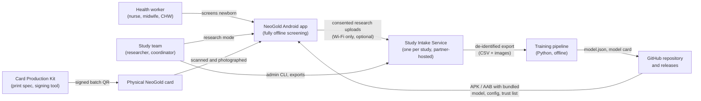
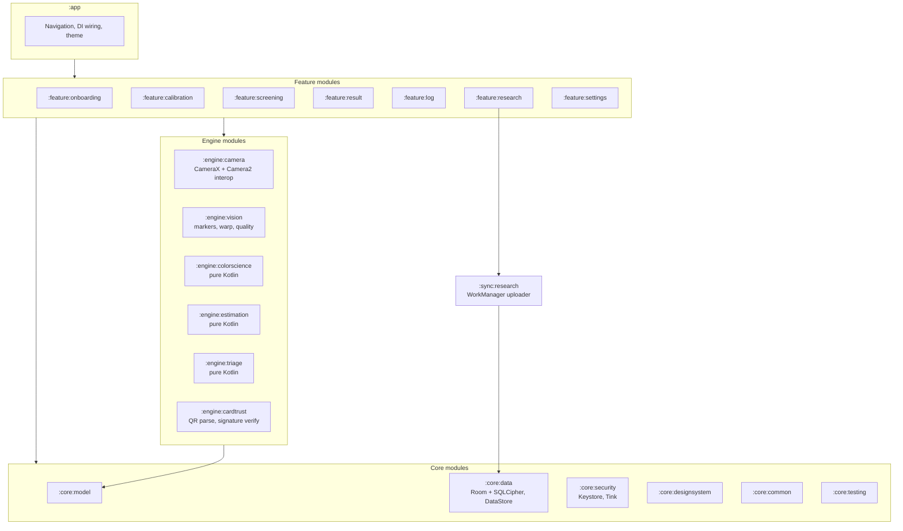
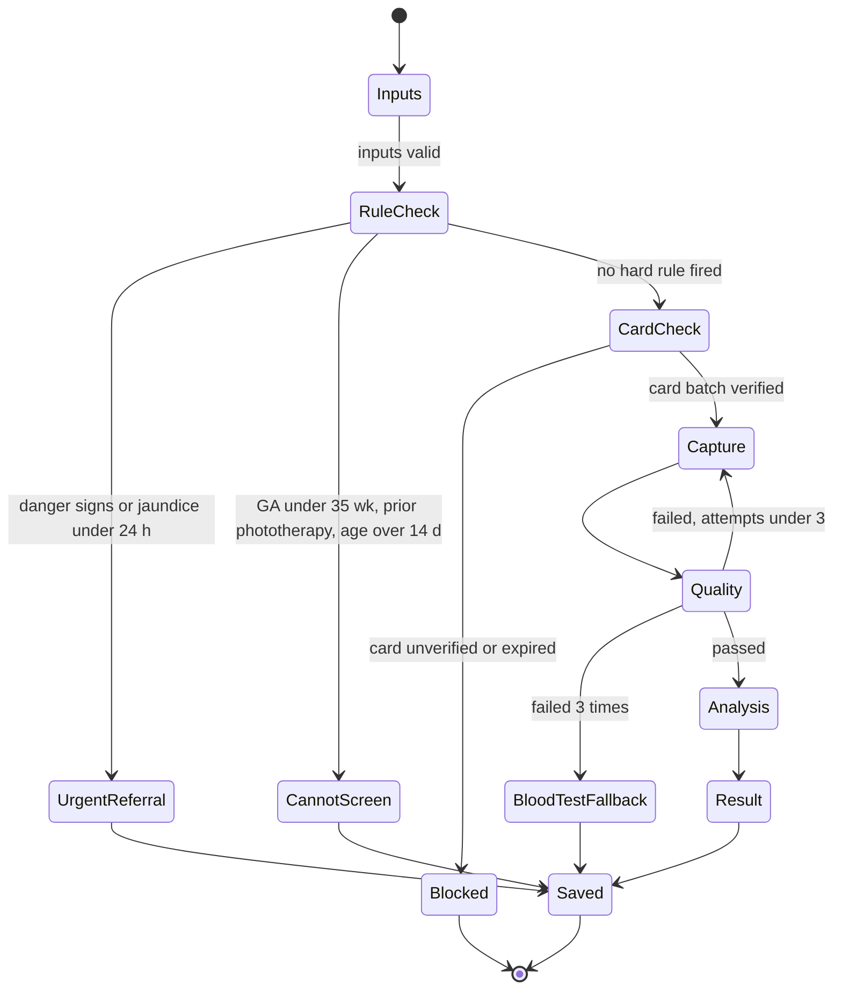
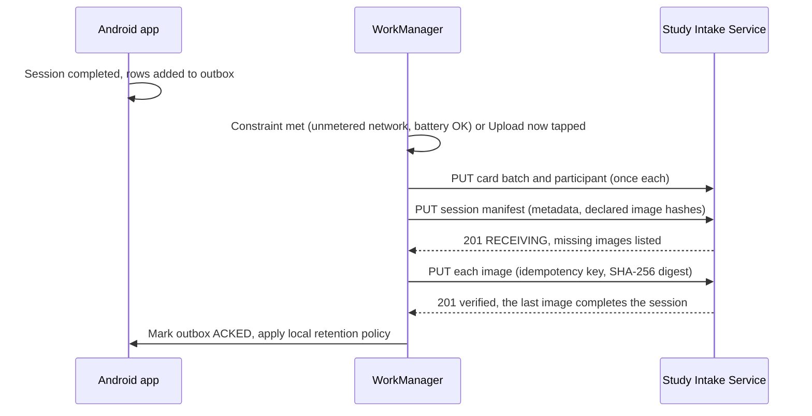
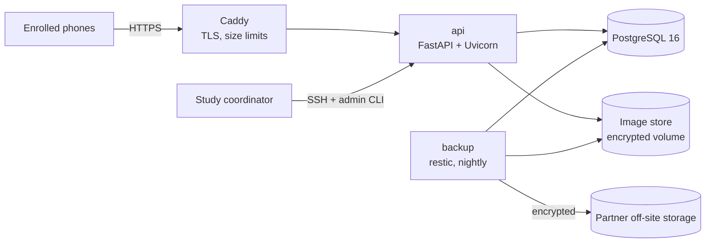
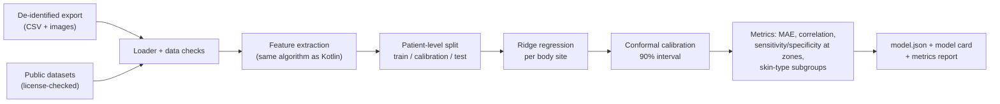

# NeoGold: System Architecture

| Field | Value |
|---|---|
| Document | 4 of 13 |
| Version | 0.2.4 (low-end device design, camera qualification, hosting decided; 0.2.1 aligns upload order and quality reason codes with doc 7; 0.2.2 corrects the timestamp claim and adds upload concurrency and reconciliation; 0.2.3 fixes triage arithmetic and threshold coverage; 0.2.4 adds `triageEnabled`, first-match reason codes, and `StrictMath`) |
| Date | 10 October 2026 |
| Owner | Sowad Al-Mughni, Kitalon Labs |
| Depends on | `2_PRD.md` v0.3, `3_Feature_Backlog.md` v0.3 |
| Status | Awaiting founder review |

Confidence tags: **[Certain]** cited or standard platform fact, **[Likely]** strong inference, **[Guessing]** needs measurement or verification.

---

## 1. Architecture Drivers

These come straight from the PRD. When two designs conflict, the higher driver wins.

| Rank | Driver | Consequence for the design |
|---|---|---|
| 1 | **Patient safety** | Hard clinical rules run before any model. Every uncertainty resolves toward a blood test. Triage logic lives in a signed, versioned config, not in code. |
| 2 | **Offline screening** | Zero network calls in the screening path. The model, config, and card trust list ship inside the app. |
| 3 | **Measurement integrity** | Phone image processing minimized and each phone qualified by measurement. Color corrected against the physical card on every photo. Every result traceable to app, model, config, card batch, and device. |
| 4 | **Privacy** | No names, no birth dates stored. Screening images never persisted. Research data encrypted and under the partner's governance. |
| 5 | **Low-end devices** | No neural network in the v1 screening path. Images downscaled before processing. Target: result in under 10 seconds on a 3 GB RAM phone. |
| 6 | **Forkability** | Open repository, reproducible training, documented card production, trust list that forks can extend with their own keys. |
| 7 | **Solo maintainability** | Few moving parts. One language per tier (Kotlin on device, Python for training, card tooling, and backend). Boring, proven libraries. |

---

## 2. System Context



**What talks to the internet:** only research uploads (optional, Wi-Fi only) and app installation. Screening never does.

---

## 3. Container View

| Container | Technology | Responsibility | Runs where |
|---|---|---|---|
| **Android app** | Kotlin, Jetpack Compose, CameraX, OpenCV for ArUco marker detection (ADR-018), SQLCipher, Tink | Capture, color correction, estimation, triage, local log, research mode, export, optional sync | Health worker's phone |
| **Study Intake Service** | Python 3.12, FastAPI, PostgreSQL 16, Caddy, Docker Compose | Device enrollment, receive research sessions and images, integrity checks, de-identified export | One small VM per study, chosen by the partner |
| **Training pipeline** | Python 3.12, NumPy, OpenCV, scikit-learn, pinned with a lockfile and a Docker image | Rebuild features from exported data, train and calibrate the model, generate metrics and model card | Researcher's machine or CI, never a public server |
| **Card Production Kit** | Design files (SVG/PDF), Python signing CLI | Card layout, print spec, batch measurement import, QR generation and signing | Card producer's machine |
| **Repository and releases** | GitHub, GitHub Actions | Source, CI, signed release artifacts, documentation | GitHub |

### Repository layout (monorepo)

```
neogold/
  android/        Gradle multi-module project
  backend/        Study Intake Service (FastAPI, Alembic, docker-compose.yml)
  training/       Python pipeline, feature code, notebooks
  card/           Card design files, print spec, signing CLI
  config/         Triage configs (signed), trust list, JSON schemas
  testdata/       Golden vectors and synthetic card images for parity tests
  docs/           Docs 1 to 13, model card, CLINICAL_SIGNOFF.md, hazard log
```

One repository keeps the color math, config schema, and golden vectors in sync across Kotlin and Python.

---

## 4. Android Client Architecture

### 4.1 Pattern

Clean Architecture with unidirectional data flow, reusing the ScanLite module pattern [Certain from founder's existing projects]:

- **UI layer:** Compose screens plus ViewModels exposing a single immutable `UiState` through `StateFlow`; user actions go in as `UiEvent`s.
- **Domain layer:** use cases and the screening state machine. Pure Kotlin.
- **Data layer:** repositories over Room (SQLCipher), DataStore, file storage, and the sync client.
- **Engine layer:** camera, vision, color science, estimation, and triage. Everything except camera and vision is pure Kotlin with no Android dependency, so it is unit tested on the JVM and can move to Kotlin Multiplatform later if an iOS port is ever needed.

### 4.2 Module map



| Module | Pure Kotlin | Key responsibility |
|---|---|---|
| `:engine:camera` | No | Preview, AE and AWB convergence and lock, burst capture, capture metadata |
| `:engine:vision` | No (native marker library) | Corner marker detection, perspective correction, patch and window sampling, blur, glare, exposure checks |
| `:engine:colorscience` | Yes | Linearization from gray patches, color correction fit, XYZ and CIELAB conversion, Delta E 2000, trimmed statistics |
| `:engine:estimation` | Yes | Feature vector, model inference from `model.json`, prediction interval, multi-site combination |
| `:engine:triage` | Yes | Config parsing and signature check, hard rules, threshold lookup, action and reason codes |
| `:engine:cardtrust` | Yes | QR payload decoding, Ed25519 batch signature verification against the trust list, expiry |
| `:sync:research` | No | Outbox processing, chunk-free per-file upload with idempotency keys and SHA-256 verification |
| `:benchmark` | No | JVM benchmark of the screening pipeline stages (not shipped in the app) |
| `:neogold-decrypt` | Yes | Offline decrypt tool for research exports, built from `tools/neogold-decrypt` and used by export tests (not shipped in the app) |

### 4.2a Additional module dependencies

Production dependencies the diagram does not draw, approved in the 2026-10-26 direction check (P24, action A16). `tools/drift_inventory.py` reads this table; any other edge fails `--check`.

| From | To | Reason |
|---|---|---|
| `:app` | `:core:common`, `:core:data`, `:core:designsystem`, `:core:model`, `:core:security`, `:engine:camera`, `:engine:cardtrust`, `:engine:colorscience`, `:engine:estimation`, `:engine:triage`, `:engine:vision`, `:sync:research` | `:app` is the composition root and wires every dependency by hand (ADR-017) |
| `:benchmark` | `:core:common`, `:core:model`, `:engine:camera`, `:engine:cardtrust`, `:engine:colorscience`, `:engine:estimation`, `:engine:triage`, `:engine:vision`, `:feature:screening` | Benchmarks the real pipeline classes |
| `:core:data` | `:core:model`, `:core:security` | Entities use the shared model; the database key comes from the Keystore wrapper |
| `:sync:research` | `:core:model`, `:core:security`, `:engine:cardtrust` | Device key and request signing; study QR signature check |
| `:engine:estimation` | `:engine:colorscience` | Features are computed from CIELAB values (pure Kotlin to pure Kotlin) |
| `:engine:vision` | `:engine:colorscience` | Patch sampling returns color-science types |
| `:engine:camera` | `:engine:vision`, `:engine:colorscience` | Camera qualification measures patches with the vision and color engines |

### 4.3 Technology choices

| Concern | Choice | Why |
|---|---|---|
| Language and UI | Kotlin 2.x, Jetpack Compose, Material 3 | Founder's existing stack; first-class Android support |
| DI | Manual constructor wiring in `:app` (ADR-017) | No annotation processor or generated code; Hilt was planned but never adopted |
| Async | Coroutines and Flow | Standard |
| Navigation | Compose Navigation with type-safe routes | Standard |
| Camera | CameraX with `Camera2Interop` | Needed to turn off scene modes and effects, lock AE and AWB where available, and read `CaptureResult` metadata; this is the reason Flutter was rejected (doc 1, Section 10) |
| Computer vision | OpenCV Android from Maven Central (`org.opencv:opencv` 4.14.0, Apache 2.0) with ArUco 4x4 markers in `objdetect`, used in `:engine:vision` only (ADR-018). The pure Kotlin detector stays as the JVM-testable reference; it runs in the app only when the native library is missing, and says so | Measured on a release App Bundle on 27 October 2026 (MiB): OpenCV adds 9.9 to the arm64-v8a download (13.96 in all, budget 25) and 8.1 to the armeabi-v7a download (11.82), and 25.3 to the arm64-v8a install (34.28 in all, budget 40). The 64-bit libraries are 16 KB aligned. The install budget is the tight one |
| ABIs | `arm64-v8a` and `armeabi-v7a` | Some low-end and Android Go phones run 32-bit Android [Likely] (the 2026-10-26 spike, docs/spikes/2026-10-26-dual-abi-armeabi-v7a.md, only inspected the build configuration, so it does not confirm what phones run); App Bundle splits deliver one ABI per phone |
| QR scanning | ZXing core (`com.google.zxing:core` 3.5.4, Apache 2.0), used in `:engine:camera` only, reads the card and study-sheet QR as raw bytes from the camera's brightness plane | Pure Java, no network, no native code. The payloads are packed binary in byte mode, so the bytes are taken from ZXing's byte segments and never from its text (card/spec/qr-formats.md). Signatures are checked by `:engine:cardtrust`, not by the scanner (C1) |
| Estimation | Pure Kotlin linear model from JSON | v1 model is ridge regression on engineered color features; no ML runtime needed, fully auditable. LiteRT reserved for the v2 sclera model |
| Local DB | Room on SQLCipher | Encrypted at rest for both screening log and research data |
| File encryption | Tink streaming AEAD, keyset wrapped by an Android Keystore key | `androidx.security:security-crypto` is deprecated [Likely]; Tink is the maintained path |
| Signatures | Ed25519 verification (Tink) for card batches; release signature over config bundle | Small, fast, offline |
| Background work | WorkManager | Research upload, retention purge, recheck reminders |
| HTTP client (research mode only) | OkHttp with kotlinx.serialization; a hand-written client for the 10 endpoints in `:sync:research` | Small, no generated code; contract tests run the client against `openapi.yaml` examples (doc 7 Section 12) |
| Settings | Jetpack DataStore | Language, acknowledgments, retention, opt-ins |
| Min SDK | API 26 (Android 8.0) | Decided (PRD D6). About 89% of Android web traffic in Bangladesh is on Android 11 or newer and the rest is older [Certain, StatCounter September 2026]; API 26 covers effectively all phones still in use, including Android Go |
| Target SDK | Latest required by Google Play at release time | Play policy |

### 4.3a Approved libraries

`tools/drift_inventory.py` (P24) reads this table. A library declared in any Gradle module that matches no row here is reported as unplanned, and `drift_inventory.py --check` fails a pull request that adds one. To approve a library, add a row in the same pull request, with the decision it rests on (an ADR in Section 15, or the doc section that already chose it).

Each row transcribes an approval that already exists elsewhere in the documents; nothing is approved here for the first time. `group:*` matches every artifact in a group. "Allowed in" is `any` or a comma-separated list of modules. "Use" is `all` (any configuration) or `test` (only `test…`, `androidTest…`, and `debug…` configurations).

| Library | Allowed in | Use | Source |
|---|---|---|---|
| `org.jetbrains.kotlinx:kotlinx-coroutines-core`, `org.jetbrains.kotlinx:kotlinx-coroutines-android` | any | all | P01 allowed list (doc 15, P01 Constraints); Section 4.3 Async |
| `org.jetbrains.kotlinx:kotlinx-coroutines-test` | any | test | P01 allowed list; doc 9 Section 3 |
| `androidx.compose:*`, `androidx.compose.ui:*`, `androidx.compose.material3:*`, `androidx.compose.material:*` | any | all | P01 allowed list (Compose, Material 3); Section 4.3 |
| `androidx.navigation:navigation-compose` | any | all | P01 allowed list; Section 4.3 Navigation |
| `androidx.core:core-ktx` | any | all | Added to every Android module by the convention plugins; required by Compose and AndroidX (P24, A15) |
| `androidx.activity:activity-compose` | `:app` | all | Compose host for `MainActivity` (`setContent`); part of Compose (P24, A15) |
| `androidx.lifecycle:*` | any | all | P01 allowed list (Lifecycle) |
| `junit:junit`, `com.google.truth:truth`, `app.cash.turbine:turbine`, `org.robolectric:robolectric` | any | test | P01 allowed list; doc 9 Section 3 |
| `io.gitlab.arturbosch.detekt:*` | any | all | P01 allowed list |
| `androidx.camera:*` | `:engine:camera` | all | Section 4.3 Camera |
| `org.opencv:opencv` | `:engine:vision` | all | ADR-018; Section 4.3 Computer vision |
| `com.google.zxing:core` | `:engine:camera` | all | Section 4.3 QR scanning (C1); approved by the owner on 2026-10-27 |
| `androidx.room:room-runtime`, `androidx.room:room-ktx`, `androidx.room:room-compiler` | any | all | Section 4.3 Local DB; ADR-008 |
| `androidx.room:room-testing` | any | test | doc 9 Section 3 (`MigrationTestHelper`) |
| `net.zetetic:sqlcipher-android` | `:core:data` | all | Section 4.3 Local DB; ADR-008 |
| `androidx.sqlite:sqlite`, `androidx.sqlite:sqlite-framework` | `:core:data` | all | SupportSQLite bridge between Room and SQLCipher; ADR-008 (P24, A15) |
| `org.bouncycastle:bcprov-jdk18on` | `:core:security` | all | ADR-016; doc 8 Section 6.2 |
| `org.bouncycastle:bcprov-jdk18on` | `:sync:research` | test | BUG-2026-036: holds the Bouncy Castle that Robolectric brings to this module's test classpath at the version the app uses; no production code in the module imports it |
| `com.google.crypto.tink:tink-android` | any | all | Section 4.3 File encryption and Signatures; ADR-008, ADR-019 |
| `androidx.work:work-runtime-ktx` | any | all | Section 4.3 Background work |
| `androidx.work:work-testing` | any | test | doc 9 Section 3 |
| `com.squareup.okhttp3:okhttp` | `:sync:research` | all | Section 4.3 HTTP client (research mode only); CLAUDE.md privacy rule |
| `com.squareup.okhttp3:mockwebserver` | `:sync:research` | test | doc 9 Section 3; doc 10 Section 15 |
| `org.jetbrains.kotlinx:kotlinx-serialization-json` | `:sync:research` | all | Section 4.3 HTTP client |
| `androidx.datastore:datastore-preferences` | any | all | Section 4.3 Settings |
| `com.jakewharton.timber:timber` | any | all | doc 8 Section 6.1 Release logging |
| `androidx.biometric:biometric` | any | all | doc 8 Section 6.3 (`BiometricPrompt`) |
| `androidx.test.ext:junit`, `androidx.test.espresso:espresso-core` | any | test | doc 9 Section 3 UI (instrumented) |
| `androidx.test:runner` | any | test | The instrumentation runner (`AndroidJUnitRunner`) that the convention plugins already name; `androidx.test.ext:junit` does not bring it. First used by the OpenCV tests of `:engine:vision` (ADR-018). This row is not a transcription of an earlier approval: it was added with A3 and waits for the owner's decision (CLAUDE.md: ask before adding a dependency) |

### 4.4 Screening state machine

The screening flow is one state machine in the domain layer. The UI only renders state; it never decides clinical flow.



- State is held in the ViewModel and mirrored to `SavedStateHandle` (inputs only). If Android kills the process mid-capture, the app restores the inputs and restarts capture; images are never restored.
- Every terminal state writes one `screening_session` row, including referrals that never reached the camera, so the log shows every decision.

### 4.5 Target device classes

From the Bangladesh device research (doc 1, Section 13):

| Class | Spec | Role |
|---|---|---|
| Floor | Android Go, 2 GB RAM, Android 8.0 or newer, 32-bit possible | Must work; slower is acceptable |
| Reference | Entry MediaTek Helio G81/G85 class, 3 to 4 GB RAM, Android 13 to 16, HD+ screen | All performance budgets are measured here |
| Common skins | TECNO HiOS, Infinix XOS, itel, Xiaomi HyperOS/MIUI, Samsung One UI | Background limits and camera processing differ; all in the test matrix |

Design consequences:
- **Background work is unreliable** on these skins. Nothing time-critical depends on it: rechecks due appear on Home, uploads have a manual button, retention purges also run on app start.
- **Memory is tight.** Images are decoded at reduced size and processed one at a time; peak memory stays under 120 MB (NFR-04b).
- **Storage is often full.** Screening images are never written to disk; research images are written only after a free-space check, with a clear warning when space is low.
- **Screens are small and dim.** Layouts are designed at 360 dp width and checked at 320 dp (doc 6).

### 4.6 Navigation map

`Onboarding (language → safety notice → device check → card scan → calibration)` → `Home` → `Screening (inputs → safety questions → rule outcome → capture guide → camera → analysis)` → `Result` → `Log`. Research mode is a separate graph behind the study PIN. Full screen inventory is in `6_UI_UX_Guidelines.md`.

### 4.7 Research session wiring (package C2)

- **One state holder.** `NeoGoldContainer.researchViewModel(database)` builds the `ResearchRepository` (database, encrypted files, trust list, `ResearchPinManager`, the PIN hasher, and a provenance provider that names the app, model, config and device profile at save time) and the `ResearchViewModel` that R01 to R06 share. It is null when the bundle has no trust list.
- **Session lock.** `ResearchSessionManager` locks on a button, after 5 minutes in the background, and when the screen turns off, and it counts its locks (`lockCount`). The view model records the count before any slow work (a PIN check, a save) and compares afterwards, so work started before a lock never writes into state the lock cleared. Every research route returns to R01 when the session locks.
- **PIN checks run one at a time** (a mutex in `ResearchPinManager`), so overlapping guesses each count against the lockout.
- **Errors are typed.** The view model exposes a `ResearchError` (a reason and the numbers it needs); each screen turns it into text in the language it shows. Repository refusals are `ResearchRefusal` (the old message text plus the typed reason).
- **The card.** A session names the card of the phone's active device profile (`chooseResearchCard`), whatever its date; one expiry rule (`cardHasExpired`) is shared with the card verifier. The quality gate gets reference colors only from a card that has not expired; a photo checked with no card is recorded as not passed, with the reason `NO_REFERENCE_CARD`.
- **Blinding is structural.** `:feature:research` does not depend on `:engine:estimation` or `:engine:triage`, so research code cannot make an estimate; `ResearchBlindingGuardTest` fails if that dependency returns or if a screen names an estimate or triage field.

### 4.8 Study server wiring (package C4)

- **One graph, in the only module that has the HTTP client.** `ResearchSyncGraph` (in `:sync:research`) builds the OkHttp client (redirects not followed), the API client, `StudyEnrollmentManager`, `StudyRevocationManager`, `ReconciliationManager`, `OutboxProcessor` and `ResearchRetentionConfirmationHook` over the open database, the app's encrypted file store and the app's trust list. `NeoGoldContainer.syncGraph(database)` creates it once per database and is null when the trust list did not verify, so nothing is sent from a phone whose bundle check failed.
- **The worker builds nothing.** `ResearchUploadWorker` asks the application for its processor (`ResearchSyncComponent`, the same pattern as the retention worker). While the application has none (storage cannot be read, the bundle check failed) the worker does nothing and tries again later. It logs the kind of an exception, never its message.
- **The feature module never sees the network.** `:feature:research` declares `StudyServer` (enroll, leave, upload now, schedule); `:app` implements it as `StudyServerSync` over the graph. A failure leaves `:sync:research` as a `ServerFailureKind` (no text), becomes a typed `ResearchError` in `:app`, and each screen writes it in the language it shows. `StudyServerViewModel` holds R07's cloud card, R08 and R09 and follows the rules of `ResearchViewModel` (one action at a time, a lock clears the scan and drops a late answer).
- **Joining a server.** The study is already on the phone (R01 made it, with the PIN). R08 scans the signed study QR again, checks it is the same study and names a server, takes the one-time code and sends it with the facts the phone measured about itself (camera level and qualification from the active device profile; no default). The manager refuses before any key is made or request sent if there is no study, the QR is of another study, the phone already has a device ID or the study has no server; after the server answers it refuses (and deletes the key) if the policy differs from the signed profile or the server's `max_image_bytes` is below the 5,000,000 bytes the app keeps. A phone with no device profile cannot join.
- **Leaving.** R09 asks for the PIN again (the same lockout as R01), tells the server (`DELETE /device`), and clears the device key and device ID. The study stays ACTIVE and every session, photo and outbox row stays, because export and retention find the study through the active row (TC-SYNC-16). A revoked device and a closed study have the same local effect, written to the audit log as `DEVICE_DISCONNECTED` with the reason only. Moving to a different study is Export, then Delete all data.
- **When uploads start.** After a session or a TSB value is saved, after enrollment, and once at every app start (`NeoGoldContainer.scheduleUploads`), each only when the phone has a device ID and rows are waiting. A waiting run is not duplicated; a run in progress gets one more queued behind it, so what was saved during the run is not left for the next save. "Upload now" replaces a waiting run with an expedited one and ignores a run in progress (TC-SYNC-10). All of it runs off the main thread.
- **Retention asks the server.** `RetentionManager` gets `ResearchRetentionConfirmationHook` from the graph; a research session is purged only after the server reports it COMPLETE or REJECTED. With no graph the default confirms nothing, so nothing is purged. A phone that has left its server never purges research data by itself (no device ID to ask with); it stays until export and Delete all data.

---

## 5. Capture and Measurement Pipeline

This is the core of the product. Each stage has a quality check, and any check failure loops back to capture with a plain-language reason.

```mermaid
flowchart LR
    A["Preview frames<br/>640x480"] --> B["Marker detection<br/>live overlay feedback"]
    B --> C["Stable for 1 s?<br/>auto-capture"]
    C --> D["AE and AWB converge,<br/>then LOCK"]
    D --> E["Burst of 3 full-res frames<br/>+ CaptureResult metadata"]
    E --> F["Pick sharpest frame<br/>(Laplacian variance)"]
    F --> G["Detect 4 markers,<br/>perspective warp to card plane"]
    G --> H["Sample patches and window<br/>(trimmed means)"]
    H --> I["Quality gate"]
    I --> J["Linearize from gray patches,<br/>fit color correction"]
    J --> K["Correct window pixels,<br/>convert to CIELAB"]
    K --> L["Feature vector"]
    L --> M["Model: estimate +<br/>prediction interval"]
    M --> N["Triage engine"]
```



### 5.1 Camera control

**What actually matters.** The card is in the same photo as the skin, so global white balance and exposure affect both equally and the per-capture correction removes them. The real threat is processing that treats parts of the image differently: HDR, local tone mapping, scene detection, beauty and "AI" enhancement. Budget phones vary widely here, and per-phone color bias before correction is large even on flagships [Certain, doc 1 Section 13.4]. So phones are qualified by measurement, not by capability flags.

1. Open the back camera through CameraX with a `Camera2Interop` extender. Do not use CameraX Extensions (HDR, night, beauty). Flash off for skin capture; flash is reserved for the sclera flash and no-flash pair in research mode.
2. Where the phone allows, request: `CONTROL_MODE_AUTO` without scene modes, `CONTROL_EFFECT_MODE_OFF`, video stabilization off, and the least aggressive noise reduction and edge enhancement modes the phone offers. Record what was accepted.
3. Run preview until auto exposure and auto white balance report converged.
4. If the phone supports `CONTROL_AE_LOCK` and `CONTROL_AWB_LOCK`, lock both before the burst so the three frames match. If not, capture anyway; each frame is corrected on its own card.
5. Capture a burst of three frames as high-quality JPEG. Record for each: sensor sensitivity, exposure time, AE and AWB state, lock support, Camera2 hardware level (`LEGACY`, `LIMITED`, `FULL`, `LEVEL_3`), and color correction gains when exposed.
**The camera host (package C1).** `CameraHost` in `:engine:camera` does steps 1, 2 and 5 for every screen: it binds the preview, the frame analyzer that `CameraMode` asks for (`ReadQr` for S06 and R08, `Stills` for S07, `LiveCard` for S16 and R04) and the still capture, applies the controls in step 2 to both, and returns a `CameraSession` with `captureFrame()` and `captureBurst()`. Only NeoGold types leave the module. The capture result of each still arrives through a Camera2 interop session callback into `CaptureResultRegistry`, keyed by the frame's sensor timestamp, and the burst controller waits up to 750 ms for the one that belongs to the photo; a photo whose result does not arrive is kept with metadata that says nothing is known (the locks are recorded as off, never as on). Frames are analyzed and photos copied on one background thread per session; photos stay in memory. `CameraPreviewHost` is the Compose side: it asks for camera access, shows the preview, closes the camera when the screen leaves and offers a retry when the camera cannot be opened. The app provides the permission state, so the module needs no activity library. The result is checked on the API 37 emulator's virtual camera (`CameraHostInstrumentedTest`); real lenses are the bench task D1, D2 and D4.

6. **Camera qualification (FR-04)** decides screening eligibility, on every phone including `LEGACY` devices:

| Test | How | Pass when (initial values, tune in v0.1) |
|---|---|---|
| Repeatability | Three card photos a few seconds apart | Mean Delta E 2000 between corrected patches across photos under 1.5 |
| Uniformity | Identical patches printed in opposite corners of the card | Difference between duplicates after correction under 2.0, which catches local tone mapping and HDR |
| Accuracy | Corrected patches vs the batch's measured values | Mean Delta E 2000 under 3.0 |

A phone that fails is limited to research mode, where its images still help the study learn which phones work. Results are stored in `device_profile` and published as the supported device list (NG-046).

### 5.2 Card detection and sampling

- Four corner markers (ArUco 4x4, ADR-018) give a homography to a canonical card image (for example 1200 x 760 px). [Likely] Markers make detection robust to angle and partial shadow at low CPU cost.
- The card carries duplicate gray and skin-tone patches in opposite corners. Comparing them on every capture detects uneven light and phone processing that varies across the image.
- Patch values are trimmed means (drop the brightest and darkest 10% of pixels) from the inner 60% of each patch, which removes edge bleed and specular highlights.
- The skin value comes from the punched window, inner 70% only. A skin plausibility check (chromaticity range, uniformity, no hard edges) rejects cloth, shadow, a finger, or an empty window.

### 5.3 Quality gate

| Check | Method | Fails when (initial values, tune on data) | Reason code |
|---|---|---|---|
| Card present | 4 markers detected | Fewer than 4 markers | `NO_CARD` |
| Card angle | Homography skew | Card tilted beyond about 20 degrees (color error rises steeply with viewing angle [Certain, doc 1 Section 13.4]) | `CARD_ANGLE` |
| Patch uniformity | Duplicate patches in opposite corners | Difference above tolerance (uneven light or local processing) | `NONUNIFORM_PATCHES` |
| Blur | Laplacian variance on the warped card | Below device-calibrated threshold | `BLUR` |
| Glare | Fraction of saturated pixels on patches and window | Any patch over 2% saturated | `GLARE` |
| Exposure | Mean of the mid-gray patch | Outside the usable range | `UNDEREXPOSED`, `OVEREXPOSED` |
| Light uniformity | Difference between gray patches at opposite corners | Above tolerance (mixed window and fluorescent light) | `UNEVEN_LIGHT` |
| Correction residual | Mean Delta E 2000 between corrected patches and batch reference | Above tolerance | `HIGH_RESIDUAL` |
| Window content | Skin plausibility check | Not skin-like | `WINDOW_NOT_SKIN` |

[Guessing] All numeric thresholds are placeholders until tuned on real capture data in v0.1 and v0.5. They live in the triage config file so tuning does not need a code change.

### 5.4 Color correction

1. **Linearize** each channel using the card's gray ramp: fit a monotonic curve from observed values to the batch's measured gray reflectances. This absorbs the phone's tone curve instead of assuming standard sRGB gamma, which phone image processors do not follow faithfully [Certain, verified in docs/spikes/2026-10-26-tone-curve-linearization.md].
2. **Fit a correction** from linearized patch RGB to the batch reference values in CIE XYZ (D65). Start with a 3 x 3 least-squares matrix; evaluate a second-order root-polynomial correction, which keeps exposure invariance, on v0.5 data [Likely].
3. **Apply** the correction to the window pixels, convert to CIELAB.
4. **Residual** Delta E on the patches feeds the quality gate and is stored with the capture.

Because the card sits next to the skin in every photo, lighting is corrected per capture. The device profile from onboarding adds a small residual correction and records device capabilities.

### 5.5 Estimation

- **Features (v1):** mean L\*, a\*, b\* of the corrected window, b\*/L\* ratio, and a\*/b\* ratio, per site. Final feature list is fixed by the training pipeline and versioned in `model.json`.
- **Model:** ridge regression per body site, trained in Python, exported as JSON (feature means, scales, coefficients, intercept). Kotlin inference is a dot product. Multi-site estimate is a weighted mean when both sternum and forehead are captured.
- **Uncertainty:** split conformal prediction gives a 90% prediction interval using residual quantiles stored in `model.json` [Likely appropriate; distribution-free and simple]. The interval, not the point value, drives triage.
- **Why not deep learning in v1:** with a few hundred paired samples, engineered color features plus regression are more reliable and auditable. BiliCam reached 0.91 correlation with features plus regression [Certain, doc 1].

### 5.6 Performance budget (reference class: Helio G81/G85, 3 to 4 GB RAM)

| Stage | Budget |
|---|---|
| Marker detection on preview frame | under 80 ms per frame, run at 5 fps [Likely] (a laptop run in Python took 23.6 ms per frame, docs/spikes/2026-10-26-marker-detection-timing.md; not yet measured on a phone) |
| AE and AWB convergence (and lock if supported) | under 1.5 s [Guessing] |
| Burst capture | under 1.5 s |
| Decode at reduced size, warp, sampling | under 700 ms |
| Quality gate, correction, features, model | under 200 ms |
| **Capture to result** | **under 4 s target, 10 s hard limit (NFR-02)** |

On the 2 GB Android Go floor, the same steps may take up to twice as long; the 10 s limit still applies. Full-resolution images are decoded with downsampling to about 1600 px on the long edge and processed one frame at a time, keeping peak memory under 120 MB (NFR-04b). The burst drops to two frames when the phone reports low memory.

---

## 6. Triage Engine

### 6.1 Signed configuration

All clinical numbers live in one JSON file, `triage-config.json`, validated against a JSON Schema in `config/schema/`. Example structure (values are drafts pending clinical sign-off):

```json
{
  "configVersion": "2026.10.0-draft",
  "guideline": "AAP-2022",
  "units": "mg/dL",
  "triageEnabled": true,
  "validUntil": "2027-12-31",
  "clinicalSignoff": { "status": "DRAFT", "signoffRecordSha256": null },
  "scope": { "minGestationalAgeWeeks": 35, "maxAgeHours": 336 },
  "hardRules": [
    { "id": "R1", "when": "dangerSigns == true", "action": "REFER_URGENT" },
    { "id": "R2", "when": "jaundiceOnsetUnder24h == true", "action": "REFER_URGENT" },
    { "id": "R3", "when": "gestationalAgeWeeks < 35", "action": "CANNOT_SCREEN_BLOOD_TEST" },
    { "id": "R4", "when": "priorPhototherapy == true", "action": "CANNOT_SCREEN_BLOOD_TEST" },
    { "id": "R5", "when": "ageHours > 336", "action": "CANNOT_SCREEN_CLINICAL_REVIEW" }
  ],
  "phototherapyThresholds": {
    "ga35": [[24, 0.0], [48, 0.0]],
    "ga36": [[24, 0.0], [48, 0.0]],
    "ga38plus": [[24, 0.0], [48, 0.0]]
  },
  "bloodTestZone": { "withinOfThreshold": 3.0, "absoluteAtOrAbove": 15.0 },
  "recheck": { "withinOfThreshold": 5.0, "hours": 24 },
  "maxIntervalWidth": 6.0,
  "qualityThresholds": { "...": "..." }
}
```

The threshold arrays are deliberately zeroed placeholders. The clinical lead fills them from the chosen guideline edition (PRD Section 9b).

### 6.2 Decision algorithm

1. **Config check:** if `triageEnabled` is false (research builds, or a clinical emergency that disables triage), no triage result is ever shown and the app says to use a blood test; such a config needs no clinical sign-off. Otherwise: schema valid, release signature valid, `clinicalSignoff.status == "SIGNED"` for public builds, and today on or before `validUntil`. If any check fails, the app refuses to show a triage result and says to use a blood test (and, for an expired config, to update the app).
2. **Hard rules** in order R1 to R5. First match wins.
3. **Quality fallback:** three failed captures give `BLOOD_TEST_TODAY`.
4. **Threshold:** `T` = linear interpolation of the phototherapy threshold for the baby's gestational age band at the current age in hours.
5. **Interval:** point estimate `E`, upper bound `U`, lower bound `L`.
6. **Actions:**
   - `E >= T` gives `REFER_URGENT`.
   - `U >= T - 3.0` or `U >= 15.0` gives `BLOOD_TEST_TODAY` (mirrors the AAP 2022 rule for transcutaneous readings [Certain, PRD 9b]).
   - `U - L > maxIntervalWidth` gives `BLOOD_TEST_TODAY` (too uncertain to reassure).
   - `U >= T - 5.0` gives `RECHECK` in the configured hours.
   - Otherwise `NO_FURTHER_ACTION_FROM_SCREEN`.
7. **Output:** action, one reason code (the first rule that matched, in the order above; for example `R2`, `ZONE_WITHIN3`, `WIDE_INTERVAL`), threshold used, interval, config and model versions.
8. **Arithmetic:** values are converted to integer tenths of mg/dL before any comparison, so a boundary such as `T - 3.0` cannot be missed through floating-point error. Rounding always moves toward more care: the threshold is rounded down, the estimate and upper bound up, and the lower bound down. Display rounding (to the nearest 0.1) is separate and never feeds a decision. The color and estimation engines use `StrictMath` for powers, roots, exponentials, logarithms, and trigonometric functions, so both ABIs (arm64-v8a, armeabi-v7a) produce bit-identical results [Certain that Java specifies `StrictMath` results exactly]. Threshold tables must cover 0 to 336 hours for every gestational band; the schema rejects a table that does not.

The triage engine is pure Kotlin with table-driven tests covering every rule, every boundary (exactly at `T`, exactly at `T - 3.0`), and every gestational band.

### 6.3 How clinical sign-off is enforced

- The clinical lead signs `CLINICAL_SIGNOFF.md` (a dated statement naming the config version and its SHA-256 hash).
- CI computes the config hash and fails the release build if it does not match the hash recorded in `CLINICAL_SIGNOFF.md`, or if the config still says `DRAFT`.
- The release key signs the config bundle, so corrupted or modified assets are rejected at runtime. This does not stop a repackaged APK, because whoever repackages the app can also change the code that checks the signature; distribution controls cover that threat (doc 8 Section 9, T3).
- `validUntil` makes an unmaintained build stop showing triage results instead of running old thresholds forever (doc 8 Section 14, H8). Each signed config is valid for at most 12 months.

---

## 7. Card Trust

- The QR payload holds: format version, batch ID, issuer ID, issue and expiry dates, measured reference values for each patch (CIELAB, compact fixed-point encoding), and an Ed25519 signature over all of it.
- [Likely] About 16 to 24 patches fit comfortably in a QR code of moderate size alongside a 64-byte signature.
- The app ships with a trust list (`config/trust-list.json`) of issuer public keys. The NeoGold issuer key is included; a fork adds its own issuer key and rebuilds.
- Verification is fully offline. A failed signature, unknown issuer, or expired batch blocks screening (research mode only, with a warning). The batch ID is stored on every capture so performance can be analyzed per batch. Research sessions upload with `card_status` `VERIFIED`, `EXPIRED`, or `UNVERIFIED` so analysis can separate them (doc 7 Section 3).
- The issuer private key never touches a server. It lives offline with the card producer; handling is specified in `8_Security_Compliance_Plan.md`.

---

## 8. Data on the Device

| Data | Store | Encryption | Retention |
|---|---|---|---|
| Settings and acknowledgments | DataStore | Not sensitive | Until uninstall |
| Screening log | Room on SQLCipher | Database key wrapped by Keystore | Register number erased at 60 days; records purged at 180 days by default, configurable 30 to 365 (PRD D7) |
| Screening images | Memory only | n/a | Discarded after analysis |
| Research records | Room on SQLCipher | As above | Until exported or acknowledged by the server, then per study policy |
| Research images | App-private files | Tink streaming AEAD, keyset wrapped by Keystore | Same as research records |
| Device profile, card batches | Room | As above | Until recalibration or expiry |

Privacy rules built into the model:
- **Birth date and time are never stored.** The app computes age in hours at the moment of screening and stores only that.
- **No names.** An optional facility register number in screening mode and a participant code in research mode are the only links to a person, and the mapping lives on paper at the facility. The register number field rejects birth registration, national ID, and mobile number patterns (PRD Section 11).
- **No cloud backup.** Backup and device-transfer rules exclude all NeoGold data, so a shared or second-hand phone cannot leak it through a Google account restore.

Writes are transactional (Room transactions, write-to-temp-then-rename for files), so a crash or dead battery cannot leave a half-written research record (NFR-09). Full schema is in `5_Database_Schema.md`.

---

## 9. Research Sync



- Outbox pattern: nothing leaves the device unless it is in the outbox, and nothing is deleted locally until the server acknowledges it.
- Budget Android skins (HiOS, XOS, HyperOS) often stop background work [Certain for HiOS, doc 1 Section 13.4]. WorkManager is the opportunistic path; the research home screen shows "N waiting to upload" and an **Upload now** button that runs the same outbox in the foreground.
- Manifest first, images second: the server rejects bad metadata (unknown participant, unregistered card batch) before the phone spends Wi-Fi on images, and it checks each image against the hash declared in the manifest.
- Each request carries an idempotency key, and each image a SHA-256 digest; retries are safe (doc 7 Section 5).
- Uploads run as one unique WorkManager work, as a foreground worker when the backlog is long, so two runs never overlap and a slow link is not cut off at the 10-minute worker limit (doc 7 Section 5.3).
- Local research data is deleted only after the server confirms the session is complete (doc 7 Section 5.4).
- Images are a few MB each, so whole-file upload with retries is simpler than resumable chunking [Likely sufficient on Wi-Fi].
- **Timestamp minimization:** by default the app uploads the capture date (day precision, in the study time zone) and the minutes between capture and blood draw, not absolute timestamps, and the server stores its own arrival dates at day precision. This narrows what can be inferred but does not eliminate it: capture date plus age in hours still places the birth within about two calendar days, so exports also shift dates per participant (doc 7 Section 7, doc 8 Section 3). *Correction (v0.2.2): an earlier version said a birth date could not be back-calculated; that overstated it.* A study can raise precision if its ethics approval allows it.
- USB or local export (FR-30) works without any server, so a study can run with no backend at all.

---

## 10. Study Intake Service (Backend)

### 10.1 Scope

Per the founder's decision (PRD D1): receive consented research uploads, nothing else. No accounts for health workers, no dashboards, no screening data.

### 10.2 Deployment



| Service | Image | Purpose |
|---|---|---|
| `caddy` | Official Caddy | TLS with automatic certificates, request size limits, timeouts (rate limiting is done in the API, since standard Caddy needs a plugin for it) |
| `api` | NeoGold backend image (built in CI, published to GitHub Container Registry) | Enrollment, uploads, manifests, health check, admin CLI |
| `db` | Official PostgreSQL 16 | Metadata |
| `backup` | restic | Encrypted nightly backups of database dumps and images to the partner's storage |

- **Image storage:** a filesystem volume on an encrypted disk by default. An S3-compatible adapter is available for partners on a cloud provider. One small storage interface, two implementations.
- **Admin:** command-line only (`neogold-admin`): create study and sites, issue one-time enrollment codes, revoke devices, list upload status, run de-identified export.
- **Sizing:** [Likely] 1,000 participants x 6 images x about 3 MB is roughly 18 GB. A 2 vCPU, 4 GB RAM VM with 100 GB of encrypted disk is ample.
- **Hosting:** chosen by the partner, preferably in-country and under its ethics approval. Kitalon Labs supplies the image and runbook; it does not need access to the data.

### 10.2a Hosting decision (PRD D9)

| Environment | Where | Data | Spec and cost |
|---|---|---|---|
| Development and staging | **New, dedicated** DigitalOcean droplet in a "NeoGold" project, BLR1 (Bangalore) region | Synthetic and test data only, never newborn data | Basic 1 vCPU / 2 GiB, 50 GiB disk: $12 per month; weekly backups add 20% ($2.40) [Certain, DigitalOcean pricing] |
| Study (production) | Inside Bangladesh: the partner's own infrastructure, or a Bangladeshi data center (the Tier IV National Data Center run by Bangladesh Data Center Company Ltd lists cloud services [Certain]; several Dhaka providers offer VPS [Certain]) | Real research data | 2 vCPU / 4 GB RAM, 100 GB encrypted disk or equivalent |

**Why not the existing droplet.** Your current droplet runs other Kitalon products [Certain from founder's stack notes]. Sharing it mixes NeoGold with unrelated software, widens the blast radius of any compromise, and makes a clean handover to a partner impossible. A separate $12 droplet removes all three problems.

**Why not DigitalOcean for real study data.** DigitalOcean has no Bangladesh region; the nearest are BLR1 and SGP1 [Certain]. Bangladesh's Personal Data Protection Ordinance 2025 treats health-related data as sensitive personal data and requires cloud-stored personal data, domestic or foreign, to keep a synchronized real-time copy inside Bangladesh (sections 2(23), 29(7)(b)) [Certain, ordinance text]; most of it already applies, with penalties from around May 2027 [Likely] (PRD Section 10, corrected in v0.3.1). A partner's ethics committee is also likely to require in-country hosting [Likely]. Staging on DigitalOcean still pays off: it runs the identical Docker Compose stack, so the partner deployment is a repeat of a rehearsed process.

**DigitalOcean storage note.** DigitalOcean Volumes are encrypted at rest with LUKS [Certain]; the documentation reviewed does not say the same for the droplet's local disk, so the image store goes on a Volume or an encrypted filesystem.

### 10.3 Device enrollment (summary)

1. Coordinator issues a one-time enrollment code for a site.
2. The app generates a hardware-backed key pair in Android Keystore and sends the public key with the code.
3. The server binds the key to the study and site; afterward every request is signed by the device key.
4. Revoking a device stops further uploads immediately.

Endpoint contracts, token formats, and error codes are specified in `7_API_Documentation.md`; threat model and key handling in `8_Security_Compliance_Plan.md`.

---

## 11. Training Pipeline



- **Parity is enforced, not hoped for.** The color pipeline exists twice (Kotlin on device, Python for training). Golden vectors in `testdata/` (input images plus expected intermediate arrays and features) run in both CI suites; any difference beyond 1e-4 fails the build.
- **Splits are by participant**, never by image, so the test set never contains a baby seen in training.
- **Subgroup reporting** by skin type, site, device model, and card batch is mandatory in every metrics report.
- Data never enters the repository. The pipeline reads from a local path and records a manifest of file hashes for reproducibility.

---

## 12. Model, Config, and Trust List Packaging

| Artifact | Versioning | Ships in | Changed by |
|---|---|---|---|
| `model.json` | SemVer (for example 1.0.0) | APK assets | Training pipeline release |
| `model-card.json` | Matches model | APK assets, shown in About | Training pipeline release |
| `triage-config.json` | CalVer (for example 2026.10.0) | APK assets | Clinical lead sign-off |
| `trust-list.json` | Integer version | APK assets | Card issuer change |
| Bundle manifest | Lists SHA-256 of all four, signed by release key | APK assets | Release pipeline |

At startup the app verifies the manifest signature and every hash. Any mismatch disables screening, research unlock and the triage switch. `config/` is the only source: the build signs these files into the app's generated assets (`:app:signBundleManifest`), and the app reads each file once, hashes those bytes and parses the config from the same bytes (`VerifiedAssets`), so nothing is checked and then read again. Over-the-air updates of these artifacts are a v1.1 Could-have (NG-062); in v1.0 they change only with an app release.

---

## 13. Observability and Support

- **On device:** a local structured log (ring buffer, no personal data) that a user can export when reporting a problem.
- **Crash reporting:** off by default, opt-in only (FR-34). Tool choice (for example a self-hostable open-source reporter) is settled in doc 8.
- **Backend:** structured JSON logs without payload contents, a `/health` endpoint, and an external uptime check run by the partner.
- **No analytics.** Adoption is measured through partner reporting, not telemetry.

---

## 14. CI/CD Overview

Detailed in `12_Deployment_Runbook.md`. Summary:

| Pipeline | Steps |
|---|---|
| Android | Lint, unit tests (engines on JVM), golden-vector parity, instrumented UI tests on emulator, bundle manifest verification, clinical sign-off hash check (release only), signed AAB and APK |
| Backend | Lint, type check, tests with a throwaway PostgreSQL, container build, image scan, push to GitHub Container Registry |
| Training | Lint, unit tests, golden-vector parity, reproducibility check on a small fixture dataset |

---

## 15. Architecture Decision Records

| ADR | Decision | Alternatives rejected | Reason |
|---|---|---|---|
| ADR-001 | Native Kotlin and Compose | Flutter | Camera2 control over processing, locks, and metadata; Android-only target; reusable founder code (doc 1, Section 10) |
| ADR-002 | Screening fully offline; backend only for research intake | Cloud processing like BiliCam and Picterus | Connectivity, privacy, cost; founder decision D1 |
| ADR-003 | Card with punched window and ArUco corner markers | Card beside the skin with segmentation | Skin region defined by geometry; no neural segmentation needed |
| ADR-004 | Ridge regression in pure Kotlin from JSON | On-device neural network | Small data, auditability, no runtime dependency |
| ADR-005 | Clinical numbers in a signed config with CI-enforced sign-off | Hardcoded thresholds | Clinical ownership, reviewability, safe tuning |
| ADR-006 | Gray-ramp linearization plus least-squares correction per capture | Assume sRGB gamma | Phone tone curves are not standard sRGB |
| ADR-007 | Split conformal prediction intervals | Point estimate only | Uncertainty must drive referral |
| ADR-008 | SQLCipher for the database, Tink for files | androidx security-crypto | Deprecated library; Tink is maintained |
| ADR-009 | Ed25519 signed card batches with an extensible trust list | Unverified printable cards | Founder decision D3; forks keep autonomy |
| ADR-010 | Per-study Docker Compose deployment on a partner VM | Central multi-tenant SaaS | Data stays under each partner's governance; tiny scale |
| ADR-011 | Store age in hours, never birth date; upload day-precision dates | Store full timestamps | Re-identification risk |
| ADR-012 | Qualify each phone by an empirical camera test (repeatability, duplicate-patch uniformity, accuracy) | Require AWB lock or Camera2 `FULL` level | Card in frame makes global locks unnecessary; spatially varying processing is the real risk and only measurement catches it; a spec rule would exclude many budget phones |
| ADR-013 | DigitalOcean (dedicated droplet) for staging; Bangladesh-hosted production | Existing shared droplet; DigitalOcean for everything | Isolation, handover, data protection law |
| ADR-014 | Nothing time-critical depends on background work | Rely on WorkManager and notifications | Budget Android skins kill background work |
| ADR-015 | Monotone piecewise-linear linearization with PAVA isotonic filtering | Cubic splines (PCHIP, natural splines), unconstrained polynomials | Unconditional monotonicity across all inputs without Runge oscillations or spline overshoot; noise-resilient with 6 to 7 gray patches; exact node fidelity; zero matrix inversion |
| ADR-016 | Bouncy Castle Argon2id (pure Java) for the research PIN hash, in `:core:security` only | argon2kt over JNI | No extra native library to build and 16 KB-align on two ABIs; R8 shrinks it. Timing on the 2 GB floor phone is not yet measured [Guessing]; switch to argon2kt if a hash takes over 1 s (doc 8 Section 6.2). Recorded in the 2026-10-26 direction check (P24, A15) |
| ADR-017 | Manual dependency wiring in `:app` | Hilt | The app was built without it; adopting Hilt now is a cross-module refactor with no user-facing gain. Recorded in the 2026-10-26 direction check (P24, A17) |
| ADR-018 | OpenCV (`org.opencv:opencv` 4.14.0) for ArUco 4x4 marker detection, in `:engine:vision` only. When OpenCV loads its answer is final; the pure Kotlin detector runs only when OpenCV is missing altogether, and says so (`usesFallback`) | The AprilTag C library through JNI (the 273-line stand-in in the repository was never built here: no NDK, and the card artwork is ArUco); pure Kotlin only; OpenCV 5.0.0 | Both ABIs fit both NFR-04 budgets with the full OpenCV library, measured on a release App Bundle; install size is the tight one. OpenCV 5.0.0 fails the install budget and gate S4. The measurement, the rules the detector applies and what is not yet verified are in the notes below the table |
| ADR-019 | Tink moves from `tink` 1.7.0 to `tink-android` 1.24.0 (all modules and the offline decrypt tool). The export engine uses the typed key API (`HpkeParameters`, `TinkProtoKeysetFormat` with `InsecureSecretKeyAccess`) instead of `CleartextKeysetHandle` and raw protobuf messages, and the app contains only the encrypting half of the export: unwrapping a data key and decrypting stay in `:neogold-decrypt` | Staying on 1.7.0; the full `tink` JVM jar on a newer version | The 1.7.0 jar pulled protobuf-java 3.19.3 (three CVEs, ignored in `.trivyignore.yaml` since BUG-2026-036); `tink-android` uses protobuf-javalite and the ignores are gone. The wire format of the export (HPKE X25519/HKDF-SHA256/AES-256-GCM, no key prefix, over the binary keyset; streaming AES-256-GCM-HKDF 4 KB) is unchanged and a fixture written by 1.7.0 is opened in the tests (BUG-083 items 27 and 29). Approved by the owner on 2026-10-30 |

**ADR-018 notes (27 October 2026).**

Measurement, on a release App Bundle with bundletool 1.18.3 (the version and checksum the release workflow pins). Sizes are MiB (1,048,576 bytes), as the repository's scripts count them:

| | Before OpenCV | With OpenCV 4.14.0 | Budget (NFR-04) |
|---|---|---|---|
| arm64-v8a download | 4.07 | 13.96 | 25 |
| arm64-v8a install | 8.97 | 34.28 | 40 |
| armeabi-v7a download | 3.68 | 11.82 | 25 |
| armeabi-v7a install | 7.31 | 24.02 | 40 |

In decimal megabytes the arm64-v8a install is 35.95 against 40, so the headroom is 4.0 MB, and the later packages will use it. No workflow checks these sizes yet (BUG-2026-053). After package B1 wired the container, the integrity check, the Keystore and retention into the app (29 October 2026) the same measurement gives arm64-v8a 14.08 download and 34.57 install, armeabi-v7a 11.94 and 24.31 (MiB); in decimal megabytes the arm64-v8a install is 36.25 against 40, so the headroom is 3.75 MB.

- **Why not 5.0.0.** It is 3.7 MiB larger to download but 8.4 MiB larger to install on arm64-v8a, which alone would pass 40 MiB, and its arm64-v8a `libc++_shared.so` is 4 KB aligned, which fails gate S4. The 4.14.0 libraries are 16 KB aligned on arm64-v8a (`zipalign -c -P 16` passes and the ELF `LOAD` alignment is 16384); the 32-bit armeabi-v7a libraries are 4 KB, which S4 does not cover.
- **Build.** Release builds keep only `arm64-v8a` and `armeabi-v7a` (the OpenCV x86 and x86_64 libraries alone add 100 MB). R8 keeps `org.opencv.**` because the native library finds its Java classes by name.
- **Rules the detector applies**, all in code and tested on the JVM: only IDs 0 to 3 count; an ID found twice is dropped, never guessed (two cards in view, or a false detection), and the vision engine drops a repeated ID from any detector that reports one (the Kotlin fallback never does); a frame on which OpenCV fails counts as "no markers"; the centre of a marker is where its diagonals cross. When OpenCV is missing, the Kotlin detector runs and `DefaultMarkerDetector.usesFallback` is true. On a supported phone that is an error state: the screening flow must block and record it (package E1, BUG-2026-057).
- **Evidence.** On an x86_64 emulator (API 37), 72 synthetic frames (three scales, three tilts up to 20 degrees, eight rotations) all gave four markers, with corners within 0.8 px and centres within 0.8 px of the rendered card. Two cards in one frame were not taken for one. The quality gate passed and all 23 patches were read within 0.5 Delta E 2000 on nine frames, including the card at the size the card spec gives it in a photo. Detection took a median of 20 ms in one run and 110 ms in another on the same code: an emulator's speed follows the host load and says nothing about a phone [Guessing for phones].
- **Provenance** (supply-chain review, 29 October 2026). The checksum pins date from the P08 commit, before OpenCV was used, so the review checked them again. The AAR passes `gpg --verify` under key 72D1FA7F942F5D762BD1790EAED1E41000A267FC ("OpenCV Team <admin@opencv.org>"), and its `libopencv_java4.so` for all four ABIs is byte-identical to the file in GitHub's `opencv-4.14.0-android-sdk.zip`. The `.module` file Central serves lists the AAR as 3.3 to 3.6 MB with hashes that match no real file, in all five versions from 4.12.0 to 5.0.0.1: upstream's build script publishes a Java-only AAR first and then copies the full one over it. Gradle ignores those fields. A pinned hash fails any later change of the served bytes; `verify-signatures` is false, so repeat this check (`gpgv` plus the GitHub digest) at every OpenCV bump. The signing key changed between 4.12.0 (RSA, expired December 2025) and 4.13.0 (Ed25519, created 22 January 2026), self-signed only.
- **What the binary can do.** The AAR manifest holds only `uses-sdk`. The Java classes use no `java.net`, `android.net`, provider or receiver, and the library imports no socket, `getaddrinfo` or SSL symbol on either ABI; gate S5 passes on the merged manifests. The library embeds libjpeg-turbo, libwebp, libpng, libtiff, libopenjp2, OpenEXR, protobuf and oneTBB, which neither the Trivy gate (S2) nor the SBOM sees. Only ArUco runs, and detekt forbids the `imgcodecs`, `videoio`, `dnn` and `android.Utils` imports in the engine modules, so those codecs stay unreachable from Kotlin; track OpenCV releases by hand. What the native libraries import is not checked by any gate yet (BUG-2026-058).
- **Not verified.** Any ARM device; printed cards under clinic light (package D1); the minified release build running OpenCV (the app does not call the detector yet, so R8 removes its call sites). The four markers are not checked against each other's geometry (BUG-2026-055). The on-device tests run by hand, not in CI (BUG-2026-054).

---

## 16. Open Issues for Review

1. **Marker library:** resolved on 27 October 2026 by ADR-018 (OpenCV, ArUco 4x4), after a measurement against the 25 MB download and 40 MB install budgets.
2. **Qualification thresholds:** the repeatability, uniformity, and accuracy limits in Section 5.1 are starting values; tune on the device test matrix.
3. **Root-polynomial vs linear correction:** decide on v0.5 data.
4. **Bangladesh hosting provider:** partner infrastructure first; if the partner has none, compare two Dhaka providers on encryption, backups, and access control before the study.
