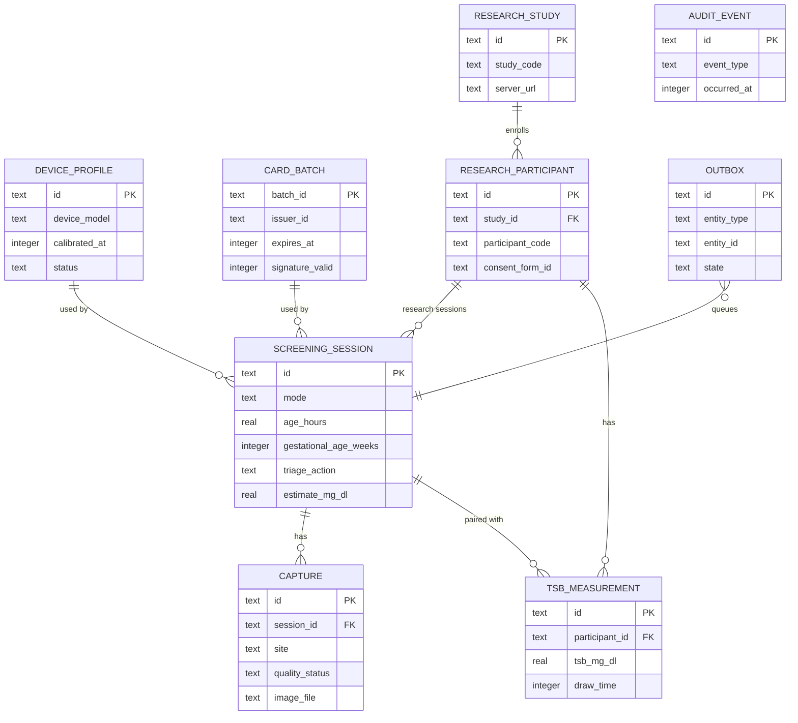
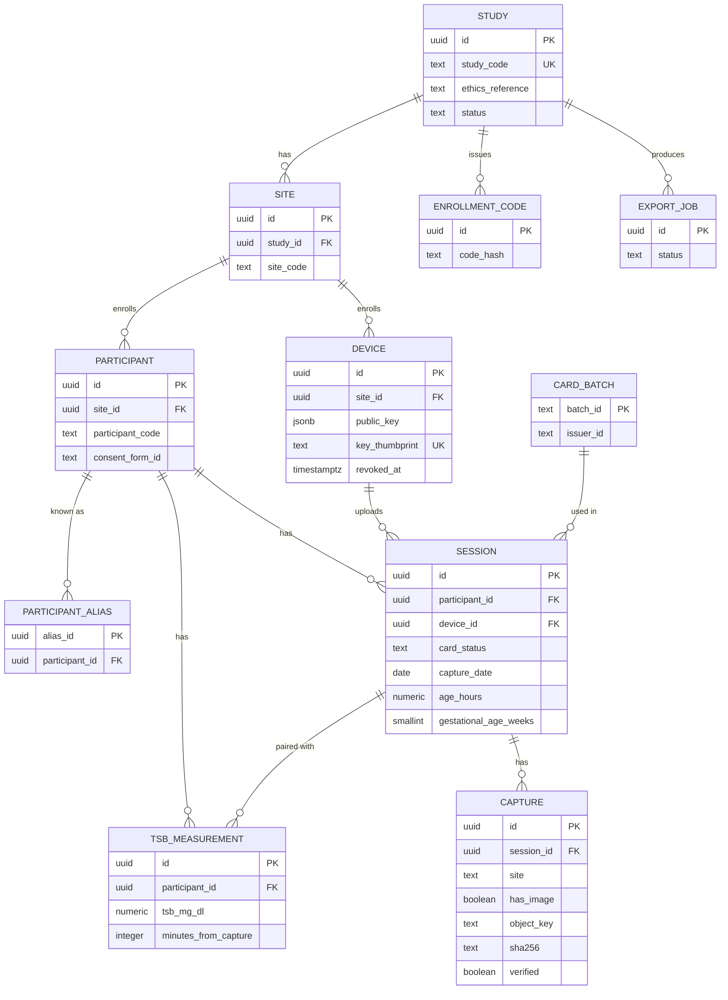

# NeoGold: Database Schema

| Field | Value |
|---|---|
| Document | 5 of 13 |
| Version | 0.3.2 (adds guardian consent confirmation; camera qualification fields, retention and register number rules; 0.3 adds device attestation and profile fields, the `auth_nonce` replay table, `NONUNIFORM_PATCHES`, participant aliases, card status, day-precision server dates, and the idempotency, outbox, and role changes from the doc 7 review) |
| Date | 10 October 2026 |
| Owner | Sowad Al-Mughni, Kitalon Labs |
| Depends on | `4_System_Architecture.md` |
| Status | Awaiting founder review |

---

## 1. Overview

NeoGold has two databases with deliberately different jobs:

| Database | Engine | Lives on | Holds | Never holds |
|---|---|---|---|---|
| **On-device** | SQLite through Room, encrypted with SQLCipher | Each phone | Screening log, device profile, card batches, research sessions and captures, outbox, local audit trail | Names, birth dates, screening images |
| **Study Intake** | PostgreSQL 16 | One VM per study, partner-hosted | Enrolled devices, participants (by code), research sessions, captures, TSB values, audit log | Screening-mode data, names, birth dates, phone numbers, addresses |

### Conventions

| Convention | Rule |
|---|---|
| Primary keys | UUID v4, generated on the device so records keep the same ID end to end |
| Timestamps | UTC. On device: epoch milliseconds (`INTEGER`). Backend: `timestamptz` |
| Bilirubin unit | **mg/dL**, stored as `REAL` on device and `numeric(4,1)` on the backend. AAP thresholds and Bangladeshi lab reports both use mg/dL [Likely for local labs]. The UI shows µmol/L as a secondary value (1 mg/dL = 17.1 µmol/L) |
| Enums | Stored as upper-case text with `CHECK` constraints |
| Versions | Every clinical record stores `app_version`, `model_version`, `config_version`, and the card `batch_id` |
| Soft deletes | Not used. Deletion is real deletion, recorded in the audit trail |
| Naming | `snake_case` tables and columns, singular table names |

---

## 2. On-Device Schema (Room on SQLCipher)

### 2.1 Entity relationship diagram



### 2.2 Tables

#### `device_profile`
One row per calibration of this phone. Only one is `ACTIVE`.

| Column | Type | Null | Notes |
|---|---|---|---|
| `id` | TEXT | No | PK, UUID |
| `manufacturer` | TEXT | No | `Build.MANUFACTURER` |
| `device_model` | TEXT | No | `Build.MODEL` |
| `android_api` | INTEGER | No | |
| `camera_id` | TEXT | No | Back camera used |
| `ram_mb` | INTEGER | No | Total RAM reported by the phone |
| `is_low_ram_device` | INTEGER | No | 0 or 1 (`ActivityManager.isLowRamDevice`, true on Android Go) |
| `camera_hardware_level` | TEXT | No | `LEGACY`, `LIMITED`, `FULL`, `LEVEL_3`, `EXTERNAL` |
| `supports_ae_lock` | INTEGER | No | 0 or 1; used when available, never required |
| `supports_awb_lock` | INTEGER | No | 0 or 1; used when available, never required |
| `supports_manual_sensor` | INTEGER | No | 0 or 1 |
| `supports_raw` | INTEGER | No | 0 or 1 |
| `residual_correction` | TEXT | Yes | JSON: device residual correction coefficients |
| `repeatability_de` | REAL | No | Mean Delta E 2000 between three qualification photos |
| `uniformity_de` | REAL | No | Difference between duplicate corner patches after correction |
| `calibration_residual_de` | REAL | No | Mean Delta E 2000 of corrected patches vs batch values |
| `qualification` | TEXT | No | `QUALIFIED` (screening allowed) or `RESEARCH_ONLY` |
| `card_batch_id` | TEXT | No | FK `card_batch.batch_id` used for calibration |
| `calibrated_at` | INTEGER | No | Epoch ms |
| `app_version` | TEXT | No | |
| `status` | TEXT | No | `ACTIVE`, `SUPERSEDED`, `FAILED` |

#### `card_batch`
Card batches seen by this phone, decoded from the card QR. Unverified batches are kept for research mode only.

| Column | Type | Null | Notes |
|---|---|---|---|
| `batch_id` | TEXT | No | PK, from QR |
| `issuer_id` | TEXT | No | Must exist in the bundled trust list |
| `format_version` | INTEGER | No | QR payload format |
| `reference_values` | TEXT | No | JSON array of CIELAB values per patch (D65) |
| `issued_at` | INTEGER | No | |
| `expires_at` | INTEGER | No | Screening blocked after this time |
| `signature_valid` | INTEGER | No | 0 or 1, result of offline Ed25519 check |
| `qr_payload` | BLOB | No | Exact signed payload, sent to the server as is |
| `server_status` | TEXT | No | `NOT_SENT`, `ACCEPTED`, `REJECTED` (server said `CARD_BATCH_INVALID`; its sessions go up as `UNVERIFIED`) |
| `first_seen_at` | INTEGER | No | |

#### `screening_session`
Every screening decision, including those that ended at a hard rule before the camera opened. Research sessions use the same table with `mode = 'RESEARCH'`.

| Column | Type | Null | Notes |
|---|---|---|---|
| `id` | TEXT | No | PK, UUID |
| `mode` | TEXT | No | `SCREENING`, `RESEARCH` |
| `status` | TEXT | No | `IN_PROGRESS`, `COMPLETED`, `ABANDONED` |
| `created_at` | INTEGER | No | Epoch ms |
| `completed_at` | INTEGER | Yes | |
| `age_hours` | REAL | No | Age at screening, computed from birth date and time, which is then discarded. `CHECK (age_hours >= 0 AND age_hours <= 720)` |
| `guardian_consent_confirmed` | INTEGER | No | Screening mode: 1, confirmed by the health worker before the camera (PRD D12, FR-37); a screen without consent is never saved. Research mode: paper consent via `consent_form_id` |
| `gestational_age_weeks` | INTEGER | No | `CHECK (gestational_age_weeks BETWEEN 22 AND 44)` |
| `flag_jaundice_under_24h` | INTEGER | No | 0 or 1 |
| `flag_danger_signs` | INTEGER | No | 0 or 1 |
| `flag_prior_phototherapy` | INTEGER | No | 0 or 1 |
| `rule_outcome` | TEXT | Yes | Hard rule ID that fired, for example `R2`, else null |
| `triage_action` | TEXT | Yes | `REFER_URGENT`, `BLOOD_TEST_TODAY`, `RECHECK`, `NO_FURTHER_ACTION_FROM_SCREEN`, `CANNOT_SCREEN_BLOOD_TEST`, `CANNOT_SCREEN_CLINICAL_REVIEW`, `BLOCKED`. Null while in progress |
| `reason_codes` | TEXT | Yes | JSON array, for example `["ZONE_ABS15"]` |
| `estimate_mg_dl` | REAL | Yes | Point estimate; null if no analysis ran |
| `estimate_low_mg_dl` | REAL | Yes | Lower bound of 90% interval |
| `estimate_high_mg_dl` | REAL | Yes | Upper bound of 90% interval |
| `threshold_mg_dl` | REAL | Yes | Phototherapy threshold used |
| `recheck_due_at` | INTEGER | Yes | Set only for `RECHECK` |
| `capture_attempts` | INTEGER | No | Default 0 |
| `register_number` | TEXT | Yes | Optional facility register number, screening mode only. Validated in the app: letters, digits, "/" and "-", max 20 characters; rejects 17-digit birth registration numbers, 10, 13, or 17-digit national ID numbers, and 11-digit mobile numbers starting with 01. Set to null by the retention job after 60 days |
| `register_number_erased_at` | INTEGER | Yes | When the retention job erased the register number |
| `participant_id` | TEXT | Yes | FK `research_participant.id`, research mode only |
| `estimate_hidden` | INTEGER | No | 1 when blinded in research mode |
| `experimental_label_shown` | INTEGER | No | 0 or 1 |
| `device_profile_id` | TEXT | Yes | FK `device_profile.id` |
| `card_batch_id` | TEXT | Yes | FK `card_batch.batch_id` |
| `app_version` | TEXT | No | |
| `model_version` | TEXT | Yes | |
| `config_version` | TEXT | No | |

Constraints:
- `CHECK (mode = 'SCREENING' OR participant_id IS NOT NULL)`: research sessions always belong to a participant.
- `CHECK (mode = 'RESEARCH' OR participant_id IS NULL)`: screening sessions never link to a participant.
- `CHECK (mode = 'SCREENING' OR register_number IS NULL)`: no register number in research mode.

#### `capture`
One row per accepted or rejected photo attempt.

| Column | Type | Null | Notes |
|---|---|---|---|
| `id` | TEXT | No | PK, UUID |
| `session_id` | TEXT | No | FK `screening_session.id`, `ON DELETE CASCADE` |
| `attempt_number` | INTEGER | No | 1 to 3 |
| `site` | TEXT | No | `STERNUM`, `FOREHEAD`, `SCLERA_FLASH`, `SCLERA_NOFLASH`, `CALIBRATION` |
| `captured_at` | INTEGER | No | |
| `iso` | INTEGER | Yes | Sensor sensitivity |
| `exposure_ns` | INTEGER | Yes | Exposure time |
| `ae_locked` | INTEGER | No | 0 or 1 |
| `awb_locked` | INTEGER | No | 0 or 1 |
| `color_gains` | TEXT | Yes | JSON, when the device reports them |
| `quality_status` | TEXT | No | `PASSED`, `FAILED` |
| `quality_fail_reasons` | TEXT | Yes | JSON array, for example `["GLARE","BLUR"]` |
| `correction_residual_de` | REAL | Yes | Mean Delta E 2000 on patches after correction |
| `features` | TEXT | Yes | JSON feature vector used by the model |
| `image_file` | TEXT | Yes | Encrypted file name, **research mode only**; always null in screening mode |
| `image_sha256` | TEXT | Yes | Hash of the encrypted-at-rest plaintext image, research mode only |

Constraint: `CHECK (image_file IS NULL OR image_sha256 IS NOT NULL)`.

#### `research_study`
Studies this phone is enrolled in. Usually one.

| Column | Type | Null | Notes |
|---|---|---|---|
| `id` | TEXT | No | PK, UUID |
| `study_code` | TEXT | No | Unique, from the study coordinator |
| `site_code` | TEXT | No | Site this phone belongs to |
| `display_name` | TEXT | No | |
| `server_url` | TEXT | Yes | Null means export-only study |
| `device_key_alias` | TEXT | Yes | Android Keystore alias of the device signing key |
| `server_device_id` | TEXT | Yes | ID returned at enrollment |
| `pin_hash` | BLOB | No | Argon2id of the PIN, then HMAC-SHA256 with a non-exportable Keystore key, so it cannot be brute-forced off the phone (doc 8 Section 6.2) |
| `pin_salt` | BLOB | No | |
| `failed_pin_attempts` | INTEGER | No | Default 0 |
| `locked_until` | INTEGER | Yes | Lockout after repeated failures |
| `timestamp_precision` | TEXT | No | `DAY_PLUS_OFFSETS` (default) or `FULL`; from the server's `upload_policy`, which must match the signed study profile |
| `time_zone` | TEXT | No | IANA zone for all uploaded dates; default `Asia/Dhaka` |
| `data_generation` | INTEGER | Yes | Last value seen from `GET /device`; a change triggers reconciliation (doc 7 Section 5.4) |
| `local_retention_after_ack_days` | INTEGER | No | Default 14, so a server restore from any nightly backup in the last 13 days can still be refilled from phones (doc 12 Section 8.2) |
| `export_public_key` | BLOB | Yes | 32-byte raw X25519 public key (K10) from the signed study profile for encrypting USB exports (doc 8 Section 5.2) |
| `status` | TEXT | No | `ACTIVE`, `CLOSED` |
| `enrolled_at` | INTEGER | No | |

#### `research_participant`
A participant code and consent reference. No personal data.

| Column | Type | Null | Notes |
|---|---|---|---|
| `id` | TEXT | No | PK, UUID |
| `study_id` | TEXT | No | FK `research_study.id` |
| `participant_code` | TEXT | No | Assigned by the study, written on the paper consent form. Format `^[A-Z]{2,5}-[0-9]{3,6}$` (for example `SKP-0142`), so a birth registration or ID number cannot be entered as a code (doc 7 Section 7) |
| `consent_form_id` | TEXT | No | Paper consent form reference; required before any capture (FR-26). Format `^[A-Z]{2,5}-[A-Z0-9-]{2,26}$` |
| `consent_recorded_at` | INTEGER | No | |
| `created_at` | INTEGER | No | |

Unique: `(study_id, participant_code)`.

#### `tsb_measurement`
Blood bilirubin values paired with research sessions.

| Column | Type | Null | Notes |
|---|---|---|---|
| `id` | TEXT | No | PK, UUID |
| `participant_id` | TEXT | No | FK `research_participant.id` |
| `session_id` | TEXT | Yes | FK `screening_session.id`; null until linked. Linking later re-sends the row once (doc 7 Section 7) |
| `tsb_mg_dl` | REAL | No | `CHECK (tsb_mg_dl > 0 AND tsb_mg_dl <= 40)` |
| `draw_time` | INTEGER | No | Time of blood draw |
| `method` | TEXT | No | `LAB`, `POINT_OF_CARE`, `OTHER` |
| `entered_at` | INTEGER | No | |

#### `outbox`
Every item waiting to go to the Study Intake Service.

| Column | Type | Null | Notes |
|---|---|---|---|
| `id` | TEXT | No | PK, UUID |
| `entity_type` | TEXT | No | `CARD_BATCH`, `PARTICIPANT`, `SESSION_MANIFEST`, `CAPTURE_IMAGE`, `TSB` |
| `entity_id` | TEXT | No | ID of the row being sent |
| `idempotency_key` | TEXT | No | Unique; reused on every retry; replaced only when the row is re-queued as a new revision |
| `revision` | INTEGER | No | Default 0; incremented when a TSB value is linked, or a client-bug failure is re-queued after an app update (doc 7 Section 5.2) |
| `dependency_requeues` | INTEGER | No | Default 0; at 3 the row becomes `FAILED_PERMANENT` |
| `payload_sha256` | TEXT | No | |
| `state` | TEXT | No | `PENDING`, `IN_FLIGHT`, `ACKED`, `FAILED_PERMANENT`; `IN_FLIGHT` rows are reset to `PENDING` when the worker starts |
| `attempts` | INTEGER | No | Default 0 |
| `last_error` | TEXT | Yes | Error code only, never payload content |
| `created_at` | INTEGER | No | |
| `updated_at` | INTEGER | No | |

Unique: `idempotency_key`. Unique: `(entity_type, entity_id)`; a re-send updates the existing row (new revision and key) instead of adding one.

#### `audit_event`
Local, append-only trail of security- and integrity-relevant actions.

| Column | Type | Null | Notes |
|---|---|---|---|
| `id` | TEXT | No | PK, UUID |
| `occurred_at` | INTEGER | No | |
| `event_type` | TEXT | No | `CONFIG_LOADED`, `CONFIG_REJECTED`, `MODEL_LOADED`, `CARD_REJECTED`, `STUDY_UNLOCKED`, `PIN_FAILED`, `EXPORT_CREATED`, `DATA_DELETED`, `RETENTION_PURGE`, `REGISTER_ERASURE`, `DEVICE_ENROLLED`, `DEVICE_QUALIFIED`, `DEVICE_RESEARCH_ONLY` |
| `details` | TEXT | Yes | JSON; never contains register numbers, participant codes, or estimates |

### 2.3 Indexes

| Table | Index | Purpose |
|---|---|---|
| `screening_session` | `(mode, created_at DESC)` | Log screen, newest first |
| `screening_session` | `(status)` | Find abandoned sessions for cleanup |
| `screening_session` | `(recheck_due_at)` where not null | Recheck reminders |
| `screening_session` | `(participant_id)` | Research views |
| `capture` | `(session_id, attempt_number)` | Load captures for a session |
| `research_participant` | Unique `(study_id, participant_code)` | Prevent duplicate codes |
| `tsb_measurement` | `(participant_id)`, `(session_id)` | Pairing |
| `outbox` | `(state, updated_at)` | Worker picks next items |
| `audit_event` | `(occurred_at)` | Export and review |

### 2.4 Settings (DataStore, not Room)

| Key | Type | Default |
|---|---|---|
| `language` | String | System language if Bangla or English, else English |
| `safety_ack_version` | Int | 0 (forces notice on first launch and after major model updates) |
| `onboarding_complete` | Boolean | false |
| `active_device_profile_id` | String | none |
| `screening_retention_days` | Int | 180 (allowed 30 to 365), PRD D7 |
| `register_number_retention_days` | Int | 60 (allowed 14 to 90), PRD D7 |
| `keep_screening_log` | Boolean | true (a facility can switch the log off entirely) |
| `app_lock_enabled` | Boolean | false (FR-35) |
| `measurement_digits` | String | `WESTERN` (see doc 6) |
| `crash_reporting_opt_in` | Boolean | false |

### 2.5 Retention and deletion jobs

| Job | Schedule | Action |
|---|---|---|
| Register number erasure | Daily (WorkManager) and on every app start | Set `register_number` to null on `SCREENING` sessions older than `register_number_retention_days`; record `register_number_erased_at` |
| Screening retention | Daily (WorkManager) and on every app start | Delete `SCREENING` sessions and their captures older than `screening_retention_days`; log `RETENTION_PURGE` with a count only |
| Abandoned session cleanup | Daily | Delete `IN_PROGRESS` sessions older than 24 hours |
| Research local retention | Daily | `local_retention_after_ack_days` after every related outbox item is `ACKED`, confirm with `GET /sessions/{id}` that the server reports `COMPLETE` or `REJECTED`, then delete research images and rows; a `404` or `RECEIVING` re-queues instead (doc 7 Section 5.4) |
| Delete all (user action) | On demand | Wipe database, encrypted files, and keys; recreate empty database |

### 2.6 Encryption at rest

- The whole database is encrypted with SQLCipher. The database key is 32 random bytes generated on first launch, wrapped by an AES key in Android Keystore, and stored in app-private storage.
- Research images are encrypted files (Tink streaming AEAD), keyset wrapped by a separate Keystore key.
- Full key lifecycle, backup exclusion, and PIN hashing are specified in `8_Security_Compliance_Plan.md`.

### 2.7 Migrations

- Room `exportSchema = true`; schema JSON committed to the repository.
- Every schema change ships with a migration and a migration test that opens the previous schema with fixture data.
- Destructive migration is forbidden for research tables. A migration that cannot preserve research data blocks the release.

---

## 3. Study Intake Schema (PostgreSQL 16)

### 3.1 Entity relationship diagram



### 3.2 DDL

```sql
-- gen_random_uuid() is built into PostgreSQL 13 and later, so no extension (and no extra privilege) is needed.

-- Study and sites
CREATE TABLE study (
    id                 uuid PRIMARY KEY DEFAULT gen_random_uuid(),
    study_code         text NOT NULL UNIQUE,
    name               text NOT NULL,
    partner_institution text NOT NULL,
    ethics_reference   text NOT NULL,
    timestamp_precision text NOT NULL DEFAULT 'DAY_PLUS_OFFSETS'
                       CHECK (timestamp_precision IN ('DAY_PLUS_OFFSETS','FULL')),
    retention_until    date NOT NULL,
    time_zone          text NOT NULL DEFAULT 'Asia/Dhaka',
    min_app_version    text NOT NULL DEFAULT '1.0.0',
    wifi_only          boolean NOT NULL DEFAULT true,
    max_image_bytes    integer NOT NULL DEFAULT 20000000 CHECK (max_image_bytes BETWEEN 1 AND 20000000),
    max_requests_per_minute integer NOT NULL DEFAULT 60,
    data_generation    bigint NOT NULL DEFAULT 1,   -- set to the Unix time of the restore by `restore mark`, so it always increases
    status             text NOT NULL DEFAULT 'ACTIVE'
                       CHECK (status IN ('ACTIVE','PAUSED','CLOSED')),
    created_at         timestamptz NOT NULL DEFAULT now()
);

CREATE TABLE site (
    id          uuid PRIMARY KEY DEFAULT gen_random_uuid(),
    study_id    uuid NOT NULL REFERENCES study(id),
    site_code   text NOT NULL,
    name        text NOT NULL,
    is_test     boolean NOT NULL DEFAULT false,  -- test sites (ZZTEST) are excluded from every export
    created_at  timestamptz NOT NULL DEFAULT now(),
    UNIQUE (study_id, site_code)
);

-- Devices and enrollment
CREATE TABLE enrollment_code (
    id          uuid PRIMARY KEY DEFAULT gen_random_uuid(),
    study_id    uuid NOT NULL REFERENCES study(id),
    site_id     uuid NOT NULL REFERENCES site(id),
    code_hash   text NOT NULL UNIQUE,          -- hash only; plaintext shown once to the coordinator
    expires_at  timestamptz NOT NULL,
    used_at     timestamptz,
    device_id   uuid,
    enroll_idempotency_key uuid,                -- replay of a lost 201 (doc 7 Section 4.1)
    enroll_key_thumbprint  text,
    created_at  timestamptz NOT NULL DEFAULT now()
);

CREATE TABLE device (
    id             uuid PRIMARY KEY DEFAULT gen_random_uuid(),
    site_id        uuid NOT NULL REFERENCES site(id),
    public_key     jsonb NOT NULL,             -- device signing key as a P-256 JWK
    key_thumbprint text NOT NULL UNIQUE,       -- RFC 7638 JWK thumbprint, base64url
    key_algorithm  text NOT NULL CHECK (key_algorithm IN ('ES256')),
    attestation    text NOT NULL DEFAULT 'NONE'
                   CHECK (attestation IN ('NONE','VERIFIED','FAILED')),
    manufacturer   text NOT NULL,
    device_model   text NOT NULL,
    android_api    smallint NOT NULL CHECK (android_api >= 26),
    camera_hardware_level text NOT NULL,
    qualification  text NOT NULL CHECK (qualification IN ('QUALIFIED','RESEARCH_ONLY')),
    app_version    text NOT NULL,
    enrolled_at    timestamptz NOT NULL DEFAULT now(),
    last_seen_on   date,
    revoked_at     timestamptz,
    revoked_reason text CHECK (revoked_reason IN ('LOST','STOLEN','REASSIGNED','SELF_UNENROLLED','COMPROMISED','STUDY_ENDED'))
);

-- Replay protection for device-signed request tokens (doc 7 Section 4)
CREATE TABLE auth_nonce (
    jti         uuid PRIMARY KEY,
    device_id   uuid NOT NULL REFERENCES device(id),
    expires_at  timestamptz NOT NULL
);

ALTER TABLE enrollment_code
    ADD CONSTRAINT enrollment_code_device_fk FOREIGN KEY (device_id) REFERENCES device(id);

-- Card batches seen in uploads (for per-batch analysis)
CREATE TABLE card_batch (
    batch_id         text PRIMARY KEY,
    issuer_id        text NOT NULL,
    qr_payload       bytea NOT NULL,           -- exact signed payload, re-verifiable
    issuer_key_id    text NOT NULL,
    reference_values jsonb NOT NULL,
    issued_at        date NOT NULL,
    expires_at       date NOT NULL,
    first_seen_at    timestamptz NOT NULL DEFAULT now()
);

-- Participants (codes only)
CREATE TABLE participant (
    id                uuid PRIMARY KEY,         -- client-generated UUID
    site_id           uuid NOT NULL REFERENCES site(id),
    participant_code  text NOT NULL,
    consent_form_id   text NOT NULL,
    consent_date      date NOT NULL,
    withdrawn_on      date,                     -- set by `participant withdraw`; sessions rejected, images and TSB values deleted
    created_on        date NOT NULL DEFAULT current_date,
    UNIQUE (site_id, participant_code)
);

-- A second phone's UUID for the same participant (doc 7 Section 3)
CREATE TABLE participant_alias (
    alias_id        uuid PRIMARY KEY,
    participant_id  uuid NOT NULL REFERENCES participant(id),
    device_id       uuid NOT NULL REFERENCES device(id),
    created_on      date NOT NULL DEFAULT current_date
);

-- Research sessions
CREATE TABLE session (
    id                      uuid PRIMARY KEY,   -- same UUID as on the device
    participant_id          uuid NOT NULL REFERENCES participant(id),  -- canonical ID; aliases resolved on write
    device_id               uuid NOT NULL REFERENCES device(id),
    card_status             text NOT NULL CHECK (card_status IN ('VERIFIED','EXPIRED','UNVERIFIED')),
    card_batch_id           text REFERENCES card_batch(batch_id),
    capture_date            date NOT NULL,      -- calendar date in study.time_zone
    captured_at             timestamptz,        -- only when study.timestamp_precision = 'FULL'
    age_hours               numeric(5,1) NOT NULL CHECK (age_hours BETWEEN 0 AND 720),
    gestational_age_weeks   smallint NOT NULL CHECK (gestational_age_weeks BETWEEN 22 AND 44),
    flag_jaundice_under_24h boolean NOT NULL,
    flag_danger_signs       boolean NOT NULL,
    flag_prior_phototherapy boolean NOT NULL,
    estimate_mg_dl          numeric(4,1),       -- computed on device, hidden from user
    estimate_low_mg_dl      numeric(4,1),
    estimate_high_mg_dl     numeric(4,1),
    app_version             text NOT NULL,
    model_version           text,
    config_version          text NOT NULL,
    manifest_sha256         text NOT NULL,
    status                  text NOT NULL DEFAULT 'RECEIVING'
                            CHECK (status IN ('RECEIVING','COMPLETE','REJECTED')),
    rejected_reason         text CHECK (rejected_reason IN ('CONSENT_WITHDRAWN','DATA_ERROR')),
    received_on             date NOT NULL DEFAULT current_date,  -- day precision only
    completed_on            date,
    CHECK ((card_status = 'UNVERIFIED') = (card_batch_id IS NULL)),
    CHECK ((status = 'REJECTED') = (rejected_reason IS NOT NULL))
);

CREATE TABLE capture (
    id                     uuid PRIMARY KEY,    -- same UUID as on the device
    session_id             uuid NOT NULL REFERENCES session(id) ON DELETE CASCADE,
    attempt_number         smallint NOT NULL CHECK (attempt_number BETWEEN 1 AND 3),
    site                   text NOT NULL CHECK (site IN
                           ('STERNUM','FOREHEAD','SCLERA_FLASH','SCLERA_NOFLASH','CALIBRATION')),
    capture_metadata       jsonb NOT NULL,      -- ISO, exposure, AE/AWB lock, gains
    quality_status         text NOT NULL CHECK (quality_status IN ('PASSED','FAILED')),
    quality_fail_reasons   jsonb,
    correction_residual_de numeric(5,2),
    features               jsonb,
    has_image              boolean NOT NULL,    -- false: image lost on the phone, nothing to upload
    object_key             text,                -- path in the encrypted image store
    sha256                 text,
    size_bytes             integer CHECK (size_bytes > 0 AND size_bytes <= 20000000),
    verified               boolean NOT NULL DEFAULT false,  -- stored file hash matches sha256
    CHECK (has_image = (sha256 IS NOT NULL)),
    CHECK (has_image = (size_bytes IS NOT NULL)),
    CHECK (has_image OR NOT verified)
);

CREATE TABLE tsb_measurement (
    id                    uuid PRIMARY KEY,
    participant_id        uuid NOT NULL REFERENCES participant(id),
    session_id            uuid REFERENCES session(id),
    tsb_mg_dl             numeric(4,1) NOT NULL CHECK (tsb_mg_dl > 0 AND tsb_mg_dl <= 40),
    minutes_from_capture  integer CHECK (minutes_from_capture BETWEEN -10080 AND 10080),
                                                -- draw time minus capture time; negative if drawn first
    draw_time             timestamptz,          -- only when study.timestamp_precision = 'FULL'
    method                text NOT NULL CHECK (method IN ('LAB','POINT_OF_CARE','OTHER')),
    received_on           date NOT NULL DEFAULT current_date,
    linked_on             date                  -- set by the one allowed null-to-session update
);

-- Safe retries
CREATE TABLE idempotency_record (
    device_id        uuid NOT NULL REFERENCES device(id),
    idempotency_key  uuid NOT NULL,
    request_sha256   text NOT NULL,             -- declared digest for image uploads
    state            text NOT NULL CHECK (state IN ('IN_PROGRESS','DONE')),
    response_status  smallint,                  -- set when DONE; only final outcomes are kept (doc 7 Section 5.1)
    response_body    jsonb,
    created_at       timestamptz NOT NULL DEFAULT now(),  -- purged after 30 days, never exported
    PRIMARY KEY (device_id, idempotency_key),
    CHECK ((state = 'DONE') = (response_status IS NOT NULL))
);

-- Append-only audit trail
CREATE TABLE audit_log (
    id           bigserial PRIMARY KEY,
    occurred_at  timestamptz NOT NULL DEFAULT now(),
    actor_type   text NOT NULL CHECK (actor_type IN ('DEVICE','ADMIN','SYSTEM')),
    actor_id     text NOT NULL,
    action       text NOT NULL,                 -- e.g. DEVICE_ENROLLED, DEVICE_REVOKED, EXPORT_CREATED; no per-session events
    target_type  text,
    target_id    text,
    details      jsonb                          -- never contains image data or participant codes
);

-- De-identified exports
CREATE TABLE export_job (
    id            uuid PRIMARY KEY DEFAULT gen_random_uuid(),
    study_id      uuid NOT NULL REFERENCES study(id),
    requested_by  text NOT NULL,
    filters       jsonb,
    status        text NOT NULL DEFAULT 'PENDING'
                  CHECK (status IN ('PENDING','RUNNING','DONE','FAILED')),
    output_path   text,
    output_sha256 text,
    created_at    timestamptz NOT NULL DEFAULT now(),
    finished_at   timestamptz
);
```

### 3.3 Indexes

```sql
CREATE INDEX idx_device_site            ON device (site_id) WHERE revoked_at IS NULL;
CREATE INDEX idx_participant_site       ON participant (site_id);
CREATE INDEX idx_session_participant    ON session (participant_id);
CREATE INDEX idx_session_device_date    ON session (device_id, capture_date);
CREATE INDEX idx_session_status         ON session (status) WHERE status <> 'COMPLETE';
CREATE INDEX idx_session_batch          ON session (card_batch_id);
CREATE INDEX idx_capture_session        ON capture (session_id);
CREATE INDEX idx_capture_unverified     ON capture (session_id) WHERE has_image AND NOT verified;
CREATE INDEX idx_alias_participant      ON participant_alias (participant_id);
CREATE INDEX idx_tsb_participant        ON tsb_measurement (participant_id);
CREATE INDEX idx_tsb_session            ON tsb_measurement (session_id);
CREATE INDEX idx_idempotency_created    ON idempotency_record (created_at);
CREATE INDEX idx_auth_nonce_expiry      ON auth_nonce (expires_at);
CREATE INDEX idx_audit_time             ON audit_log (occurred_at);
```

### 3.4 Integrity rules enforced by the service

| Rule | Where |
|---|---|
| A session is `COMPLETE` only when every capture listed with `has_image` true is stored and verified | API, in the image transaction, after `SELECT ... FOR UPDATE` on the session row; plus a nightly backstop job |
| A participant UUID from a second phone with the same code and consent form ID becomes a `participant_alias`; sessions and TSB values are stored against the canonical ID | API |
| A TSB row changes at most once, from `session_id` null to a session, setting `linked_on` | API |
| Uploads from revoked devices are rejected | API middleware |
| A participant code belongs to exactly one site | Unique constraint |
| `audit_log` is append-only | Application role has `INSERT` and `SELECT` only; `UPDATE` and `DELETE` revoked |
| Idempotency records older than 30 days are purged | Nightly job |
| Expired `auth_nonce` rows (`expires_at` is the token `exp` plus 30 seconds) are purged | Job every 10 minutes |
| A `jti` is accepted once; a second insert fails on the primary key and the request is rejected as `AUTH_REPLAY` | Primary key |
| Data past `study.retention_until` is flagged for deletion, never auto-deleted | Admin CLI warning; deletion needs explicit coordinator action |

### 3.5 Database roles

| Role | Privileges |
|---|---|
| `neogold_migrator` | DDL, used only by Alembic during deployment |
| `neogold_app` | `SELECT`, `INSERT`, `UPDATE` on data tables; `DELETE` on `auth_nonce` and `idempotency_record` only (purge jobs and dropping `IN_PROGRESS` rows); `INSERT`, `SELECT` on `audit_log`; no DDL |
| `neogold_purge` | `SELECT` and `DELETE` on data tables, used only by `neogold-admin retention purge`, `session reject`, and `participant withdraw`, each run audited |

Roles and default privileges are created once by `neogold-bootstrap` (doc 12 Appendix D.5), which was tested against PostgreSQL 16: the application role can read and write but not delete, the export role can only read, and the purge role can delete [Certain, 11 October 2026].
| `neogold_export` | `SELECT` only, used by the export command |

### 3.6 Image store layout

```
<store-root>/<study_code>/<site_code>/<session_id>/<capture_id>.jpg
```

- Stored on an encrypted volume (or S3-compatible bucket with server-side encryption).
- Paths contain only codes and UUIDs.
- File hash re-verified on write and during export.

### 3.7 Migrations

Alembic, forward-only in production, every migration reviewed and tested against a copy of a fixture database. Backups (nightly restic snapshots) are verified by a monthly test restore, specified in `12_Deployment_Runbook.md`.

---

## 4. Device-to-Server Field Mapping

| Device (`screening_session` / `capture` / `tsb_measurement`) | Server | Transformation |
|---|---|---|
| `screening_session.id` | `session.id` | Same UUID |
| `created_at` | `capture_date` (and `captured_at` only if `FULL`) | Calendar date in the study time zone (`Asia/Dhaka` by default), not UTC |
| `age_hours` | `age_hours` | Rounded to 0.1 |
| `gestational_age_weeks`, flags | Same | None |
| `estimate_*_mg_dl` | Same | Rounded to 0.1; never shown to study staff in-app |
| `register_number` | Not sent | Research sessions never have one |
| `capture.*` metadata | `capture.capture_metadata` | Packed into JSON |
| `capture.image_file` | Image upload, then `object_key` | Decrypted on device, sent over TLS, stored encrypted |
| `tsb_measurement.draw_time` | `minutes_from_capture` (and `draw_time` only if `FULL`) | Offset computed on device |
| `card_batch_id` | `session.card_batch_id` and `session.card_status`, plus a `card_batch` row | Batch row sent once per verified batch; sessions on unverified cards go up as `UNVERIFIED` with no batch |

---

## 5. Data Dictionary: Enumerations

| Enum | Values |
|---|---|
| `mode` | `SCREENING`, `RESEARCH` |
| `triage_action` | `REFER_URGENT`, `BLOOD_TEST_TODAY`, `RECHECK`, `NO_FURTHER_ACTION_FROM_SCREEN`, `CANNOT_SCREEN_BLOOD_TEST`, `CANNOT_SCREEN_CLINICAL_REVIEW`, `BLOCKED` |
| `site` | `STERNUM`, `FOREHEAD`, `SCLERA_FLASH`, `SCLERA_NOFLASH`, `CALIBRATION` |
| `quality_fail_reason` | `NO_CARD`, `CARD_ANGLE`, `NONUNIFORM_PATCHES`, `BLUR`, `GLARE`, `UNDEREXPOSED`, `OVEREXPOSED`, `UNEVEN_LIGHT`, `HIGH_RESIDUAL`, `WINDOW_NOT_SKIN` (mapping to checks in doc 4 Section 5.3) |
| `reason_code` | `R1` to `R5` (hard rules), `QUALITY_FALLBACK`, `ABOVE_THRESHOLD`, `ZONE_WITHIN3`, `ZONE_ABS15`, `WIDE_INTERVAL`, `RECHECK_ZONE`, `CONFIG_INVALID`, `CARD_INVALID` |
| `outbox.state` | `PENDING`, `IN_FLIGHT`, `ACKED`, `FAILED_PERMANENT` |
| `card_status` | `VERIFIED`, `EXPIRED`, `UNVERIFIED` |

---

## 6. Open Issues for Review

1. **Identifier formats:** confirm the birth registration, national ID, and mobile number patterns with the partner before v1.0.
2. **Full timestamps:** default `DAY_PLUS_OFFSETS`; the first study's ethics protocol may require `FULL` for audit.

Resolved (PRD D7, D8): retention 180 days with register numbers erased at 60 days; register number kept as an optional, validated field.
