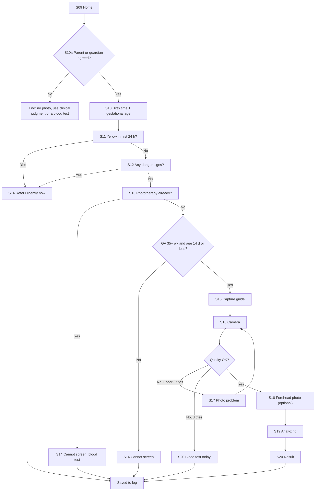

# NeoGold: UI/UX Guidelines

| Field | Value |
|---|---|
| Document | 6 of 13 |
| Version | 0.2.2 (adds guardian consent S10a and decision-support wording on results; low-end phone baseline, camera qualification screens, register number rules; 0.2.1 adds enrollment screens R08 and R09, upload error microcopy for doc 7, and phone-clock checks on S10) |
| Date | 10 October 2026 |
| Owner | Sowad Al-Mughni, Kitalon Labs |
| Depends on | `2_PRD.md` v0.3, `4_System_Architecture.md` v0.2 |
| Status | Awaiting founder review |

---

## 1. Design Principles

| # | Principle | What it means on screen |
|---|---|---|
| 1 | **The action is the answer** | The result screen leads with what to do (refer, test, recheck), not with a number |
| 2 | **Never reassure falsely** | No "safe," "normal," "healthy," or green check marks. The lowest result still tells the worker to watch for danger signs |
| 3 | **Never color alone** | Every clinical state has color plus icon plus words plus position. Red and orange look alike to many color-blind users |
| 4 | **One decision per screen** | Each step asks one thing, with one primary button |
| 5 | **Bangla first** | Layouts are designed with Bangla text, which runs longer and taller than English, then checked in English |
| 6 | **Works with gloves, in glare, in the dark** | Large targets, high contrast, readable at arm's length in a bright ward and a dim home |
| 7 | **Under a minute** | No decorative screens. Defaults that are almost always right. Auto-capture instead of a shaky tap |
| 8 | **Honest about limits** | The experimental label, model version, and "Always confirm with a blood test" appear on every result |
| 9 | **The camera screen stays neutral** | No colored interface near the baby while capturing, so screen light does not tint the skin |

---

## 2. Design Tokens

### 2.1 Color

All text and background pairs below were checked against WCAG 2.x contrast. Every pair meets 4.5:1; most exceed 7:1.

**Light theme**

| Token | Hex | Use | Contrast |
|---|---|---|---|
| `bg` | `#FFFFFF` | Screen background | |
| `surface` | `#F5F7F8` | Cards, input fields | |
| `text.primary` | `#1A1F24` | Body text | 16.6:1 on `bg` |
| `text.secondary` | `#4A5560` | Hints, labels | 7.6:1 on `bg` |
| `primary` | `#0B5C68` | Primary buttons, links, focus | 7.7:1 white on `primary` |
| `outline` | `#C5CDD3` | Borders, dividers | Decorative |
| `error` | `#B3261E` | Input errors (not triage) | 6.5:1 white on `error` |

**Triage colors** (solid header with white text, tinted body with dark text)

| Action | Solid | White text contrast | Tint | Text on tint | Contrast |
|---|---|---|---|---|---|
| Refer urgently now | `#B3261E` | 6.5:1 | `#FDECEA` | `#8C1D18` | 8.0:1 |
| Blood test today | `#A14400` | 6.3:1 | `#FFF1E6` | `#7A3300` | 8.3:1 |
| Screen again later | `#1E4FB8` | 7.3:1 | `#EAF0FC` | `#173E91` | 8.6:1 |
| No further action from this screen | `#475569` | 7.6:1 | `#F1F5F9` | `#334155` | 9.5:1 |
| Experimental label | n/a | n/a | `#FFF7DB` | `#5B3E00` | 9.2:1 |

**Dark theme**

| Token | Hex | Contrast |
|---|---|---|
| `bg` | `#12161A` | |
| `text.primary` | `#E8ECEF` | 15.3:1 |
| `text.secondary` | `#AAB4BE` | 8.6:1 |
| `primary` | `#7FD3DE` | 10.6:1 |
| Urgent tint / text | `#3A1210` / `#FFB4AB` | 9.7:1 |
| Blood test tint / text | `#3A1E08` / `#FFB68A` | 9.0:1 |
| Recheck tint / text | `#0F1F3D` / `#AFC6FF` | 9.6:1 |
| No further action tint / text | `#1E2530` / `#CBD5E1` | 10.4:1 |

**Brand color rule.** The NeoGold name invites a gold brand color. Gold and yellow are kept to the logo and splash screen only. Yellow is the color of jaundice; it must never appear near the camera, on results, or anywhere it could be read as a clinical signal.

**Camera screen colors.** Neutral dark gray overlay `#2B2F33` with white text (13.5:1). No colored elements on screen during capture.

### 2.2 Typography

| Role | Font | Size | Weight | Line height |
|---|---|---|---|---|
| Result action | Noto Sans Bengali / Noto Sans | 28 sp | Bold | 1.3 |
| Screen title | same | 22 sp | SemiBold | 1.35 |
| Question text | same | 20 sp | Medium | 1.5 |
| Body | same | 16 sp (Bangla 17 sp) | Regular | 1.5 |
| Label, hint | same | 14 sp | Medium | 1.4 |
| Version footer | same | 12 sp | Regular | 1.4 (only non-essential text may use 12 sp) |

- Noto Sans and Noto Sans Bengali are open fonts under the SIL Open Font License [Certain]. Bundle them so rendering does not depend on the phone's fonts, which vary on low-cost devices [Likely].
- Bangla conjuncts and vowel signs need extra vertical space; never set Bangla below 1.5 line height.
- Support system font scaling to 200%. Layouts must reflow, not clip.

### 2.3 Spacing, shape, and size

| Token | Value |
|---|---|
| Design baseline | 360 dp wide, 720 x 1600 px HD+ screen, the typical budget phone in Bangladesh (doc 1, Section 13.3); every screen also checked at 320 dp |
| Grid | 8 dp base, 4 dp for fine alignment |
| Screen side padding | 16 dp |
| Minimum touch target | 48 x 48 dp |
| Primary button height | 56 dp (64 dp on result and capture screens, for gloved hands) |
| Yes/No answer buttons | Full width, 64 dp tall, 12 dp gap |
| Corner radius | 12 dp cards, 28 dp buttons |
| Elevation | Flat; borders instead of shadows (shadows disappear in glare) |

### 2.4 Iconography

Material Symbols Rounded (Apache 2.0) [Certain], 24 dp default, 32 dp on triage headers.

| Meaning | Icon | Notes |
|---|---|---|
| Refer urgently | `emergency` or octagon warning | Always paired with the word "urgently" |
| Blood test today | `bloodtype` | |
| Screen again later | `schedule` | Shows the hours |
| No further action | `visibility` (watch) | Deliberately not a check mark |
| Cannot screen | `block` | |
| Experimental | `science` | |
| Research mode | `lab_profile` | Visible on every research screen |

### 2.5 Motion

- Transitions 200 ms or less; no motion on result screens.
- Respect the system "remove animations" setting.
- Haptic tick on successful card detection, double tick on capture.

---

## 3. Triage Visual Language

Each result has four redundant signals so it is unmistakable even in glare, on a cracked screen, or for a color-blind user.

| Signal | Refer urgently now | Blood test today | Screen again in N hours | No further action from this screen |
|---|---|---|---|---|
| Header color | Red `#B3261E` | Orange `#A14400` | Blue `#1E4FB8` | Slate `#475569` |
| Icon | Octagon warning | Blood drop | Clock | Eye |
| Border | 4 dp solid | 4 dp solid | 2 dp solid | 2 dp dashed |
| Words | "Refer urgently now" | "Blood test today" | "Screen again in 24 hours" | "No further action from this screen" |
| Next step line | "Arrange transport to the hospital now." | "Send for a blood test today." | "Check again at [time]. Come back sooner if danger signs appear." | "Continue routine care. Watch for danger signs." |

"Cannot screen" outcomes use a neutral gray card with the `block` icon and a single instruction ("Use a blood test" or "This baby needs a doctor's review").

---

## 4. Component Hierarchy

Components live in `:core:designsystem` (atoms, molecules) and the feature modules (organisms). Names use the `Ng` prefix.

### 4.1 Atoms

| Component | Purpose | Rules |
|---|---|---|
| `NgPrimaryButton` | The one main action per screen | Full width, 56 or 64 dp, label states the outcome ("Take photo," not "Next") |
| `NgSecondaryButton` | Alternative action | Outlined, never more than one per screen |
| `NgTextButton` | Low-emphasis action | Help, cancel |
| `NgYesNoButtons` | Answer a yes/no question | Two full-width buttons, no default selection |
| `NgNumberStepper` | Gestational age | Large minus and plus buttons around the number, range 22 to 44 |
| `NgIcon` | Icon with mandatory content description | Decorative icons marked as such |
| `NgBadge` | Small status tag | Text required |

### 4.2 Molecules

| Component | Purpose |
|---|---|
| `NgBirthTimeField` | Date and time of birth with a live "Age: 52 hours" readout so the worker can sanity-check |
| `NgSafetyQuestion` | One question, its explanation, and `NgYesNoButtons` |
| `NgDangerSignsList` | The four danger signs with icons, used inside the danger signs question |
| `NgStepIndicator` | "Step 2 of 4" text plus dots |
| `NgQualityFeedback` | Plain-language reason a photo failed and how to fix it, with an illustration |
| `NgExperimentalBanner` | Amber tinted banner: "Experimental. Not yet validated in Bangladesh." |
| `NgEstimateRangeBar` | Horizontal bar showing the estimated range against the threshold for this baby's age |
| `NgVersionFooter` | App, model, config versions and card batch |
| `NgSyncStatusChip` | Research mode only: "3 waiting to upload" |

### 4.3 Organisms

| Component | Purpose |
|---|---|
| `NgTriageCard` | Header (color, icon, action), next-step line, reason, range bar |
| `NgCaptureOverlay` | Card outline guide, corner detection markers, distance and steadiness cues, neutral colors |
| `NgSafetyNoticePager` | Three-screen safety notice with acknowledgment |
| `NgCalibrationChecklist` | Card scan, lighting check, calibration photo, result |
| `NgSessionRow` | Log row: time, age, action icon and word, register number if any |
| `NgParticipantHeader` | Research mode: participant code, consent ID, study badge |

### 4.4 Templates

| Template | Used by |
|---|---|
| Wizard step (title, question, content, primary button, back) | Onboarding, inputs, safety questions, research protocol |
| Full-bleed camera | Calibration photo, screening capture, research capture |
| Result | Screening result, rule outcome, cannot-screen outcome |
| List with filter | Screening log, research sessions |
| Settings list | Settings, About |

---

## 5. Screen Inventory

| ID | Screen | Primary action | Backlog |
|---|---|---|---|
| S01 | Language choice | Choose Bangla or English | NG-002 |
| S02 to S04 | Safety notice (3 pages) | "I understand" | NG-003 |
| S05 | Device check and battery settings | Follow brand-specific steps (TECNO, Infinix, itel, Xiaomi, Samsung), then Continue | NG-004 |
| S06 | Card scan (QR) | Scan card | NG-039 |
| S07 | Camera qualification (3 photos) | Take photo 1, 2, 3 | NG-007 |
| S08 | Qualification result | "This phone can screen" or "This phone can be used for research only" with the reason | NG-007 |
| S09 | Home | New screening | |
| S10a | Parent or guardian consent | Yes, or No (ends the screen, no photo) | NG-056 |
| S10 | Birth time and gestational age | Next | NG-017 |
| S11 to S13 | Safety questions (early jaundice, danger signs, phototherapy) | Yes or No | NG-018 |
| S14 | Rule outcome (urgent or cannot screen) | Save to log | NG-019 |
| S15 | Capture guide | Open camera | NG-008 |
| S16 | Camera | Auto-capture (manual button as fallback) | NG-009, NG-010 |
| S17 | Photo problem | Retake | NG-011, NG-012 |
| S18 | Optional forehead photo | Add forehead photo, or skip | NG-040 |
| S19 | Analyzing | None (under 3 s) | NG-015 |
| S20 | Result | Save to log | NG-021, NG-022 |
| S21 | Screening log | Open a session | NG-023 |
| S22 | Session detail | Back | NG-023 |
| S23 | Settings | Various | |
| S24 | About and model card | Back | NG-027 |
| S25 | Delete all data (confirm) | Delete | NG-026 |
| R01 | Research unlock (scan signed study QR, set or enter PIN) | Unlock | NG-028 |
| R02 | Study home | New participant session | NG-028 |
| R03 | Participant and consent | Confirm consent ID | NG-029 |
| R04 | Research capture protocol | Start captures | NG-030, NG-041 |
| R05 | TSB entry | Save TSB | NG-031 |
| R06 | Session complete | Done | |
| R07 | Export and sync | Export to USB, or upload now | NG-036, NG-042 |
| R08 | Study server enrollment (scan signed study QR, enter one-time code, confirm study name and server) | Join study | NG-042 |
| R09 | Leave study (confirm) | Leave study | NG-042 |

---

## 6. Key Flows

### 6.1 Screening



Gestational age is collected on S10, so the gestational age check needs no extra screen; it is evaluated before the camera opens.

### 6.2 Research session

`R01 Unlock` → `R02 Study home` → `R03 Participant code + consent ID` → `S10 to S13 inputs` → `R04 Captures: sternum, forehead, sclera flash, sclera no-flash (estimate hidden)` → `R05 TSB value and draw time (now or later)` → `R06 Complete` → outbox.

---

## 7. Wireframes

### 7.1 Home (S09)

```
+--------------------------------------+
|  NeoGold                     [gear]  |
|                                      |
|  [science] Experimental. Not yet     |
|  validated in Bangladesh.            |
|                                      |
|                                      |
|  +--------------------------------+  |
|  |        NEW SCREENING           |  |  64 dp primary
|  +--------------------------------+  |
|                                      |
|  Today: 6 screenings                 |
|  [clock] 1 recheck due at 3:00 PM    |
|                                      |
|  [list] Screening log                |
|                                      |
|  Card batch NG-2026-001 valid        |
|  until 31 Jan 2027                   |
+--------------------------------------+
```

### 7.2 Birth time and gestational age (S10)

```
+--------------------------------------+
|  <  Step 1 of 4                      |
|                                      |
|  When was the baby born?             |
|  +--------------------------------+  |
|  | 9 Oct 2026      08:30 AM       |  |
|  +--------------------------------+  |
|  Age now: 52 hours                   |
|  Phone time now: 11 Oct 12:30 PM     |
|                                      |
|  Gestational age (weeks)             |
|     [ - ]      38      [ + ]         |
|                                      |
|  +--------------------------------+  |
|  |             NEXT               |  |
|  +--------------------------------+  |
+--------------------------------------+
```

The "Phone time now" line lets the health worker catch a wrong phone clock, because age in hours is computed from it (doc 8 Section 14, H2). The gestational age stepper starts empty and Next stays disabled until it is set; the "38" in the sketch shows a set value, not a default, because a silent default would hide a missing answer (doc 8 Section 14, H3).

### 7.3 Camera (S16)

```
+--------------------------------------+
| (live preview, neutral gray chrome)  |
|                                      |
|    +-------------------------+       |
|    | o                     o |       |  corner markers fill in
|    |                         |       |  as they are detected
|    |        [ window ]       |       |
|    |                         |       |
|    | o                     o |       |
|    +-------------------------+       |
|                                      |
|  Hold the phone steady, 20 cm away   |
|  [ steady bar ##########--- ]        |
|                                      |
|  ( manual capture )        [ ? ]     |
+--------------------------------------+
```

### 7.4 Result (S20)

```
+--------------------------------------+
|  Suggested next step                 |
| ##################################   |
| ##  [drop]  BLOOD TEST TODAY    ##   |  orange header, white text
| ##################################   |
|  You decide, using your clinical     |
|  judgment.                           |
|                                      |
|  Send for a blood test today.        |
|                                      |
|  Why: estimate is close to the       |
|  treatment level for 52 hours.       |
|                                      |
|  Estimated range  11 to 14 mg/dL     |
|  |-----[=========]--|--------|       |
|                  threshold 15.4      |
|                                      |
|  Always confirm with a blood test.   |
|  [science] Experimental              |
|                                      |
|  +--------------------------------+  |
|  |          SAVE TO LOG           |  |
|  +--------------------------------+  |
|  App 1.0.0 . Model 1.0.0 .           |
|  Config 2026.10.0 . Card NG-2026-001 |
+--------------------------------------+
```

All numbers in the wireframes are illustrative, not clinical values. The range bar shows mg/dL with µmol/L available on tap. Numbers are secondary; the action line comes first. In this example the upper end of the range (14) is within 3 mg/dL of the threshold (15.4), so the triage engine returns "Blood test today" (doc 4, Section 6.2).

---

## 8. Interaction Paradigms

| Pattern | Rule |
|---|---|
| Wizard navigation | Back is always available before capture. After a successful capture, back returns to the start of capture, not to the questions |
| Defaults | No default answers on safety questions. Gestational age defaults to blank, not 40 |
| Auto-capture | Fires when all four markers are detected and the phone is steady for 1 second; manual capture available as fallback |
| Retake guidance | One reason at a time, the most important first, with an illustration |
| Confirmation | Only for destructive actions (delete all, abandon a research session). Never for saving |
| Errors | Say what happened and what to do, in one sentence each. No error codes on screen; codes go to the local log |
| Loading | Analysis shows a simple progress indicator; if it exceeds 10 s, show "Taking longer than usual" and offer "Blood test today" as the safe exit |
| Notifications | Recheck reminders only, with no baby details on the lock screen ("A NeoGold recheck is due") |
| Research visibility | A persistent "Research mode" bar on every research screen so screening and research are never confused |
| Session timeout | Research mode locks after 5 minutes of inactivity |

---

## 9. Camera UX Rules

1. Neutral dark gray interface only; no colored elements while the camera is open.
2. Screen brightness is not raised automatically on the capture screen (a bright screen at 20 cm can add light to the skin) [Guessing on magnitude; test in v0.1].
3. Flash off for skin capture. The research sclera protocol uses a guided flash and no-flash pair.
4. Live feedback in this order: card found, all corners found, distance right, steady.
5. Capture guide (S15) shows a photo-style illustration of card placement on the chest, the right distance, and "turn away from the window."
6. Screening eligibility comes from the camera qualification on S07 and S08, not from camera features. A phone that fails qualification never opens the camera for screening and says why in one sentence.
7. On low-memory phones, the camera screen shows "Processing..." between burst frames rather than freezing; it never silently drops a capture.

---

## 10. Content and Voice

### 10.1 Voice

- Plain, calm, direct. Short sentences. Verbs first ("Send for a blood test today").
- Written for a busy nurse, readable by a community health worker with basic schooling.
- No medical jargon on primary screens; terms like "bilirubin" appear only in the range bar and About.

### 10.2 Words never used

| Banned | Bangla to avoid (draft, nurse panel confirms) | Why | Use instead |
|---|---|---|---|
| Safe, normal, healthy, fine | নিরাপদ, স্বাভাবিক, সুস্থ, ঠিক আছে (in result or status text) | False reassurance | "No further action from this screen" |
| No jaundice | জন্ডিস নেই | The app cannot rule it out | (no equivalent; never claim absence) |
| Diagnosis, diagnose | রোগ নির্ণয় | NeoGold is not a diagnostic device | "Screening" |
| Accurate, precise | নির্ভুল, সঠিক মাপ | Overclaims | "Estimate," "estimated range" |
| AI | এআই, কৃত্রিম বুদ্ধিমত্তা | Not useful to the user and invites overtrust | (omit) |

The one exception is outside the app: Google Play requires non-device health apps to state in the store description that the app does not diagnose (doc 8 Section 13.2), and that required sentence is used as Google words it.

### 10.3 Required phrases

- "Suggested next step" above, and "You decide, using your clinical judgment." below, every result action (PRD D11).
- "Always confirm with a blood test." on every result.
- "Experimental. Not yet validated in Bangladesh." on Home and every result, until Phase B results are published.

### 10.4 Core microcopy (English and draft Bangla)

The Bangla column is a **draft for the nurse wording panel**, not final copy. The clinical lead and panel sign the final wording (PRD Section 9b).

| Key | English | Bangla (draft) |
|---|---|---|
| `action_refer_urgent` | Refer urgently now | এখনই জরুরি রেফার করুন |
| `action_blood_test` | Blood test today | আজই রক্ত পরীক্ষা করান |
| `action_recheck` | Screen again in %d hours | %d ঘণ্টা পর আবার পরীক্ষা করুন |
| `action_no_further` | No further action from this screen | এই পরীক্ষা থেকে আর কিছু করার নেই |
| `next_no_further` | Continue routine care. Watch for danger signs. | নিয়মিত যত্ন চালিয়ে যান। বিপদচিহ্নের দিকে নজর রাখুন। |
| `confirm_blood` | Always confirm with a blood test. | সবসময় রক্ত পরীক্ষা করে নিশ্চিত হোন। |
| `experimental` | Experimental. Not yet validated in Bangladesh. | পরীক্ষামূলক। বাংলাদেশে এখনো যাচাই করা হয়নি। |
| `cannot_screen` | NeoGold cannot screen this baby. Use a blood test. | নিওগোল্ড এই শিশুকে পরীক্ষা করতে পারবে না। রক্ত পরীক্ষা করান। |
| `cannot_screen_14d` | Jaundice after two weeks needs a doctor's review. | দুই সপ্তাহের পরেও জন্ডিস থাকলে ডাক্তার দেখাতে হবে। |
| `q_early_jaundice` | Did yellow color appear in the first 24 hours of life? | জন্মের প্রথম ২৪ ঘণ্টার মধ্যে কি হলুদ ভাব দেখা গিয়েছিল? |
| `q_danger_signs` | Does the baby have any of these danger signs? | শিশুর কি এই বিপদচিহ্নগুলোর কোনোটি আছে? |
| `danger_feeding` | Not feeding well | ঠিকমতো খাচ্ছে না |
| `danger_sleepy` | Unusually sleepy or hard to wake | অস্বাভাবিক ঘুমঘুম ভাব বা জাগানো কঠিন |
| `danger_cry` | High-pitched cry | তীক্ষ্ণ গলায় কান্না |
| `danger_arching` | Arching of the back or neck | পিঠ বা ঘাড় পেছনে বেঁকে যাওয়া |
| `q_phototherapy` | Has the baby already had phototherapy (light treatment)? | শিশুকে কি আগে ফটোথেরাপি (আলোর চিকিৎসা) দেওয়া হয়েছে? |
| `birth_time` | When was the baby born? | শিশুর জন্ম কখন হয়েছে? |
| `ga_label` | Gestational age (weeks) | গর্ভকাল (সপ্তাহ) |
| `place_card` | Place the card on the baby's chest | কার্ডটি শিশুর বুকের ওপর রাখুন |
| `hold_still` | Hold the phone steady | ফোন স্থির রাখুন |
| `glare` | Too much glare. Move away from the window. | আলোর প্রতিফলন বেশি। জানালা থেকে সরে আসুন। |
| `card_invalid` | This card could not be verified. It cannot be used for screening. | কার্ডটি যাচাই করা যায়নি। এই কার্ড দিয়ে পরীক্ষা করা যাবে না। |
| `register_label` | Facility register no. (optional) | রেজিস্টার নম্বর (ঐচ্ছিক) |
| `register_hint` | Do not enter names, phone numbers, or birth registration numbers. | নাম, ফোন নম্বর বা জন্ম নিবন্ধন নম্বর লিখবেন না। |
| `register_rejected` | This looks like a phone or ID number. Use the facility register number only. | এটি ফোন বা পরিচয়পত্রের নম্বরের মতো দেখাচ্ছে। শুধু রেজিস্টার নম্বর লিখুন। |
| `phone_qualified` | This phone can be used for screening. | এই ফোন দিয়ে পরীক্ষা করা যাবে। |
| `phone_research_only` | This phone's camera changes colors unevenly, so it can be used for research only. | এই ফোনের ক্যামেরা রং অসমানভাবে বদলায়, তাই এটি শুধু গবেষণার কাজে ব্যবহার করা যাবে। |
| `battery_steps_title` | Keep NeoGold reminders working | নিওগোল্ডের রিমাইন্ডার চালু রাখুন |
| `upload_now` | Upload now | এখনই আপলোড করুন |
| `consent_question` | Has the baby's parent or guardian agreed to this screening? | শিশুর মা-বাবা বা অভিভাবক কি এই পরীক্ষায় সম্মতি দিয়েছেন? |
| `consent_no` | No screening without consent. Use your clinical judgment or a blood test. | সম্মতি ছাড়া পরীক্ষা করা যাবে না। আপনার ক্লিনিক্যাল বিবেচনা বা রক্ত পরীক্ষা ব্যবহার করুন। |
| `result_suggested` | Suggested next step | পরামর্শকৃত পরবর্তী পদক্ষেপ |
| `result_you_decide` | You decide, using your clinical judgment. | আপনার ক্লিনিক্যাল বিবেচনা দিয়ে আপনিই সিদ্ধান্ত নিন। |
| `upload_waiting` | %d waiting to upload | %dটি আপলোডের অপেক্ষায় |
| `upload_clock_wrong` | Phone clock is wrong. Set the date and time automatically, then tap Upload now. | ফোনের সময় ভুল। তারিখ ও সময় স্বয়ংক্রিয়ভাবে সেট করুন, তারপর "এখনই আপলোড করুন" চাপুন। |
| `upload_update_app` | Update NeoGold to keep uploading. | আপলোড চালিয়ে যেতে নিওগোল্ড আপডেট করুন। |
| `upload_reenroll` | This phone must be enrolled again. Contact your study coordinator. | এই ফোনটি আবার নিবন্ধন করতে হবে। আপনার স্টাডি কোঅর্ডিনেটরের সাথে যোগাযোগ করুন। |
| `upload_removed` | This phone was removed from the study. Data not yet uploaded can still be exported by USB. | এই ফোনটি স্টাডি থেকে বাদ দেওয়া হয়েছে। যে তথ্য এখনো আপলোড হয়নি তা ইউএসবি দিয়ে এক্সপোর্ট করা যাবে। |
| `enroll_confirm` | Join %1$s, run by %2$s? Study data will be sent to %3$s. | %2$s পরিচালিত %1$s স্টাডিতে যোগ দেবেন? স্টাডির তথ্য %3$s-এ পাঠানো হবে। |
| `enroll_code_invalid` | Code not recognised. Check it and try again. | কোডটি চেনা যায়নি। দেখে আবার চেষ্টা করুন। |
| `enroll_code_new` | Ask your coordinator for a new code. | কোঅর্ডিনেটরের কাছে নতুন কোড চান। |
| `participant_code_taken` | This participant code is already in use. Check the consent form. | এই অংশগ্রহণকারী কোডটি আগেই ব্যবহার করা হয়েছে। সম্মতিপত্রটি দেখুন। |
| `pin_locked` | Too many wrong PINs. Try again in %d minutes. | অনেকবার ভুল পিন দেওয়া হয়েছে। %d মিনিট পর আবার চেষ্টা করুন। |
| `clock_now` | Phone time now: %s | ফোনে এখনকার সময়: %s |
| `clock_wrong_block` | The phone's date or time looks wrong. Set the date and time automatically, then try again. | ফোনের তারিখ বা সময় ভুল মনে হচ্ছে। তারিখ ও সময় স্বয়ংক্রিয়ভাবে সেট করে আবার চেষ্টা করুন। |
| `clock_auto_off` | Automatic date and time is off. Turn it on so the baby's age is calculated correctly. | স্বয়ংক্রিয় তারিখ ও সময় বন্ধ আছে। শিশুর বয়স ঠিকভাবে হিসাব করতে এটি চালু করুন। |
| `study_settings_mismatch` | Study settings do not match. Contact your coordinator. | স্টাডির সেটিংস মিলছে না। আপনার কোঅর্ডিনেটরের সাথে যোগাযোগ করুন। |

---

## 11. Accessibility

| Requirement | Standard |
|---|---|
| Contrast | 4.5:1 minimum for all text; achieved values in Section 2.1 |
| Not color alone | Color plus icon plus words plus border style (Section 3) |
| Touch targets | 48 dp minimum, 64 dp for primary actions on clinical screens |
| Font scaling | Up to 200% without clipping |
| Screen readers | Every interactive element and every icon that carries meaning has a TalkBack label in both languages; the result screen announces the action first |
| Motion | Respects "remove animations" |
| Audio (Could-have NG-060) | Spoken result and instructions in Bangla for low-literacy contexts |

---

## 12. Localization

- All strings in `strings.xml` (`values/` English, `values-bn/` Bangla); plurals via Android plural resources.
- **Digits:** clinical numbers (bilirubin, hours, weeks) shown in Western digits in both languages by default, because Bangladeshi lab reports and registers commonly use them [Likely; confirm with the nurse panel]. A setting allows Bangla digits.
- Dates use the Gregorian calendar with localized month names.
- A `TRANSLATING.md` guide explains how a fork adds a language (NG-038). Clinical strings are marked so translators know they need clinical review.

---

## 13. Dark Mode

- Follows the system setting; tokens in Section 2.1.
- The result screen uses the same icons, words, and borders in both themes; only the colors shift.
- The camera screen looks the same in both themes (neutral dark gray).

---

## 14. Design QA Checklist

Run before every release that changes UI:

- [ ] Every result state shows color, icon, words, and border, checked in grayscale
- [ ] No banned words in either language (automated string check in CI)
- [ ] "Always confirm with a blood test" and the experimental label present on every result
- [ ] Bangla layouts checked at 200% font scale on a 5-inch screen
- [ ] All touch targets 48 dp or larger
- [ ] TalkBack walkthrough of the full screening flow in Bangla and English
- [ ] Camera screen has no colored elements
- [ ] Journey J2 completed in under 60 seconds by a first-time tester
- [ ] Recheck notification shows no baby details on the lock screen

---

## 15. Open Issues for Review

1. **Nurse panel comprehension test:** schedule once the clinical lead is confirmed; test the four actions, the danger signs, and the experimental label with 5 nurses or CHWs.
2. **Digits:** Western digits for clinical numbers by default, pending panel feedback.
3. **Screen brightness during capture:** measure in v0.1 whether screen light affects the reading.
4. **Illustrations:** card placement and retake illustrations need a designer or a careful photo shoot with consent; budget not yet allocated.
5. **Battery-settings steps:** the exact menu paths differ by brand and Android version; capture screenshots on each phone in the device test matrix before v1.0.
