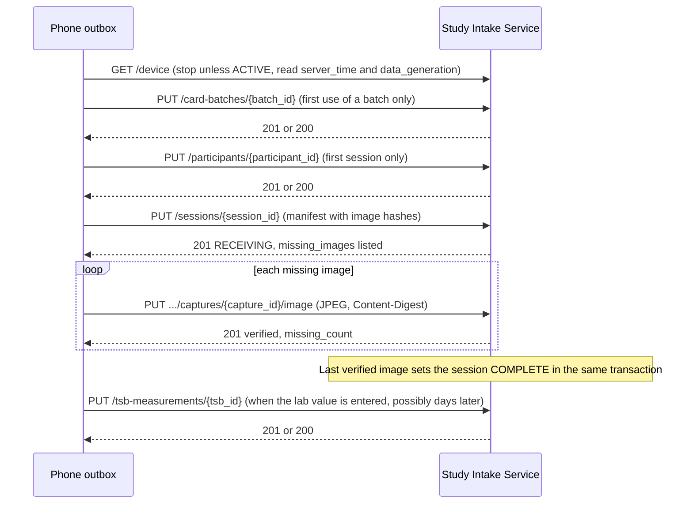
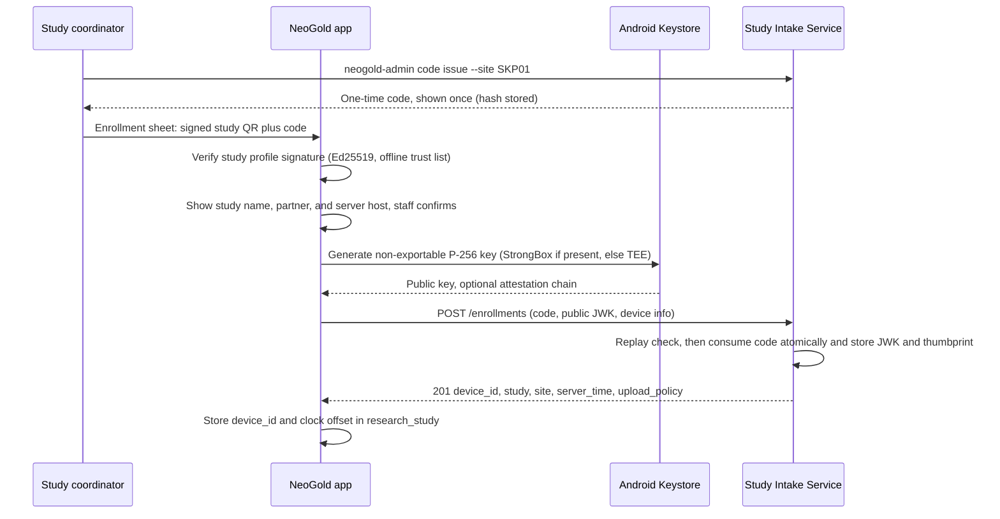

# NeoGold: API Documentation (Study Intake API v1)

| Field | Value |
|---|---|
| Document | 7 of 13 |
| Version | 0.2 (API contract version 1.0.0; 0.2 applies an independent review: idempotency storage, participant aliases, concurrency, card status, TSB linking, local dates, verification order, reconciliation) |
| Date | 10 October 2026 |
| Owner | Sowad Al-Mughni, Kitalon Labs |
| Depends on | `4_System_Architecture.md` v0.2.2 (Sections 9, 10), `5_Database_Schema.md` v0.3 (Section 3) |
| Companion | `openapi.yaml` (source of truth, reproduced in Appendix A), `8_Security_Compliance_Plan.md` |
| Status | Awaiting founder review |

Confidence tags: **[Certain]** standard or verified by a test run, **[Likely]** strong inference, **[Guessing]** needs measurement.

---

## 0. Read This First

- **This API carries research data only.** Screening mode never makes a network call (doc 4, driver 2). A phone that never joins a study never talks to any server.
- **There are no user accounts.** The credential is a key pair generated inside each phone's Android Keystore at enrollment. The phone signs every request; the server holds only public keys. Nothing on the server can be replayed to impersonate a phone.
- **The contract is strict in, tolerant out.** The server rejects any request field it does not know, so a coding mistake cannot leak a name or register number into the study database. The app ignores response fields it does not know, so the server can add fields without breaking old phones.
- **Validated:** `openapi.yaml` passes `openapi-spec-validator` (OpenAPI 3.1) and Redocly's recommended ruleset with zero warnings, the authentication scheme in Section 4 was prototyped and passed all ten attack and edge cases listed in Section 12.3, and an independent reviewer who had not seen the drafting checked this document against docs 4, 5, and 8; its 15 findings are fixed in v0.2 [Certain, 10 October 2026].

---

## 1. Contract Summary

| Property | Rule |
|---|---|
| Base URL | `https://{host}/v1`, host taken from the signed study profile (Section 4.1) |
| Transport | HTTPS only, TLS 1.2 or 1.3; HTTP is not served (doc 8 Section 5.3) |
| Format | JSON, UTF-8, `Content-Type: application/json`; images `image/jpeg` |
| Errors | RFC 9457 Problem Details, `application/problem+json`, with a stable `code` (Section 6) |
| Time | Timestamps RFC 3339 UTC (`2027-02-03T09:41:07Z`). Every `date` field is a calendar date in the study's time zone (`upload_policy.time_zone`, Asia/Dhaka by default), because a 02:00 consent in Dhaka is still the previous day in UTC |
| Units | Bilirubin in mg/dL, one decimal place |
| IDs | UUIDs generated on the phone; the server keeps the same ID |
| Writes | `PUT` to a client-chosen ID (naturally idempotent), plus a required `Idempotency-Key` header; the only `POST` is enrollment |
| Auth | Per-request ES256 JWT signed by the phone's Keystore key (Section 4) |
| Unknown request fields | Rejected with `400 VALIDATION_FAILED` (`additionalProperties: false` on every request schema) |
| Unknown response fields | Ignored by the client (`ignoreUnknownKeys = true`) |
| App version | Header `X-NeoGold-App-Version` on every call; below the study minimum returns `426` |
| Network policy | Wi-Fi only by default (`upload_policy.wifi_only`) |

---

## 2. Endpoints

| # | Method and path | Purpose | Auth | Success |
|---|---|---|---|---|
| 1 | `GET /health` | Liveness and server time | None | 200 |
| 2 | `POST /enrollments` | Bind a phone to a study site with a one-time code; register its public key | Code | 201 |
| 3 | `GET /device` | Device, study status, minimum app version, upload policy | Device | 200 |
| 4 | `DELETE /device` | Leave study (self-revoke) | Device | 204 |
| 5 | `PUT /card-batches/{batch_id}` | Register a signed card batch, once per batch | Device | 201 new, 200 known |
| 6 | `PUT /participants/{participant_id}` | Create a participant (code and consent reference only) | Device | 201 new, 200 identical or registered as an alias |
| 7 | `PUT /sessions/{session_id}` | Submit a session manifest with declared image hashes | Device | 201 new, 200 identical |
| 8 | `PUT /sessions/{session_id}/captures/{capture_id}/image` | Upload one JPEG listed in the manifest | Device | 201 new, 200 identical |
| 9 | `GET /sessions/{session_id}` | Session status and missing images | Device | 200 |
| 10 | `PUT /tsb-measurements/{tsb_id}` | Submit a paired blood bilirubin value | Device | 201 new, 200 identical |

There is no HTTP admin interface. Study administration runs on the server's command line over SSH (Section 10), which removes a whole class of web attack surface.

---

## 3. Upload Sequence



**Ordering rules (enforced by the outbox, checked by the server):**

1. A card batch before any session with `card_status` `VERIFIED` or `EXPIRED` that uses it (`422 CARD_BATCH_UNKNOWN` otherwise). Research sessions captured on an unverified card (allowed in research mode only, doc 4 Section 7) are sent as `UNVERIFIED` with `card_batch_id` null, so they never wait on a batch the server will refuse.
2. A participant before its sessions and TSB values (`422 PARTICIPANT_UNKNOWN`).
3. A manifest before its images (`404 SESSION_UNKNOWN`).
4. A session before a TSB value that references it (`422 SESSION_UNKNOWN`).

When the server reports a missing dependency, the outbox re-queues that dependency first and retries; this heals a phone whose local outbox lost order after a crash. Each item may trigger at most 3 dependency re-queues; after that it is held as `FAILED_PERMANENT` with the code shown to the coordinator, so a broken dependency cannot loop forever.

**Same baby, two phones.** A recheck may happen on a different phone. Each phone creates its own participant UUID; when the second phone registers the same `participant_code` with the same `consent_form_id`, the server stores its UUID as an alias of the first and returns `canonical_participant_id`. Sessions and TSB values from either phone resolve to one participant. A matching code with a different consent form ID is a genuine conflict (`409 PARTICIPANT_CODE_TAKEN`).

**Every batch starts with `GET /device`.** If the study is not `ACTIVE`, the device is revoked, or the app is below `min_app_version`, the batch stops before any image is sent.

**Why manifest first.** The server validates metadata (participant, card batch, timestamp policy) before the phone spends Wi-Fi on images, and it checks every image against a hash the phone committed to in advance. A 3 MB image takes about 24 seconds at 1 Mbps [Certain, arithmetic], so rejecting a bad session before the images matters on rural connections.

**Status at any time:** `GET /sessions/{session_id}` returns `RECEIVING`, `COMPLETE`, or `REJECTED`, plus `missing_images`. The research home screen shows "N waiting to upload" from the local outbox; this call resolves disagreements after a lost response.

---

## 4. Authentication

### 4.1 Enrollment



**Signed study profile.** The phone learns the server address from a QR code on a printed enrollment sheet. The QR holds a study profile (`study_code`, `display_name`, `partner`, `host` or none for an export-only study, `timestamp_precision`, `export_public_key`, `expires_at`) signed with Kitalon Labs' offline **study issuer key**, a separate Ed25519 key from the card issuer key (doc 8 Section 4). The app verifies it against the trust list shipped inside the signed config bundle. This blocks the obvious attack: a fake QR that points phones at someone else's server. The one-time code is printed beside the QR so staff can type it if scanning fails; the profile itself must be scanned.

**One-time code.** 12 characters of Crockford base32 in three groups (`K7QM-3XRA-9TPD`), 60 bits of entropy, single use, valid 72 hours, bound to one site. The server stores an HMAC-SHA256 of the code under a server secret, never the code. At the enrollment rate limit (Section 8), guessing a live code is not feasible [Certain, arithmetic: 2^60 codes against 10 tries per hour per address].

**Device key.** Generated with `KeyGenParameterSpec` for `PURPOSE_SIGN`, `EC` P-256, `DIGEST_SHA256`, non-exportable, StrongBox requested where available (API 28 and up) and Trusted Execution Environment otherwise. StrongBox is rare on budget phones [Likely]; a TEE-backed key is the realistic floor. No user-authentication requirement on the key, because uploads run without a person at the phone; the research PIN (doc 8 Section 6.2) guards access to research mode instead.

**Attestation.** The key is generated with an attestation challenge equal to the SHA-256 of the enrollment code, so a chain cannot be replayed from another enrollment. The app sends the Android Key Attestation chain when the phone provides one. The server records `VERIFIED` only if the chain validates, the challenge matches, and the leaf certificate's public key equals `device_public_key`; otherwise `FAILED`, or `NONE` when no chain was sent. In v1 it does not refuse enrollment on failure, because some budget phones ship broken or revoked attestation chains [Likely]. The coordinator sees the result in `neogold-admin device list`. Making attestation mandatory is open issue 1.

**Server processing order.**

1. Look up the code by its HMAC. If it is already used **and** the stored enrollment `Idempotency-Key` and key thumbprint match this request, replay the original `201` (a lost response does not burn the code or create an orphan device).
2. Consume the code atomically: `UPDATE enrollment_code SET used_at = now(), ... WHERE id = $1 AND used_at IS NULL AND expires_at > now() RETURNING id`. No row back means `ENROLLMENT_CODE_USED` or `ENROLLMENT_CODE_EXPIRED`, so a double tap cannot enroll two keys.
3. Insert the device in the same transaction, storing the request's `Idempotency-Key` and key thumbprint on the code row.

**Settings check.** After a `201`, the app compares `upload_policy.timestamp_precision` with the signed study profile. If they differ, it deletes the new key and shows "Study settings do not match. Contact your coordinator." The server's value is authoritative for uploads; the mismatch means the study was set up inconsistently.

### 4.2 Request signing

Every call except `/health` and `/enrollments` carries:

```
Authorization: Bearer <device assertion JWT>
```

**JOSE header**

```json
{ "alg": "ES256", "typ": "ng-device+jwt", "kid": "<device_id>" }
```

The explicit `typ` follows the JWT best-current-practice advice to prevent one kind of token being accepted as another [Certain, RFC 8725 Section 3.11].

**Claims**

| Claim | Value | Purpose |
|---|---|---|
| `iss` | `device_id` | Who signed; must equal `kid` |
| `aud` | API base URL, for example `https://intake.example.bd/v1` | Token useless at any other server; compared with the server's configured public base URL |
| `iat` | Issue time, seconds, corrected by the stored clock offset | Freshness |
| `exp` | At most `iat + 300` | Short life |
| `jti` | New UUID per request | Replay protection |
| `htm` | HTTP method, upper case | Binds token to the method |
| `htu` | Request URL: scheme and host in lower case, no default port, path as sent, no query, no fragment | Binds token to the endpoint and resource ID. The server rebuilds it from its configured public base URL plus the request path, never from the URL Uvicorn sees behind Caddy (which would be `http`) |
| `bsh` | base64url SHA-256 of the exact request body bytes (hash of the empty string when there is no body). For image uploads, the manifest's `image_sha256` re-encoded | Binds token to the body; an intercepted token cannot carry a different body |

The design borrows its method and URL binding from OAuth DPoP [Certain, RFC 9449] but has no access token: the signature itself is the credential.

**Android implementation notes**

- Keystore's `Signature.getInstance("SHA256withECDSA")` returns an ASN.1 DER signature; ES256 needs the 64-byte `R || S` form, so the client converts DER to JOSE before encoding [Certain, RFC 7518 Section 3.4]. This is the most common ES256 bug and has its own unit test.
- The token is minted immediately before each request, never cached, never logged.
- For image uploads the client does **not** re-hash before sending. It takes `bsh` and `Content-Digest` from the `image_sha256` stored at capture time (the same value the manifest declared), then decrypts and streams the file once, so the image is never written to disk unencrypted and a flaky second read cannot change the headers. If the bytes on disk have changed, the server's streaming hash catches it (`HASH_MISMATCH`).

### 4.3 Server verification order

The server verifies in two phases and stops at the first failure. **Everything that can reject a request without its body runs before the body is read**, so a paused study or a revoked phone never makes the server ingest a 20 MB image just to refuse it.

**Phase A: headers only**

1. Header parses; `alg` is `ES256` and `typ` is `ng-device+jwt`; otherwise `401 AUTH_INVALID_SIGNATURE`.
2. `kid` names an enrolled device; otherwise `401 DEVICE_UNKNOWN`.
3. Signature verifies with that device's stored key; otherwise `401 AUTH_INVALID_SIGNATURE`.
4. All eight claims present, `iss` equals `kid`, `aud` equals the configured public base URL, `exp - iat` at most 300 seconds; otherwise `401 AUTH_CLAIM_MISMATCH`.
5. Time, measured against **t0, the moment the request headers arrived** (recorded by ASGI middleware, so a slow image upload cannot expire its own token): `iat` more than 60 seconds after t0 is `401 CLOCK_SKEW`; t0 more than 30 seconds after `exp` is `401 AUTH_EXPIRED`. Both include `server_time`.
6. `htm` and `htu` match the request (rebuilt from the configured public base URL); for images, `bsh` and `Content-Digest` describe the same hash. Otherwise `401 AUTH_CLAIM_MISMATCH`.
7. Device not revoked; otherwise `403 DEVICE_REVOKED`.
8. Insert `jti` into `auth_nonce` with `expires_at = exp + 30 seconds` (the full grace window, so the purge job cannot drop a nonce that would still be accepted); a primary-key collision is `401 AUTH_REPLAY`.
9. Study is `ACTIVE`; otherwise `403 STUDY_PAUSED` or `403 STUDY_CLOSED`. **Skipped** for `GET /device`, `GET /sessions/{id}`, and `DELETE /device`.
10. App version at or above `min_app_version`; otherwise `426 APP_VERSION_UNSUPPORTED`. **Skipped** for the same three calls, so a phone can always learn its status, reconcile, and leave.
11. Route checks: `Content-Length` within limits (`413`); for images, the session exists (`404 SESSION_UNKNOWN`), the capture is listed with `has_image` true (`404 CAPTURE_NOT_IN_MANIFEST`), and the declared digest equals the manifest's `image_sha256` (`422 HASH_MISMATCH`).
12. Idempotency: insert an `IN_PROGRESS` row for `(device_id, Idempotency-Key)`; if a `DONE` row exists, replay it; if an `IN_PROGRESS` row exists, return `409 REQUEST_IN_PROGRESS` (retryable).

**Phase B: body**

13. Stream the body, hashing as it arrives. JSON: the hash must equal `bsh` (`401 AUTH_CLAIM_MISMATCH`). Images: the hash must equal the declared digest (`422 HASH_MISMATCH`), then the JPEG checks of Section 7 run.
14. Schema and semantic validation (Section 7), then the write.

`device.last_seen_on` (a date, Section 7) is updated on success.

### 4.4 Clock handling

Research phones are often Wi-Fi only with no SIM, so their clocks can be wrong after a full battery drain [Likely]. The client keeps `clock_offset = server_time - device_time` from enrollment, `/health`, and any `CLOCK_SKEW` or `AUTH_EXPIRED` response, and applies it to `iat`. On either error it updates the offset, mints a new token, and retries once. A second failure stops the batch and shows "Phone clock is wrong. Set the date and time automatically, then tap Upload now."

The clock offset affects only authentication. Clinical times are computed on the phone from the **phone's own clock**: age in hours is the current time minus the birth time the health worker enters, and the capture date and blood draw offset also come from the phone clock. Screening is offline, so there is no server to correct them. That makes a wrong phone clock a clinical hazard (doc 8 Section 14, H2), handled on the phone: screening is blocked when the clock is earlier than the app's build time, or more than 10 minutes away from the last known server offset in research mode; the birth time screen shows the phone's current date and time so the health worker can spot a wrong clock; and a warning appears when automatic date and time is switched off.

### 4.5 Revocation and leaving

| Path | Trigger | Effect |
|---|---|---|
| Coordinator revokes | `neogold-admin device revoke <id> --reason LOST` (or `STOLEN`, `REASSIGNED`, `COMPROMISED`, `STUDY_ENDED`) | Next request from that key gets `403 DEVICE_REVOKED`; takes effect immediately because the server checks on every request |
| Phone leaves | `DELETE /device` from the research settings screen | Server sets `revoked_reason = SELF_UNENROLLED` |

On `204` or `403 DEVICE_REVOKED`, the app deletes its Keystore key and clears `server_device_id`. Research records not yet uploaded stay encrypted on the phone and can still be exported over USB behind the research PIN (FR-30), so revoking a phone never silently destroys study data. Data already on the server stays under the study's retention rules.

### 4.6 Why this scheme

| Option considered | Rejected because |
|---|---|
| Username and password per health worker | No accounts by decision (PRD D1); shared phones (NFR-13); passwords get written on the phone case |
| Long-lived bearer token stored on the phone | Can be copied off a rooted or backed-up phone and replayed from anywhere |
| Mutual TLS with client certificates | Caddy and partner proxies make client-certificate handling fragile; per-request JWT gives the same key binding with simpler operations |
| OAuth 2.0 with an authorization server | A second service to run and secure per study, for a single-tenant API with one client type |

---

## 5. Idempotency and Retries

### 5.1 Rules

- Every write sends `Idempotency-Key: <UUID>`. The outbox generates it once per logical write and stores it with the outbox row, so every retry of that write reuses it [header semantics follow the IETF HTTPAPI draft, Certain that the draft exists].
- The server keys `idempotency_record` on `(device_id, idempotency_key)` and keeps rows for 30 days.
  - An `IN_PROGRESS` row is written before processing (Section 4.3 step 12), so two copies of the same request in flight cannot both execute; the second gets `409 REQUEST_IN_PROGRESS` and retries.
  - **Only final outcomes are stored:** `2XX` responses and deterministic rejections that a retry can never change (`400 VALIDATION_FAILED`, `409 CONFLICT_IMMUTABLE`, `409 PARTICIPANT_CODE_TAKEN`, `413`, `415`, `422 IMAGE_INVALID`, `422 IMAGE_METADATA_NOT_ALLOWED`, `422 CARD_BATCH_INVALID`). Anything that depends on server state or time (`401`, `403`, `404`, `409 REQUEST_IN_PROGRESS`, dependency `422`s, `422 HASH_MISMATCH`, `426`, `429`, `5XX`, `507`) deletes the `IN_PROGRESS` row instead, so the same key succeeds once the condition clears.
  - Same key, same request hash: the stored response is replayed. Same key, different request hash: `409 IDEMPOTENCY_KEY_REUSED`. For images, the request hash is the declared digest, not a re-read of the body.
  - `/enrollments` has no device yet, so its idempotency lives on the `enrollment_code` row (Section 4.1).
- Resource IDs are client UUIDs, so even a lost key is safe: an identical `PUT` returns `200` with the existing resource; a different body for an existing ID returns `409 CONFLICT_IMMUTABLE`. Participants, sessions, and captures cannot be edited through the API; TSB values allow one linking update (Section 7). Other corrections are an admin action with an audit entry.

### 5.2 Client retry policy

| Outcome | Outbox action |
|---|---|
| `200`, `201`, `204` | Mark `ACKED`; local deletion waits for reconciliation (Section 5.4) |
| No response (timeout, connection drop) | Retry with the same key, exponential backoff with jitter: 30 s, 2 min, 10 min, 1 h, then every 6 h |
| `429`, `503` | Wait `Retry-After`, then retry |
| `500`, other `5XX`, `507` | Backoff as above |
| `401 CLOCK_SKEW`, `401 AUTH_EXPIRED`, `401 AUTH_REPLAY` | Fix offset or mint a new `jti`, retry once immediately |
| `409 REQUEST_IN_PROGRESS` | Retry after 30 seconds with the same key |
| `422` or `404` naming a missing dependency | Re-queue the dependency first, then retry; at most 3 times per item (Section 3) |
| `422 HASH_MISMATCH` | Retry with the same key and headers, at most 3 times; then `FAILED_PERMANENT` (the file on the phone no longer matches what was captured) |
| `422 CARD_BATCH_INVALID` on a card batch | Mark the batch server-unverified; its sessions are sent as `UNVERIFIED` |
| `403 STUDY_PAUSED` | Keep the outbox; retry after 6 hours or on Upload now |
| Unknown `code` | Follow the response's `retryable` flag; if it is missing, treat `4XX` as permanent and `5XX` as retryable |
| Any other `4XX` | `FAILED_PERMANENT`; show the code on the upload screen for the coordinator |

**Upload now** runs the same outbox in the foreground and skips any backoff wait once. Backoff never deletes data; only reconciliation (Section 5.4) or a coordinator action removes local research data.

**Recovering from permanent failures.** When the app version changes, every `FAILED_PERMANENT` item whose code points to a client bug (`VALIDATION_FAILED`, `AUTH_CLAIM_MISMATCH`, `IDEMPOTENCY_KEY_REUSED`, `CAPTURE_NOT_IN_MANIFEST`, `IMAGE_METADATA_NOT_ALLOWED`, `PAYLOAD_TOO_LARGE`, `UNSUPPORTED_MEDIA_TYPE`) is re-queued once with a new `Idempotency-Key`, so an app fix rescues the data instead of leaving it stranded.

### 5.3 Concurrency

- All uploads run as **one unique WorkManager work** name. The background path enqueues it with `KEEP`; **Upload now** replaces a run that is still waiting for its constraints with an expedited one, and does nothing if a run is already active. Two runners never process the outbox at once.
- When the worker starts, any `IN_FLIGHT` row is reset to `PENDING`, because the only way a row is still `IN_FLIGHT` at start is that the previous run was killed (common on HiOS, XOS, and HyperOS).
- Long backlogs run as a foreground worker (`setForeground`) with `foregroundServiceType="dataSync"` and, on Android 14 and up, the `FOREGROUND_SERVICE_DATA_SYNC` permission [Certain that API 34 requires a declared type and its permission], because an ordinary worker is stopped after about 10 minutes [Certain, WorkManager execution limit], which a slow link can exceed. Progress is saved per item, so a stopped run resumes where it left off.
- On the server, the image transaction locks the session row (`SELECT ... FOR UPDATE`) before counting missing images, so two images verified at the same moment cannot both miss the `COMPLETE` transition. A nightly job also completes any `RECEIVING` session with no missing images, as a backstop.

### 5.4 Reconciliation before local deletion

- Before deleting any local research record (doc 5 Section 2.5), the phone calls `GET /sessions/{session_id}`. Only `COMPLETE` (or `REJECTED`) allows deletion; `404` or `RECEIVING` re-queues the missing items.
- `GET /device` returns `data_generation`. A coordinator who restores the server from a backup runs `neogold-admin restore mark`, which sets it to the Unix time of the restore, so it always increases even after a second restore. Phones that see a new value re-send **every** item they still hold: card batches, participants, manifests, images, and TSB values, including links made after the backup. The PUTs are idempotent, so anything the server kept simply returns `200`.
- Phones keep acknowledged research data for 14 days (`local_retention_after_ack_days`, doc 5), so any restore from a nightly backup in the last 13 days can be refilled completely. An older restore loses whatever phones have already deleted; doc 12 Section 8.2 makes the coordinator record that loss before proceeding.

---

## 6. Error Handling

### 6.1 Format

```http
HTTP/1.1 422 Unprocessable Content
Content-Type: application/problem+json

{
  "type": "https://neogold.example/problems/hash-mismatch",
  "title": "Image hash does not match the manifest",
  "status": 422,
  "code": "HASH_MISMATCH",
  "retryable": true,
  "detail": "Declared 3f9c...e1, received 77ab...02.",
  "instance": "/v1/sessions/8a7b6c5d-4e3f-4a2b-9c1d-0e9f8a7b6c5d/captures/5b0e6f3c-1d2a-4b9c-8e7f-6a5b4c3d2e1f/image",
  "request_id": "01J9Z6Q4V8M3N2P1R0S9T8U7V6"
}
```

- `code` is the stable machine value; the client switches on `code`, never on `title` or `detail`.
- `retryable` is the server's hint; the client's table in Section 5.2 is authoritative.
- `request_id` also appears in server logs, so a coordinator can quote it in a support request.
- `detail` never contains participant codes, image content, or anything from the request body beyond IDs.
- `VALIDATION_FAILED` adds `errors: [{field, message}]`.

### 6.2 Error catalog

| Code | HTTP | Retry | Meaning | What the app does |
|---|---|---|---|---|
| `VALIDATION_FAILED` | 400 | No | Schema or semantic rule failed (Section 7) | Permanent; this is a client bug, logged with `request_id` |
| `AUTH_MISSING` | 401 | No | No `Authorization` header | Permanent; client bug |
| `AUTH_INVALID_SIGNATURE` | 401 | No | Bad header or signature | Stop uploads; "Re-enroll this phone with your coordinator" |
| `AUTH_CLAIM_MISMATCH` | 401 | No | Claims missing or not matching the request | Permanent; client bug |
| `AUTH_EXPIRED` | 401 | Once | Token stale or phone clock slow | Fix clock offset, retry once |
| `CLOCK_SKEW` | 401 | Once | Phone clock fast | Fix clock offset, retry once |
| `AUTH_REPLAY` | 401 | Once | `jti` already used | New token, retry once |
| `DEVICE_UNKNOWN` | 401 | No | Server has no record of this device | "Re-enroll this phone" |
| `DEVICE_REVOKED` | 403 | No | Device revoked | Delete key; keep local data for USB export; "This phone was removed from the study" |
| `STUDY_PAUSED` | 403 | Later | Coordinator paused intake | Keep outbox; retry in 6 hours |
| `STUDY_CLOSED` | 403 | No | Study closed | Stop uploads; offer USB export |
| `ENROLLMENT_CODE_INVALID` | 403 | No | Code not recognised | "Code not recognised. Check it and try again." |
| `ENROLLMENT_CODE_EXPIRED` | 403 | No | Older than 72 hours | "Ask your coordinator for a new code" |
| `ENROLLMENT_CODE_USED` | 403 | No | Already used by another phone | "Ask your coordinator for a new code" |
| `DEVICE_KEY_ALREADY_ENROLLED` | 409 | No | This public key is already registered | Generate a new key, then enroll with a new code |
| `IDEMPOTENCY_KEY_REUSED` | 409 | No | Same key, different request hash | Permanent; client bug |
| `REQUEST_IN_PROGRESS` | 409 | Yes | The same key is still being processed | Retry after 30 seconds |
| `CONFLICT_IMMUTABLE` | 409 | No | Resource exists with different content | Permanent; flagged for the coordinator |
| `PARTICIPANT_CODE_TAKEN` | 409 | No | Code already used at this site with a **different** consent form ID (same form ID becomes an alias instead) | "This participant code is already in use. Check the consent form." |
| `PARTICIPANT_UNKNOWN` | 422 | After dependency | Referenced participant not uploaded | Upload participant first |
| `PARTICIPANT_WITHDRAWN` | 422 | No | Participant withdrew consent (`participant withdraw`) | Mark permanent; delete that participant's local research data |
| `SESSION_UNKNOWN` | 404, 422 | After dependency | Manifest not uploaded | Upload manifest first |
| `CAPTURE_NOT_IN_MANIFEST` | 404 | No | Image for a capture the manifest does not list | Permanent; client bug |
| `CARD_BATCH_UNKNOWN` | 422 | After dependency | Card batch not registered | Upload batch first |
| `CARD_BATCH_INVALID` | 422 | No | Batch signature fails or issuer untrusted on the server | Send that batch's sessions as `UNVERIFIED` |
| `HASH_MISMATCH` | 422 | Up to 3 | Declared digest differs from the manifest, or the streamed body differs from the declared digest | Retry with the same key; then permanent |
| `IMAGE_INVALID` | 422 | No | Not a decodable baseline JPEG, or dimensions over 8192 px | Permanent |
| `IMAGE_METADATA_NOT_ALLOWED` | 422 | No | JPEG carries EXIF other than orientation (GPS, date-time, maker notes, thumbnail) | Permanent; client bug, because the app strips it (doc 8 Section 6.4) |
| `PAYLOAD_TOO_LARGE` | 413 | No | Over the size limit | Permanent; client bug |
| `UNSUPPORTED_MEDIA_TYPE` | 415 | No | Wrong `Content-Type` | Permanent; client bug |
| `NOT_FOUND` | 404 | No | Unknown path or resource for this study | Permanent |
| `APP_VERSION_UNSUPPORTED` | 426 | No | App below study minimum | "Update NeoGold to keep uploading"; outbox kept |
| `RATE_LIMITED` | 429 | Yes | Over the request limit | Wait `Retry-After` |
| `SERVER_ERROR` | 500 | Yes | Unexpected failure | Backoff |
| `MAINTENANCE` | 503 | Yes | Planned downtime | Wait `Retry-After` |
| `STORAGE_FULL` | 507 | Yes | Image store full; coordinator alerted | Backoff |

The upload screen shows user-facing text in English and Bangla (keys `upload_*`, `enroll_*`, and `participant_code_taken` in doc 6 Section 10.4) and the raw code in small type for the coordinator.

---

## 7. Validation Beyond the Schema

The JSON Schemas in Appendix A catch types, ranges, and formats. The service also enforces:

| Rule | Error |
|---|---|
| `captured_at` and `draw_time` must be absent or null unless the study's `timestamp_precision` is `FULL` | `VALIDATION_FAILED` |
| All `date` fields are calendar dates in the study's time zone | Definition (Section 1) |
| `estimate_low_mg_dl <= estimate_mg_dl <= estimate_high_mg_dl` when present | `VALIDATION_FAILED` |
| Capture IDs are unique within a manifest; `attempt_number` is unique per capture site | `VALIDATION_FAILED` |
| `has_image` false requires `image_sha256` and `size_bytes` null; true requires both | `VALIDATION_FAILED` |
| Participant (or the participant an alias points to) belongs to the calling device's site | `PARTICIPANT_UNKNOWN` |
| `consent_date` is on or before `capture_date` | `VALIDATION_FAILED` |
| `card_status` `VERIFIED` or `EXPIRED` needs a registered `card_batch_id`; `UNVERIFIED` needs null. The server records whether the batch had expired on `capture_date` rather than rejecting the session | `CARD_BATCH_UNKNOWN`, `VALIDATION_FAILED` |
| A TSB value's session, if given, belongs to the same participant | `VALIDATION_FAILED` |
| A TSB value may change only once, from `session_id` null to a session (with `minutes_from_capture`); every other field identical | `CONFLICT_IMMUTABLE` otherwise |
| Image starts with the JPEG marker, decodes, is at most 8192 px per side, and contains only allow-listed segments: SOI, APP0 JFIF without thumbnail, APP1 Exif with only the orientation tag, DQT, SOF0 or SOF2, DHT, DRI, SOS, EOI. XMP, MPF secondary images, thumbnails, GPS, and date-time tags are rejected, since any of them can carry location or exact time | `IMAGE_INVALID`, `IMAGE_METADATA_NOT_ALLOWED` |
| Image body hash equals the manifest's `image_sha256` and the `Content-Digest` header | `HASH_MISMATCH` |
| `participant_code` matches `^[A-Z]{2,5}-[0-9]{3,6}$` and `consent_form_id` matches `^[A-Z]{2,5}-[A-Z0-9-]{2,26}$`, so a 17-digit birth registration number, a national ID, or an 11-digit mobile number cannot be stored as a code | `VALIDATION_FAILED` |

**Timestamps the server keeps.** Data tables hold arrival and completion as dates only (`received_on`, `completed_on`), because a full arrival time sits close to capture time when phones upload on the next Wi-Fi connection. Exact times exist only in the request log, kept 90 days and never exported. Per-session events are not written to the 5-year `audit_log`. Day precision still leaves some signal: a capture date plus age in hours places the birth within about two calendar days, and several sessions narrow that further, so de-identified exports also shift all dates by a random offset per participant (doc 8 Section 3).

**What the contract makes impossible to send.** There is no field for a name, register number, birth date, phone number, address, location, or free text. Unknown fields are rejected. The screening log never enters the outbox. This is the API half of the data minimization in doc 8 Section 3; the other half is that the app never collects those values in research mode.

---

## 8. Limits

| Limit | Value | Enforced by |
|---|---|---|
| Requests per device | Token bucket: 20 back-to-back, refilled at 1 per second (60 per minute sustained) | API (per `device_id`) |
| Enrollment attempts | 10 **failed** attempts per hour per client IP, so a training session of 10 phones behind one clinic router is not blocked; alert to coordinator after 20 failures per day across the server. The client IP comes from Caddy's `X-Forwarded-For`, trusted only from Caddy's fixed address (`FORWARDED_ALLOW_IPS`, doc 12 Section 7.1); without that setting every request would appear to come from Caddy and one clinic's typos would block all sites | API |
| Unauthenticated `/health` | 60 per minute per IP address | API (standard Caddy has no rate limiter without a plugin) |
| JSON body | 256 KB | Caddy and API |
| Image body | 20,000,000 bytes (matches `capture.size_bytes` check) | Caddy and API |
| Request timeout | 15 minutes for image uploads, 30 seconds for everything else | Caddy |
| Captures per manifest | 15 (5 capture sites times 3 attempts) | Schema |

Typical images are 2 to 5 MB [Likely, 12 to 13 MP JPEG at quality 90], well under the limit.

---

## 9. Versioning and Compatibility

- The major version is in the path (`/v1`). Within v1, changes are additive only: new optional response fields, new endpoints, new error codes with the same HTTP class. A new required request field or a removed field means `/v2`, served alongside `/v1` until every enrolled phone has moved.
- `GET /device` returns `min_app_version`. Raising it is a coordinator action with at least 14 days' notice, so phones can update over Wi-Fi first.
- The client follows the `retryable` flag for an unknown `code`; only when the flag is missing does it fall back to the HTTP class (unknown `4XX` permanent, unknown `5XX` retryable). This lets v1 add codes without old phones discarding data.
- `openapi.yaml` carries `info.version`; the server reports it in `/health` as `api_version`.

---

## 10. Administration (Command Line, Not HTTP)

All admin actions run as `neogold-admin` inside the `api` container over SSH on the study server, and each one writes an `ADMIN` row to `audit_log`.

| Command | Does |
|---|---|
| `study create --code SKP --name ... --partner ... --ethics-ref ... --retention-until 2029-12-31 [--timestamp-precision FULL]` | Create a study |
| `study pause`, `study resume`, `study close` | Change intake status |
| `study set-min-app-version 1.0.2` | Raise the minimum app version |
| `site add --study SKP --code SKP01 --name ... [--test]` | Add a site; `--test` marks it excluded from every export (used for the production smoke test, doc 12 Section 7.4) |
| `code issue --site SKP01 --count 5 [--expires 72h]` | Issue one-time enrollment codes, printed once |
| `device list [--site SKP01]` | Devices, model, attestation result, qualification, last seen |
| `device revoke <device_id> --reason LOST` | Revoke a device |
| `status [--older-than 7d]` | Sessions still `RECEIVING`, failures by code, per-device last upload date |
| `session reject <session_id> --reason DATA_ERROR` | Set one session `REJECTED`; images are deleted and the row kept as a tombstone |
| `participant withdraw <participant_code>` | Consent withdrawn: reject all the participant's sessions, delete their images and TSB values, set `withdrawn_on`; later uploads for that participant get `PARTICIPANT_WITHDRAWN` |
| `restore mark` | After restoring from a backup, increment `data_generation` so phones re-check what the server holds (Section 5.4) |
| `selftest` | Database reachable, schema at this image's head (or newer, when `NEOGOLD_ALLOW_NEWER_SCHEMA=1` during a rollback), image store writable, last backup under 26 hours old; used by the deploy smoke test (doc 12 Section 7.3) |
| `audit since <time>` | List admin actions after a time, used before a restore so they can be re-applied (doc 12 Section 8.2) |
| `decrypt-export --key <study export private key> <file>` | Decrypt a USB export made on a phone and apply the per-participant date shift (doc 8 Section 5.2). Runs on the coordinator's own offline machine, never on the server, so the export private key (K10) never touches the server |
| `export --study SKP --out <path>` | De-identified export (CSV plus images) with a SHA-256 manifest |
| `retention check` | Lists data past `retention_until`; deletion needs a separate, confirmed `retention purge` |

The study QR (Section 4.1) is signed off the server, on Kitalon Labs' offline signing machine, with `neogold-sign study-profile` from the Card Production Kit tools (NG-045).

---

## 11. Client Implementation Notes (`:sync:research`)

- OkHttp plus kotlinx.serialization, hand-written for 10 endpoints (doc 4 Section 4.3). No generated client: the code is small and every request model is checked against the schema in tests.
- Request JSON is serialized once to bytes; the same bytes are hashed for `bsh` and sent, so the hash always matches.
- `Json { ignoreUnknownKeys = true; explicitNulls = false }` for responses; requests are built from data classes with only contract fields.
- Network security config: cleartext disallowed, system CAs only, user-installed CAs not trusted (the default for apps targeting API 24 and up [Certain]). No certificate pinning in v1; reasons in doc 8 Section 5.3.
- The outbox worker is one unique WorkManager work, foreground when the backlog is long (Section 5.3); background runs and **Upload now** call the same `OutboxProcessor`, so there is one code path to test.
- Dates are formatted in the study time zone from `upload_policy.time_zone`, never with the phone's default zone or UTC.

---

## 12. Contract Testing

### 12.1 Single source of truth

`docs/api/openapi.yaml` is the contract. Appendix A of this document is generated from it, and CI fails if they differ.

### 12.2 CI checks

| Check | Tool | Gate |
|---|---|---|
| Spec is valid OpenAPI 3.1 | `openapi-spec-validator` | Every pull request |
| Lint, recommended rules, zero warnings | Redocly CLI | Every pull request |
| Server routes, status codes, and schemas match the spec | Diff of FastAPI's generated schema against `openapi.yaml` | Every backend pull request |
| Property-based fuzzing of every endpoint | Schemathesis against staging [Likely supports 3.1 adequately; confirm in v0.5] | Every release candidate |
| Client request models validate against the spec's JSON Schemas; spec examples deserialize | JVM unit tests with a JSON Schema validator | Every Android pull request |

### 12.3 Authentication test cases

Prototyped on 10 October 2026 with a reference minter and verifier; all ten produced the expected result [Certain]. They become `backend/tests/test_device_auth.py`, with the minting side mirrored in Android unit tests.

| # | Case | Expected |
|---|---|---|
| 1 | Valid token | Accepted |
| 2 | Same token sent twice | `AUTH_REPLAY` |
| 3 | Valid token, body swapped | `AUTH_CLAIM_MISMATCH` |
| 4 | Valid token, sent to another URL | `AUTH_CLAIM_MISMATCH` |
| 5 | Phone clock 10 minutes fast | `CLOCK_SKEW` |
| 6 | Token issued 400 seconds ago | `AUTH_EXPIRED` |
| 7 | Upload whose headers arrived inside the token's life but finished after it | Accepted (t0 rule) |
| 8 | Token with a one-hour life | `AUTH_CLAIM_MISMATCH` |
| 9 | Token signed by a different key | `AUTH_INVALID_SIGNATURE` |
| 10 | Token from a revoked device | `DEVICE_REVOKED` |

---

## 13. Open Issues for Review

1. **Mandatory attestation:** require a verified Key Attestation chain from v1.1 if the device matrix (doc 1 Section 13.5) shows the target phones produce valid chains.
2. **Production TLS certificate:** Caddy's automatic certificates need a public DNS name and reachable ports 80 or 443 [Certain]. If the partner's network cannot expose them, the fallback is a DNS-challenge certificate, not a private CA, because the app trusts system CAs only.
3. **Resumable uploads:** whole-file upload is assumed adequate on Wi-Fi (doc 4 Section 9). If v0.5 field data shows frequent failures on images, add range-based resumption in v1.1 as an additive change.
4. **Lab entry of TSB values:** v1 accepts TSB values only from enrolled phones. If the partner wants the lab to enter them directly, that is a second client type and a `/v2` discussion.
5. **Export date shifting:** default on, one random offset per participant within plus or minus 180 days. A study that needs seasonal analysis can switch it off with ethics approval.

---

## Sources

- [OpenAPI Specification 3.1.0](https://spec.openapis.org/oas/v3.1.0)
- [RFC 9457: Problem Details for HTTP APIs](https://www.rfc-editor.org/rfc/rfc9457)
- [RFC 7519: JSON Web Token](https://www.rfc-editor.org/rfc/rfc7519)
- [RFC 7518: JSON Web Algorithms, Section 3.4 (ES256 signature format)](https://www.rfc-editor.org/rfc/rfc7518#section-3.4)
- [RFC 8725: JWT Best Current Practices](https://www.rfc-editor.org/rfc/rfc8725)
- [RFC 7638: JWK Thumbprint](https://www.rfc-editor.org/rfc/rfc7638)
- [RFC 9449: OAuth 2.0 Demonstrating Proof of Possession (DPoP)](https://www.rfc-editor.org/rfc/rfc9449)
- [RFC 9530: Digest Fields (Content-Digest)](https://www.rfc-editor.org/rfc/rfc9530)
- [IETF HTTPAPI: The Idempotency-Key HTTP Header Field (draft)](https://datatracker.ietf.org/doc/draft-ietf-httpapi-idempotency-key-header/)
- [Android Keystore system](https://developer.android.com/privacy-and-security/keystore)
- [Android Key Attestation](https://developer.android.com/privacy-and-security/security-key-attestation)
- [Android network security configuration](https://developer.android.com/privacy-and-security/security-config)
- [Caddy automatic HTTPS](https://caddyserver.com/docs/automatic-https)

---

## Appendix A: OpenAPI 3.1 Specification

Generated from `openapi.yaml`. Do not edit here.

```yaml
openapi: 3.1.0
info:
  title: NeoGold Study Intake API
  version: 1.0.0
  summary: Receives consented research uploads from enrolled NeoGold phones.
  description: |
    One Study Intake Service runs per study, hosted under the partner's data governance.
    Screening mode never calls this API. Only research mode does, and only on Wi-Fi.

    Authentication: every call except /health and /enrollments carries a short-lived JWT
    signed by the phone's hardware-backed key (see the deviceAssertion security scheme).

    Errors use RFC 9457 Problem Details (`application/problem+json`) with a stable `code`.
    All request bodies reject unknown fields, so personal data cannot slip in by accident.
  license:
    name: MIT
    identifier: MIT
servers:
  - url: https://{host}/v1
    variables:
      host:
        default: staging.neogold.example
        description: Study server host name, issued by the study coordinator.
tags:
  - name: System
    description: Liveness and server time.
  - name: Enrollment
    description: One-time binding of a phone to a study site.
  - name: Device
    description: Device status, study status, and upload policy.
  - name: Card batches
    description: Signed calibration card batches referenced by sessions.
  - name: Participants
    description: Consented study participants, stored as codes only.
  - name: Sessions
    description: Session manifests and their capture images. Manifest first, then images.
  - name: Measurements
    description: Paired blood bilirubin (TSB) reference values.
security:
  - deviceAssertion: []
paths:
  /health:
    get:
      tags: [System]
      operationId: getHealth
      summary: Liveness check and server time (no authentication).
      security: []
      responses:
        '200':
          description: Service is up.
          content:
            application/json:
              schema:
                $ref: '#/components/schemas/Health'
              example:
                status: ok
                api_version: 1.0.0
                server_time: '2026-10-10T08:15:00Z'
        '429':
          $ref: '#/components/responses/TooManyRequests'
        '503':
          $ref: '#/components/responses/Unavailable'
        '5XX':
          $ref: '#/components/responses/ServerError'
  /enrollments:
    post:
      tags: [Enrollment]
      operationId: enrollDevice
      summary: Enroll a phone with a one-time code and register its public key.
      security: []
      parameters:
        - $ref: '#/components/parameters/IdempotencyKey'
        - $ref: '#/components/parameters/AppVersion'
      requestBody:
        required: true
        content:
          application/json:
            schema:
              $ref: '#/components/schemas/EnrollmentRequest'
            example:
              enrollment_code: K7QM-3XRA-9TPD
              device_public_key:
                kty: EC
                crv: P-256
                x: f83OJ3D2xF1Bg8vub9tLe1gHMzV76e8Tus9uPHvRVEU
                y: x_FEzRu9m36HLN_tue659LNpXW6pCyStikYjKIWI5a0
              device:
                manufacturer: TECNO
                model: TECNO KL8
                android_api: 34
                app_version: 1.0.0
                camera_hardware_level: LIMITED
                qualification: QUALIFIED
      responses:
        '201':
          description: Phone enrolled.
          content:
            application/json:
              schema:
                $ref: '#/components/schemas/EnrollmentResponse'
        '400':
          $ref: '#/components/responses/BadRequest'
        '403':
          $ref: '#/components/responses/Forbidden'
        '409':
          $ref: '#/components/responses/Conflict'
        '426':
          $ref: '#/components/responses/UpgradeRequired'
        '429':
          $ref: '#/components/responses/TooManyRequests'
        '503':
          $ref: '#/components/responses/Unavailable'
        '5XX':
          $ref: '#/components/responses/ServerError'
  /device:
    get:
      tags: [Device]
      operationId: getDevice
      summary: Current device status, study status, and upload policy.
      description: |
        Exempt from study-status and app-version checks, so a paused, closed, or outdated phone
        can still learn its status. Clients call this once at the start of every upload batch and
        stop the batch unless study_status is ACTIVE.
      parameters:
        - $ref: '#/components/parameters/AppVersion'
      responses:
        '200':
          description: Device status.
          content:
            application/json:
              schema:
                $ref: '#/components/schemas/DeviceStatus'
        '401':
          $ref: '#/components/responses/Unauthorized'
        '403':
          $ref: '#/components/responses/Forbidden'
        '429':
          $ref: '#/components/responses/TooManyRequests'
        '503':
          $ref: '#/components/responses/Unavailable'
        '5XX':
          $ref: '#/components/responses/ServerError'
    delete:
      tags: [Device]
      operationId: leaveStudy
      summary: Self-revoke this device (Leave study). The key stops working immediately.
      description: |
        Used when a phone is handed back or reassigned. The server sets revoked_at with reason
        SELF_UNENROLLED. Data already received is kept under the study's retention rules.
        After a 204, or a 403 DEVICE_REVOKED if the response was lost, the client deletes only its
        device signing key and server_device_id. Outbox rows and research data stay encrypted on the
        phone for USB export; a local wipe is offered only once the outbox is empty or exported.
        Exempt from study-status and app-version checks, so a phone can always leave.
      parameters:
        - $ref: '#/components/parameters/IdempotencyKey'
        - $ref: '#/components/parameters/AppVersion'
      responses:
        '204':
          description: Device revoked.
        '401':
          $ref: '#/components/responses/Unauthorized'
        '403':
          $ref: '#/components/responses/Forbidden'
        '429':
          $ref: '#/components/responses/TooManyRequests'
        '503':
          $ref: '#/components/responses/Unavailable'
        '5XX':
          $ref: '#/components/responses/ServerError'
  /card-batches/{batch_id}:
    put:
      tags: [Card batches]
      operationId: putCardBatch
      summary: Register a card batch seen by this phone (sent once per batch).
      description: |
        Sent only for batches whose signature the app verified (card_status VERIFIED or EXPIRED in
        the manifest). The server re-verifies against its own copy of `config/trust-list.json`,
        built from the same repository release as the app. Expired but validly signed batches are
        accepted; expiry is recorded per session. If the server rejects a batch with
        CARD_BATCH_INVALID, the client sends that batch's sessions as card_status UNVERIFIED.
      parameters:
        - $ref: '#/components/parameters/BatchId'
        - $ref: '#/components/parameters/IdempotencyKey'
        - $ref: '#/components/parameters/AppVersion'
      requestBody:
        required: true
        content:
          application/json:
            schema:
              $ref: '#/components/schemas/CardBatchUpload'
      responses:
        '200':
          description: Batch already known; nothing changed.
          content:
            application/json:
              schema:
                $ref: '#/components/schemas/CardBatchReceipt'
        '201':
          description: Batch registered.
          content:
            application/json:
              schema:
                $ref: '#/components/schemas/CardBatchReceipt'
        '400':
          $ref: '#/components/responses/BadRequest'
        '401':
          $ref: '#/components/responses/Unauthorized'
        '403':
          $ref: '#/components/responses/Forbidden'
        '422':
          $ref: '#/components/responses/Unprocessable'
        '426':
          $ref: '#/components/responses/UpgradeRequired'
        '429':
          $ref: '#/components/responses/TooManyRequests'
        '503':
          $ref: '#/components/responses/Unavailable'
        '5XX':
          $ref: '#/components/responses/ServerError'
  /participants/{participant_id}:
    put:
      tags: [Participants]
      operationId: putParticipant
      summary: Create a participant (code and consent reference only).
      description: |
        The site is taken from the enrolled device. Repeating an identical request is safe.
        If another phone at the same site already registered this participant_code with the same
        consent_form_id, the server records this participant_id as an alias of the existing one
        and returns 200 with `canonical_participant_id`. The client keeps using its own ID; the
        server resolves aliases for sessions and TSB values. A matching code with a different
        consent_form_id is a real conflict (409 PARTICIPANT_CODE_TAKEN).
      parameters:
        - $ref: '#/components/parameters/ParticipantId'
        - $ref: '#/components/parameters/IdempotencyKey'
        - $ref: '#/components/parameters/AppVersion'
      requestBody:
        required: true
        content:
          application/json:
            schema:
              $ref: '#/components/schemas/ParticipantUpload'
            example:
              participant_code: SKP-0142
              consent_form_id: CF-2027-0142
              consent_date: '2027-02-03'
      responses:
        '200':
          description: Participant already exists with identical values, or was registered as an alias.
          content:
            application/json:
              schema:
                $ref: '#/components/schemas/ParticipantReceipt'
        '201':
          description: Participant created.
          content:
            application/json:
              schema:
                $ref: '#/components/schemas/ParticipantReceipt'
        '400':
          $ref: '#/components/responses/BadRequest'
        '401':
          $ref: '#/components/responses/Unauthorized'
        '403':
          $ref: '#/components/responses/Forbidden'
        '409':
          $ref: '#/components/responses/Conflict'
        '426':
          $ref: '#/components/responses/UpgradeRequired'
        '429':
          $ref: '#/components/responses/TooManyRequests'
        '503':
          $ref: '#/components/responses/Unavailable'
        '5XX':
          $ref: '#/components/responses/ServerError'
  /sessions/{session_id}/captures/{capture_id}/image:
    put:
      tags: [Sessions]
      operationId: putCaptureImage
      summary: Upload one capture image (JPEG) listed in an accepted manifest.
      description: |
        The capture must be listed in the session manifest with has_image true. The client sets
        Content-Digest (and the JWT `bsh`) from the manifest's `image_sha256` and streams the file
        once; it does not re-hash before sending. The server checks the declared digest against
        the manifest before reading the body, then hashes while streaming: a body that does not
        match is 422 HASH_MISMATCH (retryable, not stored as an idempotent result).
        The session row is locked (SELECT ... FOR UPDATE) while the last missing image is verified,
        so concurrent uploads cannot both miss the COMPLETE transition.
        Only these JPEG segments are accepted: SOI, APP0 (JFIF, no thumbnail), APP1 Exif holding
        only the orientation tag, DQT, SOF0 or SOF2, DHT, DRI, SOS, EOI. XMP, MPF, maker notes,
        thumbnails, GPS, and date-time tags are rejected with IMAGE_METADATA_NOT_ALLOWED.
      parameters:
        - $ref: '#/components/parameters/SessionId'
        - $ref: '#/components/parameters/CaptureId'
        - $ref: '#/components/parameters/IdempotencyKey'
        - $ref: '#/components/parameters/AppVersion'
        - name: Content-Digest
          in: header
          required: true
          description: RFC 9530 digest, for example `sha-256=:<base64>:`, taken from the manifest's image_sha256. Must describe the same hash as the JWT `bsh` claim.
          schema:
            type: string
            pattern: '^sha-256=:[A-Za-z0-9+/]{43}=:$'
      requestBody:
        required: true
        content:
          image/jpeg:
            schema:
              type: string
              contentMediaType: image/jpeg
      responses:
        '200':
          description: Same image already stored; nothing changed.
          content:
            application/json:
              schema:
                $ref: '#/components/schemas/ImageReceipt'
        '201':
          description: Image stored and hash verified.
          content:
            application/json:
              schema:
                $ref: '#/components/schemas/ImageReceipt'
        '400':
          $ref: '#/components/responses/BadRequest'
        '401':
          $ref: '#/components/responses/Unauthorized'
        '403':
          $ref: '#/components/responses/Forbidden'
        '404':
          $ref: '#/components/responses/NotFound'
        '409':
          $ref: '#/components/responses/Conflict'
        '413':
          $ref: '#/components/responses/PayloadTooLarge'
        '415':
          $ref: '#/components/responses/UnsupportedMediaType'
        '422':
          $ref: '#/components/responses/Unprocessable'
        '426':
          $ref: '#/components/responses/UpgradeRequired'
        '429':
          $ref: '#/components/responses/TooManyRequests'
        '503':
          $ref: '#/components/responses/Unavailable'
        '507':
          $ref: '#/components/responses/InsufficientStorage'
        '5XX':
          $ref: '#/components/responses/ServerError'
  /sessions/{session_id}:
    put:
      tags: [Sessions]
      operationId: putSessionManifest
      summary: Submit the session manifest. Send this before any of the session's images.
      description: |
        Creates the session in RECEIVING state with one capture row per listed capture,
        each holding its declared hash and size. The response lists the images still missing.
        Re-sending an identical manifest returns 200 with the current status. A different
        manifest for an existing session returns 409 CONFLICT_IMMUTABLE. A capture with
        has_image false (image lost on the phone) needs no upload, so the session can still complete.
      parameters:
        - $ref: '#/components/parameters/SessionId'
        - $ref: '#/components/parameters/IdempotencyKey'
        - $ref: '#/components/parameters/AppVersion'
      requestBody:
        required: true
        content:
          application/json:
            schema:
              $ref: '#/components/schemas/SessionManifest'
      responses:
        '200':
          description: Identical manifest already accepted; current status returned.
          content:
            application/json:
              schema:
                $ref: '#/components/schemas/SessionStatus'
        '201':
          description: Manifest accepted; session is RECEIVING until every image is verified.
          content:
            application/json:
              schema:
                $ref: '#/components/schemas/SessionStatus'
              example:
                session_id: 8a7b6c5d-4e3f-4a2b-9c1d-0e9f8a7b6c5d
                status: RECEIVING
                missing_images:
                  - 5b0e6f3c-1d2a-4b9c-8e7f-6a5b4c3d2e1f
                  - 6c1f7a4d-2e3b-4cad-9f80-7b6c5d4e3f20
                received_on: '2027-02-03'
                completed_on: null
        '400':
          $ref: '#/components/responses/BadRequest'
        '401':
          $ref: '#/components/responses/Unauthorized'
        '403':
          $ref: '#/components/responses/Forbidden'
        '409':
          $ref: '#/components/responses/Conflict'
        '422':
          $ref: '#/components/responses/Unprocessable'
        '426':
          $ref: '#/components/responses/UpgradeRequired'
        '429':
          $ref: '#/components/responses/TooManyRequests'
        '503':
          $ref: '#/components/responses/Unavailable'
        '5XX':
          $ref: '#/components/responses/ServerError'
    get:
      tags: [Sessions]
      operationId: getSessionStatus
      summary: Session status, including any images still missing.
      description: |
        Exempt from study-status and app-version checks. Phones call this before deleting local
        research data, and after a change in data_generation, to confirm the server still holds it.
      parameters:
        - $ref: '#/components/parameters/SessionId'
        - $ref: '#/components/parameters/AppVersion'
      responses:
        '200':
          description: Session status.
          content:
            application/json:
              schema:
                $ref: '#/components/schemas/SessionStatus'
        '401':
          $ref: '#/components/responses/Unauthorized'
        '403':
          $ref: '#/components/responses/Forbidden'
        '404':
          $ref: '#/components/responses/NotFound'
        '429':
          $ref: '#/components/responses/TooManyRequests'
        '503':
          $ref: '#/components/responses/Unavailable'
        '5XX':
          $ref: '#/components/responses/ServerError'
  /tsb-measurements/{tsb_id}:
    put:
      tags: [Measurements]
      operationId: putTsbMeasurement
      summary: Submit a blood bilirubin (TSB) value paired with a participant and optionally a session.
      description: |
        TSB values are immutable with one exception: a value first sent with session_id null may
        be sent again, with a new Idempotency-Key, setting session_id and minutes_from_capture
        once, all other fields identical. Any other change returns 409 CONFLICT_IMMUTABLE.
      parameters:
        - $ref: '#/components/parameters/TsbId'
        - $ref: '#/components/parameters/IdempotencyKey'
        - $ref: '#/components/parameters/AppVersion'
      requestBody:
        required: true
        content:
          application/json:
            schema:
              $ref: '#/components/schemas/TsbUpload'
            example:
              participant_id: 3f1c2b7e-9a4d-4c1e-8b2a-6d5e4f3a2b1c
              session_id: 8a7b6c5d-4e3f-4a2b-9c1d-0e9f8a7b6c5d
              tsb_mg_dl: 13.4
              minutes_from_capture: 25
              method: LAB
      responses:
        '200':
          description: Identical measurement already stored.
          content:
            application/json:
              schema:
                $ref: '#/components/schemas/TsbReceipt'
        '201':
          description: Measurement stored.
          content:
            application/json:
              schema:
                $ref: '#/components/schemas/TsbReceipt'
        '400':
          $ref: '#/components/responses/BadRequest'
        '401':
          $ref: '#/components/responses/Unauthorized'
        '403':
          $ref: '#/components/responses/Forbidden'
        '409':
          $ref: '#/components/responses/Conflict'
        '422':
          $ref: '#/components/responses/Unprocessable'
        '426':
          $ref: '#/components/responses/UpgradeRequired'
        '429':
          $ref: '#/components/responses/TooManyRequests'
        '503':
          $ref: '#/components/responses/Unavailable'
        '5XX':
          $ref: '#/components/responses/ServerError'
components:
  securitySchemes:
    deviceAssertion:
      type: http
      scheme: bearer
      bearerFormat: JWT
      description: |
        A JWT minted by the phone for each request and signed with ES256 by its
        non-exportable Android Keystore key registered at enrollment.
        Header: `{"alg":"ES256","typ":"ng-device+jwt","kid":"<device_id>"}`.
        Claims: `iss` (device_id), `aud` (API base URL), `iat`, `exp` (at most 300 s after iat),
        `jti` (UUID, single use), `htm` (HTTP method), `htu` (request URL without query),
        `bsh` (base64url SHA-256 of the request body; hash of the empty string when there is no body;
        for image uploads, the manifest's image_sha256 re-encoded, which equals the body hash when the file is intact).
        `aud` and `htu` are compared with the server's configured public base URL, not the URL as seen
        behind the reverse proxy.
        Time claims are checked against t0, the moment the server received the request headers,
        so a slow image upload cannot expire its own token. The server rejects `iat` more than
        60 s after t0 (CLOCK_SKEW), t0 more than 30 s after `exp` (AUTH_EXPIRED), `exp - iat`
        over 300 s, reused `jti` values (AUTH_REPLAY), mismatched `htm`, `htu`, or `bsh`
        (AUTH_CLAIM_MISMATCH), and tokens from revoked devices (DEVICE_REVOKED).
        CLOCK_SKEW and AUTH_EXPIRED responses include `server_time`.
  parameters:
    IdempotencyKey:
      name: Idempotency-Key
      in: header
      required: true
      description: UUID chosen by the client and reused on every retry of the same write.
      schema:
        type: string
        format: uuid
    AppVersion:
      name: X-NeoGold-App-Version
      in: header
      required: true
      description: App version (SemVer). Below the server minimum returns 426.
      schema:
        type: string
        pattern: '^\d+\.\d+\.\d+$'
    BatchId:
      name: batch_id
      in: path
      required: true
      schema:
        $ref: '#/components/schemas/BatchId'
    ParticipantId:
      name: participant_id
      in: path
      required: true
      schema:
        type: string
        format: uuid
    SessionId:
      name: session_id
      in: path
      required: true
      schema:
        type: string
        format: uuid
    CaptureId:
      name: capture_id
      in: path
      required: true
      schema:
        type: string
        format: uuid
    TsbId:
      name: tsb_id
      in: path
      required: true
      schema:
        type: string
        format: uuid
  responses:
    BadRequest:
      description: Malformed request or failed validation (`VALIDATION_FAILED`).
      content:
        application/problem+json:
          schema:
            $ref: '#/components/schemas/Problem'
    Unauthorized:
      description: Missing, invalid, expired, or replayed device assertion.
      content:
        application/problem+json:
          schema:
            $ref: '#/components/schemas/Problem'
          example:
            type: https://neogold.example/problems/clock-skew
            title: Device clock is out of range
            status: 401
            code: CLOCK_SKEW
            retryable: true
            server_time: '2026-10-10T08:15:00Z'
            request_id: 01J9Z6Q4V8M3N2P1R0S9T8U7V6
    Forbidden:
      description: Device revoked, study closed or paused, or enrollment code invalid, expired, or used.
      content:
        application/problem+json:
          schema:
            $ref: '#/components/schemas/Problem'
    NotFound:
      description: Not found for this device's study (`NOT_FOUND`, `SESSION_UNKNOWN`, `CAPTURE_NOT_IN_MANIFEST`).
      content:
        application/problem+json:
          schema:
            $ref: '#/components/schemas/Problem'
    Conflict:
      description: Conflicts with existing data (`CONFLICT_IMMUTABLE`, `IDEMPOTENCY_KEY_REUSED`, `PARTICIPANT_CODE_TAKEN`, `DEVICE_KEY_ALREADY_ENROLLED`), or `REQUEST_IN_PROGRESS` (retryable) when the same Idempotency-Key is still being processed.
      content:
        application/problem+json:
          schema:
            $ref: '#/components/schemas/Problem'
          example:
            type: https://neogold.example/problems/conflict-immutable
            title: Resource already exists with different content
            status: 409
            code: CONFLICT_IMMUTABLE
            retryable: false
            detail: Session 8a7b6c5d-4e3f-4a2b-9c1d-0e9f8a7b6c5d was accepted with a different manifest.
            request_id: 01J9Z6Q4V8M3N2P1R0S9T8U7V7
    PayloadTooLarge:
      description: Body exceeds the size limit (`PAYLOAD_TOO_LARGE`).
      content:
        application/problem+json:
          schema:
            $ref: '#/components/schemas/Problem'
    UnsupportedMediaType:
      description: Wrong content type (`UNSUPPORTED_MEDIA_TYPE`).
      content:
        application/problem+json:
          schema:
            $ref: '#/components/schemas/Problem'
    Unprocessable:
      description: Well-formed but rejected (`HASH_MISMATCH`, `IMAGE_INVALID`, `IMAGE_METADATA_NOT_ALLOWED`, `CARD_BATCH_INVALID`, `CARD_BATCH_UNKNOWN`, `PARTICIPANT_UNKNOWN`, `PARTICIPANT_WITHDRAWN`, `SESSION_UNKNOWN`).
      content:
        application/problem+json:
          schema:
            $ref: '#/components/schemas/Problem'
    UpgradeRequired:
      description: App version below the server minimum (`APP_VERSION_UNSUPPORTED`).
      content:
        application/problem+json:
          schema:
            $ref: '#/components/schemas/Problem'
    TooManyRequests:
      description: Rate limit exceeded (`RATE_LIMITED`). See the Retry-After header.
      headers:
        Retry-After:
          description: Seconds to wait before retrying.
          schema:
            type: integer
            minimum: 1
      content:
        application/problem+json:
          schema:
            $ref: '#/components/schemas/Problem'
    InsufficientStorage:
      description: Server storage is full (`STORAGE_FULL`). Retry later; the coordinator is alerted.
      content:
        application/problem+json:
          schema:
            $ref: '#/components/schemas/Problem'
    ServerError:
      description: Unexpected server failure (`SERVER_ERROR`, 500) or other 5XX. Retry with backoff and the same Idempotency-Key.
      content:
        application/problem+json:
          schema:
            $ref: '#/components/schemas/Problem'
    Unavailable:
      description: Maintenance or temporary failure (`MAINTENANCE`).
      headers:
        Retry-After:
          description: Seconds to wait before retrying.
          schema:
            type: integer
            minimum: 1
      content:
        application/problem+json:
          schema:
            $ref: '#/components/schemas/Problem'
  schemas:
    Uuid:
      type: string
      format: uuid
    BatchId:
      type: string
      pattern: '^[A-Z0-9][A-Z0-9-]{2,31}$'
      examples: [NG-2026-001]
    MgDl:
      type: number
      minimum: 0
      maximum: 40
      multipleOf: 0.1
    Health:
      type: object
      additionalProperties: false
      required: [status, api_version, server_time]
      properties:
        status:
          type: string
          enum: [ok, degraded]
        api_version:
          type: string
        server_time:
          type: string
          format: date-time
    Jwk:
      type: object
      additionalProperties: false
      required: [kty, crv, x, y]
      properties:
        kty:
          const: EC
        crv:
          const: P-256
        x:
          type: string
          pattern: '^[A-Za-z0-9_-]{43}$'
        y:
          type: string
          pattern: '^[A-Za-z0-9_-]{43}$'
    DeviceInfo:
      type: object
      additionalProperties: false
      required: [manufacturer, model, android_api, app_version, camera_hardware_level, qualification]
      properties:
        manufacturer:
          type: string
          maxLength: 64
        model:
          type: string
          maxLength: 64
        android_api:
          type: integer
          minimum: 26
          maximum: 60
        app_version:
          type: string
          pattern: '^\d+\.\d+\.\d+$'
        camera_hardware_level:
          type: string
          enum: [LEGACY, LIMITED, FULL, LEVEL_3, EXTERNAL]
        qualification:
          type: string
          enum: [QUALIFIED, RESEARCH_ONLY]
    EnrollmentRequest:
      type: object
      additionalProperties: false
      required: [enrollment_code, device_public_key, device]
      properties:
        enrollment_code:
          type: string
          description: One-time code issued by the coordinator, Crockford base32 in three groups.
          pattern: '^[0-9A-HJKMNP-TV-Z]{4}-[0-9A-HJKMNP-TV-Z]{4}-[0-9A-HJKMNP-TV-Z]{4}$'
        device_public_key:
          $ref: '#/components/schemas/Jwk'
        key_attestation_chain:
          type: array
          description: Optional Android Key Attestation certificate chain (base64 DER), leaf first.
          maxItems: 6
          items:
            type: string
            contentEncoding: base64
        device:
          $ref: '#/components/schemas/DeviceInfo'
    UploadPolicy:
      type: object
      additionalProperties: false
      required: [wifi_only, max_image_bytes, max_requests_per_minute, timestamp_precision, time_zone]
      properties:
        wifi_only:
          type: boolean
        max_image_bytes:
          type: integer
          maximum: 20000000
        max_requests_per_minute:
          type: integer
        timestamp_precision:
          type: string
          enum: [DAY_PLUS_OFFSETS, FULL]
          description: Authoritative. The app refuses to finish enrollment if this differs from the signed study profile.
        time_zone:
          type: string
          description: IANA time zone for all date fields, for example Asia/Dhaka.
    EnrollmentResponse:
      type: object
      additionalProperties: false
      required: [device_id, study_code, study_name, site_code, server_time, data_generation, upload_policy]
      properties:
        data_generation:
          type: integer
          minimum: 1
        device_id:
          $ref: '#/components/schemas/Uuid'
        study_code:
          type: string
        study_name:
          type: string
        site_code:
          type: string
        server_time:
          type: string
          format: date-time
        upload_policy:
          $ref: '#/components/schemas/UploadPolicy'
    DeviceStatus:
      type: object
      additionalProperties: false
      required: [device_id, site_code, study_status, revoked, server_time, min_app_version, data_generation, upload_policy]
      properties:
        data_generation:
          type: integer
          minimum: 1
          description: Set by `neogold-admin restore mark` to the Unix time of the restore, so it always increases even if the database is restored again. When it changes, phones re-send every item they still hold (card batches, participants, manifests, images, TSB values); the PUTs are idempotent, so items the server kept return 200.
        device_id:
          $ref: '#/components/schemas/Uuid'
        site_code:
          type: string
        study_status:
          type: string
          enum: [ACTIVE, PAUSED, CLOSED]
        revoked:
          type: boolean
        server_time:
          type: string
          format: date-time
        min_app_version:
          type: string
        upload_policy:
          $ref: '#/components/schemas/UploadPolicy'
    CardBatchUpload:
      type: object
      additionalProperties: false
      required: [qr_payload]
      properties:
        qr_payload:
          type: string
          contentEncoding: base64
          description: The exact signed payload read from the card's QR code.
          maxLength: 4096
    CardBatchReceipt:
      type: object
      additionalProperties: false
      required: [batch_id, issuer_id, signature_valid, expires_at]
      properties:
        batch_id:
          $ref: '#/components/schemas/BatchId'
        issuer_id:
          type: string
        signature_valid:
          type: boolean
        expires_at:
          type: string
          format: date
    ParticipantUpload:
      type: object
      additionalProperties: false
      required: [participant_code, consent_form_id, consent_date]
      properties:
        participant_code:
          type: string
          description: Study-assigned code with a letter prefix, so an ID or phone number cannot pass.
          pattern: '^[A-Z]{2,5}-[0-9]{3,6}$'
        consent_form_id:
          type: string
          pattern: '^[A-Z]{2,5}-[A-Z0-9-]{2,26}$'
        consent_date:
          type: string
          format: date
    ParticipantReceipt:
      type: object
      additionalProperties: false
      required: [participant_id, canonical_participant_id, site_code, created_on]
      properties:
        participant_id:
          $ref: '#/components/schemas/Uuid'
        canonical_participant_id:
          $ref: '#/components/schemas/Uuid'
          description: Equals participant_id unless this ID was registered as an alias.
        site_code:
          type: string
        created_on:
          type: string
          format: date
    ImageReceipt:
      type: object
      additionalProperties: false
      required: [capture_id, sha256, size_bytes, verified, session_status, missing_count]
      properties:
        session_status:
          type: string
          enum: [RECEIVING, COMPLETE, REJECTED]
        missing_count:
          type: integer
          minimum: 0
        capture_id:
          $ref: '#/components/schemas/Uuid'
        sha256:
          type: string
          pattern: '^[a-f0-9]{64}$'
        size_bytes:
          type: integer
          minimum: 1
          maximum: 20000000
        verified:
          type: boolean
    CaptureManifest:
      type: object
      additionalProperties: false
      required: [capture_id, attempt_number, site, quality_status, has_image, image_sha256, size_bytes, capture_metadata]
      properties:
        capture_id:
          $ref: '#/components/schemas/Uuid'
        attempt_number:
          type: integer
          minimum: 1
          maximum: 3
        site:
          type: string
          enum: [STERNUM, FOREHEAD, SCLERA_FLASH, SCLERA_NOFLASH, CALIBRATION]
        quality_status:
          type: string
          enum: [PASSED, FAILED]
        quality_fail_reasons:
          type: array
          items:
            type: string
            enum: [NO_CARD, CARD_ANGLE, NONUNIFORM_PATCHES, BLUR, GLARE, UNDEREXPOSED, OVEREXPOSED, UNEVEN_LIGHT, HIGH_RESIDUAL, WINDOW_NOT_SKIN]
        correction_residual_de:
          type: [number, 'null']
          minimum: 0
        features:
          type: [object, 'null']
          description: Feature vector used by the model, keyed by feature name.
          additionalProperties:
            type: number
        capture_metadata:
          type: object
          additionalProperties: false
          required: [ae_locked, awb_locked, camera_hardware_level]
          properties:
            iso:
              type: [integer, 'null']
            exposure_ns:
              type: [integer, 'null']
            ae_locked:
              type: boolean
            awb_locked:
              type: boolean
            camera_hardware_level:
              type: string
              enum: [LEGACY, LIMITED, FULL, LEVEL_3, EXTERNAL]
            color_gains:
              type: [array, 'null']
              items:
                type: number
              maxItems: 4
        has_image:
          type: boolean
          description: False only when the image was lost on the phone; image_sha256 and size_bytes are then null.
        image_sha256:
          type: [string, 'null']
          pattern: '^[a-f0-9]{64}$'
        size_bytes:
          type: [integer, 'null']
          minimum: 1
          maximum: 20000000
    SessionManifest:
      type: object
      additionalProperties: false
      required:
        - participant_id
        - card_status
        - card_batch_id
        - capture_date
        - age_hours
        - gestational_age_weeks
        - flag_jaundice_under_24h
        - flag_danger_signs
        - flag_prior_phototherapy
        - app_version
        - config_version
        - captures
      properties:
        participant_id:
          $ref: '#/components/schemas/Uuid'
        card_status:
          type: string
          enum: [VERIFIED, EXPIRED, UNVERIFIED]
          description: VERIFIED and EXPIRED need a registered card_batch_id; UNVERIFIED (research mode only) sends null.
        card_batch_id:
          oneOf:
            - $ref: '#/components/schemas/BatchId'
            - type: 'null'
        capture_date:
          type: string
          format: date
          description: Calendar date of capture in the study's time zone (Asia/Dhaka by default), not UTC.
        captured_at:
          type: [string, 'null']
          format: date-time
          description: Sent only when the study's timestamp_precision is FULL; otherwise must be null or absent.
        age_hours:
          type: number
          minimum: 0
          maximum: 720
          multipleOf: 0.1
        gestational_age_weeks:
          type: integer
          minimum: 22
          maximum: 44
        flag_jaundice_under_24h:
          type: boolean
        flag_danger_signs:
          type: boolean
        flag_prior_phototherapy:
          type: boolean
        estimate_mg_dl:
          oneOf:
            - $ref: '#/components/schemas/MgDl'
            - type: 'null'
        estimate_low_mg_dl:
          oneOf:
            - $ref: '#/components/schemas/MgDl'
            - type: 'null'
        estimate_high_mg_dl:
          oneOf:
            - $ref: '#/components/schemas/MgDl'
            - type: 'null'
        app_version:
          type: string
          pattern: '^\d+\.\d+\.\d+$'
        model_version:
          type: [string, 'null']
        config_version:
          type: string
        captures:
          type: array
          minItems: 1
          maxItems: 15
          description: Up to 5 capture sites times 3 attempts.
          items:
            $ref: '#/components/schemas/CaptureManifest'
    SessionStatus:
      type: object
      additionalProperties: false
      required: [session_id, status, received_on]
      properties:
        session_id:
          $ref: '#/components/schemas/Uuid'
        status:
          type: string
          enum: [RECEIVING, COMPLETE, REJECTED]
          description: REJECTED is set only by a coordinator (`neogold-admin session reject`), for example after consent is withdrawn.
        missing_images:
          type: array
          items:
            $ref: '#/components/schemas/Uuid'
        received_on:
          type: string
          format: date
          description: Day precision only, so arrival time cannot reveal capture time.
        completed_on:
          type: [string, 'null']
          format: date
    TsbUpload:
      type: object
      additionalProperties: false
      required: [participant_id, tsb_mg_dl, method]
      properties:
        participant_id:
          $ref: '#/components/schemas/Uuid'
        session_id:
          oneOf:
            - $ref: '#/components/schemas/Uuid'
            - type: 'null'
        tsb_mg_dl:
          type: number
          exclusiveMinimum: 0
          maximum: 40
          multipleOf: 0.1
        minutes_from_capture:
          type: [integer, 'null']
          minimum: -10080
          maximum: 10080
          description: Blood draw time minus capture time, in minutes. Negative when the blood was drawn first.
        draw_time:
          type: [string, 'null']
          format: date-time
          description: Sent only when the study's timestamp_precision is FULL.
        method:
          type: string
          enum: [LAB, POINT_OF_CARE, OTHER]
    TsbReceipt:
      type: object
      additionalProperties: false
      required: [tsb_id, participant_id, linked, received_on]
      properties:
        tsb_id:
          $ref: '#/components/schemas/Uuid'
        participant_id:
          $ref: '#/components/schemas/Uuid'
        linked:
          type: boolean
          description: True once session_id is set.
        received_on:
          type: string
          format: date
    ErrorCode:
      type: string
      enum:
        - VALIDATION_FAILED
        - AUTH_MISSING
        - AUTH_INVALID_SIGNATURE
        - AUTH_EXPIRED
        - AUTH_REPLAY
        - AUTH_CLAIM_MISMATCH
        - CLOCK_SKEW
        - DEVICE_UNKNOWN
        - DEVICE_REVOKED
        - STUDY_PAUSED
        - STUDY_CLOSED
        - ENROLLMENT_CODE_INVALID
        - ENROLLMENT_CODE_EXPIRED
        - ENROLLMENT_CODE_USED
        - DEVICE_KEY_ALREADY_ENROLLED
        - IDEMPOTENCY_KEY_REUSED
        - REQUEST_IN_PROGRESS
        - CONFLICT_IMMUTABLE
        - PARTICIPANT_CODE_TAKEN
        - PARTICIPANT_UNKNOWN
        - PARTICIPANT_WITHDRAWN
        - SESSION_UNKNOWN
        - CAPTURE_NOT_IN_MANIFEST
        - CARD_BATCH_INVALID
        - CARD_BATCH_UNKNOWN
        - HASH_MISMATCH
        - IMAGE_INVALID
        - IMAGE_METADATA_NOT_ALLOWED
        - PAYLOAD_TOO_LARGE
        - UNSUPPORTED_MEDIA_TYPE
        - NOT_FOUND
        - APP_VERSION_UNSUPPORTED
        - RATE_LIMITED
        - STORAGE_FULL
        - MAINTENANCE
        - SERVER_ERROR
    Problem:
      type: object
      description: RFC 9457 Problem Details with NeoGold extensions.
      required: [type, title, status, code, retryable, request_id]
      properties:
        type:
          type: string
          format: uri
        title:
          type: string
        status:
          type: integer
        detail:
          type: string
        instance:
          type: string
        code:
          $ref: '#/components/schemas/ErrorCode'
        retryable:
          type: boolean
        request_id:
          type: string
        errors:
          type: array
          description: Field-level validation errors (VALIDATION_FAILED only).
          items:
            type: object
            required: [field, message]
            properties:
              field:
                type: string
              message:
                type: string
        server_time:
          type: string
          format: date-time
          description: Present on CLOCK_SKEW and AUTH_EXPIRED so the client can correct its offset.
        min_app_version:
          type: string
          description: Present on APP_VERSION_UNSUPPORTED.
```
