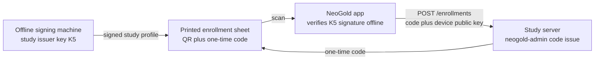

# NeoGold: Security and Compliance Plan

| Field | Value |
|---|---|
| Document | 8 of 13 |
| Version | 0.2.2 (records PRD D10 to D12; applies the independent review of docs 7 and 8: timestamps, Android worker and manifest details, SQLCipher key format, revocation wording; 0.2.1 aligns allow-lists, retention, and backup key handling with doc 12) |
| Date | 10 October 2026 |
| Owner | Sowad Al-Mughni, Kitalon Labs |
| Depends on | `2_PRD.md` v0.3.1, `4_System_Architecture.md` v0.2.2, `5_Database_Schema.md` v0.3, `7_API_Documentation.md` v0.2 |
| Status | Awaiting founder review |

Confidence tags: **[Certain]** cited law, standard, or platform fact; **[Likely]** strong inference; **[Guessing]** needs legal advice or measurement. This plan is not legal advice; Section 13 lists what a Bangladeshi lawyer must confirm.

---

## 0. Read This First

Four findings change what you should do, so they come before the controls.

1. **Decided 11 October 2026 (PRD D10 to D12): v1.0 is a closed research build, so G3 applies only to a later public release.** The legal risk described here is unchanged for that release. Bangladesh's Personal Data Protection Ordinance 2025 says a data fiduciary "shall not conduct activities such as tracking, monitoring, profiling or targeted advertising" of a specific child (section 9(3)), and defines profiling as automated processing to "evaluate, analyse or predict aspects" of a person (section 2(14)) [Certain, ordinance text in unofficial English translation]. Whether a triage suggestion for a named baby fits that wording is the lawyer's call [Guessing]. Separately, the Drug and Cosmetics Act 2023 brings software into the medical device definition [Certain, per regulatory guide]; regulators judge a product by what it does, so the decision-support framing (D11) helps but does not settle the question [Likely]. The v1.0 study runs under the partner's ethics approval and the research exemption (section 24(1)(h)) [Certain on the section].
2. **Most of the ordinance already applies.** Only section 23 (Chief Data Officers) and sections 31 to 46 (offences and penalties) wait for a government notification after 18 months (section 1(3)) [Certain]. Consent, children's data, security, retention, and breach duties are in force now; only the penalties are deferred, to around May 2027 at the earliest [Likely].
3. **A repackaged APK cannot be stopped by code.** Anyone who modifies the app can also remove the checks that would detect it. In a market where apps travel by messaging apps and file sharing [Likely], the real controls are distribution (Play Store only), published signing fingerprints, a trademark rule for forks, and training (T3, H9).
4. **Budget phones can lose Keystore keys** after some OS updates or factory-level resets [Likely]. When that happens, everything encrypted on the phone is unreadable by design. The paper register stays the record of truth for screening, and research mode uploads or exports often (Section 6.1).

The earlier PRD and architecture text overstated one legal point (that the ordinance requires confidential data to be stored only in Bangladesh). It has been corrected in PRD v0.3.1 and doc 4 v0.2.1; the hosting decision stands, for the reasons in Section 13.1.

---

## 1. Scope and Security Objectives

**In scope:** the Android app (screening and research modes), the Study Intake Service and its host, the signing and card production tooling, the CI/CD pipeline, and the repository.

| Objective | Meaning for NeoGold | Measured by |
|---|---|---|
| Confidentiality | A lost, stolen, or shared phone, or a breached server, exposes no identifiable baby data | Threats T1, T2, T10 controls pass the release checklist (Section 13.3) |
| Integrity | The number shown to a health worker comes from a genuine card, model, and config | Signature and hash checks, golden vectors in CI |
| Availability | Screening never depends on a network or server | Zero network calls in screening path (doc 4 driver 2), enforced by a module dependency rule |
| Accountability | Every clinical output is traceable to config, model, and card batch versions | `screening_session` and `audit_event` fields (doc 5) |
| Minimization | Data that is never collected cannot leak | Section 3 |

**Security standards used as checklists, not certifications:**

- Android app: OWASP MASVS v2, all eight control groups (STORAGE, CRYPTO, AUTH, NETWORK, PLATFORM, CODE, RESILIENCE, PRIVACY) [Certain], with RESILIENCE treated as best effort for the reason in finding 3.
- Study Intake Service: OWASP ASVS 5.0.0 (May 2025) Level 2 [Certain on version] and the OWASP API Security Top 10 (2023) [Certain].

---

## 2. Data Inventory and Classification

NeoGold uses four internal classes. The ordinance's own classes (public, internal, confidential, limited) are set by a government schedule (section 29(1)) [Certain] that the lawyer maps onto these.

| Class | Meaning | Handling |
|---|---|---|
| **N0 Public** | Published by design | Integrity protection only |
| **N1 Internal** | No personal data, but not for publication | Access control |
| **N2 Sensitive** | Health data about a child, pseudonymous | Encrypted at rest and in transit, minimized, retention-limited |
| **N3 Identifying** | Directly links N2 data to a person | Avoided wherever possible; erased early; never leaves the phone |

| Data | Where | Class | Ordinance category | Retention | Protection |
|---|---|---|---|---|---|
| App code, model, triage config, trust lists, card spec | Repository, APK | N0 | Not personal | n/a | Signatures and hashes (Section 6.5) |
| Device profile and qualification results | Phone | N1 | Not personal | Until recalibration | SQLCipher |
| Screening session: age in hours, gestational age, flags, estimate, interval, triage action, versions | Phone | N2 | Sensitive (health-related, section 2(23)) [Certain] | 180 days default (PRD D7) | SQLCipher, app lock, FLAG_SECURE |
| Facility register number (optional) | Phone | N3 | Personal | Erased at 60 days | Validation blocks ID and phone numbers; never uploaded |
| Screening images | Phone memory only | N2 | Sensitive | Discarded after analysis | Never written to storage |
| Research participant code and consent form ID | Phone, study server | N2 | Pseudonymized personal data (section 2(6)) [Certain] | Study `retention_until` | Encrypted everywhere |
| Research images, metadata, TSB values | Phone until acknowledged, study server | N2 | Sensitive | Phone: 14 days after acknowledgment, deleted only after the server confirms (doc 7 Section 5.4); server: study retention | Tink on phone, encrypted volume on server |
| Code-to-identity mapping | Paper at the facility | N3 | Personal | Partner's protocol | Never in NeoGold |
| Device public keys, enrollment records, audit log | Study server | N1 | Not personal (no person linked) [Likely] | 5 years (Section 11) | Database roles |
| Server logs | Study server | N1 | Not personal by design | 90 days | No bodies or codes logged |

**Who is responsible for what** [Likely; the lawyer confirms]:

- **Screening mode:** the facility or health worker's employer is the data fiduciary. Kitalon Labs receives nothing, so it is neither fiduciary nor processor for screening data.
- **Research mode:** the partner institution is the data fiduciary and runs the server. Kitalon Labs supplies software and has no access to production data.
- **Training exports:** if Kitalon Labs or a collaborator abroad receives de-identified exports, it becomes a recipient of pseudonymized personal data. That needs a data sharing agreement and, for a recipient abroad, the transfer conditions of section 29(3) and (4) [Certain on the sections], which the consent form should cover.

---

## 3. Data Minimization

Minimization is the strongest control in this plan, because the most damaging data simply does not exist.

| Never collected | How it is prevented |
|---|---|
| Names of baby or mother | No field exists in either mode |
| Birth date and time | The app computes age in hours on screen and stores only that (doc 4 Section 8) |
| Phone numbers, national ID, birth registration number | Register number validation rejects these patterns (PRD FR-23); participant codes need a letter prefix (doc 7 Section 7) |
| Location | No location permission; EXIF GPS stripped and rejected by the server (Section 6.4) |
| Full timestamps on the server | Day precision plus minute offsets by default (`DAY_PLUS_OFFSETS`); the server's own arrival and completion fields are dates too; JPEG date tags stripped; exact request times only in the 90-day request log |
| Exact birth timing in exports | Not fully preventable: capture date plus age in hours places a birth within about two calendar days. De-identified exports therefore shift every date by one random offset per participant (default within plus or minus 180 days), which keeps intervals intact for analysis |
| Screening data on any server | Screening mode has no network path; screening rows never enter the outbox |
| Analytics and crash data | None unless the user opts in (FR-34); crash reports drop exception messages (Section 6.6) |
| Free text | No free-text fields in either mode, so nothing personal can be typed into a note |

On the API side, every request schema sets `additionalProperties: false`, so a coding mistake that adds a field is rejected rather than stored (doc 7 Section 0).

---

## 4. Keys and Secrets

| # | Key or secret | Type | Purpose | Where it lives | Rotation | If compromised |
|---|---|---|---|---|---|---|
| K1 | Play app signing key | Managed by Google | Signs what users install | Google Play App Signing | Google-managed | Contact Google; publish advisory |
| K2 | Upload key | Keystore file | Signs bundles uploaded to Play | Founder's machine, encrypted, plus offline backup | On compromise | Reset through Play Console upload key reset [Certain this exists] |
| K3 | Release manifest key | Ed25519 | Signs the bundle manifest (model, config, trust lists) | GitHub Actions secret in a protected `release` environment with required reviewer | Each major version | Low in v1.0, because APK signing dominates; high once over-the-air updates ship (NG-062), so K3 moves to offline signing before then |
| K4 | Card issuer key | Ed25519 | Signs card batch QR payloads | Offline: air-gapped laptop with encrypted disk, plus a paper or encrypted USB backup in a separate location | 2 years, or on compromise | Serious: an attacker could sign fake reference values that match a counterfeit card. Revoke via trust list in an app update; revoke affected batch IDs |
| K5 | Study issuer key | Ed25519 | Signs study profiles (server host, export key) | Same offline machine as K4, separate key | 2 years | Phones could be enrolled to a rogue server; remove key in an app update, re-issue study profiles |
| K6 | Device signing keys | ECDSA P-256 | Per-request API signatures | Android Keystore on each phone, non-exportable | Per enrollment | Revoke the device (doc 7 Section 4.5) |
| K7 | Database key | 256-bit random | SQLCipher raw key | Wrapped by a Keystore AES-256-GCM key | Per install | Requires Keystore compromise on that phone |
| K8 | File encryption keyset | Tink AES256_GCM_HKDF_4KB streaming AEAD | Research images | Tink keyset wrapped by a separate Keystore key | Per install | As K7 |
| K9 | PIN verifier key | Keystore HMAC-SHA256 | Binds the PIN hash to the phone (Section 6.2) | Keystore, non-exportable | Per study enrollment | As K7 |
| K10 | Study export key pair | X25519 (Tink HPKE) | Encrypts USB exports (Section 5.2) | Public key in the study profile; private key offline with the study coordinator | Per study | Exports readable by holder; issue new profile and key |
| K11 | TLS certificate keys | Managed by Caddy | HTTPS | Server, Caddy data volume | Automatic, about every 60 to 90 days [Likely] | Revoke and reissue |
| K12 | Enrollment code secret | 256-bit random | HMAC of enrollment codes | Server environment file, mode 0600 | On compromise (invalidates unused codes only) | Reissue codes |
| K13 | Database role passwords | Random | `neogold_app`, `neogold_export`, `neogold_migrator` | Server environment file | Yearly | Rotate; review audit log |
| K14 | Backup repository password | Random passphrase | restic encryption | On the server only in a root-owned file (mode 0600) read by the backup job; offline copies with the coordinator and one deputy | Per study | Start a new repository, copy the snapshots into it (`restic copy`), and delete the old one. Adding a new password and removing the old one is not enough, because restic keeps the same master key [Likely, per restic's key design] |
| K15 | SSH and WireGuard keys | Ed25519 | Admin access | Each admin's own machine | On staff change | Remove from `authorized_keys` and WireGuard peers |
| K16 | GitHub accounts | Hardware key or TOTP 2FA | Repository and CI control | Maintainers | n/a | Revoke sessions and tokens; audit commits |

**Offline signing machine (K4, K5, K10 generation).** A dedicated laptop that never connects to a network after setup, full-disk encryption, the `neogold-sign` tool installed from a verified release, keys in an encrypted file with a passphrase known to two people. Each signing event (batch ID or study code, date, key ID, operator) is written in a paper log and a signed text log copied to the repository's `signing-log/`. [Likely adequate for the threat level; a hardware security key with Ed25519 support is a later upgrade.]

**Trust list rules.** `config/trust-list.json` carries key IDs, public keys, key purpose (`CARD_ISSUER` or `STUDY_ISSUER`), validity dates, and a list of revoked batch IDs and study codes. A key is only accepted for its stated purpose, so a leaked card issuer key cannot sign a study profile.

---

## 5. Encryption

### 5.1 On the phone, at rest

| Data | Mechanism | Key |
|---|---|---|
| Screening log, research rows, device profile | SQLCipher 4 for Android (`net.zetetic:sqlcipher-android`) with Room [Likely on the artifact name; confirm against the current release]; AES-256 page encryption with per-page HMAC [Certain, SQLCipher 4 defaults] | K7, passed in SQLCipher's raw-key form `x'<64 hex characters>'`. A plain byte array is treated as a passphrase and run through PBKDF2 with 256,000 iterations on every open [Certain, SQLCipher 4 defaults], which a 2 GB phone does not need for a key that is already random |
| Research images | Tink `StreamingAead` with `AES256_GCM_HKDF_4KB`, write-to-temp then rename [Likely: Tink's guide names the AES-128 variant, and the Java library's predefined parameters also include AES-256] | K8 |
| Settings | DataStore, unencrypted | Holds no personal data (doc 5) |

- Keystore master keys are AES-256-GCM, non-exportable, StrongBox where present, TEE otherwise. They do not require user authentication, so retention jobs and uploads run with the screen off.
- `androidx.security:security-crypto` is not used; it is deprecated [Likely] and Tink is the maintained path (doc 4 Section 4.3).
- **Keystore loss.** If a Keystore key disappears, decryption fails with a specific exception. The app then tells the user plainly that local data could not be opened, resets the encrypted stores, and keeps working. Research mode reduces the impact by uploading on every Wi-Fi connection and offering USB export; screening relies on the paper register. This path has its own instrumented test.

### 5.2 Exports (USB and local)

- **Research export (FR-30)** is encrypted to the study's export public key (K10), which arrives inside the signed study profile. Each file is encrypted with a fresh Tink streaming AEAD key, and that key is wrapped with Tink HPKE (X25519, HKDF-SHA256, AES-256-GCM) [Likely available in the Tink version used; confirm in v0.5]. The coordinator decrypts with `neogold-admin decrypt-export`. A lost USB drive exposes nothing, and the health worker never handles a password.
- **Screening log export (FR-33)** goes to a location the user picks through the Storage Access Framework, with register numbers excluded by default and a warning screen before writing. It is not encrypted, because its purpose is a facility reading it in a spreadsheet; minimization (no names, no birth dates) is the protection.

### 5.3 In transit

- HTTPS only, TLS 1.2 or 1.3, terminated by Caddy with its default modern cipher configuration [Certain that Caddy defaults to TLS 1.2 minimum]. Port 80 serves only the certificate challenge and a redirect.
- `Strict-Transport-Security: max-age=31536000` added explicitly in the Caddyfile.
- Android network security config: `cleartextTrafficPermitted="false"`, trust anchors set to system CAs only. User-installed CAs are already untrusted for apps targeting API 24 and up [Certain]; the config makes it explicit.
- Request signing (doc 7 Section 4) means a network attacker who somehow breaks TLS still cannot forge or alter uploads.
- **No certificate pinning in v1.** Reasons: each study has its own host, unknown at build time; Let's Encrypt chains and keys change; a pinning mistake silently stops every phone in a study from uploading, which is a data integrity risk in itself [Likely]. The signed study profile already binds the phone to the right host name. Revisit if a study needs it.

### 5.4 On the server and in backups

| Data | Mechanism |
|---|---|
| PostgreSQL data and image store | On an encrypted volume: DigitalOcean Volumes for staging, which DigitalOcean encrypts at rest with LUKS [Certain]; LUKS on the partner's disk for production |
| Backups | restic, which encrypts with AES-256 in counter mode and authenticates with Poly1305-AES [Certain]; nightly; repository password K14 |
| Backup location | Staging: a second DigitalOcean region or Spaces bucket. Production: a second location **inside Bangladesh** (Section 13.1) |
| Restore test | Monthly, documented in `12_Deployment_Runbook.md`; a backup that has never been restored is not counted as a backup |

---

## 6. Android App Security

### 6.1 Platform hardening checklist

Checked on the merged manifest of every release build by a CI script (S5 in Section 13.3).

| Control | Setting |
|---|---|
| Cloud backup and device transfer | `android:allowBackup="false"`, plus `android:fullBackupContent` rules excluding every domain (API 30 and lower) and `android:dataExtractionRules` excluding every domain for both cloud backup and device transfer (API 31 and up). Both rule files are needed because on some manufacturers' phones `allowBackup="false"` stops cloud backup but not device-to-device transfer [Certain, Android backup guide] |
| Exported components | The launcher activity, plus library components that are exported but guarded by a system permission: WorkManager's `SystemJobService` (`BIND_JOB_SERVICE`) and `DiagnosticsReceiver` (`DUMP`), and the profile installer's `ProfileInstallerReceiver` (`DUMP`). The CI check allow-lists exactly these; anything else exported fails the build. The `FileProvider` used for export is not exported and grants per-URI permissions only |
| Debuggable | `false` in release; CI fails if a release APK is debuggable |
| Cleartext | Disallowed (Section 5.3) |
| Permissions | `CAMERA`; `INTERNET` and `ACCESS_NETWORK_STATE` (research upload); `FOREGROUND_SERVICE` and, on API 34 and up, `FOREGROUND_SERVICE_DATA_SYNC` (long uploads, doc 7 Section 5.3); `WAKE_LOCK` and `RECEIVE_BOOT_COMPLETED` (added by WorkManager); `USE_BIOMETRIC` and `USE_FINGERPRINT` (added by the biometric library for the app lock); the app's own `DYNAMIC_RECEIVER_NOT_EXPORTED_PERMISSION` (added by AndroidX); `POST_NOTIFICATIONS` on API 33 and up (recheck reminders). No location, contacts, phone state, or broad storage permissions. The CI check allow-lists exactly this set |
| Network isolation of screening | Only `:sync:research` may depend on the HTTP client; a Gradle dependency rule fails the build if any `:engine:*` or screening feature module does |
| Screenshots | `FLAG_SECURE` on every screen showing a register number or research data; `setRecentsScreenshotEnabled(false)` on API 33 and up |
| Overlay attacks | `filterTouchesWhenObscured` on result confirmation and research consent buttons for API 26 to 30 (Android 12 and later block untrusted overlay touches by default [Certain]) |
| WebView | None in the app |
| Native code | Every `.so` (SQLCipher, marker detection) built or verified for 16 KB page alignment; Google Play blocks updates that lack it for apps targeting Android 15 and up, starting 1 February 2027 [Certain, Android developer guide] |
| Code shrinking | R8 full mode for size; obfuscation is not counted as a security control |
| Release logging | `android.util.Log` calls stripped by R8 rules; the Timber release tree drops everything below `WARN` and never receives personal data |

### 6.2 Research PIN

| Item | Rule |
|---|---|
| Length | 6 digits minimum; rejects repeated digits, simple sequences, and the top 100 most common PINs |
| Hash | Argon2id with m = 19 MiB, t = 2, p = 1 and a 16-byte random salt [Certain, OWASP Password Storage Cheat Sheet minimum]; if the 2 GB floor phone takes more than 1 second, use OWASP's equivalent m = 12 MiB, t = 3 [Certain that OWASP lists it] |
| Device binding | The Argon2id output is then passed through HMAC-SHA256 with a non-exportable Keystore key (K9). A copied database cannot be brute-forced on another computer, because the last step only runs inside this phone's Keystore |
| Library | Bouncy Castle's Argon2 (pure Java, shrunk by R8) or argon2kt over JNI if the pure-Java version is too slow on Android Go [Guessing which; measure in v0.5] |
| Lockout | The failure counter is written **before** each check, so killing the app does not reset it. 5 failures: 1 minute; 10: 15 minutes; 15 and above: 1 hour per attempt |
| No wipe on failures | Wiping would let anyone destroy study data by typing wrong PINs; the data is already encrypted, so a slow attacker gains little |
| Forgotten PIN | Re-enroll with a coordinator-issued code while keeping local data (open issue 3) |
| Session | Research mode re-locks after 5 minutes in the background or on screen off |

### 6.3 Shared phones and app lock

- Optional app lock (FR-35) through `BiometricPrompt` allowing the phone's screen lock (PIN, pattern, or fingerprint), with the `KeyguardManager` confirm-credential screen as the fallback where `BiometricPrompt` cannot offer device credentials on older Android versions [Likely needed on API 28 and 29].
- Notifications never show baby details, only "A recheck is due" (NG-048).
- The Home due list (FR-36) shows register numbers only after the app lock, when the lock is enabled.
- A facility can turn the screening log off entirely (`keep_screening_log`, doc 5); the triage result still works.

### 6.4 Images and metadata

- Research JPEGs are re-written before encryption keeping only the image data segments and an Exif block with the orientation tag. GPS, every date-time tag, maker notes, XMP, MPF secondary images, and embedded thumbnails are removed, because any of them can carry location or an exact time.
- Camera settings needed for research (ISO, exposure, AE and AWB lock state, gains) travel in `capture_metadata` JSON instead (doc 7).
- The server accepts only an allow-list of JPEG segments (doc 7 Section 7) and rejects anything else with `IMAGE_METADATA_NOT_ALLOWED`, so a stripping bug is caught at the first upload rather than discovered in a data audit.
- Screening images never leave memory (doc 4 Section 8).

### 6.5 Integrity of bundled artifacts

- Model, triage config, card trust list, and study trust list are listed in a bundle manifest signed with K3 and checked at startup (doc 4 Section 12). A failed check disables screening.
- This catches corruption and on-device modification. It does **not** stop a repackaged APK (T3). The triage config's `validUntil` (doc 4 Section 6.1) stops an old, unmaintained build from showing triage results forever (H8).
- Card batches and study profiles are separately signed (K4, K5) and verified offline.

### 6.6 Crash reports and logs

**Decision (resolves doc 4 Section 13):** no third-party crash reporting SDK in v1.

- A small in-house handler writes crash reports to an encrypted local file: exception class names, stack frames, app version, Android version, device model. **Exception messages are dropped**, because messages are where personal values leak (a formatted register number, for example).
- After a crash, the next launch offers "Share crash report", which opens the Android share sheet so the user decides where it goes. Nothing is sent automatically (FR-34).
- The on-device structured log (doc 4 Section 13) follows the same rules: event names and codes, no values typed by users.
- Why not an SDK: hosted crash services send data abroad by default, and self-hosted ones add a server to secure. ACRA was considered and stays an option if field debugging needs more [Likely suitable, Apache 2.0].

---

## 7. Authentication Flows

The contracts are in doc 7 Section 4. This section covers the security reasoning and the parts outside the API.

### 7.1 Study profile and enrollment

- The signed study profile replaces the typed study code of FR-25. It carries the study name, partner, server host (absent for export-only studies), timestamp precision, export public key (K10), and expiry.
- Staff see the study name, partner, and host before confirming. A forged QR fails signature verification; a genuine QR for the wrong study is caught by the name on screen.
- Enrollment code properties (60 bits, single use, 72 hours, site-bound, HMAC-stored) are in doc 7 Section 4.1.

### 7.2 Request signing

Per-request ES256 tokens from the Keystore key, bound to method, URL, and body hash, with replay protection (doc 7 Sections 4.2 to 4.4). The design was prototyped and passed ten attack and edge cases (doc 7 Section 12.3) [Certain]. There is no long-lived secret on the phone that could be copied and replayed elsewhere.

### 7.3 Revocation and loss

| Event | Who acts | Steps |
|---|---|---|
| Phone lost or stolen | Coordinator | `neogold-admin device revoke <id> --reason LOST`; check `status` for uploads after the loss time; record in incident log (Section 12) |
| Phone reassigned | Health worker or coordinator | Leave study in the app (`DELETE /device`), or revoke with `REASSIGNED`. Leaving deletes only the device key; local research data is wiped (FR-33) only once the outbox is empty or exported |
| Staff member leaves | Coordinator | Change the research PIN on that phone; the device key itself is not personal |
| Study ends | Coordinator | `study close`; phones show `STUDY_CLOSED` and offer USB export of anything not yet uploaded |

### 7.4 Admin access

- SSH keys only (Ed25519), password and root login disabled, one named account per admin, `sudo` with a password.
- SSH reachable only over WireGuard; the cloud or partner firewall exposes only ports 80 and 443 to the internet. DigitalOcean's web console is the break-glass path for staging [Certain it exists].
- All study administration runs through `neogold-admin` (doc 7 Section 10), and each command writes an `ADMIN` audit row. Direct `psql` access is for incident response only and is itself logged in the incident record.

---

## 8. Backend Security

### 8.1 Host

- Ubuntu 24.04 LTS, `unattended-upgrades` for security updates, automatic reboot window at 03:00 Asia/Dhaka.
- Firewall: allow 80 and 443 from anywhere, WireGuard UDP from anywhere, everything else denied; enforced both in the provider firewall and `ufw`.
- Staging is a **dedicated** droplet (doc 4 Section 10.2a): nothing else runs on it, so a flaw in another Kitalon product cannot reach NeoGold.

### 8.2 Containers

| Control | Setting |
|---|---|
| Users | Every container runs as a non-root user |
| Privileges | `cap_drop: [ALL]`, `security_opt: [no-new-privileges:true]` |
| Filesystem | `read_only: true` with explicit writable volumes (image store, Caddy data, temp) |
| Network | Only Caddy publishes ports; `db` is on an internal network with no host port |
| Images | Pinned by digest; `api` image built in CI with an SBOM and scanned (Section 10) |
| Resources | Memory and CPU limits so one runaway upload cannot starve PostgreSQL |

### 8.3 Application

- FastAPI with Pydantic models set to forbid extra fields; every input validated before use.
- SQLAlchemy with bound parameters only; a lint rule rejects string-formatted SQL.
- Image store paths built only from validated UUIDs and study and site codes; never from request strings, so path traversal has nothing to work with.
- JPEG handling: magic-byte check, size limit enforced while streaming, hash computed while streaming, decode with Pillow under a pixel limit (8192 by 8192) to stop decompression bombs; files written to a temp path, `fsync`, then renamed.
- Authentication and replay checks in middleware in the order of doc 7 Section 4.3; time claims measured from header arrival.
- Rate limits in the API (doc 7 Section 8); Caddy enforces body size limits and timeouts.
- Errors return problem details without stack traces; stack traces go to the server log with the `request_id`.

### 8.4 Database

- PostgreSQL 16, `scram-sha-256` authentication [Certain default since PostgreSQL 14], listening on the internal Docker network only.
- Least-privilege roles (doc 5 Section 3.5); `audit_log` is insert and select only for the application role.
- Forward-only migrations, reviewed and tested on a fixture database.

### 8.5 Monitoring and alerts

| Signal | Alert when |
|---|---|
| External uptime check on `/health` | Down for 5 minutes |
| Disk usage on the image volume | Over 80% |
| Nightly backup | Missing or failed |
| TLS certificate | Under 14 days to expiry |
| Failed authentication | More than 50 per hour, or any `AUTH_REPLAY` |
| Enrollment failures | More than 20 per day (doc 7 Section 8) |
| Sessions stuck in `RECEIVING` | Older than 7 days |

Alerts go to the coordinator and, for staging, the founder, by email. No third-party monitoring agent runs on production study servers.

---

## 9. Threat Model (STRIDE)

Likelihood and impact are qualitative (Low, Medium, High) [Guessing until reviewed with the partner].

| ID | Threat | STRIDE | Likelihood | Impact | Controls | Residual |
|---|---|---|---|---|---|---|
| T1 | Lost or stolen phone exposes screening or research data | I | High | Medium | SQLCipher, Tink, Keystore keys; app lock; research PIN bound to Keystore; retention 60 and 180 days; device revocation | Low |
| T2 | Family member on a shared phone browses NeoGold | I | High | Medium | App lock, FLAG_SECURE, notifications without details, screening log can be off | Low with app lock, Medium without |
| T3 | Repackaged APK with altered thresholds or malware, shared over messaging apps | T, S | Medium | High | Play Store as the only official channel; signing certificate SHA-256 fingerprint published on the website and README; trademark rule that forks must not use the NeoGold name or icon; training material ("Install only from Google Play"); `validUntil` | Medium; cannot be fully closed |
| T4 | Counterfeit card: genuine QR copied onto a home-printed card | S, T | Medium | High | Signature authenticates the reference values; the correction residual check authenticates the physical print, because a home print's colors miss the signed reference (`HIGH_RESIDUAL`); batch expiry; batch revocation | Low to Medium [Guessing until tested with deliberate counterfeits in v0.5] |
| T5 | Card issuer key stolen | S, E | Low | High | Offline key K4, two-person passphrase, signing log; purpose-bound trust list; revocation by app update | Low |
| T6 | Forged study QR points phones at a rogue server | S, I | Low | High | Signed study profile (K5); host shown before confirming | Low |
| T7 | Malicious Wi-Fi or network attacker | I, T | Medium | Medium | TLS, system CAs only, no cleartext, request signing with body hash | Low |
| T8 | Stolen enrollment code | S | Medium | Medium | Single use, 72 hours, site-bound, consumed atomically; attestation challenge bound to the code; coordinator sees each enrolled device and its attestation result; revocation | Low |
| T9 | Forged or replayed uploads | S, T | Low | High | ES256 per request, `jti` replay table, method, URL, and body binding | Low |
| T10 | Study server compromise | I, T | Low | High | Hardened host (Section 8), dedicated machine, WireGuard-only SSH, encrypted volume, no names or birth dates on the server, encrypted backups | Medium (server holds images) |
| T11 | Insider at the partner copies data | I, R | Low | High | CLI-only export, append-only audit log, de-identified exports, separate export role, data sharing agreement | Medium |
| T12 | Supply chain: malicious dependency, compromised GitHub account, poisoned CI action | T, E | Medium | High | Gradle dependency verification metadata; pip hash-pinned lockfile; GitHub Actions pinned by commit SHA; Dependabot; 2FA required; branch protection with review; release environment approval; SBOMs | Medium |
| T13 | Denial of service on the study server | D | Low | Low | Rate and size limits; uploads wait in the outbox; screening unaffected | Low |
| T14 | Crafted image exploits the server's image parser | E | Low | High | Only enrolled devices can upload; pixel limits; non-root, read-only container; prompt Pillow updates | Low |
| T15 | Re-identification from uploaded data | I | Low | High | Codes only, day-precision dates on device and server, JPEG metadata stripped, per-participant date shift in exports, identity mapping on paper | Low |
| T16 | A health worker disputes what the app showed | R | Medium | Medium | Local `audit_event` with config, model, and card batch versions per session; not a legal-grade record | Medium |
| T17 | Data pulled off the phone through backup or debugging | I | Low | Medium | Backup disabled, release not debuggable | Low |

---

## 10. Vulnerability Management and Secure Development

| Practice | Tooling | When |
|---|---|---|
| Static analysis, Android | Android Lint (security checks as errors), detekt | Every pull request |
| Static analysis, Python | Ruff, Bandit | Every pull request |
| Secrets scanning | gitleaks; GitHub secret scanning | Every pull request and push |
| Dependency updates | Dependabot for Gradle, pip, Docker, and GitHub Actions | Weekly |
| Known-vulnerability scan | OSV-Scanner on lockfiles; Trivy on container images | Every pull request and nightly |
| SBOM | CycloneDX for the Android app and backend, attached to each GitHub release | Every release |
| Mobile app scan | MobSF static scan of the release APK, findings triaged | Every release candidate |
| API fuzzing | Schemathesis against staging (doc 7 Section 12) | Every release candidate |
| Manifest and network checks | CI script for Section 6.1 items | Every release build |
| Independent review | External security review of app and server before the first production study, scope MASVS and ASVS Level 2 [Guessing on cost; seek a volunteer or grant-funded reviewer] | Once before the study, then yearly |

**Fix deadlines:** critical 7 days, high 30 days, medium 90 days, low at the next release. A critical issue in a release already on phones triggers the halt procedure in `12_Deployment_Runbook.md`.

**Disclosure:** `SECURITY.md` in the repository names a security contact address and enables GitHub private vulnerability reporting; acknowledgment within 3 working days; coordinated disclosure within 90 days; credit to reporters who want it.

---

## 11. Logging, Audit, and Records

| Record | Contents | Never contains | Kept |
|---|---|---|---|
| Server request log | Time, `request_id`, `device_id`, route, status, latency. The only place exact arrival times exist | Bodies, `Authorization` headers, enrollment codes, participant codes | 90 days, never exported |
| Server `audit_log` | Enrollments, revocations, study status changes, exports, retention purges, session rejections, admin commands. No per-session upload events, so the 5-year log cannot reveal capture times | Image data, participant codes | At least 5 years, as processing records (ordinance section 19(1)) [Certain on the 5-year minimum]; kept after study data is deleted, which is safe because it holds no personal data |
| Phone `audit_event` | Config and model versions, qualification results, erasures, PIN lockouts | Register numbers, typed values | With the screening log retention |
| Incident register | Each security or data incident, decisions, notifications | Personal data beyond what the regulator requires | 5 years |
| Signing log | Every K4 and K5 signature | Private material | Permanently, in the repository |
| Ethics records | Partner's responsibility under its committee rules; ethics committees keep records at least 3 years after a trial [Certain, Bangladesh GCP guideline via ClinRegs] | | Partner's protocol |

---

## 12. Incident Response

### 12.1 Roles

| Role | Staging | Production study |
|---|---|---|
| Incident lead | Founder | Partner's named data protection lead |
| Technical responder | Founder | Partner IT, with the founder on call for the software |
| Clinical lead | Consulted for any incident that could have affected a triage result | Same |
| Communications | Founder | Partner, with ethics committee as required |

### 12.2 Steps and clocks

1. **Detect and record** (time zero): alert, report, or `SECURITY.md` submission. Open an incident record.
2. **Contain** within 4 hours of confirmation: revoke devices, `study pause`, rotate exposed secrets, isolate the server, halt the Play staged rollout if the app is involved.
3. **Assess** within 24 hours: what data, how many participants, whether the breach "is likely to cause significant damage" to them, which is the ordinance's trigger for notifying the Authority (section 20(1)) [Certain].
4. **Notify** within 72 hours: partner, ethics committee, and clinical lead. The Authority within the time set by the regulations under section 20; until those regulations exist, use 72 hours as the internal target [Likely the regulations are not yet issued; confirm with the lawyer].
5. **Recover:** restore from a verified backup if integrity is in doubt; re-enroll devices if keys may be exposed.
6. **Review** within 14 days: root cause, control changes, hazard log update.

### 12.3 Clinical safety incidents

A report that NeoGold missed a baby who needed treatment is a clinical incident first and a software incident second. The clinical lead decides whether to disable triage. Because the app is offline, the fastest lever is an app update that ships a config with triage disabled, released to 100% at once and pushed through Play's update prompt; the slower backstop is `validUntil`. A remote kill switch is deliberately absent, because it would require screening to call a server.

---

## 13. Compliance

### 13.1 Personal Data Protection Ordinance 2025 (Ordinance No. 61 of 2025)

Section numbers refer to the unofficial English translation; the lawyer confirms against the official Bangla text.

| Section | Requirement [Certain unless tagged] | NeoGold control | Status |
|---|---|---|---|
| 1(3) | Most provisions in force on promulgation (6 November 2025); section 23 and sections 31 to 46 later, by notification after 18 months | This plan applies now | Done |
| 2(23) | Health-related, genetic, and biometric data are sensitive personal data | All clinical data handled as N2 (Section 2) | Done |
| 9(1) | A child's data needs consent from a parent, legal guardian, or authorized person | Research: written guardian consent, `consent_form_id` required before capture (FR-26). Screening: the health worker confirms parent or guardian consent before the camera (FR-37, PRD D12); whether verbal consent is enough for the log is for the lawyer before a public release | Partly done |
| 9(3) | No tracking, monitoring, profiling, or targeted advertising of a specific child | Research exemption under 24(1)(h) for the v1.0 study [Likely]. Screening triage is hidden in v1.0 (PRD D10); for a public release, decision-support framing (D11) and guardian consent (D12) go to the lawyer with this question | Deferred to G3 |
| 11(3), 13(6) | Explain the rationale of automated decisions on request; inform the person before automated processing | Session detail shows reason codes and threshold; model card in the app; the "What to tell the mother" script (NG-047) gets a sentence saying a phone app helps decide whether a blood test is needed | Add to NG-047 wording |
| 17 | Appropriate technical and organizational measures, including pseudonymization, encryption, risk assessment, regular testing | Sections 3 to 10 | In this plan |
| 18 | Retention no longer than regulations set; research may keep longer | Phone 60 and 180 days; study `retention_until`; deletion by admin action (doc 5 Section 3.4) | Done |
| 19(1) | Keep records for at least 5 years | `audit_log`, incident register, processing records (Section 11) | Done |
| 20 | Notify the Authority of a breach likely to cause significant damage, in the form and time set by regulation | Section 12 | Done; timing to confirm |
| 23 | Significant data fiduciaries appoint Chief Data Officers (in force later) | Partner's obligation if it is designated significant [Guessing] | Partner |
| 24(1)(h), 24(4) | Exemption for scientific research, limited where it would disproportionately affect data subjects | Ethics approval; all safeguards still applied | Done |
| 29(1) | Government classifies personal data as public, internal, confidential, or limited by schedule | Mapping of N0 to N3 onto the schedule | Open (lawyer) |
| 29(3), 29(4) | Cross-border transfer only with consent, contract, or listed conditions, and only to places with adequate technology | No real data leaves Bangladesh; any export to a collaborator abroad named in the consent form and covered by agreement | Open (consent form wording) |
| 29(7)(b) | Data stored in any cloud keeps at least one synchronized real-time copy in Bangladesh | Production and its backups hosted in Bangladesh; staging holds synthetic data only | Done (PRD D9) |

**Why hosting stays in Bangladesh.** The corrected reading still supports the decision: hosting on DigitalOcean in Bangalore or Singapore would need a real-time copy in Bangladesh (29(7)(b)) and the transfer conditions (29(3), 29(4)), on top of what an ethics committee is likely to require [Likely]. Hosting in Bangladesh satisfies all of these at once.

### 13.2 Medical device, research ethics, and app store

| Area | Finding | What NeoGold does |
|---|---|---|
| Medical device law | The Drug and Cosmetics Act 2023 (18 September 2023) covers medical devices including software; devices are classed A to D [Certain, per regulatory guides]. Classes B to D need approval from a reference country (EU, USA, Canada, Japan, Australia) to register [Likely, per one regulatory guide] | NeoGold has no reference-country approval, so registration is not currently possible. Whether a free, open-source app distributed without sale must register is the second G3 question |
| Research approval | Ethics committee approval is required for research involving humans; the BMRC IRB manual says trials of new devices should go to the National Research Ethics Committee [Certain, per ClinRegs]. Whether DGDA must also approve a device investigation is unclear [Guessing] | Partner obtains approval; ask DGDA in writing before enrollment starts |
| Research consent | Under 18 is a minor; consent from a legal representative or guardian, in Bangla and English, for national committee submissions [Certain, per ClinRegs] | Paper consent; app records only the form ID |
| Voluntary standards | ISO 14971 (risk management), IEC 62304 (software life cycle), IEC 82304-1 (health software) [Certain they exist] | Used to structure the hazard log and release process; no certification claimed |
| Google Play | Every app completes the Health apps declaration. Apps regulated as medical devices must declare it and provide proof of approval on request; other health apps must say in the description that the app "is not a medical device and does not diagnose, treat, cure, or prevent any medical condition" and remind users to consult a professional [Certain, Play policy page] | The declaration must match the legal opinion. If counsel says NeoGold is a medical device, a public Play release is blocked until it is approved. If counsel says it is not, the required disclaimer goes in the listing, and the triage wording is reviewed against it so the listing and the app do not contradict each other |
| Play Data safety form | Research uploads are data collected off the device; screening collects nothing | Declare health information and photos for research mode, encrypted in transit; screening mode declares no collection; privacy policy on a public web page, not a PDF [Certain this is required] |
| Target audience | Health workers, not children | Declare adult audience; no child-directed features |

### 13.3 Release gates

| Gate | Condition | Blocks |
|---|---|---|
| **G1** Clinical sign-off | Signed `CLINICAL_SIGNOFF.md` whose hash matches the config (PRD Section 9b) | Any build that shows a triage result |
| **G2** Verified cards | Signed, measured card batches in circulation (PRD Section 9a) | Any build that shows a triage result |
| **G3** Legal opinion (adopted; applies to public release only, PRD D10) | Written opinion from a Bangladeshi lawyer on (a) section 9(3) profiling and the screening log's legal basis, and (b) medical device status of a free triage app; Play declaration aligned with it | Any **public** build that shows a triage result. Research builds under ethics approval are not blocked |
| S1 | MASVS checklist (Section 1) reviewed for this release | Release |
| S2 | No open critical or high vulnerabilities | Release |
| S3 | SBOMs generated and attached | Release |
| S4 | All native libraries pass the 16 KB alignment checks | Release |
| S5 | Merged-manifest checks pass (Section 6.1) | Release |
| S6 | Network config: no cleartext, system CAs only | Release |
| S7 | Authentication test cases 10 of 10 (doc 7 Section 12.3) | Backend release |
| S8 | Backup restore test passed within the last 30 days | Production study go-live and each backend release |
| S9 | Secrets scan clean on the release commit | Release |

G3 was adopted on 11 October 2026 together with the decision to keep v1.0 a closed research build (PRD D10); PRD Section 16 open item 5 tracks it.

### 13.4 Open-source licenses

| Component | License | Obligation |
|---|---|---|
| NeoGold code | MIT (PRD) | Keep notice |
| Card design and documentation | CC BY 4.0 (PRD) | Attribution |
| OpenCV (if chosen) | Apache 2.0 [Certain] | Notice file |
| Tink | Apache 2.0 [Certain] | Notice file |
| SQLCipher for Android, community edition | BSD-style [Likely] | Notice in app |
| Bouncy Castle (if chosen) | MIT-style Bouncy Castle license [Certain] | Notice |
| Noto Sans and Noto Sans Bengali | SIL Open Font License 1.1 [Certain] | Include license |

An "Open-source licenses" screen generated at build time lists all of them (About screen, FR-32). CI fails on a dependency with an unknown or copyleft license until reviewed.

**Trademark rule for forks.** The code is MIT, but `CONTRIBUTING.md` asks that forks with changed thresholds, models, or cards use a different app name and icon, so a modified clinical tool cannot pass as NeoGold (T3). Whether to register the name as a trademark in Bangladesh is open issue 5.

---

## 14. Clinical Safety Hazard Log (Seed)

A starting list for the clinical lead, structured after ISO 14971. The maintained log lives at `docs/safety/HAZARD_LOG.md` and is reviewed with every clinical sign-off. Severity and likelihood are left for the clinical lead to rate.

| ID | Hazard | Cause | Harm | Controls | Verified by |
|---|---|---|---|---|---|
| H1 | False reassurance | Estimate too low (skin tone, lighting, camera) | Missed treatment, risk of brain injury from bilirubin | Upper-bound zones (within 3 mg/dL of threshold, or 15 and above), wide-interval rule, hard rules, danger-sign questions, "Always confirm with a blood test", experimental label, G1 to G3 | Validation study; triage boundary tests |
| H2 | Wrong age in hours | Birth time entered wrong, or the phone clock is wrong (age is computed from the phone clock) | Wrong threshold | Date and time picker with "Baby is N hours old" confirmation; the phone's current date and time shown on that screen; screening blocked if the clock is earlier than the app build time or, in research mode, more than 10 minutes from the last server offset; warning when automatic date and time is off; 14-day rule (R5) | Usability test with nurses; clock-manipulation tests |
| H3 | Wrong gestational age | Not known or entered wrong | Wrong threshold band | Required field; under 35 weeks goes to blood test (R3); handling of unknown age decided by the clinical lead | Clinical review |
| H4 | Counterfeit, faded, or dirty card | Copied QR, sun damage, handling | Biased estimate | Signature, residual check, card integrity check (NG-043), expiry | Deliberate counterfeit and aged-card tests in v0.5 |
| H5 | Camera processing distorts colors | Local tone mapping, HDR, beauty filters | Biased estimate | Device qualification, duplicate-patch check, `RESEARCH_ONLY` phones cannot screen | Device matrix (doc 1 Section 13.5) |
| H6 | Light that defeats correction | Mixed window and tube light, colored light | Biased estimate | Light-uniformity and residual checks; guidance to move away from windows | Ward lighting tests |
| H7 | Wrong or corrupted config or model | Build error, tampering on the phone | Wrong output for every baby | Signed manifest, schema check, golden vectors, clinical sign-off hash check in CI | CI; startup check test |
| H8 | Outdated build keeps running | No updates in the field | Thresholds or model known to be wrong stay in use | `validUntil` (12 months maximum) disables triage and asks for an update | Expiry test |
| H9 | Modified copy of the app | Repackaged or forked build passed around | Unknown behavior under the NeoGold name | T3 controls; training; published fingerprint | Periodic search for copies |
| H10 | Missed recheck | Notification blocked by battery manager | Delayed detection | Home due list (FR-36), paper register, battery guidance screen | Field test on target phones |
| H11 | Result misread | Low literacy, color vision, small screens | Wrong action taken | Color, icon, border, and words together; Bangla wording signed by the nurse panel; 320 dp layout check (doc 6) | Usability test |

---

## 15. Open Issues for Review

1. **G3 before a public release.** Resolved for v1.0 by PRD D10 (closed research build). Before any public build shows a triage result, get the written opinion; the questions are in Section 13.3.
2. **Lawyer and DGDA.** Who drafts the questions (Section 13.1 rows marked Open, Section 13.2 first two rows) and which firm answers them; the Sakhipur partner may already have counsel.
3. **Forgotten research PIN.** Proposed: re-enroll with a coordinator code while keeping local data. Needs the partner's agreement that a coordinator code is enough proof.
4. **Mandatory key attestation** from v1.1 (doc 7 open issue 1).
5. **Trademark.** Whether to register "NeoGold" in Bangladesh to back the fork naming rule.
6. **External security review** funding and timing before the first production study.

---

## Sources

- [Personal Data Protection Ordinance 2025, Ordinance No. 61 of 2025 (unofficial English translation)](https://dpo-india.com/Resources/Privacy_Regulations_in_Asia_Pacific_Countries/Bangladesh-Personal-Data-Protection-Ordinance,2025(Ordinance.No.61-2025).pdf)
- [Daily Star: Personal Data Protection Ordinance 2025, key takeaways](https://www.thedailystar.net/tech-startup/news/bangladeshs-personal-data-protection-ordinance-2025-key-takeaways-4015401)
- [Prothom Alo: Government issues gazettes of two data ordinances](https://en.prothomalo.com/bangladesh/government/teeopu4dfv)
- [Asia Actual: Bangladesh launches new medical device regulations](https://asiaactual.com/blog/bangladesh_launches_new_medical_device_regulations/)
- [ClinRegs (NIAID): Bangladesh clinical research profile](https://clinregs.niaid.nih.gov/country/bangladesh)
- [Google Play: Health Content and Services policy](https://support.google.com/googleplay/android-developer/answer/16555673)
- [Android Developers: Support 16 KB page sizes](https://developer.android.com/guide/practices/page-sizes)
- [Android Developers: Keystore system](https://developer.android.com/privacy-and-security/keystore)
- [Android Developers: Network security configuration](https://developer.android.com/privacy-and-security/security-config)
- [Android Developers: Back up user data with Auto Backup](https://developer.android.com/identity/data/autobackup)
- [OWASP MASVS](https://mas.owasp.org/MASVS/)
- [OWASP ASVS repository (5.0.0, May 2025)](https://github.com/OWASP/ASVS)
- [OWASP API Security Top 10 (2023)](https://owasp.org/API-Security/editions/2023/en/0x11-t10/)
- [OWASP Password Storage Cheat Sheet (Argon2id parameters)](https://cheatsheetseries.owasp.org/cheatsheets/Password_Storage_Cheat_Sheet.html)
- [SQLCipher for Android](https://www.zetetic.net/sqlcipher/sqlcipher-for-android/)
- [Tink streaming AEAD](https://developers.google.com/tink/streaming-aead)
- [restic: design and cryptography](https://restic.readthedocs.io/en/stable/100_references.html)
- [DigitalOcean Volumes: encryption at rest](https://docs.digitalocean.com/products/volumes/details/features/)
- [Caddy automatic HTTPS](https://caddyserver.com/docs/automatic-https)
