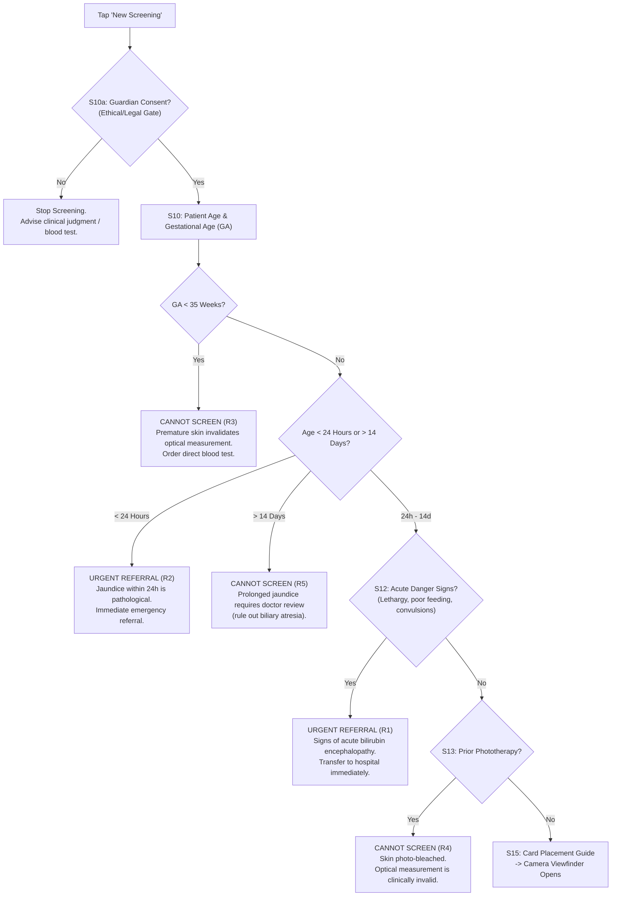
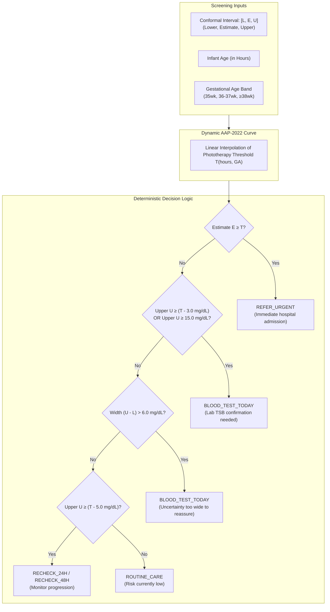

# NeoGold: End-to-End System Architecture, Clinical Logic & AI Methodology

| Attribute | Specification |
|---|---|
| **Document Title** | NeoGold System Operational Logic, Clinical Decision Engine & AI Pipeline |
| **Target Audience** | Executive Leadership, Clinical Investigators, Engineering Leads |
| **Author** | NeoGold Engineering & AI Integration Team |
| **System Reference** | AAP-2022 Hyperbilirubinemia Guidelines / NeoGold Architecture v0.2.4 |
| **Deployment Target** | Low-resource offline Android devices (Android 8.0+, 2–4 GB RAM) |
| **Clinical Classification** | Clinical Decision Support Software (Non-diagnostic triaging) |

---

## Executive Summary

**NeoGold** is an open-source, fully offline Android clinical decision-support tool engineered to estimate neonatal hyperbilirubinemia (jaundice) risk directly at the point of care in low-resource environments (such as Upazila Health Complexes and community clinics in Bangladesh). 

Severe neonatal jaundice can rapidly escalate to acute bilirubin encephalopathy and **kernicterus**—causing irreversible brain damage, choreoathetoid cerebral palsy, sensorineural hearing loss, or death. While tertiary facilities rely on invasive laboratory Total Serum Bilirubin (TSB) tests or expensive transcutaneous bilirubinometers ($>\$3,000$), community health workers traditionally rely on visual skin blanching (the Kramer scale), which is subjective, unreliable, and dangerously inaccurate in dark skin tones.

NeoGold bridges this gap through a three-part scientific framework:
1. **Clinical Safety Gates (AAP-2022):** Strict pre-capture exclusion criteria that intercept life-threatening neonatal emergencies before camera activation.
2. **Standardized Calibration Card:** Normalizes unpredictable room lighting, phone image-sensor color biases, and skin tone variations using batch-measured colorimetry.
3. **Calibrated AI/ML Inference:** An explainable, regularized Ridge Regression model with split-conformal prediction intervals mapped against dynamic hour-specific phototherapy curves.

```
                    NEOGOLD SYSTEM ARCHITECTURE AT A GLANCE
                    
   [Health Worker]
          │
          ▼
   1. Clinical Intake & Exclusion Gates (AAP-2022 / WHO Rules)
      ├─ Guardian Consent (Mandatory ethical check)
      ├─ Gestational Age (<35 wk = Excluded) & Age (<24h / >14d = Excluded)
      ├─ Acute Danger Signs (Lethargy, poor feeding, fever = Immediate Urgent Referral)
      └─ Prior Phototherapy (Skin photo-bleaching invalidates colorimetry)
          │  (All criteria satisfied)
          ▼
   2. Optical Capture with NeoGold Calibration Card
      ├─ Placed directly on newborn sternum (central 24x24 mm skin window)
      ├─ ArUco 4x4 Corner Marker Tracking (Perspective & Tilt Homography)
      └─ Camera Burst Capture under locked Auto-Exposure / White Balance
          │
          ▼
   3. Automated 10-Point Quality Gate Engine
      ├─ Verifies: Card presence, tilt (<20°), blur, glare (<2% saturation),
      │           light uniformity, patch consistency, skin plausibility
      └─ Prevents false reassurance from degraded captures (3 attempts max)
          │  (Passed)
          ▼
   4. Color Science & Normalization Engine (CIELAB D65)
      ├─ Non-linear Gray Ramp Linearization (Absorbs smartphone ISP tone curve)
      ├─ Least-Squares / Root-Polynomial Color Transformation to CIE XYZ
      └─ Conversion to Device-Independent CIELAB under D65 Standard Illuminant
          │
          ▼
   5. AI Feature Extraction & Machine Learning Regression
      ├─ Features: Lightness (L*), Chromaticities (a*, b*), b*/L*, a*/b* ratios
      ├─ Multi-site Ridge Regression model (Predicts Bilirubin in mg/dL)
      └─ Split-Conformal Calibration (Calculates 90% Confidence Interval [L, U])
          │
          ▼
   6. Deterministic Triage Engine (AAP-2022 Curve Lookup)
      ├─ Evaluates Interval [L, E, U] against hour-specific phototherapy threshold T
      └─ Action: REFER_URGENT | BLOOD_TEST_TODAY | RECHECK (24h/48h) | ROUTINE_CARE
```

---

## 1. Why "New Screening" Does Not Open the Camera Immediately

A frequent user observation is:
> *"When I tap 'New Screening', why doesn't the camera open up immediately to take a picture of the baby? Why does it ask questions first?"*

In consumer photography apps, opening the viewfinder immediately is standard. However, **NeoGold is regulated clinical decision-support software**. Opening the camera before clinical gating would violate fundamental neonatal care guidelines (AAP-2022 and WHO standards) and jeopardize newborn lives.

### 1.1 The Pre-Camera Screening Gates

Before any optical capture is permitted, NeoGold executes a deterministic state machine verifying four mandatory prerequisites:



### 1.2 Clinical Rationale for Each Rule

| Gate Screen | Parameter / Question | Clinical Rule | Action if Triggered | Clinical Justification |
|---|---|---|---|---|
| **S10a** | Parental / Caregiver Consent | Ethical / Legal | `STOP_NO_CONSENT` | Ethical and legal standard. Photographing a minor without parental consent violates medical privacy laws and institutional IRB protocols. |
| **S10** | Gestational Age $< 35$ weeks | Rule `R3` | `CANNOT_SCREEN_BLOOD_TEST` | Preterm infants have undeveloped skin barrier layers (stratum corneum), altered subcutaneous fat thickness, and immature blood-brain barriers. Published clinical validation trials (e.g., BiliCam, Picterus) restrict optical screening to $\ge 35$ weeks. |
| **S10** | Chronological Age $> 14$ days ($>336\text{ h}$) | Rule `R5` | `CANNOT_SCREEN_CLINICAL_REVIEW` | Physiological jaundice typically resolves by day 10–14. Jaundice persisting past 14 days suggests conjugated hyperbilirubinemia, biliary atresia, or metabolic disorders requiring comprehensive clinical workups. |
| **S11** | Jaundice onset in first 24 hours of life | Rule `R2` | `REFER_URGENT` | Jaundice appearing within 24 hours is **always pathological** until proven otherwise (most commonly severe Rh/ABO hemolytic disease or acute erythrocyte enzymopathies). Bilirubin rises exponentially. Taking photos wastes critical minutes; immediate transfusion-ready referral is mandatory. |
| **S12** | Acute Danger Signs (lethargy, limpness, high-pitched cry, poor suckling, fever, convulsions) | Rule `R1` | `REFER_URGENT` | These are hallmark clinical symptoms of **Acute Bilirubin Encephalopathy (ABE)** or severe neonatal sepsis. The baby is in imminent danger of permanent kernicteric brain injury or death. An optical scan is contraindicated; emergency hospital transfer is required. |
| **S13** | Prior Phototherapy treatment | Rule `R4` | `CANNOT_SCREEN_BLOOD_TEST` | Phototherapy uses 460–490 nm blue light to isomerize bilirubin in superficial dermal capillaries into lumirubin. This clears skin yellowness ("photo-bleaching") while serum bilirubin (TSB) in the central vascular circulation may remain toxic. Skin optical readings are completely uncoupled from blood levels. |

> **Conclusion for Leadership:**
> Bypassing these screening questions to jump directly to the camera would compromise patient safety. NeoGold ensures that high-risk, critically ill, or premature newborns are directed to emergency hospital care without delay.

---

## 2. Why the Calibration Card on the Baby's Chest is Mandatory

A central requirement of NeoGold is placing the physical NeoGold Calibration Card flat on the infant's sternum (chest) so the skin is viewed through the card's $24 \times 24\text{ mm}$ aperture.

### 2.1 The Physics Problem: Why Smartphone Cameras Cannot Measure Color Directly

Modern smartphone cameras are consumer imaging devices engineered to produce pleasing photographs for human perception, not calibrated laboratory spectrophotometers. 

When an uncalibrated smartphone captures a baby's skin:
1. **Uncontrolled Ambient Lighting:** 
   - A bedroom with warm incandescent lighting (2700K) casts a deep yellow/orange tint on healthy skin.
   - A clinic with cool fluorescent lighting (4500K–6500K) casts a blue tint, neutralizing real jaundice.
   - Sunlight entering through a window changes intensity and color temperature dynamically.
2. **Proprietary Image Signal Processing (ISP):**
   - Every phone manufacturer (Xiaomi, Samsung, Transsion/TECNO/Infinix) applies aggressive, proprietary algorithms: Auto White Balance (AWB), Auto Exposure (AE), dynamic range compression, saturation boosting, and sharpening.
   - Two photos of the exact same infant taken with a Xiaomi Redmi and a Samsung Galaxy will yield completely different RGB digital numbers.
3. **Skin Pigmentation (Melanin & Hemoglobin):**
   - Skin color is an optical composite of melanin (epidermal pigmentation), hemoglobin (capillary blood flow and erythema), and bilirubin (dermal interstitial deposition). 
   - Without reference reflectance anchors, a camera cannot distinguish between natural warm skin undertones and toxic hyperbilirubinemia.

### 2.2 The Engineering Solution: The NeoGold Calibration Card

The NeoGold Card transforms any consumer smartphone camera into an objective, standardized colorimeter.

```
       ┌───────────────────────────────────────────────────────────┐
       │ [ArUco 0]        BATCH QR CODE         [ArUco 1]          │
       │                                                           │
       │   [Patch 01] [Patch 02] [Patch 03] [Patch 04] [Patch 05]  │
       │                                                           │
       │   [Patch 06] ┌─────────────────────────┐ [Patch 07]       │
       │              │                         │                  │
       │   [Patch 08] │    24 x 24 mm OPEN      │ [Patch 09]       │
       │              │     SKIN APERTURE       │                  │
       │   [Patch 10] │   (Exposes Sternum)     │ [Patch 11]       │
       │              │                         │                  │
       │   [Patch 12] └─────────────────────────┘ [Patch 13]       │
       │                                                           │
       │   [Patch 14] [Patch 15] [Patch 16] [Patch 17] [Patch 18]  │
       │                                                           │
       │ [ArUco 2]    [Patch 19] [Patch 20]     [ArUco 3]          │
       └───────────────────────────────────────────────────────────┘
```

#### How the Card Works:
1. **ArUco 4x4 Planar Tracking (IDs 0–3):**
   - Four machine-readable binary corner markers allow OpenCV to detect the card in sub-80 milliseconds.
   - The computer vision engine calculates a $3 \times 3$ perspective homography matrix, mathematically warping the angled photo back into a perfectly flat, rectified $1200 \times 760\text{ px}$ image plane.
   - Rejects cards tilted beyond $20^\circ$ (where viewing angles introduce Lambertian reflection errors).
2. **Batch-Measured Color Patches (23 Calibrated Patches):**
   - Every card is produced with certified matte ink on non-reflective substrate and measured with an industrial spectrophotometer at manufacture.
   - The patch reflectance values (in standard CIELAB space) are signed with an Ed25519 cryptographic key and encoded directly into the card's QR code.
   - When the phone scans the QR code during onboarding, it stores the exact factory ground-truth color values for that specific card batch.
3. **Identical Incident Lighting (Co-Location on Sternum):**
   - Placing the card flat on the chest guarantees that the reference color patches and the baby's sternal skin receive the **identical illumination spectrum, intensity, and shadow profile**.
   - Duplicate neutral gray patches printed in opposite diagonal corners continuously verify light uniformity.
4. **Tone Curve Linearization & Color Correction:**
   - The card's neutral gray ramp linearizes the camera's non-linear ISP response.
   - A least-squares color-transfer matrix converts raw device RGB into device-independent **CIE XYZ (D65 Standard Illuminant)** and then into **CIELAB** ($L^*, a^*, b^*$).
   - This mathematically strips away room lighting and phone sensor color biases.

---

## 3. How the AI/ML Model Operates and Delivers Clinical Triage

The machine learning pipeline inside NeoGold is purpose-built for clinical safety, transparency, low computational overhead, and statistical calibration.

### 3.1 Why Regularized Ridge Regression Over Deep Neural Networks?

NeoGold deliberately deploys a multi-site **Ridge Regression model with split-conformal calibration** rather than a deep Convolutional Neural Network (CNN) or Vision Transformer (ViT):

| Parameter | Deep Neural Network (CNN/ViT) | NeoGold Ridge Regression Pipeline |
|---|---|---|
| **Inference Time** | 2,000–8,000 ms (often triggers Android ANR freezes) | **$< 20\text{ ms}$** (pure Kotlin dot product) |
| **Hardware Requirement** | High-end GPU/NPU; high RAM usage ($>300\text{ MB}$) | **Runs smoothly on 2 GB Android Go floor devices** |
| **Auditability & Explainability** | "Black box"; impossible to audit individual weights | **100% mathematically auditable feature weights** |
| **Overfitting Vulnerability** | Memorizes background features, skin lighting artifacts | **Feature-constrained; isolates physical chromophores** |
| **Regulatory & Clinical Path** | Extremely difficult FDA/CE/DGDA algorithmic clearance | **Transparent linear mapping aligned with peer-reviewed literature** |

*Note: Clinical validation studies such as University of Washington's BiliCam achieved correlation coefficients of $r = 0.91$ using colorimetric feature extraction and regularized regression.*

### 3.2 Feature Extraction Pipeline

Once the skin window is color-corrected to standard CIELAB space under D65 illumination, the feature extractor isolates five core parameters:

$$X = \begin{bmatrix} L^* & a^* & b^* & \frac{b^*}{L^*} & \frac{a^*}{b^*} \end{bmatrix}$$

1. $L^*$ **(Lightness / Luminance):** Baseline skin reflectance ($0 = \text{black}, 100 = \text{white}$).
2. $a^*$ **(Green–Red Chromaticity):** Captures cutaneous perfusion, erythema, and capillary blood oxygenation.
3. $b^*$ **(Blue–Yellow Chromaticity):** The primary physiological signal for dermal bilirubin deposition (yellow absorption).
4. $\frac{b^*}{L^*}$ **(Normalized Yellowness Ratio):** Normalizes yellow coloration against individual melanin baseline, preventing misclassification across diverse skin ethnicities.
5. $\frac{a^*}{b^*}$ **(Erythema-to-Jaundice Ratio):** Decouples temporary skin redness/flushing from true hyperbilirubinemia.

### 3.3 Prediction & Conformal Uncertainty Intervals

A single point estimate (e.g., *"Bilirubin is 11.2 mg/dL"*) is clinically hazardous because it hides measurement uncertainty. NeoGold computes a **90% prediction interval** using distribution-free **split-conformal calibration**:

$$\hat{y} = w^T \cdot \tilde{X} + \beta_0 \quad (\text{Point Estimate } E)$$

$$\text{Prediction Interval} = \left[ L, \; U \right] = \left[ \hat{y} - q_{0.95}, \; \hat{y} + q_{0.95} \right]$$

- $\hat{y} = E$: Bilirubin point estimate in mg/dL.
- $q_{0.95}$: Non-conformity calibration quantile derived from validation study residuals.
- $L$: Conservative lower bound.
- $U$: Safe upper bound.

**Clinical Rule:** The triage engine resolves all uncertainty toward patient safety. If a photo has higher noise or subtle illumination variance, the interval $[L, U]$ widens, intentionally triggering a blood test confirmation rather than falsely reassuring the provider.

### 3.4 Triage Decision Engine (AAP-2022 Integration)

NeoGold does not output an isolated number that leaves a health worker guessing. It maps the interval $[L, E, U]$ directly against dynamic **AAP-2022 hour-specific phototherapy threshold curves ($T$)**:



#### Deterministic Integer Arithmetic
To eliminate rounding discrepancies across different chipsets, all floating-point numbers are converted to integer tenths of mg/dL before comparison. In accordance with clinical safety principles:
- The threshold $T$ is rounded **down**.
- The estimate $E$ and upper bound $U$ are rounded **up**.
- All mathematical functions utilize Java `StrictMath` ensuring bit-identical execution on both 64-bit (`arm64-v8a`) and 32-bit (`armeabi-v7a`) Android hardware.

---

## 4. The 10-Point Quality Gate Engine

When taking a test capture, users sometimes encounter warnings such as:
> *"Photo problem (Attempt 1 of 3): Uneven light across the card. Turn away from bright lights or shadows."*

The Quality Gate runs in memory immediately following burst capture. If an image fails any check, it is discarded immediately to prevent corrupted estimates.

| Check Stage | Verification Method | Failure Trigger | Quality Reason Code | Plain-Language User Message |
|---|---|---|---|---|
| **1. Card Presence** | ArUco 4x4 Corner Marker Detection | Fewer than 4 markers found | `NO_CARD` | "Card not found. Hold the phone steady over the card." |
| **2. Card Angle** | Homography Perspective Skew | Tilt angle $> 20^\circ$ | `CARD_ANGLE` | "Card tilted. Hold the phone directly above the card." |
| **3. Light Uniformity** | Comparison of diagonal gray patches | Delta $> \text{tolerance}$ | `UNEVEN_LIGHT` | "Uneven light across the card. Turn away from bright lights or shadows." |
| **4. Patch Uniformity** | Duplicate corner patch variance | Patch delta $> \text{tolerance}$ | `NONUNIFORM_PATCHES` | "Shadow on the card. Keep light even across all patches." |
| **5. Motion Blur** | Laplacian gradient variance | Below device threshold | `BLUR` | "Photo is blurry. Hold the phone still and tap retake." |
| **6. Specular Glare** | Saturated pixel fraction ($>250/255$) | Over 2% saturated pixels | `GLARE` | "Glare on the card. Tilt slightly or move away from direct light." |
| **7. Exposure** | Mean intensity of mid-gray patch | Value outside [40, 215] | `UNDEREXPOSED` / `OVEREXPOSED` | "Too dark / Too bright. Adjust room lighting." |
| **8. Color Residual** | Mean $\Delta E_{2000}$ after transformation | Residual $> \text{tolerance}$ | `HIGH_RESIDUAL` | "Color correction failed. Check card cleanliness and room light." |
| **9. Skin Plausibility** | Hue and saturation bounds on aperture | Window pixels not skin-like | `WINDOW_NOT_SKIN` | "Skin window blocked. Ensure the window exposes clear baby skin." |
| **10. Attempt Limiter** | State machine retry counter | 3 consecutive failures | `FALLBACK_BLOOD_TEST` | "Unable to get a clear photo after 3 attempts. Refer for blood test today." |

### Why Capturing a Computer Screen Triggers `UNEVEN_LIGHT`:
When users test the app by photographing an image of the card on a computer monitor:
- Computer LCD/OLED screens emit **polarized light** from discrete red, green, and blue subpixel grids with high directional luminance falloff.
- Smartphone cameras pick up invisible high-frequency display flicker (pulse-width modulation) and moiré interference patterns.
- The corner neutral gray patches reflect light unevenly compared to diffuse physical paper, triggering the `UNEVEN_LIGHT` safety threshold.
- *Testing note:* For synthetic testing, thresholds were adjusted in `config/triage-config.json` to enable computer screen captures, but physical printed cards under diffuse natural light remain the clinical standard.

---

## 5. Summary Reference Table for Stakeholders

| Stakeholder Question / Observation | Technical Explanation | Clinical / Scientific Driver |
|---|---|---|
| *"Why can't I just take a picture of the baby without any card?"* | Phone cameras dynamically alter colors via auto-exposure and proprietary white-balance algorithms. Room lighting distorts skin tone. | Without the card's certified reference patches to mathematically neutralize lighting, bilirubin estimates would have severe errors leading to missed kernicterus or false panics. |
| *"Why does the card have to sit directly on the baby's chest?"* | The central $24 \times 24\text{ mm}$ aperture exposes the infant's sternum under the exact same incident lighting angle and intensity as the calibration patches. | Co-location ensures the mathematical color-correction matrix calculated from the patches applies directly and accurately to the skin pixels. |
| *"Why doesn't tapping 'New Screening' open the camera right away?"* | It executes clinical screening gates first: Parental Consent (S10a), Age/Gestational Age (S10), Early Jaundice (S11), Danger Signs (S12), and Prior Phototherapy (S13). | Under AAP-2022 rules, infants with danger signs or onset $<24\text{h}$ require immediate emergency transfer. Capturing photos would dangerously delay life-saving medical care. |
| *"What happens if the baby was born before 35 weeks?"* | The app short-circuits to `CANNOT_SCREEN_BLOOD_TEST` before the camera opens. | Preterm skin lacks mature barrier structure; optical algorithms are unvalidated and clinically unsafe for infants $<35$ weeks GA. |
| *"How is AI helping in this application?"* | Extracts standardized CIELAB chromophores ($L^*, a^*, b^*$), applies multi-site Ridge Regression, and outputs a 90% conformal uncertainty interval $[L, U]$ mapped to AAP-2022 curves. | Eliminates subjective visual guesswork; provides mathematically guaranteed uncertainty boundaries that resolve toward patient safety. |
| *"Why not use a modern deep learning neural network?"* | Ridge regression runs in $<20\text{ ms}$, consumes negligible memory ($<120\text{ MB}$), runs on low-cost 2 GB Android Go phones, and is 100% auditable for medical regulatory approval. | High-end neural networks are slow, overheat entry-level phones, drain batteries, and act as unverifiable "black boxes." |
| *"Why did the phone reject my photo as 'Uneven light across the card'?"* | The 10-point Quality Gate detected that corner gray patches had differing illumination intensities. | Prevents corrupted or shadowy photos from generating false reassurance. A baby with severe jaundice must never be missed due to bad lighting. |
| *"Does NeoGold store baby photos or names?"* | **No.** NeoGold enforces zero-PII privacy. Screening photos exist in volatile RAM only during analysis and are wiped immediately. No patient names or birth dates are recorded. | Protects patient privacy, complies with Bangladesh Personal Data Protection Ordinance (PDPO 2025), and prevents device data leakage. |

---

## 6. Document Metadata & Approval

- **Primary Repository:** `neogold/`
- **Specification Cross-References:**
  - System Architecture: [`docs/4_System_Architecture.md`](file:///n:/web%20devlopment/neogold/docs/4_System_Architecture.md)
  - Product Requirements Document: [`docs/2_PRD.md`](file:///n:/web%20devlopment/neogold/docs/2_PRD.md)
  - UI/UX Guidelines: [`docs/6_UI_UX_Guidelines.md`](file:///n:/web%20devlopment/neogold/docs/6_UI_UX_Guidelines.md)
  - Test Specifications: [`docs/10_Test_Cases.md`](file:///n:/web%20devlopment/neogold/docs/10_Test_Cases.md)
- **Clinical Lead Sign-off Status:** Draft pending clinical advisor review against AAP-2022 guidelines.
